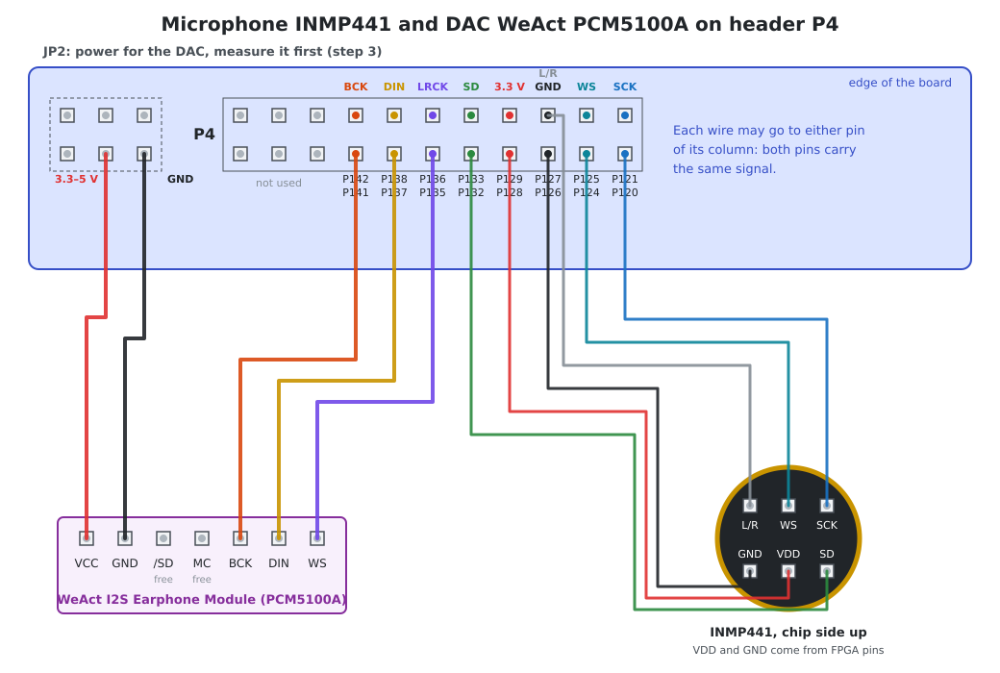
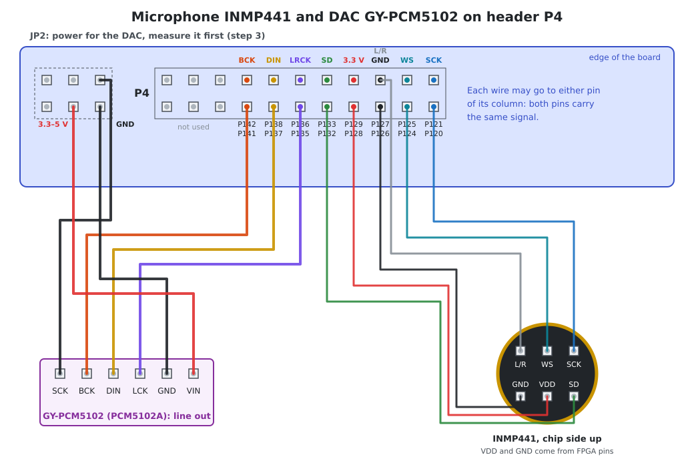

# BETTERSHENGSUN Cyclone IV board with a microphone and an I2S DAC

*Generated by Claude Code 2.1.329, model Claude Opus 5.5 (claude-opus-5-5), on 20 November 2026. Board configuration `bettershengsun_by_claude`. Not yet tried on hardware. Русская версия: [README_ru.md](README_ru.md).*

This board is sold on AliExpress by the store BETTERSHENGSUN. The silkscreen
calls it "FPGA NIOS KIT Board Cyclone IV". The watermark on the seller's
photos names the maker: TodayStart (启程电子, todaystart2012.taobao.com).
Its photos are in [misc/000_todo/bettershengsun](../../misc/000_todo/bettershengsun).

The board has:

* an Altera Cyclone IV EP4CE6E22C8N FPGA and a 50 MHz oscillator;
* a VGA connector with one bit per color;
* a four-digit seven-segment display, six LEDs and four keys;
* a buzzer, an RS-232 port with a DB9 connector, 32 MB of SDRAM
  (HY57V561620), an EPCS4 configuration chip and a DS1302 clock;
* sockets for DS18B20 and an infrared receiver, and a header for LCD1602
  and LCD12864;
* a 2 × 11 expansion header, P4, and a 2 × 3 header, JP2, next to the
  power jack.

The seller publishes no schematic. This guide shows how to connect an INMP441
microphone and one of two I2S DAC modules to header P4 with jumper wires,
and how to use them in the labs of this repository:

* WeAct I2S Earphone Module, with PCM5100A and a headphone amplifier;
* GY-PCM5102, with PCM5102A and a line output.

## Contents

* [What you need](#what-you-need)
* [The plan](#the-plan)
* [Step by step](#step-by-step)
* [Wiring tables](#wiring-tables)
* [The board in the labs](#the-board-in-the-labs)
* [What is checked and what is assumed](#what-is-checked-and-what-is-assumed)
* [Troubleshooting](#troubleshooting)
* [Files](#files)
* [Sources](#sources)
* [Appendix: the prompts](#appendix-the-prompts)

## What you need

* The board, its 5 V power supply and a USB-Blaster.
* An INMP441 microphone module.
* One DAC module:
  * WeAct I2S Earphone Module (PCM5100A), for headphones of 32 Ω or more;
  * or GY-PCM5102 (PCM5102A), for active speakers or an amplifier: its
    output is a line output.
* Female-to-female jumper wires with 2.54 mm sockets, 10 to 20 cm long:
  6 for the microphone, 5 for WeAct or 6 for GY-PCM5102.
* A multimeter.
* A VGA monitor, if you want to see the spectrum in lab 3_11.

## The plan

Everything goes to the right part of header P4, plus two wires from JP2
for the DAC power:





Header P4 has 11 columns of 2 pins. Under 8 of its columns, the silkscreen
names two FPGA pins, for example "P142 P141". The 3 columns on the left
have no names and are not used.

| P4 column, by its silkscreen | Signal | Connect to |
|------------------------------|--------|------------|
| P142 P141 | I2S bit clock | DAC: BCK |
| P138 P137 | I2S data | DAC: DIN |
| P136 P135 | I2S word clock | DAC: WS (WeAct) or LCK (GY-PCM5102) |
| P133 P132 | Microphone data | INMP441: SD |
| P129 P128 | 3.3 V from the FPGA | INMP441: VDD |
| P127 P126 | 0 V from the FPGA | INMP441: GND on one pin, L/R on the other |
| P125 P124 | Microphone word clock | INMP441: WS |
| P121 P120 | Microphone bit clock | INMP441: SCK |

### Why each signal has two pins

The silkscreen gives the two FPGA pins of each column, but not which of them
is in the row nearer the board edge. So the FPGA drives the same signal on
both pins of a column, and reads the microphone data from both pins of its
column. **A wire may go to either pin of its column.** Only the column
P127 P126 takes two wires, GND and L/R of the microphone, one on each pin.

### Power

The microphone takes its 3.3 V from FPGA pins, as on the other boards of
this repository: it needs 1.4 mA. The FPGA drives these pins in every lab,
so you can check them with a multimeter before you connect anything.

The DAC needs a real supply: up to some tens of milliamperes with
headphones. Both modules have their own 3.3 V regulator and take 3.3 to 5 V
on their VCC or VIN pin. The supply comes from JP2, the 2 × 3 header next to
the power jack. Its silkscreen reads "…V GND", so it most likely has a
supply column and a GND column, but without a schematic **you must measure
it first** (step 3).

## Step by step

1. **Choose the board.** In any lab directory, run
   `./06_choose_another_fpga_board.bash` and choose `bettershengsun`, then
   `bettershengsun_by_claude` if the menu asks for a configuration.
2. **Load a lab with nothing on P4.** For example, in
   `labs/1_basics/1_01_and_or_not_xor_de_morgan`, run
   `./03_synthesize_for_fpga.bash`. It builds the lab and loads it through
   the USB-Blaster. Leave the board on.
3. **Measure.** Set the multimeter to DC volts. Hold the black probe on the
   metal shell of the VGA connector, which is GND.
4. Touch both pins of column P129 P128 with the red probe: each must show
   3.3 V. Both pins of column P127 P126 must show 0 V. If not, stop and
   check that the board configuration is `bettershengsun_by_claude`.
5. Touch each of the six pins of JP2. Write down which show 3.3 or 5 V and
   which show 0 V. You need one pin with 3.3 to 5 V and one or two with 0 V.
   If JP2 has no such pins, do not guess: use pin 1 (GND) and pin 2 (VCC) of
   the LCD header instead, after measuring them the same way.
6. **Turn the board off.**
7. **Connect the microphone** with 6 wires, as in the diagram and the
   [INMP441 table](#inmp441). The microphone may hang on its wires; it
   does not matter which side faces up.
8. **Connect the DAC** with 5 or 6 wires, as in its diagram and table:
   [WeAct](#weact-i2s-earphone-module-pcm5100a) or
   [GY-PCM5102](#gy-pcm5102-pcm5102a). On GY-PCM5102, first check the
   four solder jumpers on its back.
9. **Check every wire against the table**, especially the DAC power: VCC or
   VIN to the 3.3 to 5 V pin of JP2, GND to its 0 V pin.
10. **Turn the board on and run lab 3_11.** In
    `labs/3_music/3_11_microphone_monitor`, run
    `./03_synthesize_for_fpga.bash`. Speak near the microphone: you hear
    yourself in the headphones or the speakers. The display shows the gain
    of the automatic gain control, and a VGA monitor shows the spectrum.
11. Try the other labs of `labs/3_music`, which use the microphone, the DAC
    or both.

## Wiring tables

### INMP441

The module has two rows of three pins: SCK, WS, L/R in one row and SD, VDD,
GND in the other, with SD next to SCK. The labels are on the side opposite
the microphone chip.

| INMP441 pin | P4 column (either pin) |
|-------------|------------------------|
| SD  | P133 P132 |
| VDD | P129 P128 |
| GND | P127 P126 |
| L/R | P127 P126, the other pin of the column |
| WS  | P125 P124 |
| SCK | P121 P120 |

L/R at 0 V selects the left channel, which the lab code reads.

### WeAct I2S Earphone Module (PCM5100A)

Its 7-pin header reads VCC, GND, /SD, MC, BCK, DIN, WS.

| WeAct pin | Connect to |
|-----------|------------|
| VCC | JP2: the 3.3 to 5 V pin you found in step 5 |
| GND | JP2: a 0 V pin |
| /SD | nothing: the module pulls it up, so the amplifier is on |
| MC  | nothing: the module pulls it down, and the DAC makes its master clock from BCK |
| BCK | P4: P142 P141 |
| DIN | P4: P138 P137 |
| WS  | P4: P136 P135 |

There is nothing to set on this module. Its schematic ties the FMT and FLT
pins of PCM5100A low, for I2S and the normal filter. Leave its solder jumper
S1, de-emphasis, open. Its regulator, ME6231A33, makes 3.3 V from VCC. The
3.5 mm jack is for headphones of 32 Ω or more.

### GY-PCM5102 (PCM5102A)

Its main header usually reads SCK, BCK, DIN, LCK, GND, VIN. The order
differs between versions of the board, so go by the labels.

| GY-PCM5102 pin | Connect to |
|----------------|------------|
| SCK | JP2: a 0 V pin |
| BCK | P4: P142 P141 |
| DIN | P4: P138 P137 |
| LCK | P4: P136 P135 |
| GND | JP2: a 0 V pin |
| VIN | JP2: the 3.3 to 5 V pin you found in step 5 |

Before the first use, check the four solder jumpers on the back, marked
1 to 4 or H1L to H4L. For I2S they must be:

| Jumper | Pin of PCM5102A | Setting |
|--------|-----------------|---------|
| 1, H1L | FLT, filter | L |
| 2, H2L | DEMP, de-emphasis | L |
| 3, H3L | XSMT, soft mute | **H**, otherwise the DAC stays muted |
| 4, H4L | FMT, audio format | L, I2S |

Some boards come with these jumpers unsoldered or set wrong. If the SCK pad
is bridged to GND on the board, the SCK wire is not needed, but it does no
harm. **Never connect SCK to an FPGA pin:** on a board with that bridge, it
would short the pin to GND.

**Its 3.5 mm jack is a line output.** PCM5102A drives loads of 1 kΩ or
more, such as the input of active speakers or of an amplifier, not
headphones of 32 Ω. Of the two modules, only WeAct has a headphone
amplifier.

## The board in the labs

| Board part | In the labs |
|------------|-------------|
| Keys | Four keys. The key on FPGA pin 64 is the reset. The other three are `key[2:0]`, and also `sw[2:0]`, since the board has no switches. |
| LEDs | Five LEDs, `led[4:0]`. The sixth LED, D7, is wired to a pin that cannot drive it, according to a buyer. |
| Display | Four digits, `digit[3:0]`, `abcdefgh`. |
| VGA | 640 × 480, one bit per color: a color is on when any bit of the lab's `red`, `green` or `blue` is set. |
| Microphone and DAC | As above: `mic` and `sound` in the labs. |
| GPIO | None: `w_gpio` is 0, since P4 is used by the microphone and the DAC. Labs 3_9, 3_12, 6_1 and 6_2 use GPIO for extra modules. |
| UART | Not connected: its FPGA pins are not known yet. |
| Buzzer | Not used. An unused output is driven low, which may make it sound all the time, so its pin stays unassigned. |

Quartus Prime Lite 25.1std builds these labs for the board with no errors,
and all meet timing at 50 MHz:

| Lab | Logic elements | Setup slack |
|-----|---------------:|------------:|
| 1_01_and_or_not_xor_de_morgan | 74 of 6,272 | 13.96 ns |
| 1_08_7segment_word | 114 | 12.96 ns |
| 2_1_rectangle_ellipse_parabola | 114 | 11.61 ns |
| 3_10_spectrum_analyzer | 5,611 (89 %) | 8.16 ns |
| 3_11_microphone_monitor | 4,425 (71 %) | 9.06 ns |

## What is checked and what is assumed

| Item | Source | Status |
|------|--------|--------|
| FPGA pins of the clock, keys, LEDs, display, VGA and buzzer | The pin table of a buyer, Peter I., in a review of 5 May 2022: [noname1_c4.png](../../misc/000_todo/bettershengsun/noname1_c4.png) | Taken as given |
| FPGA pins of P4 | The silkscreen in the seller's photo | Taken as given. Which row holds which pin does not matter: see above |
| FPGA part, EP4CE6E22C8N | The seller's photo and listings of this board | If your chip reads EP4CE10E22C8N, swap the two DEVICE lines at the top of `board_specific.qsf` |
| Keys and LEDs are active low | Assumed, as on similar boards; the LEDs share a "LEDVCC" supply | Lab 1_01: if the LEDs are lit when they should be off, invert `LED_N` in `board_specific_top.sv` |
| `seven_seg[0]` to `seven_seg[7]` of the buyer's table are segments a to g and the dot; segments and digits are active low | Assumed | Lab 1_08 shows a word: if it is garbled, change the order of `ABCDEFGH_N` in `board_specific.qsf` |
| `seven_seg_tr[0]` is the rightmost digit | Assumed | Lab 1_08: if the word is mirrored, reverse `DIGIT_N` |
| The key on pin 64 is the reset | Choice: the buyer's `button[3]` | Find which key it is: pressing it clears the counter of lab 1_06 |
| JP2 has a 3.3 to 5 V pin and GND | Its silkscreen, "…V GND" | Measure, step 5 |
| The board works with these files | Builds with Quartus 25.1std | Not tried on hardware |

## Troubleshooting

* **No sound.** Measure 3.3 to 5 V between VCC (VIN) and GND on the DAC.
  On GY-PCM5102, check jumper 3, XSMT: it must be H. Check the columns of
  BCK, DIN and the word clock. GY-PCM5102 needs active speakers or an
  amplifier. On WeAct, leave /SD unconnected.
* **No sound from the microphone, and the display of lab 3_11 shows the
  highest gain.** Check SD and the 3.3 V column P129 P128, and that L/R
  goes to column P127 P126.
* **Hum or noise.** Keep the wires short and the DAC near the header.
* **The board restarts when you press a key, or the display flickers.**
  The buyer found the FPGA badly soldered on their board and fixed it by
  resoldering it.

## Files

| File | What it is |
|------|------------|
| `board_specific_top.sv` | The top module: the lab, VGA, the microphone and the DAC |
| `board_specific.qsf` | The FPGA part and pins, with their sources |
| `board_specific.sdc` | The 50 MHz clock |
| `generate_wiring_diagram.py` | Draws the four `wiring_*.svg`; Inkscape turns them into PNG |
| `wiring_weact.png`, `wiring_gy_pcm5102.png` | The diagrams, and `_ru` versions with Russian labels |
| `README.md`, `README.html` | This guide |
| `README_ru.md`, `README_ru.html` | The guide in Russian |

## Sources

* Photos of the seller and the pin table of a buyer, in
  [misc/000_todo/bettershengsun](../../misc/000_todo/bettershengsun).
* The boards of this repository given as examples: `alinx_ax301`,
  `alinx_ax4010`, `emooc_cc`, `omdazz`, `piswords6`, `rzrd`, `saylinx` and
  `zeowaa`. `piswords6` has almost the same FPGA pin pairs on its header,
  and it also powers the microphone from FPGA pins.
* WeAct Studio, [I2S Earphone Module V1](https://github.com/WeActStudio/WeActStudio.I2SEarphoneModuleV1):
  the schematic, the regulator and the header labels.
* Texas Instruments, [PCM5102A](https://www.ti.com/product/PCM5102A) data
  sheet: the 1 kΩ minimum load of the line output.
* GY-PCM5102: [mt32-pi wiki](https://github.com/dwhinham/mt32-pi/wiki/GY-PCM5102-DAC-module)
  and [Makerguides](https://www.makerguides.com/playing-audio-with-esp32-and-pcm5102/)
  on the solder jumpers, SCK and the supply.
* INMP441: [peripherals/inmp441.pdf](../../peripherals/inmp441.pdf) and
  [peripherals/inmp441.jpeg](../../peripherals/inmp441.jpeg).

## Appendix: the prompts

Each prompt of the task, verbatim, with its time in Pacific time, and its
Russian translation.

### Prompt 1, 20 November 2026, 20:18

```text
read bettershengsun/AGENTS.md  and do the task
```

The task in `bettershengsun/AGENTS.md`:

```text
# Task

Create a new branch of basics_graphics_music starting from main.
The branch should be called claude_bettershengsun is you are claude and codex_bettershengsun is you are codex.

Read the contents of basics-graphics-music/misc/000_todo/bettershengsun and implement support for this new board.

Search internet to find more information about it.

Update the relevant bash scripts in scripts/steps

Create .md and HTML files with an instruction on how to connect microphone and either of the following DAC modules:

* WeAct I2S Earphone Module PCM5100A Stereo HP AMP 32Ω 160mW DAC Decoder Audio Board

* Interface I2S PCM5102A DAC Decoder GY-PCM5102 I2S Player Module For Raspberry Pi PHAT Format Board Digital PCM5102 Audio Board

When planning what pins to use for the microphone and sound DAC connection, make them compact and easy to assemple.

Add this prompt as an appendix to .md and HTML files.

In addition to the instriction in English create an instruction in Russian (also .md and .html). In prompt appendix put both the original prompt in English and its transaction to Russian.
```

#### Russian translation

```text
прочитай bettershengsun/AGENTS.md и выполни задачу
```

```text
# Задача

Создай новую ветку basics_graphics_music от main.
Ветка должна называться claude_bettershengsun, если ты Claude, и codex_bettershengsun, если ты Codex.

Прочитай содержимое basics-graphics-music/misc/000_todo/bettershengsun и реализуй поддержку этой новой платы.

Поищи в интернете дополнительную информацию о ней.

Обнови соответствующие bash-скрипты в scripts/steps.

Создай файлы .md и HTML с инструкцией, как подключить микрофон и любой из следующих модулей ЦАП:

* WeAct I2S Earphone Module PCM5100A Stereo HP AMP 32Ω 160mW DAC Decoder Audio Board

* Interface I2S PCM5102A DAC Decoder GY-PCM5102 I2S Player Module For Raspberry Pi PHAT Format Board Digital PCM5102 Audio Board

Выбирая выводы для подключения микрофона и звукового ЦАП, сделай подключение компактным и простым в сборке.

Добавь этот запрос как приложение к файлам .md и HTML.

Кроме инструкции на английском, создай инструкцию на русском (тоже .md и .html). В приложение с запросом помести и исходный запрос на английском, и его перевод на русский.
```

### Prompt 2, 20 November 2026, 20:21

```text
Also look to the following board implementations as examples:

alinx_ax301
alinx_ax4010
emooc_cc
omdazz
piswords6
rzrd
saylinx
zeowaa
```

#### Russian translation

```text
Также посмотри в качестве примеров на реализации следующих плат:

alinx_ax301
alinx_ax4010
emooc_cc
omdazz
piswords6
rzrd
saylinx
zeowaa
```

### Prompt 3, 20 November 2026, 23:13

```text
commit and push
```

#### Russian translation

```text
закоммить и запушь
```
