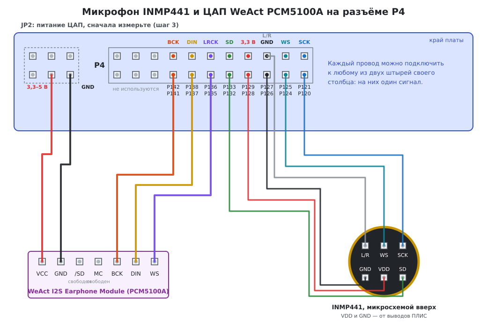
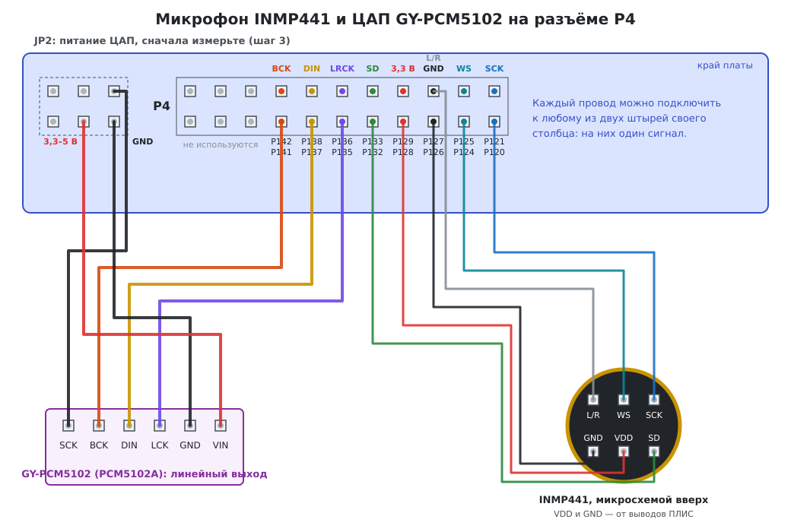

# Плата BETTERSHENGSUN на Cyclone IV с микрофоном и ЦАП I2S

*Создано Claude Code 2.1.329, модель Claude Opus 5.5 (claude-opus-5-5), 20 ноября 2026 года. Конфигурация платы `bettershengsun_claude`. На железе ещё не проверено. English version: [README.md](README.md).*

Эту плату продаёт на AliExpress магазин BETTERSHENGSUN. На шелкографии она
названа «FPGA NIOS KIT Board Cyclone IV». Водяной знак на фотографиях
продавца называет производителя: TodayStart (启程电子, todaystart2012.taobao.com).
Фотографии лежат в [misc/000_todo/bettershengsun](../../misc/000_todo/bettershengsun).

На плате есть:

* ПЛИС Altera Cyclone IV EP4CE6E22C8N и генератор 50 МГц;
* разъём VGA, по одному биту на цвет;
* четырёхразрядный семисегментный индикатор, шесть светодиодов и четыре
  кнопки;
* зуммер, порт RS-232 с разъёмом DB9, 32 МБ SDRAM (HY57V561620),
  микросхема конфигурации EPCS4 и часы DS1302;
* гнёзда для DS18B20 и инфракрасного приёмника, разъём для LCD1602 и
  LCD12864;
* разъём расширения 2 × 11, P4, и разъём 2 × 3, JP2, рядом с гнездом
  питания.

Продавец не публикует схему. Эта инструкция показывает, как подключить
проводами к разъёму P4 микрофон INMP441 и один из двух модулей ЦАП I2S и как
пользоваться ими в лабораторных работах репозитория:

* WeAct I2S Earphone Module, с PCM5100A и усилителем для наушников;
* GY-PCM5102, с PCM5102A и линейным выходом.

Эта конфигурация, `bettershengsun_claude`, следует подходу других плат этого
репозитория. Её `board_specific.qsf` называет 16 выводов ПЛИС разъёма P4
`GPIO`, потому что плата ничего не знает о микрофонах и ЦАП. Её
`board_specific_top.sv` подключает к этим GPIO микрофон и ЦАП только в тех
лабораторных, которые ими пользуются. Другая конфигурация,
[`bettershengsun_claude_alt`](../bettershengsun_claude_alt/), — первая
версия: она называет выводы по сигналам микрофона и ЦАП и питает микрофон в
любой лабораторной. Подключение у обеих одинаковое.

## Содержание

* [Что понадобится](#что-понадобится)
* [План подключения](#план-подключения)
* [Шаг за шагом](#шаг-за-шагом)
* [Таблицы подключения](#таблицы-подключения)
* [Плата в лабораторных работах](#плата-в-лабораторных-работах)
* [Что проверено и что предположено](#что-проверено-и-что-предположено)
* [Если что-то не работает](#если-что-то-не-работает)
* [Файлы](#файлы)
* [Источники](#источники)
* [Приложение: запросы](#приложение-запросы)

## Что понадобится

* Плата, её блок питания 5 В и USB-Blaster.
* Модуль микрофона INMP441.
* Один модуль ЦАП:
  * WeAct I2S Earphone Module (PCM5100A), для наушников сопротивлением
    32 Ом и больше;
  * или GY-PCM5102 (PCM5102A), для активных колонок или усилителя: у него
    линейный выход.
* Провода «мама — мама» с гнёздами 2,54 мм, длиной от 10 до 20 см: 6 для
  микрофона, 5 для WeAct или 6 для GY-PCM5102.
* Мультиметр.
* Монитор VGA, если хотите видеть спектр в лабораторной 3_11.

## План подключения

Всё подключается к правой части разъёма P4, плюс два провода питания ЦАП
от JP2:





У разъёма P4 11 столбцов по 2 штыря. Под 8 столбцами шелкография называет
два вывода ПЛИС, например «P142 P141». 3 левых столбца без надписей не
используются.

| Столбец P4, по шелкографии | GPIO | Сигнал | Куда подключить |
|----------------------------|------|--------|-----------------|
| P142 P141 | `GPIO[15:14]` | Тактовый сигнал битов I2S | ЦАП: BCK |
| P138 P137 | `GPIO[13:12]` | Данные I2S | ЦАП: DIN |
| P136 P135 | `GPIO[11:10]` | Тактовый сигнал слов I2S | ЦАП: WS (WeAct) или LCK (GY-PCM5102) |
| P133 P132 | `GPIO[9:8]` | Данные микрофона | INMP441: SD |
| P129 P128 | `GPIO[7:6]` | 3,3 В от ПЛИС | INMP441: VDD |
| P127 P126 | `GPIO[5:4]` | 0 В от ПЛИС | INMP441: GND на один штырь, L/R на другой |
| P125 P124 | `GPIO[3:2]` | Тактовый сигнал слов микрофона | INMP441: WS |
| P121 P120 | `GPIO[1:0]` | Тактовый сигнал битов микрофона | INMP441: SCK |

GPIO идут по возрастанию номеров выводов ПЛИС, по два на столбец:
`GPIO[0]` — вывод 120, `GPIO[15]` — вывод 142.

### Почему у каждого сигнала два штыря

Шелкография называет два вывода ПЛИС каждого столбца, но не говорит, какой из
них в ряду ближе к краю платы. Поэтому ПЛИС выдаёт один и тот же сигнал на
оба штыря столбца, а данные микрофона читает с обоих штырей его столбца.
**Провод можно подключить к любому штырю своего столбца.** Только в столбец
P127 P126 идут два провода, GND и L/R микрофона, по одному на штырь.

### Питание

Микрофон получает 3,3 В от выводов ПЛИС, как и на других платах этого
репозитория: ему нужно 1,4 мА. ПЛИС выдаёт эти уровни только в тех
лабораторных, где `lab_specific_board_config.svh` включает микрофон, например
в 3_11. В остальных лабораторных эти выводы — GPIO лабораторной, и
большинство лабораторных их не трогает. Поэтому, чтобы проверить их
мультиметром до подключения, загрузите лабораторную 3_11.

ЦАП нужен настоящий источник питания: с наушниками до нескольких десятков
миллиампер. У обоих модулей свой стабилизатор на 3,3 В, и на вывод VCC или
VIN им можно подавать от 3,3 до 5 В. Питание берётся с JP2, разъёма 2 × 3
рядом с гнездом питания. На его шелкографии написано «…V GND», поэтому, скорее
всего, у него есть столбец питания и столбец GND, но без схемы **его нужно
сначала измерить** (шаг 3).

## Шаг за шагом

1. **Выберите плату.** В каталоге любой лабораторной запустите
   `./06_choose_another_fpga_board.bash` и выберите `bettershengsun`,
   а затем конфигурацию `bettershengsun_claude`.
2. **Загрузите лабораторную 3_11, ничего не подключая к P4.** В
   `labs/3_music/3_11_microphone_monitor` запустите
   `./03_synthesize_for_fpga.bash`. Скрипт соберёт лабораторную и загрузит её
   через USB-Blaster. Не выключайте плату.
3. **Измерьте.** Включите на мультиметре измерение постоянного напряжения.
   Чёрный щуп держите на металлическом корпусе разъёма VGA: это GND.
4. Коснитесь красным щупом обоих штырей столбца P129 P128: на каждом должно
   быть 3,3 В. На обоих штырях столбца P127 P126 должно быть 0 В. Если это не
   так, остановитесь и проверьте, что выбрана конфигурация
   `bettershengsun_claude` и загружена лабораторная 3_11.
5. Коснитесь каждого из шести штырей JP2. Запишите, на каких 3,3 или 5 В, а на
   каких 0 В. Нужен один штырь с напряжением от 3,3 до 5 В и один или два с
   0 В. Если таких штырей на JP2 нет, не гадайте: возьмите вывод 1 (GND) и
   вывод 2 (VCC) разъёма для LCD, измерив их так же.
6. **Выключите плату.**
7. **Подключите микрофон** шестью проводами, как на схеме и в
   [таблице для INMP441](#inmp441). Микрофон может висеть на проводах; какой
   стороной вверх, неважно.
8. **Подключите ЦАП** пятью или шестью проводами, как на его схеме и в
   таблице: [WeAct](#weact-i2s-earphone-module-pcm5100a) или
   [GY-PCM5102](#gy-pcm5102-pcm5102a). У GY-PCM5102 сначала проверьте четыре
   паяные перемычки на обратной стороне.
9. **Сверьте каждый провод с таблицей**, особенно питание ЦАП: VCC или VIN на
   штырь JP2 с напряжением от 3,3 до 5 В, GND на его штырь с 0 В.
10. **Включите плату и снова загрузите лабораторную 3_11.** В
    `labs/3_music/3_11_microphone_monitor` запустите `./04_configure_fpga.bash`:
    лабораторная уже собрана. Говорите рядом с микрофоном: вы услышите
    себя в наушниках или колонках. Индикатор показывает усиление
    автоматической регулировки, а монитор VGA показывает спектр.
11. Попробуйте другие лабораторные из `labs/3_music`, которые используют
    микрофон, ЦАП или оба.

## Таблицы подключения

### INMP441

У модуля два ряда по три вывода: в одном ряду SCK, WS, L/R, в другом SD, VDD,
GND, причём SD напротив SCK. Надписи на стороне, противоположной микросхеме
микрофона.

| Вывод INMP441 | Столбец P4 (любой штырь) |
|---------------|--------------------------|
| SD  | P133 P132 |
| VDD | P129 P128 |
| GND | P127 P126 |
| L/R | P127 P126, другой штырь столбца |
| WS  | P125 P124 |
| SCK | P121 P120 |

L/R на 0 В выбирает левый канал, который и читает код лабораторных.

### WeAct I2S Earphone Module (PCM5100A)

Его 7-контактный разъём подписан VCC, GND, /SD, MC, BCK, DIN, WS.

| Вывод WeAct | Куда подключить |
|-------------|-----------------|
| VCC | JP2: штырь с напряжением от 3,3 до 5 В, найденный на шаге 5 |
| GND | JP2: штырь с 0 В |
| /SD | никуда: модуль подтягивает его вверх, усилитель включён |
| MC  | никуда: модуль подтягивает его вниз, и ЦАП делает тактовый сигнал из BCK |
| BCK | P4: P142 P141 |
| DIN | P4: P138 P137 |
| WS  | P4: P136 P135 |

На этом модуле ничего настраивать не нужно. По его схеме выводы FMT и FLT
микросхемы PCM5100A подключены к земле: формат I2S и обычный фильтр. Паяную
перемычку S1, коррекцию предыскажений, оставьте разомкнутой. Его стабилизатор,
ME6231A33, делает 3,3 В из VCC. Гнездо 3,5 мм рассчитано на наушники
сопротивлением 32 Ом и больше.

### GY-PCM5102 (PCM5102A)

Его основной разъём обычно подписан SCK, BCK, DIN, LCK, GND, VIN. Порядок
выводов у разных версий платы разный, поэтому ориентируйтесь на надписи.

| Вывод GY-PCM5102 | Куда подключить |
|------------------|-----------------|
| SCK | JP2: штырь с 0 В |
| BCK | P4: P142 P141 |
| DIN | P4: P138 P137 |
| LCK | P4: P136 P135 |
| GND | JP2: штырь с 0 В |
| VIN | JP2: штырь с напряжением от 3,3 до 5 В, найденный на шаге 5 |

Перед первым включением проверьте четыре паяные перемычки на обратной
стороне, помеченные цифрами от 1 до 4 или H1L–H4L. Для I2S нужно:

| Перемычка | Вывод PCM5102A | Положение |
|-----------|----------------|-----------|
| 1, H1L | FLT, фильтр | L |
| 2, H2L | DEMP, коррекция предыскажений | L |
| 3, H3L | XSMT, мягкое отключение звука | **H**, иначе ЦАП останется без звука |
| 4, H4L | FMT, формат | L, I2S |

Некоторые платы приходят с незапаянными или неправильно запаянными
перемычками. Если площадка SCK на плате соединена с GND перемычкой, провод SCK
не нужен, но и не мешает. **Никогда не подключайте SCK к выводу ПЛИС:** на
плате с такой перемычкой это замкнёт вывод на землю.

**Гнездо 3,5 мм у него — линейный выход.** PCM5102A рассчитан на нагрузку
1 кОм и больше, например на вход активных колонок или усилителя, а не на
наушники 32 Ом. Из двух модулей усилитель для наушников есть только у WeAct.

## Плата в лабораторных работах

| Часть платы | В лабораторных |
|-------------|----------------|
| Кнопки | Четыре кнопки. Кнопка на выводе ПЛИС 64 — сброс. Остальные три — `key[2:0]`, а также `sw[2:0]`, потому что переключателей на плате нет. |
| Светодиоды | Пять светодиодов, `led[4:0]`. Шестой, D7, по словам покупателя, подключён к выводу, который не может им управлять. |
| Индикатор | Четыре разряда, `digit[3:0]`, `abcdefgh`. |
| VGA | 640 × 480, один бит на цвет: цвет горит, если в `red`, `green` или `blue` лабораторной есть хоть одна единица. |
| Микрофон и ЦАП | Как описано выше: `mic` и `sound` в лабораторных. |
| GPIO | 16, `gpio[15:0]`: выводы P4, как в таблице выше. Лабораторная с микрофоном отдаёт ему `gpio[9:0]`, лабораторная с ЦАП — `gpio[15:10]`, остальные остаются лабораторной. Лабораторная 3_9 использует `gpio[1:0]` для датчика расстояния, 3_12 — `gpio[15:14]` для светодиодной ленты, 6_2 — `gpio[5:3]` для датчика освещённости. |
| UART | Не подключён: его выводы ПЛИС пока неизвестны. |
| Зуммер | Не используется. Неиспользуемый выход ПЛИС выдаёт 0, и зуммер мог бы звучать всё время, поэтому его вывод не назначен. |

Quartus Prime Lite 25.1std собирает для этой платы такие лабораторные без
ошибок, и все укладываются во временные ограничения на 50 МГц:

| Лабораторная | Логических элементов | Запас по setup |
|--------------|---------------------:|---------------:|
| 1_01_and_or_not_xor_de_morgan | 74 из 6272 | 14,27 нс |
| 1_08_7segment_word | 114 | 13,96 нс |
| 2_1_rectangle_ellipse_parabola | 114 | 12,69 нс |
| 3_9_distance | 185 | 13,04 нс |
| 3_10_spectrum_analyzer | 5613 (89 %) | 6,81 нс |
| 3_11_microphone_monitor | 4421 (70 %) | 8,39 нс |
| 3_12_acoustic_locator | 5090 (81 %) | 9,21 нс |

Лабораторные 3_9 и 3_12 сами управляют GPIO, и их GPIO не пересекаются с
GPIO микрофона и ЦАП.

## Что проверено и что предположено

| Что | Источник | Состояние |
|-----|----------|-----------|
| Выводы ПЛИС генератора, кнопок, светодиодов, индикатора, VGA и зуммера | Таблица выводов покупателя Peter I. в отзыве от 5 мая 2022 года: [noname1_c4.png](../../misc/000_todo/bettershengsun/noname1_c4.png) | Принято как есть |
| Выводы ПЛИС разъёма P4 | Шелкография на фотографии продавца | Принято как есть. Какой вывод в каком ряду, неважно: см. выше |
| Микросхема ПЛИС, EP4CE6E22C8N | Фотография продавца и объявления об этой плате | Если на вашей микросхеме написано EP4CE10E22C8N, поменяйте местами две строки DEVICE в начале `board_specific.qsf` |
| Кнопки и светодиоды активны низким уровнем | Предположение, как на похожих платах; у светодиодов общее питание «LEDVCC» | Лабораторная 1_01: если светодиоды горят, когда должны быть погашены, инвертируйте `LED_N` в `board_specific_top.sv` |
| `seven_seg[0]`–`seven_seg[7]` из таблицы покупателя — сегменты от a до g и точка; сегменты и разряды активны низким уровнем | Предположение | Лабораторная 1_08 показывает слово: если оно искажено, измените порядок `ABCDEFGH_N` в `board_specific.qsf` |
| `seven_seg_tr[0]` — правый разряд | Предположение | Лабораторная 1_08: если слово отражено, переверните `DIGIT_N` |
| Кнопка на выводе 64 — сброс | Выбор: `button[3]` покупателя | Найдите, какая это кнопка: она обнуляет счётчик лабораторной 1_06 |
| На JP2 есть штырь от 3,3 до 5 В и GND | Его шелкография, «…V GND» | Измерить, шаг 5 |
| Плата работает с этими файлами | Сборка в Quartus 25.1std | На железе не проверено |

## Если что-то не работает

* **Нет звука.** Измерьте напряжение между VCC (VIN) и GND на ЦАП: от 3,3 до
  5 В. У GY-PCM5102 проверьте перемычку 3, XSMT: она должна быть в положении
  H. Проверьте столбцы BCK, DIN и тактового сигнала слов. GY-PCM5102 нужны
  активные колонки или усилитель. У WeAct оставьте /SD неподключённым.
* **Микрофон молчит, а индикатор лабораторной 3_11 показывает наибольшее
  усиление.** Проверьте SD и столбец 3,3 В P129 P128, а также что L/R идёт в
  столбец P127 P126.
* **Гул или шум.** Делайте провода короче, а ЦАП держите рядом с разъёмом.
* **Плата перезапускается при нажатии кнопки, или индикатор мерцает.**
  Покупатель нашёл на своей плате плохо припаянную ПЛИС и исправил это,
  пропаяв её заново.

## Файлы

| Файл | Что это |
|------|---------|
| `board_specific_top.sv` | Модуль верхнего уровня: лабораторная, VGA, а также микрофон и ЦАП на GPIO |
| `board_specific.qsf` | Микросхема ПЛИС и выводы, с источниками: P4 — это `GPIO` |
| `board_specific.sdc` | Тактовый сигнал 50 МГц |
| `generate_wiring_diagram.py` | Рисует четыре `wiring_*.svg`; Inkscape делает из них PNG |
| `wiring_weact_ru.png`, `wiring_gy_pcm5102_ru.png` | Схемы с русскими надписями, а без `_ru` — с английскими |
| `README_ru.md`, `README_ru.html` | Эта инструкция |
| `README.md`, `README.html` | Инструкция на английском |

## Источники

* Фотографии продавца и таблица выводов покупателя в
  [misc/000_todo/bettershengsun](../../misc/000_todo/bettershengsun).
* Платы этого репозитория, названные как примеры: `alinx_ax301`,
  `alinx_ax4010`, `emooc_cc`, `omdazz`, `piswords6`, `rzrd`, `saylinx` и
  `zeowaa`. У `piswords6` на разъёме почти те же пары выводов ПЛИС, и он тоже
  питает микрофон от выводов ПЛИС.
* WeAct Studio, [I2S Earphone Module V1](https://github.com/WeActStudio/WeActStudio.I2SEarphoneModuleV1):
  схема, стабилизатор и надписи на разъёме.
* Texas Instruments, техническое описание [PCM5102A](https://www.ti.com/product/PCM5102A):
  минимальная нагрузка линейного выхода 1 кОм.
* GY-PCM5102: [вики mt32-pi](https://github.com/dwhinham/mt32-pi/wiki/GY-PCM5102-DAC-module)
  и [Makerguides](https://www.makerguides.com/playing-audio-with-esp32-and-pcm5102/)
  о паяных перемычках, SCK и питании.
* INMP441: [peripherals/inmp441.pdf](../../peripherals/inmp441.pdf) и
  [peripherals/inmp441.jpeg](../../peripherals/inmp441.jpeg).

## Приложение: запросы

Каждый запрос задачи дословно, со временем по тихоокеанскому времени, и его
перевод на русский.

### Запрос 1, 20 ноября 2026 года, 20:18

```text
read bettershengsun/AGENTS.md  and do the task
```

Задача в `bettershengsun/AGENTS.md`:

```text
# Task

Create a new branch of basics_graphics_music starting from main.
The branch should be called claude_bettershengsun is you are claude and codex_bettershengsun is you are codex.

Read the contents of basics-graphics-music/misc/000_todo/bettershengsun and implement support for this new board.

Search internet to find more information about it.

Update the relevant bash scripts in scripts/steps

Create .md and HTML files with an instruction on how to connect microphone and either of the following DAC modules:

* WeAct I2S Earphone Module PCM5100A Stereo HP AMP 32Ω 160mW DAC Decoder Audio Board

* Interface I2S PCM5102A DAC Decoder GY-PCM5102 I2S Player Module For Raspberry Pi PHAT Format Board Digital PCM5102 Audio Board

When planning what pins to use for the microphone and sound DAC connection, make them compact and easy to assemple.

Add this prompt as an appendix to .md and HTML files.

In addition to the instriction in English create an instruction in Russian (also .md and .html). In prompt appendix put both the original prompt in English and its transaction to Russian.
```

#### Перевод на русский

```text
прочитай bettershengsun/AGENTS.md и выполни задачу
```

```text
# Задача

Создай новую ветку basics_graphics_music от main.
Ветка должна называться claude_bettershengsun, если ты Claude, и codex_bettershengsun, если ты Codex.

Прочитай содержимое basics-graphics-music/misc/000_todo/bettershengsun и реализуй поддержку этой новой платы.

Поищи в интернете дополнительную информацию о ней.

Обнови соответствующие bash-скрипты в scripts/steps.

Создай файлы .md и HTML с инструкцией, как подключить микрофон и любой из следующих модулей ЦАП:

* WeAct I2S Earphone Module PCM5100A Stereo HP AMP 32Ω 160mW DAC Decoder Audio Board

* Interface I2S PCM5102A DAC Decoder GY-PCM5102 I2S Player Module For Raspberry Pi PHAT Format Board Digital PCM5102 Audio Board

Выбирая выводы для подключения микрофона и звукового ЦАП, сделай подключение компактным и простым в сборке.

Добавь этот запрос как приложение к файлам .md и HTML.

Кроме инструкции на английском, создай инструкцию на русском (тоже .md и .html). В приложение с запросом помести и исходный запрос на английском, и его перевод на русский.
```

### Запрос 2, 20 ноября 2026 года, 20:21

```text
Also look to the following board implementations as examples:

alinx_ax301
alinx_ax4010
emooc_cc
omdazz
piswords6
rzrd
saylinx
zeowaa
```

#### Перевод на русский

```text
Также посмотри в качестве примеров на реализации следующих плат:

alinx_ax301
alinx_ax4010
emooc_cc
omdazz
piswords6
rzrd
saylinx
zeowaa
```

### Запрос 3, 20 ноября 2026 года, 23:13

```text
commit and push
```

#### Перевод на русский

```text
закоммить и запушь
```

### Запрос 4, 20 ноября 2026 года, 23:26

```text
Don't call any pins in .qsf file for this board DAC_ or MIC_ . Basics-Graphics-Music (BGM) repo does BGM-specific pin mapping for lab_top via code in board_specific_lab.sv . The board manufacturer does not know about BGM signals. So those pins should be called GPIO (inout in lab_top). I also don't see a point to assign 1 to any GPIO pin if mic is not present. REname your directory claude_bettershengsun_alt and implement another claude_bettershengsun following these repository approach. Also add this prompt to READMEs
```

#### Перевод на русский

```text
Не называй никакие выводы в файле .qsf для этой платы DAC_ или MIC_. Репозиторий Basics-Graphics-Music (BGM) делает специфичное для BGM отображение выводов на lab_top кодом в board_specific_lab.sv. Производитель платы ничего не знает о сигналах BGM. Поэтому эти выводы должны называться GPIO (inout в lab_top). Я также не вижу смысла выдавать 1 на какой-либо вывод GPIO, если микрофона нет. Переименуй свой каталог в claude_bettershengsun_alt и сделай ещё один, claude_bettershengsun, следуя этому подходу репозитория. Также добавь этот запрос в README.
```

### Запрос 5, 21 ноября 2026 года, 07:07

```text
rename claude_bettershengsun_alt to bettershengsun_claude_alt ; rename claude_bettershengsun to bettershengsun_claude
```

#### Перевод на русский

```text
переименуй claude_bettershengsun_alt в bettershengsun_claude_alt; переименуй claude_bettershengsun в bettershengsun_claude
```
