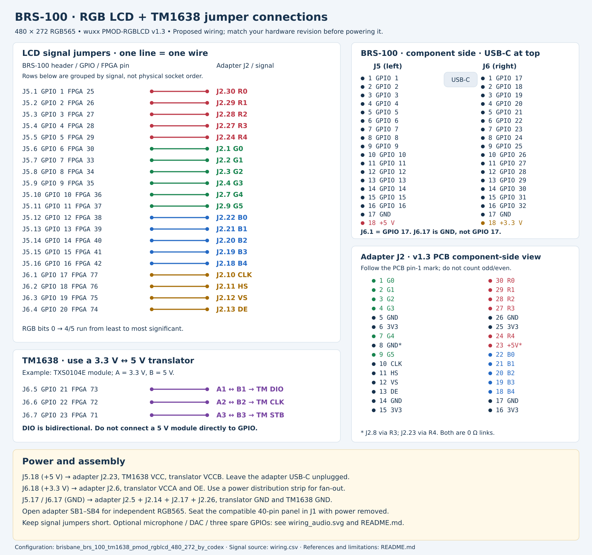
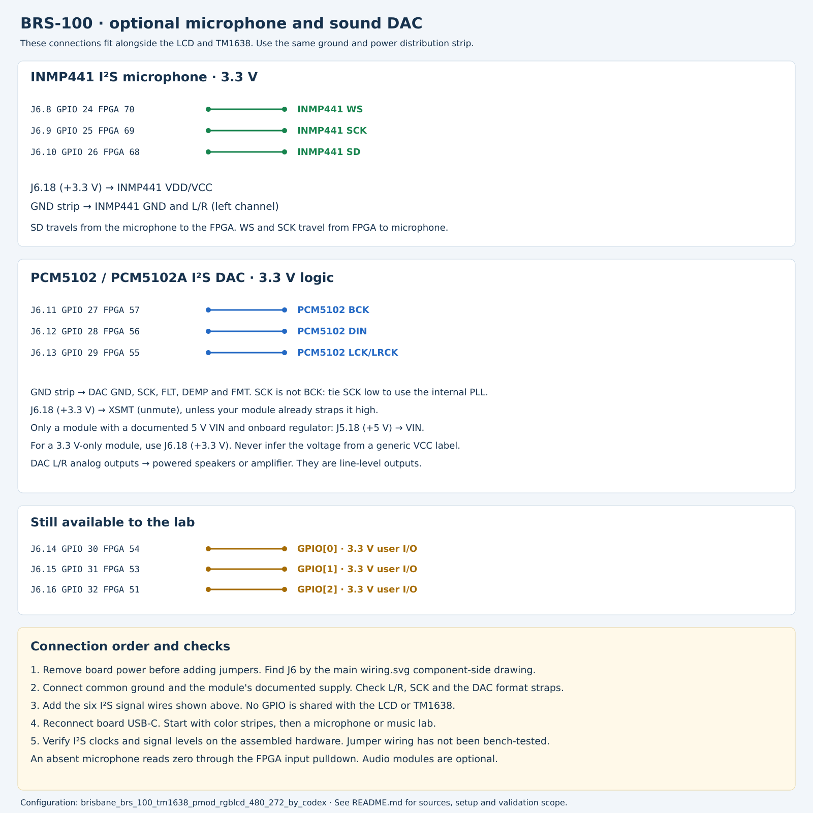

# BRS-100-GW1NR9: 480×272 RGB LCD and TM1638

Board selection: **`brisbane_brs_100_tm1638_pmod_rgblcd_480_272_by_codex_alt`**.

This configuration connects a BrisbaneSilicon BRS-100 to a **wuxx/Muse Lab
PMOD-RGBLCD v1.3 adapter**, a compatible **480×272, 3.3 V parallel RGB panel**,
and an eight-key/eight-digit TM1638 module. It also has enough pins for an
INMP441 microphone and PCM5102/PCM5102A sound DAC at the same time.

The [800×480 configuration](../brisbane_brs_100_tm1638_pmod_rgblcd_800_480_by_codex_alt/README.md)
uses the same jumpers. Choose the configuration matching your panel.
HDMI and additional configurations without TM1638 are outside this first pair.

**Status:** RTL simulation and a limited Gowin implementation check are covered
below. This wiring has **not been tested on a physical board**. The exact
manufacturer part needs a Gowin device database newer/different than the
installed Education package used for these checks.

## What is connected

| Function | Support |
| --- | --- |
| FPGA | Manufacturer target `GW1NR-LV9QN88PC7/I6`, device `GW1NR-9`, revision C |
| Board clock / lab clock | 27 MHz / 27 MHz |
| LCD | 480×272, RGB565, 9 MHz pixel clock; 525×288 total, about 59.52 Hz |
| TM1638 | Eight keys, eight LEDs, eight seven-segment digits |
| Onboard buttons | Either button resets the lab when the TM1638 controller is enabled |
| Onboard LEDs | Active low; mirror the first six lab LEDs |
| Switches | Alias of the lab keys, as on Tang Nano 9K |
| Microphone | Optional INMP441, left channel, 24-bit samples |
| Sound | Optional PCM5102/PCM5102A I²S DAC, 16-bit lab samples |
| UART | Existing USB bridge: FPGA TX pin 17, RX pin 18 |
| Spare I/O | Three 3.3 V GPIOs, J6.14–J6.16 |

The allocation uses 20 GPIOs for the LCD, three for TM1638, three for the
microphone, and three for the DAC: **29 of 32 header GPIOs**. The microphone L/R
and DAC SCK pins are tied to ground, saving two FPGA signals. External user
flash and PSRAM are not used; user flash chip select is held inactive.

## Wiring drawings

- LCD and TM1638: [SVG](wiring.svg), [PNG](wiring.png).
- Optional microphone and DAC: [SVG](wiring_audio.svg), [PNG](wiring_audio.png).
- Machine-readable signal list: [wiring.csv](wiring.csv).



`J5.1` means **physical pin 1 of board connector J5**. `J2.30` means **physical
pin 30 of the LCD adapter's J2**, not a BRS-100 pin. With the board component
side facing you and USB-C at the top, J5 is on the left and J6 is on the right.
Each is an 18-pin, single-row header. Board GPIO numbering continues across
both headers: **GPIO 17 is J6.1; J6.17 is ground**. FPGA package numbers in the
tables are the numbers used in `board_specific.cst`, not connector positions.

The adapter is **not a standard 12-pin Pmod**. J2 has 30 pins in two rows:
1 opposite 30, 2 opposite 29, …, 15 opposite 16. Match the component-side
drawing and PCB pin-1 mark. Do not apply the usual odd/even header numbering.

## Assemble with power removed

1. Identify the adapter revision and the panel's exact part number. Check its
   40-pin FPC order, contact orientation, supply, pixel-clock polarity and
   backlight requirements against the adapter schematic. A matching resolution
   alone does not establish connector compatibility. A 50-pin panel needs a
   suitable interposer; it cannot be plugged into this 40-pin adapter.
2. On PMOD-RGBLCD v1.3, leave **SB1–SB4 open**. They join color nets for reduced
   color modes; closing them would short independently driven FPGA outputs in
   this RGB565 configuration. Verify R4 is fitted for the J2.23 5 V input.
3. Seat the panel in adapter J1. Add the LCD signal jumpers in the table below.
   Keep wires short, especially pixel clock, and run grounds alongside them.
4. Distribute board ground, 3.3 V and 5 V through separate breadboard rails or
   a distribution strip. They feed several modules; one header contact cannot
   take all the jumpers directly.
5. Connect the adapter and TM1638 power/level translator as described below.
   Leave the adapter USB-C unplugged when taking 5 V from the BRS-100. Check the
   combined board, backlight and TM1638 current against your USB supply budget.
6. Optionally connect the microphone and DAC. Check continuity and supply
   polarity, then power the BRS-100 through its USB-C connector.

The v1.3 adapter's 3.3 V contacts are connected together, as are its ground
contacts. Its onboard backlight converter uses 5 V; the FPC backlight pins
must not be wired directly to the FPGA. The adapter hardwires panel DISP and
backlight enable, so software cannot sequence or dim them. Check the panel's
power-sequencing and backlight requirements; this adapter does not implement
arbitrary panel power sequencing.

| Board supply | Connect to |
| --- | --- |
| J5.18, **+5 V** | Adapter J2.23; TM1638 VCC; translator VCCB |
| J6.18, **+3.3 V** | Adapter J2.6; translator VCCA and OE |
| J5.17 or J6.17, **GND** | Adapter J2.5, J2.14, J2.17, J2.26; translator GND; TM1638 GND |

The four adapter ground connections provide several return paths. Unused
adapter power contacts may remain unconnected. J2.8 is another ground through
R3; J2.23 reaches 5 V through R4. Both are shown as zero-ohm links in v1.3.

## LCD signal jumpers

| Signal | BRS connector | GPIO | FPGA pin | Adapter J2 pin |
| --- | --- | --- | --- | --- |
| LCD_R[0] | J5.1 | 1 | 25 | J2.30 (R0) |
| LCD_R[1] | J5.2 | 2 | 26 | J2.29 (R1) |
| LCD_R[2] | J5.3 | 3 | 27 | J2.28 (R2) |
| LCD_R[3] | J5.4 | 4 | 28 | J2.27 (R3) |
| LCD_R[4] | J5.5 | 5 | 29 | J2.24 (R4) |
| LCD_G[0] | J5.6 | 6 | 30 | J2.1 (G0) |
| LCD_G[1] | J5.7 | 7 | 33 | J2.2 (G1) |
| LCD_G[2] | J5.8 | 8 | 34 | J2.3 (G2) |
| LCD_G[3] | J5.9 | 9 | 35 | J2.4 (G3) |
| LCD_G[4] | J5.10 | 10 | 36 | J2.7 (G4) |
| LCD_G[5] | J5.11 | 11 | 37 | J2.9 (G5) |
| LCD_B[0] | J5.12 | 12 | 38 | J2.22 (B0) |
| LCD_B[1] | J5.13 | 13 | 39 | J2.21 (B1) |
| LCD_B[2] | J5.14 | 14 | 40 | J2.20 (B2) |
| LCD_B[3] | J5.15 | 15 | 41 | J2.19 (B3) |
| LCD_B[4] | J5.16 | 16 | 42 | J2.18 (B4) |
| LCD_CLK | J6.1 | 17 | 77 | J2.10 (CLK) |
| LCD_HS | J6.2 | 18 | 76 | J2.11 (HS) |
| LCD_VS | J6.3 | 19 | 75 | J2.12 (VS) |
| LCD_DE | J6.4 | 20 | 74 | J2.13 (DE) |

Bits numbered zero are the least significant bits. The adapter expands 5/6/5
signals onto its 24-bit FPC by repeating the low color bit on the additional
low-order panel inputs. Connect the adapter's R0–R4, G0–G5 and B0–B4 names
exactly as shown; these are not the full 8-bit FPC signal indices.

## TM1638 and logic levels

The BRS-100 expansion GPIOs are **3.3 V**, not 5 V tolerant. Use a 3.3 V ↔ 5 V
translator for a TM1638 module powered at 5 V. DIO must work in both directions;
CLK and STB go from the FPGA to the module. For example, use a TXS0104E module
with A-side VCCA at 3.3 V, B-side VCCB at 5 V, OE at 3.3 V, and common ground.
Follow its module schematic for decoupling and enable wiring; keep the load and
wiring within the translator's specification. Leave its unused fourth channel
unconnected.

| Board connection | Translator | TM1638 |
| --- | --- | --- |
| J6.5 / GPIO 21 / FPGA 73 | A1 ↔ B1 | DIO |
| J6.6 / GPIO 22 / FPGA 72 | A2 → B2 | CLK |
| J6.7 / GPIO 23 / FPGA 71 | A3 → B3 | STB |

Do not connect a 5 V DIO pull-up directly to the FPGA. Running an arbitrary
TM1638 module at 3.3 V is not the documented configuration here: the referenced
Titan Micro datasheet specifies 5 V operation and 0.7×VDD input-high thresholds.

Onboard buttons and LEDs are a **different bank at 1.8 V**. The constraints use
LVCMOS18 for them, and LVCMOS33 for the expansion header, clock and UART.
`LED[0..5]` maps to package pins `16,15,14,13,11,10`, following the manufacturer's
published pinout/reference CST. The schematic sheet uses the reverse LED names;
confirm silkscreen order on your board if LED numbering matters to the lab.

## Optional microphone and DAC



| Module signal | Board connector | GPIO | FPGA package pin |
| --- | --- | --- | --- |
| INMP441 WS | J6.8 | 24 | 70 |
| INMP441 SCK | J6.9 | 25 | 69 |
| INMP441 SD | J6.10 | 26 | 68 |
| PCM5102 BCK | J6.11 | 27 | 57 |
| PCM5102 DIN | J6.12 | 28 | 56 |
| PCM5102 LCK / LRCK | J6.13 | 29 | 55 |
| Lab GPIO[0] | J6.14 | 30 | 54 |
| Lab GPIO[1] | J6.15 | 31 | 53 |
| Lab GPIO[2] | J6.16 | 32 | 51 |

Power the INMP441 from J6.18 (3.3 V), connect GND and **L/R to ground**, and
connect the three signals above. The FPGA input pulldown gives zero samples
when the microphone is absent.

For PCM5102/PCM5102A, tie **SCK to ground** to use its internal PLL, and strap
FLT, DEMP and FMT to ground for the shared BGM driver's I²S format. XSMT must be
high at 3.3 V to unmute; many modules already provide these straps. Follow the
module's supply specification: a module with a documented 5 V VIN and regulator
can use J5.18; a 3.3 V-only board must use J6.18. Do not assume every VCC/VIN label
means 5 V. Connect its analog outputs to powered speakers or an amplifier.

The existing Tang Nano drivers are reused with the actual lab clock parameter.
At 27 MHz, the microphone receives about 26.37 ksample/s, and the DAC outputs
about 52.73 ksample/s. These are not a claim of standard 48 kHz audio. The two
interfaces run independently, as they do in the Tang Nano configuration.

## Select, build and program

1. Use Gowin EDA with **`GW1NR-LV9QN88PC7/I6`, revision C** in its device database.
   BrisbaneSilicon's reference flow uses Gowin 1.9.12. Locally installed
   Education 1.9.11.03 cannot select that exact part. If you see
   `can't find device`, use a package that supports it; this BSP deliberately
   does not silently substitute the Tang Nano's C6/I5 part.
2. In a lab such as `labs/2_graphics/2_3_color_stripes`, run
   `./06_choose_another_fpga_board.bash`. Select `brisbane_brs_100`, then
   `brisbane_brs_100_tm1638_pmod_rgblcd_480_272_by_codex_alt`. The configuration's
   name determines the resolution; do not use a Tang Nano LCD macro to change it.
3. Run `./03_synthesize_for_fpga.bash`. The normal BGM command **builds and then
   programs** the board. Start with color stripes; check all edges of the panel,
   colors, the two reset buttons, and then a TM1638 seven-segment/key lab.
4. On Linux with openFPGALoader, the board identifier is **`brs-100-gw1nr9`**.
   Check that your version lists it with `openFPGALoader --list-boards`. The BGM
   script loads SRAM; power cycling restores the previous flash image. The
   proprietary programmer route uses device `GW1NR-9C`, also SRAM operation 2.
   No flash programming is introduced by this BSP.

The FTDI USB identifier is covered by the repository's existing
`scripts/fpga/91-sipeed.rules`, despite that file's historical name. For Windows
driver selection, follow BrisbaneSilicon's FTDI/WinUSB instructions for the
programmer you use.

This initial BSP supplies the scripted Tcl flow. It does not supply the optional
Gowin GUI project fragments used by `05_run_gui_for_fpga_synthesis.bash`. To work
in the GUI, create a project with the exact part/revision and use the sources,
include paths, CST and SDC listed in the generated `run/fpga_project.tcl`.

## Timing and lab feature switches

`brs100_config.svh` holds the panel dimensions and porches. Horizontal timing is
41 sync + 2 back + 480 active + 2 front; vertical timing is 10 sync + 2 back +
272 active + 4 front. DE is active high; HS/VS are active low. This is a DE-mode
480×272 timing profile. Compare it to your particular panel's datasheet.

The PLL configuration is adapted from the repository's Tang Nano 9K 480×272
wrapper, with LOCK exposed for reset. Coordinates advance on falling pixel
edges. On the next falling edge, RGB and its associated DE/HS/VS are registered
together; the panel samples on the following rising edge. Coordinates themselves
are registered, and RGB registers are preserved to allow placement in I/O cells. A lab has one full
pixel period to compute color. Simulation covers combinational RGB and one,
two, or three register stages at the related 27 MHz lab clock. Deeper pipelines
need explicit alignment and are not supported automatically.

The wrapper follows the lab's `INSTANTIATE_*_INTERFACE_MODULE` switches. Disabled
microphone/audio interfaces have defined inactive outputs; disabled graphics
has zero coordinates/RGB and inactive DE, with the pixel clock still running.
If `FORCE_NO_INSTANTIATE_TM1638_BOARD_CONTROLLER_MODULE` is defined, the two
onboard buttons become active-high lab keys, the six onboard LEDs remain
available, and reset happens only at power-up. This macro behavior is provided
for existing labs; it is not a separate board configuration without TM1638.

The SDC constrains the related clocks and LCD setup/hold, with a 2 ns allowance
for jumper skew. External UART/TM1638/I²S timing is not fully constrained.
Physical jumper lengths, signal integrity, power and module behavior still
need measurement on the assembled hardware.

## Validation and reproducibility

Run from the repository root:

```sh
python3 scripts/tests/test_brs100.py
python3 scripts/tests/test_board_menu.py
```

The BRS tests check the header/package mapping and duplicate assignments, every
pixel and sync interval in two complete frames at each supported RGB latency,
and wrapper reset/feature combinations using an ideal PLL clock model. The menu
test covers discovery, grouping and toolchain selection for the real board tree.
Programmer dispatch is also exercised with mocks; the tests do not access USB.
See [validation.md](validation.md) for the implementation-check results.

The available Gowin Education tool accepted the physical and timing constraints
and built color stripes and the microphone-monitor lab using the **C6/I5
device model as temporary smoke tests only**. This is not a completed build for the manufacturer's C7/I6 target,
and that test bitstream is not supplied for programming the BRS-100. Exact-target
place and route, both panel sizes on hardware, TM1638 key/display operation,
microphone capture, DAC output and UART still require verification.

The original request and subsequent resolution clarification are preserved in
[codex_prompt.txt](codex_prompt.txt). To regenerate the drawings in this directory:

```sh
python3 draw_wiring.py
inkscape wiring.svg --export-filename=wiring.png
inkscape wiring_audio.svg --export-filename=wiring_audio.png
```

## Sources

- [BrisbaneSilicon board page](https://brisbanesilicon.com.au/brs-100-gw1nr9/),
  [pinout](https://brisbanesilicon.com.au/docs/BRS-100-GW1NR9_Pinout.pdf), and
  [schematic](https://brisbanesilicon.com.au/docs/BRS-100-GW1NR9_Schematic.pdf).
- [Manufacturer reference project](https://github.com/BrisbaneSilicon/BRS-100-GW1NR9/tree/cd0bcbf1c24ae6c567346271b2f94c26927d5c5f),
  particularly the device CSV and `GW1NR-9/C7I6/constraints/location.cst`.
- [wuxx PMOD-RGBLCD v1.3 schematic and PCB drawing](https://github.com/wuxx/icesugar/blob/master/schematic/pmod-rgblcd-v1.3.pdf).
- [Innolux AT043TN24 V.7 timing reference](https://download.reachtech.com/userfiles/file/downloadcenter/reach_43_innolux_panel_specification.pdf).
  A timing reference does not certify that a specific panel/backlight matches
  the adapter or its power sequencing.
- [Titan Micro TM1638 datasheet](https://www.handsontec.com/pdf_files/TM1638_V1.3_EN.pdf)
  and [TI TXS0104E translator](https://www.ti.com/product/TXS0104E).
- [INMP441 datasheet](https://invensense.tdk.com/wp-content/uploads/2015/02/INMP441.pdf)
  and [TI PCM5102A](https://www.ti.com/product/PCM5102A).
- Existing BGM `tang_nano_9k_lcd_480_272_tm1638` and the shared
  `tm1638_board.sv`, `inmp441_mic_i2s_receiver.sv`, and `i2s_audio_out.sv`.
