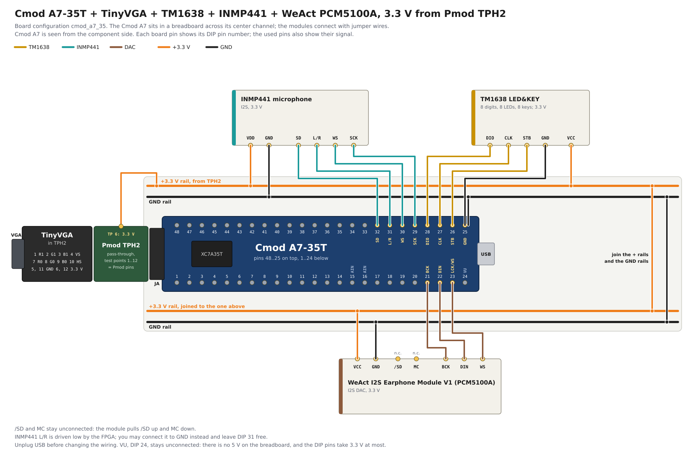
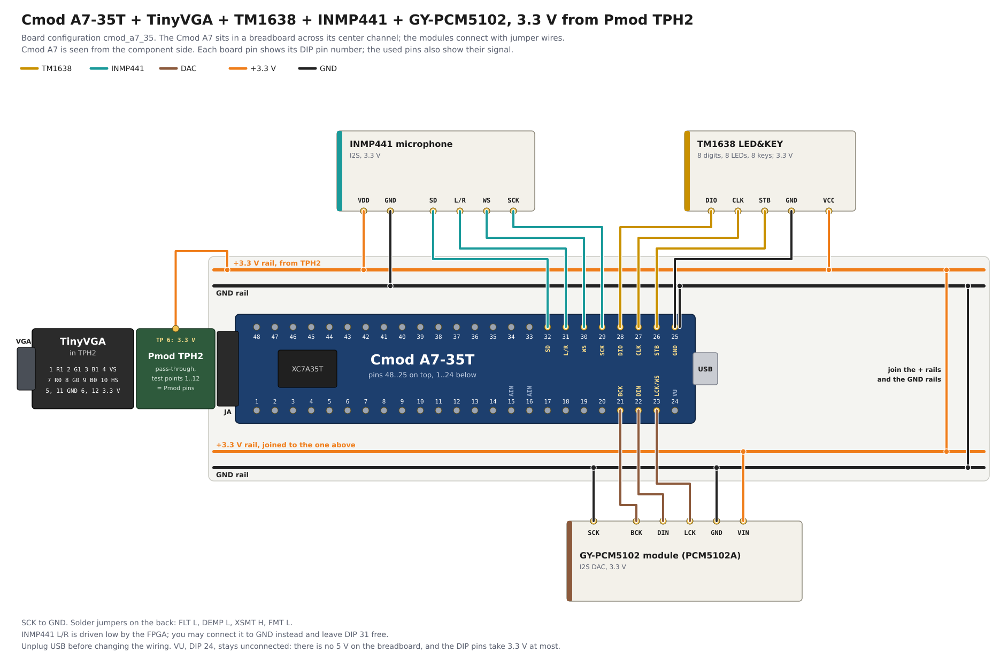
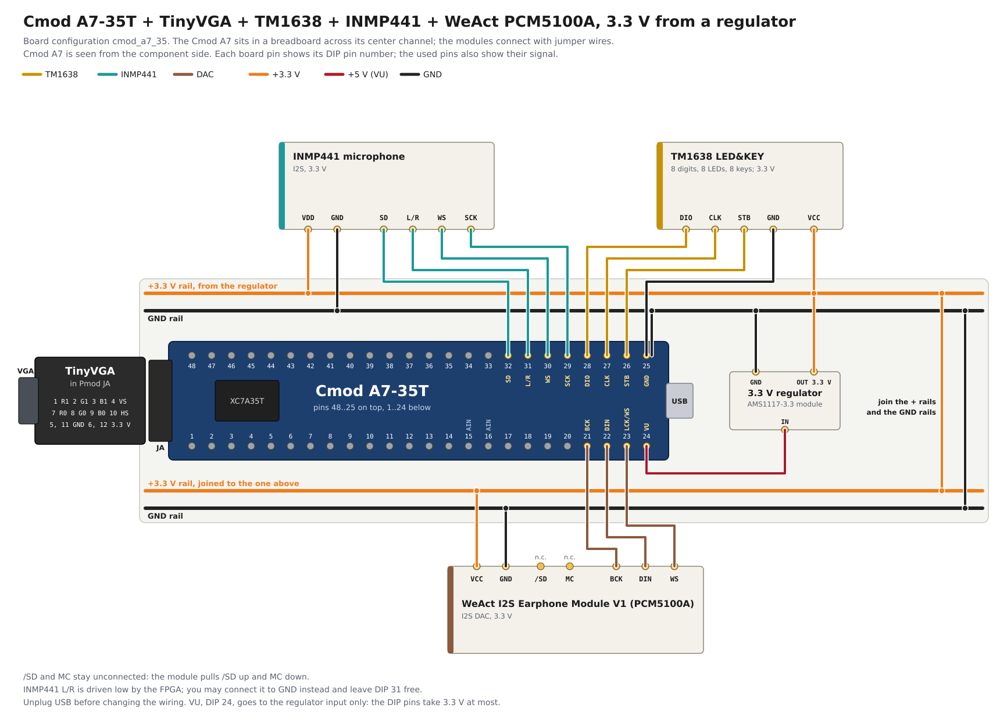
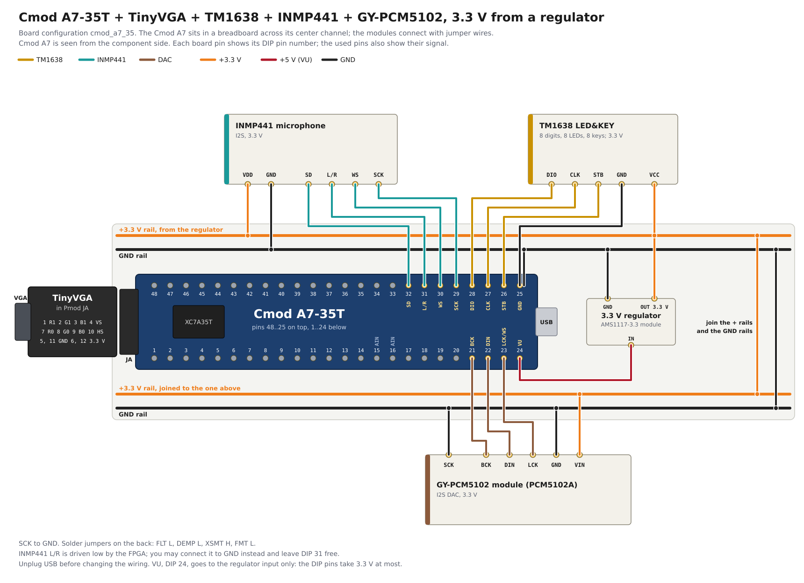

*Создано Claude Opus 5.5 (`claude-opus-5-5`) в Claude Code 2.1.325, уровень усилий xhigh, по промпту Юрия Панчула. Дословный промпт — в [приложении](#приложение-промпты).*

# Cmod A7-35T на макетной плате с TinyVGA, TM1638, микрофоном и ЦАП I2S

Конфигурация платы `cmod_a7_35`. English version: [README.md](README.md).

[Digilent Cmod A7-35T](https://digilent.com/reference/programmable-logic/cmod-a7/start)
— это ПЛИС Artix-7 (XC7A35T-1CPG236C) на модуле в корпусе DIP с 48 выводами,
размером 0,7 на 2,75 дюйма, который вставляется прямо в беспаечную макетную
плату. На модуле есть генератор 12 МГц, две кнопки, два светодиода,
RGB-светодиод, порт USB для JTAG и UART, один разъём Pmod и 44 цифровых
вывода ввода-вывода на выводах DIP. Эта конфигурация добавляет к нему:

* **TinyVGA** в разъёме Pmod JA: выход VGA, 640x480, 2 бита на цвет;
* модуль **TM1638 LED&KEY**: 8 семисегментных индикаторов, 8 светодиодов и 8 кнопок;
* модуль микрофона I2S **INMP441**;
* один из двух модулей ЦАП I2S для наушников или активных колонок:
  * **WeAct I2S Earphone Module** с PCM5100A и усилителем для наушников 32 Ом, 160 мВт;
  * обычный фиолетовый модуль **GY-PCM5102** с PCM5102A.

Оба модуля ЦАП подключаются к одним и тем же трём выводам ПЛИС, поэтому проект
для них один и тот же; отличается только подключение их питания и выводов настройки.

Все модули питаются от 3,3 В, а на выводах DIP модуля Cmod A7 вывода 3,3 В
нет. Инструкция даёт два способа получить это напряжение, и проект ПЛИС для
них один и тот же; см. раздел [Питание](#питание):

* **A: Pmod TPH2.** Проходной модуль Digilent между JA и TinyVGA выводит
  собственные 3,3 В модуля с разъёма Pmod. На макетной плате нет 5 В.
* **B: стабилизатор 3,3 В.** Модуль стабилизатора делает 3,3 В из VU — 5 В от
  USB на выводе DIP 24.

Старая конфигурация в
[zzz_postponed_and_retired/cmod_a7](../zzz_postponed_and_retired/cmod_a7)
рассчитана на другую ПЛИС, XC7A15T, и не используется.

## Содержание

* [Детали](#детали)
* [Распределение выводов](#распределение-выводов)
* [Питание](#питание)
* [Схемы подключения](#схемы-подключения)
* [Таблицы подключения](#таблицы-подключения)
* [Сборка по шагам](#сборка-по-шагам)
* [Сборка и запуск упражнений](#сборка-и-запуск-упражнений)
* [Кнопки и светодиоды](#кнопки-и-светодиоды)
* [Тактовая частота и VGA](#тактовая-частота-и-vga)
* [Если что-то не работает](#если-что-то-не-работает)
* [Состояние](#состояние)
* [Файлы](#файлы)
* [Источники](#источники)
* [Приложение: промпты](#приложение-промпты)

## Детали

| Деталь | Примечание |
|--------|------------|
| Digilent Cmod A7-35T | Не 15T: в [board_specific.tcl](board_specific.tcl) указана ПЛИС `xc7a35tcpg236-1`. |
| Кабель micro-USB | Кабель для передачи данных, а не только для зарядки. Угловой штекер не даёт кабелю лежать на макетной плате. |
| Беспаечная макетная плата | Полноразмерная, на 830 отверстий, с парой шин питания вдоль каждой длинной стороны. |
| TinyVGA Pmod | Автор — Leo Moser, [mole99/tiny-vga](https://github.com/mole99/tiny-vga). Ещё нужны кабель VGA и монитор, который принимает 640x480 при 60 Гц. |
| Модуль TM1638 LED&KEY | 8 индикаторов, 8 светодиодов, 8 кнопок, разъём из 5 выводов VCC, GND, STB, CLK, DIO. |
| Модуль INMP441 | Круглая плата микрофона I2S с 6 выводами. |
| Один модуль ЦАП | WeAct I2S Earphone Module (PCM5100A) или GY-PCM5102 (PCM5102A). Наушники или активные колонки со штекером 3,5 мм. |
| Для варианта A: Digilent Pmod TPH2 | Проходной модуль на 12 выводов с контрольной точкой для каждого вывода Pmod. Ставится между JA и TinyVGA. |
| Для варианта B: модуль стабилизатора 3,3 В | Например, модуль AMS1117-3.3, который работает от 5 В и даёт не меньше 300 мА. |
| Провода-перемычки | «Папа-папа» для макетной платы, «мама-папа» для разъёмов модулей и контрольной точки TPH2. |
| Мультиметр | Чтобы проверить шины питания до подключения модулей. |

## Распределение выводов

Выводы DIP модуля Cmod A7 пронумерованы как выводы микросхемы в корпусе DIP,
если смотреть со стороны деталей и держать разъём Pmod сверху: выводы с 1 по
24 идут вниз по левой стороне, выводы с 25 по 48 — вверх по правой. Вывод 24,
VU, и вывод 25, GND, — два вывода у конца с разъёмом USB; выводы 15 и 16 —
аналоговые входы.

Все модули подключены к 8 выводам у конца с USB на каждой стороне, рядом
с выводами питания, чтобы провода были короткими и шли группами по модулям:

| Выводы DIP | Назначение | Почему здесь |
|------------|------------|--------------|
| 21, 22, 23 | BCK, DIN, LCK ЦАП (на WeAct — WS) | Тот же порядок, что на разъёмах обоих модулей ЦАП. |
| 25, 26, 27, 28 | GND, STB, CLK, DIO модуля TM1638 | Разъём TM1638 — VCC, GND, STB, CLK, DIO: выводы DIP с 25 по 28 соединяются с выводами разъёма с GND по DIO один к одному, четырьмя параллельными проводами. |
| 29, 30, 31, 32 | SCK, WS, L/R, SD модуля INMP441 | Один ряд выводов INMP441 — SCK, WS, L/R; SD рядом с SCK во втором ряду. |

TinyVGA вставляется в разъём Pmod JA, в варианте A — через Pmod TPH2. Остальные выводы DIP остаются
свободными, а RGB-светодиод, кнопки, светодиоды и UART через USB находятся на
самом модуле.

Файл ограничений [board_specific.xdc](board_specific.xdc) — это
[Cmod-A7-Master.xdc](https://github.com/Digilent/digilent-xdc/blob/master/Cmod-A7-Master.xdc)
от Digilent, в котором раскомментированы только строки используемых выводов,
а больше ничего не изменено. Поэтому у портов остались имена Digilent:
`pio21` для вывода DIP 21, `ja[0]` для вывода Pmod 1 и так далее, а всё
сопоставление этих имён сигналам TM1638, микрофона, ЦАП и VGA сделано в
[board_specific_top.sv](board_specific_top.sv).

## Питание

**Макетной плате нужен источник 3,3 В.** На выводах DIP модуля Cmod A7
выхода 3,3 В нет: из 48 выводов 44 — это вводы-выводы ПЛИС, 15 и 16 —
аналоговые входы, 24 — VU и 25 — GND. Напряжение 3,3 В модуля выведено только
на выводы 6 и 12 разъёма Pmod JA, а этот разъём занимает TinyVGA, который и сам
от них питается. Справочное руководство говорит, что при питании Cmod A7 от
USB на VU подаётся 5 В от USB через диод Шоттки, так что там почти 5 В, и от
VU можно питать внешние схемы.

Выберите один из двух способов подать 3,3 В на макетную плату:

| | A: Pmod TPH2 | B: стабилизатор 3,3 В |
|---|--------------|-----------------------|
| Деталь | Digilent Pmod TPH2: пропускает все 12 выводов Pmod насквозь, и у него есть контрольная точка для каждого, с теми же номерами, что у выводов Pmod | Модуль стабилизатора 3,3 В, например AMS1117-3.3 |
| Где стоит | Между JA и TinyVGA | На свободном месте макетной платы за концом с USB |
| Откуда 3,3 В | Шина 3,3 В модуля Cmod A7, с контрольной точки 6 модуля TPH2; контрольная точка 12 — тоже 3,3 В | VU, вывод DIP 24 |
| Провода питания | Один: от контрольной точки 6 к шине + | Три: от вывода DIP 24 ко входу, от выхода к шине +, GND к шине GND |
| 5 В на макетной плате | Нет: VU остаётся неподключённым | Один провод, от вывода DIP 24 ко входу стабилизатора |
| Ток | Модули делят 0,6 А шины 3,3 В модуля с вводами-выводами ПЛИС, SRAM, светодиодами и TinyVGA | Модули берут ток от стабилизатора, а не от шины 3,3 В модуля |
| TinyVGA | Выступает на 2 см дальше, на TPH2 | Вставляется прямо в JA |

**Всё на макетной плате питается от 3,3 В в обоих вариантах.** Шины 5 В нет:
на выводах DIP нет последовательных резисторов, и они выдерживают не больше
3,75 В, так что от шины 5 В вдоль них до сгоревшей ПЛИС был бы один неверно
вставленный провод. В варианте B 5 В есть только на проводе от вывода DIP 24
ко входу стабилизатора.

Используйте две пары шин питания макетной платы так:

| Пара шин | Шина + | Шина − |
|----------|--------|--------|
| Со стороны выводов DIP с 25 по 48 | +3,3 В, с контрольной точки 6 модуля TPH2 (A) или с выхода стабилизатора (B) | GND |
| Со стороны выводов DIP с 1 по 24 | +3,3 В, соединена с другой шиной + | GND |

Соедините обе шины + друг с другом, а обе шины GND — друг с другом и с выводом
DIP 25.

| Модуль | Питание | Почему |
|--------|---------|--------|
| TM1638 | +3,3 В | Его линия DIO подключена к выводу ПЛИС, а модуль подтягивает DIO к своему VCC. При 5 В на вывод ПЛИС попало бы 5 В. |
| INMP441 | +3,3 В | Допустимое напряжение питания — от 1,62 до 3,63 В. |
| WeAct PCM5100A | +3,3 В | VCC питает собственный стабилизатор 3,3 В модуля (ME6231), от которого работает PCM5100A, и усилитель для наушников (HT97226). При 3,3 В на входе стабилизатор даёт около 3,2 В — в пределах от 3,0 до 3,6 В, нужных PCM5100A. |
| GY-PCM5102 | +3,3 В | VIN принимает от 3,3 до 5 В. |

Предупреждения из справочного руководства Cmod A7:

* Выводы DIP подключены к ПЛИС напрямую, без последовательных резисторов.
  Когда модуль включён, на них допустимо от −0,4 до 3,75 В, не больше; никогда
  не подключайте VU к сигнальному выводу.
* Когда модуль выключен, на выводах DIP допустимо не больше 0,55 В. Питайте
  все модули от Cmod A7, как здесь, чтобы ни один модуль не подавал сигнал на
  вывод выключенной ПЛИС.
* Когда подключён USB, на VU напряжение USB. Никогда не подключайте к VU
  другой источник питания, пока подключён USB.
* Шина 3,3 В модуля Cmod A7 даёт не больше 0,6 А на всю плату: вводы-выводы
  ПЛИС, SRAM, светодиоды и разъём Pmod, включая TinyVGA. В варианте A она
  питает ещё и все модули на макетной плате; больше всех из них потребляет
  TM1638, когда все его светодиоды горят с полной яркостью.

## Схемы подключения

Схема есть для каждого источника 3,3 В и каждого модуля ЦАП; отличаются
только подключение питания и ЦАП. На схемах Cmod A7 показан со стороны деталей
и повёрнут так, что разъём Pmod слева: выводы DIP с 48 по 25 идут вдоль
верхнего края, с 1 по 24 — вдоль нижнего. Надписи на схемах — на английском.

### Вариант A: 3,3 В от Pmod TPH2

С модулем WeAct I2S Earphone Module:



С модулем GY-PCM5102:



### Вариант B: 3,3 В от стабилизатора

С модулем WeAct I2S Earphone Module:



С модулем GY-PCM5102:



Векторные версии: [wiring_weact_tph2.svg](wiring_weact_tph2.svg),
[wiring_gy_pcm5102_tph2.svg](wiring_gy_pcm5102_tph2.svg),
[wiring_weact_regulator.svg](wiring_weact_regulator.svg),
[wiring_gy_pcm5102_regulator.svg](wiring_gy_pcm5102_regulator.svg).

### Микрофон и ЦАП, вставленные в макетную плату

Вместо того чтобы подвешивать микрофон и ЦАП на проводах «мама-папа», можно
вставить их прямо в макетную плату и соединить их полосы проводами
«папа-папа». Такую раскладку показывают отдельные рисунки:
[breadboard_weact.png](breadboard_weact.png) с модулем WeAct и
[breadboard_gy_pcm5102.png](breadboard_gy_pcm5102.png) с GY-PCM5102; векторные
версии — [breadboard_weact.svg](breadboard_weact.svg) и
[breadboard_gy_pcm5102.svg](breadboard_gy_pcm5102.svg). Коротко:

* Cmod A7 вставляется выводами DIP с 25 по 48 в столбец c, а с 1 по 24 — в
  столбец g. С одной стороны остаются свободными отверстия a и b, с другой —
  h, i и j.
* INMP441 встаёт поперёк центральной канавки, как микросхема DIP с 6
  выводами, надписями вверх, в ряды с 44 по 46: SCK, WS и L/R в столбце e, SD,
  VDD и GND в столбце f. Его L/R идёт на шину GND, поэтому вывод DIP 31
  остаётся свободным.
* ЦАП вставляется своим разъёмом в столбец j: модуль WeAct в ряды с 29 по 35,
  GY-PCM5102 в ряды с 30 по 35. Его плата и гнездо свисают над нижними шинами и
  краем макетной платы, поэтому провода его питания и GND идут к верхним
  шинам. В отверстия можно вставлять только основной разъём GY-PCM5102, а его
  контур на рисунке приблизительный.
* Середину рядов с 25 по 29 оставьте свободной для штекера USB.
* Источник 3,3 В, TinyVGA и TM1638 подключаются, как в варианте A или B выше.

## Таблицы подключения

### Выводы DIP модуля Cmod A7

| Вывод DIP | Вывод ПЛИС | Порт в board_specific.xdc | Сигнал | Подключить к |
|----------:|-----------:|---------------------------|--------|--------------|
| 21 | N1 | `pio21` | `DAC_BCK` | BCK ЦАП |
| 22 | N2 | `pio22` | `DAC_DIN` | DIN ЦАП |
| 23 | P1 | `pio23` | `DAC_LCK` | LCK GY-PCM5102, WS WeAct |
| 24 | — | — | VU, около 5 В | A: ничего. B: вход стабилизатора, и больше ничего |
| 25 | — | — | GND | шина GND и GND модуля TM1638 |
| 26 | R3 | `pio26` | `TM_STB` | STB TM1638 |
| 27 | T3 | `pio27` | `TM_CLK` | CLK TM1638 |
| 28 | R2 | `pio28` | DIO TM1638 | DIO TM1638 |
| 29 | T1 | `pio29` | `MIC_SCK` | SCK INMP441 |
| 30 | T2 | `pio30` | `MIC_WS` | WS INMP441 |
| 31 | U1 | `pio31` | `MIC_LR` | L/R INMP441 |
| 32 | W2 | `pio32` | `MIC_SD` | SD INMP441 |

### TinyVGA в разъёме Pmod JA

Выводы TinyVGA соответствуют стандарту Pmod: выводы 5 и 11 — GND, 6 и 12 —
3,3 В, как и у JA, поэтому TinyVGA вставляется без проводов. В варианте A
между ними стоит TPH2: он пропускает все выводы насквозь, так что таблица та
же.

| Вывод Pmod | Вывод ПЛИС | Порт | Сигнал TinyVGA |
|-----------:|-----------:|------|----------------|
| 1 | G17 | `ja[0]` | R1, старший бит красного |
| 2 | G19 | `ja[1]` | G1, старший бит зелёного |
| 3 | N18 | `ja[2]` | B1, старший бит синего |
| 4 | L18 | `ja[3]` | VS, кадровая синхронизация |
| 7 | H17 | `ja[4]` | R0, младший бит красного |
| 8 | H19 | `ja[5]` | G0, младший бит зелёного |
| 9 | J19 | `ja[6]` | B0, младший бит синего |
| 10 | K18 | `ja[7]` | HS, строчная синхронизация |
| 5, 11 | — | — | GND |
| 6, 12 | — | — | 3,3 В |

### Источник 3,3 В

Вариант A, Pmod TPH2:

| TPH2 | Подключить к |
|------|--------------|
| Его вилка Pmod | Разъём Pmod JA |
| Его розетка Pmod | TinyVGA |
| Контрольная точка 6 | Шина + со стороны выводов DIP с 25 по 48 |

Вариант B, модуль стабилизатора; выводы могут быть подписаны VIN, GND, VOUT:

| Вывод стабилизатора | Подключить к |
|---------------------|--------------|
| IN | Вывод DIP 24, VU |
| GND | Шина GND |
| OUT | Шина + со стороны выводов DIP с 25 по 48 |

В обоих вариантах соедините обе шины + друг с другом.

### TM1638 LED&KEY

| Вывод TM1638 | Подключить к |
|--------------|--------------|
| VCC | шина +3,3 В |
| GND | DIP 25 |
| STB | DIP 26 |
| CLK | DIP 27 |
| DIO | DIP 28 |

### INMP441

У модуля два ряда по три вывода. Если смотреть со стороны надписей, в одном
ряду SCK, WS, L/R, в другом — SD, VDD, GND, причём SD рядом с SCK.

| Вывод INMP441 | Подключить к |
|---------------|--------------|
| SCK | DIP 29 |
| WS | DIP 30 |
| L/R | DIP 31 |
| SD | DIP 32 |
| VDD | шина +3,3 В |
| GND | шина GND |

ПЛИС подаёт на L/R низкий уровень, что выбирает левый канал, как на других
платах репозитория. Можно вместо этого подключить L/R к GND и оставить DIP 31
свободным.

### ЦАП: WeAct I2S Earphone Module V1 (PCM5100A)

На его разъёме 7 выводов: VCC, GND, /SD, MC, BCK, DIN, WS.

| Вывод WeAct | Подключить к |
|-------------|--------------|
| VCC | шина +3,3 В |
| GND | шина GND |
| /SD | никуда: модуль подтягивает его вверх, и усилитель включён |
| MC | никуда: модуль подтягивает его вниз, и ЦАП делает свою опорную частоту из BCK |
| BCK | DIP 21 |
| DIN | DIP 22 |
| WS | DIP 23 |

На этом модуле ничего настраивать не нужно: по его схеме выводы FMT и FLT
микросхемы PCM5100A соединены с землёй (формат I2S и обычный фильтр), а DEMP
подтянут к земле через 10 кОм. Перемычку S1 (коррекция предыскажений)
оставьте разомкнутой. Гнездо 3,5 мм — для наушников сопротивлением 32 Ом и
больше.

### ЦАП: GY-PCM5102 (PCM5102A)

Основной разъём обычно подписан SCK, BCK, DIN, LCK, GND, VIN. Порядок
выводов у разных версий платы бывает разным, поэтому ориентируйтесь на надписи.

| Вывод GY-PCM5102 | Подключить к |
|------------------|--------------|
| SCK | шина GND |
| BCK | DIP 21 |
| DIN | DIP 22 |
| LCK | DIP 23 |
| GND | шина GND |
| VIN | шина +3,3 В |

Перед первым включением проверьте четыре паяные перемычки на обратной стороне,
помеченные цифрами от 1 до 4 или H1L–H4L. Для I2S они должны стоять так:

| Перемычка | Вывод PCM5102A | Положение |
|-----------|----------------|-----------|
| 1, H1L | FLT, фильтр | L |
| 2, H2L | DEMP, коррекция предыскажений | L |
| 3, H3L | XSMT, мягкое отключение звука | **H**, иначе ЦАП молчит |
| 4, H4L | FMT, формат данных | L, I2S |

Бывает, что платы приходят с незапаянными или неправильно запаянными
перемычками. Если площадка SCK на плате соединена перемычкой с GND, провод
от SCK к GND не нужен, но и не мешает. Никогда не подключайте SCK к выводу
ПЛИС: на плате с такой перемычкой это замкнёт вывод на землю.

## Сборка по шагам

Собирайте при отключённом кабеле USB.

1. **Установите Cmod A7.** Вставьте его в макетную плату поперёк центральной
   канавки, у одного из концов макетной платы, так, чтобы разъём Pmod был над
   краем макетной платы, а разъём USB смотрел внутрь. Выводы DIP 1 и 48
   попадают в первый ряд отверстий. Ряды выводов отстоят друг от друга на 0,6
   дюйма, поэтому один ряд окажется в одном отверстии от канавки, а другой —
   в двух: у каждого вывода в его ряду остаётся два или три свободных
   отверстия для проводов.
2. **Вставьте TinyVGA.** В варианте A вставьте TPH2 в JA, затем TinyVGA в
   TPH2; в варианте B вставьте TinyVGA прямо в JA. Все платы должны быть
   обращены деталями вверх; каждый раз проверяйте, что выводы 5, 6, 11 и 12,
   GND и VCC, совпали с такими же выводами разъёма: модуль Pmod, вставленный
   наоборот, подаёт 3,3 В на сигнальные выводы. Платы Pmod и кабель VGA
   свисают с края макетной платы; подоприте кабель, чтобы его вес не
   выламывал разъём Pmod.
3. **Сделайте шины GND.** Соедините вывод DIP 25 с шиной − со стороны
   выводов с 25 по 48, а обе шины − — друг с другом на дальнем конце макетной
   платы. На многих макетных платах шины разорваны посередине, это видно по
   разрыву их цветных линий; такие разрывы соедините перемычками.
4. **Сделайте шины +3,3 В.** В варианте A проводом «мама-папа» соедините
   контрольную точку 6 модуля TPH2 с шиной + со стороны выводов с 25 по 48, а
   вывод DIP 24, VU, оставьте неподключённым. В варианте B поставьте модуль
   стабилизатора на свободное место за концом с USB; соедините его вход с
   выводом DIP 24, VU, — это единственный провод с 5 В, — GND с шиной GND, а
   выход с шиной + со стороны выводов с 25 по 48. В обоих вариантах соедините
   обе шины + друг с другом на дальнем конце макетной платы и, как у шин GND,
   соедините перемычками разрывы.
5. **Проверьте питание.** Подключите USB. Мультиметр должен показать на обеих
   шинах + от 3,1 до 3,5 В относительно GND; в варианте B на входе
   стабилизатора должно быть примерно от 4,5 до 5 В. Отключите USB.
6. **Подключите TM1638.** Четыре провода «мама-папа» от выводов DIP 25, 26, 27
   и 28 к выводам TM1638 GND, STB, CLK и DIO, именно в этом порядке, и один
   провод от VCC к шине +3,3 В.
7. **Подключите INMP441.** Провода от выводов DIP 29, 30, 31 и 32 к SCK, WS,
   L/R и SD; VDD — к шине +3,3 В, GND — к шине GND.
8. **Подключите ЦАП.** Провода от выводов DIP 21, 22 и 23 к BCK, DIN и LCK
   (на WeAct — WS); VCC или VIN — к шине +3,3 В, GND — к шине GND. На
   GY-PCM5102 ещё соедините SCK с GND и проверьте паяные перемычки. На WeAct
   оставьте /SD и MC неподключёнными.
9. **Проверьте подключение** ещё раз по таблице
   [Выводы DIP модуля Cmod A7](#выводы-dip-модуля-cmod-a7): ни один
   сигнальный вывод Cmod A7 не должен касаться шины +, а вывод DIP 24, VU,
   в варианте A никуда не подключён, а в варианте B идёт только на вход
   стабилизатора.
10. Подключите монитор VGA и наушники или колонки, затем подключите USB.

## Сборка и запуск упражнений

В каталоге упражнения один раз выберите плату скриптом
`./06_choose_another_fpga_board.bash` — пункт `cmod_a7_35`. Затем
`./03_synthesize_for_fpga.bash` собирает проект в Vivado и загружает его в
ПЛИС через USB. Скрипты загружают саму ПЛИС, а не флеш-память модуля, поэтому
после отключения питания проект пропадает; `./04_configure_fpga.bash`
загружает его снова.

Для начала подойдут упражнения:

* `labs/2_graphics/2_3_color_stripes` — выход VGA;
* `labs/1_basics/1_01_and_or_not_xor_de_morgan` — кнопки и светодиоды TM1638;
* `labs/3_music/3_0_oscilloscope` — сигнал микрофона на мониторе;
  микрофон, ЦАП и TM1638 используют упражнения в `labs/3_music`.

## Кнопки и светодиоды

| На Cmod A7 | Вывод ПЛИС | Порт | Назначение |
|------------|-----------:|------|------------|
| BTN0, BTN1 | A18, B18 | `btn[0]`, `btn[1]` | С TM1638, как в большинстве упражнений: любая из кнопок сбрасывает проект, а упражнения получают кнопки от TM1638. Без TM1638 — `key[0]` и `key[1]` упражнений. |
| LED1, LED2 | A17, C16 | `led[0]`, `led[1]` | `led[0]` и `led[1]` упражнений; TM1638 показывает все восемь. |
| RGB-светодиод | B17, B16, C17 | `led0_b`, `led0_g`, `led0_r` | Выключен. На его выводы подаётся высокий уровень: он горит при низком уровне, а подтяжка неиспользуемых выводов к земле по умолчанию заставила бы его светиться. |
| UART через USB | J17, J18 | `uart_txd_in`, `uart_rxd_out` | `uart_rx` и `uart_tx` упражнений. |

Проект сбрасывается и после загрузки, пока не будет готов генератор тактовой
частоты. Без TM1638 кнопки сброса нет: обе кнопки — это кнопки упражнений.
Однако со скриптами репозитория в нынешнем виде TM1638 на этой плате включён
всегда; см. раздел [Состояние](#состояние).

## Тактовая частота и VGA

Генератор Cmod A7 работает на 12 МГц. Модуль VGA репозитория,
[peripherals/vga.sv](../../peripherals/vga.sv), получает частоту пикселей
25 МГц из более высокой тактовой частоты с помощью разрешения такта: он
отсчитывает `CLK_MHZ / PIXEL_MHZ` тактов на пиксель. Для этого нужна частота,
кратная 25 МГц. При 12 МГц `CLK_MHZ / PIXEL_MHZ` равно 0, и модуль не выдаёт
ни одного пикселя; а частота пикселей 12 МГц не даёт и стандартного режима
640x480 при 60 Гц, которому нужно около 25 МГц.

Поэтому board_specific_top.sv начинается с генератора тактовой частоты ПЛИС,
MMCM, который превращает 12 МГц в 50 МГц:

```text
VCO = 12 MHz * 62.5 = 750 MHz   (диапазон MMCM — от 600 до 1200 МГц)
clk = 750 MHz / 15  =  50 MHz
```

50 МГц — тактовая частота большинства плат репозитория, поэтому `vga.sv`
менять не нужно, а модули TM1638, микрофона и ЦАП работают на своих обычных
частотах: тактовые частоты битов I2S — 50 МГц / 16 = 3,125 МГц, частота
выборок — 50 МГц / 1024 = 48,8 кГц. Изображение — 640x480 при
25 МГц / (800 × 525) = 59,5 Гц. Упражнения получают `clk_mhz = 50`.

**Предлагаемое изменение vga.sv, здесь не сделанное.** `vga.sv` не замечает
частоту, которую не может поделить: если `CLK_MHZ` меньше `PIXEL_MHZ` или не
кратна ей, модуль молча не выдаёт изображения или выдаёт неправильное.
Проверка при элаборации превратила бы это в понятное сообщение об ошибке:

```systemverilog
    // The pixel rate is made with a clock enable every CLK_MHZ / PIXEL_MHZ
    // cycles, so CLK_MHZ has to be a multiple of PIXEL_MHZ, up to 16 times.

    if (   CLK_MHZ < PIXEL_MHZ
        || CLK_MHZ % PIXEL_MHZ != 0
        || CLK_MHZ / PIXEL_MHZ > 16 )
    begin : bad_clock
        $error ("vga: CLK_MHZ %0d is not a multiple of PIXEL_MHZ %0d",
                CLK_MHZ, PIXEL_MHZ);
    end
```

Прежде чем вносить это в `vga.sv`, нужно проверить, что `$error` в блоке
generate принимают все средства синтеза, которыми пользуется репозиторий.

## Если что-то не работает

| Признак | Что проверить |
|---------|---------------|
| Нет изображения | Вход монитора и кабель VGA. TinyVGA, а в варианте A и TPH2, вставлены так, что GND и VCC совпадают с GND и VCC разъёма JA. Упражнение должно использовать графику. |
| TM1638 не светится или показывает не то | VCC на +3,3 В. DIP 26, 27, 28 подключены к STB, CLK, DIO, не наоборот. DIP 25 подключён к GND модуля. |
| Нет звука с GY-PCM5102 | Перемычка 3, XSMT, в положении H. SCK на GND. VIN на +3,3 В. |
| Нет звука с WeAct | /SD не подключён к GND. VCC на +3,3 В. Штекер наушников вставлен до конца. |
| Микрофон молчит | VDD на +3,3 В. SD на DIP 32. На L/R низкий уровень, от DIP 31 или от GND. |
| На шине + мало напряжения или его нет | A: провод на контрольной точке 6 или 12 модуля TPH2, а не на другой. B: вход стабилизатора на выводе DIP 24, VU. В обоих: шины + соединены, разрывы шин соединены перемычками. |
| После отключения USB проект пропал | Так и должно быть: скрипты загружают ПЛИС, а не флеш-память. Запустите `./04_configure_fpga.bash`. |

## Состояние

Собрано в Vivado 2026.1 скриптами репозитория, без ошибок и критических
предупреждений, все временные ограничения при 50 МГц выполнены:

| Упражнение | Что использует | LUT | Регистры | Худший запас по setup |
|------------|----------------|----:|---------:|----------------------:|
| `labs/2_graphics/2_3_color_stripes` | VGA, TM1638 | 141 | 107 | 12,4 нс |
| `labs/3_music/3_0_oscilloscope` | VGA, TM1638, микрофон, ЦАП | 273 | 196 | 13,9 нс |
| `labs/3_music/3_10_spectrum_analyzer` | VGA, TM1638, микрофон, ЦАП | 2432 | 1536 | 8,4 нс |

**Скрипт Vivado в репозитории не читает `lab_specific_board_config.svh`
упражнения.** `board_specific_top.sv` всегда получает
`peripherals/lab_specific_board_config.svh`, который включает TM1638, VGA,
микрофон и ЦАП. Поэтому `3_10_spectrum_analyzer`, в котором TM1638 и вывод
звука выключены, собирается с ними. Так происходит на всех платах Xilinx в
репозитории, а не только на этой, и со скриптами в нынешнем виде кнопки Cmod A7
всегда сбрасывают проект.

Остальные ветви `board_specific_top.sv` собраны отдельным запуском Vivado,
в котором файл конфигурации стоял первым в пути поиска включаемых файлов:

| Упражнение | Конфигурация | LUT | Регистры | Худший запас по setup |
|------------|--------------|----:|---------:|----------------------:|
| `labs/1_basics/1_01_and_or_not_xor_de_morgan` | Без TM1638, VGA, микрофона и ЦАП: только кнопки и светодиоды Cmod | 1 | 0 | нет тактируемых путей |
| `labs/3_music/3_10_spectrum_analyzer` | VGA, микрофон и ЦАП без TM1638 | 2330 | 1477 | 1,7 нс |

Ещё Vivado выдаёт предупреждение проверки правил CFGBVS-1: в файле Digilent
не заданы свойства `CFGBVS` и `CONFIG_VOLTAGE`, а эта конфигурация только
раскомментирует строки этого файла. Это предупреждение не мешает созданию
файла конфигурации ПЛИС.

Ещё не проверено на настоящей плате.

## Файлы

| Файл | Что это |
|------|---------|
| [board_specific.xdc](board_specific.xdc) | Cmod-A7-Master.xdc от Digilent, раскомментированы только используемые строки |
| [board_specific_top.sv](board_specific_top.sv) | Сопоставление выводов, генератор тактовой частоты 50 МГц, сброс и экземпляры модулей упражнения, VGA, TM1638, микрофона и ЦАП |
| [board_specific.tcl](board_specific.tcl) | ПЛИС для Vivado |
| [generate_wiring_diagram.py](generate_wiring_diagram.py) | Создаёт четыре схемы подключения, `wiring_*.svg` |
| `wiring_*.svg`, `wiring_*.png` | Схемы подключения |
| [generate_breadboard_diagram.py](generate_breadboard_diagram.py) | Создаёт две раскладки на макетной плате, `breadboard_*.svg` |
| `breadboard_*.svg`, `breadboard_*.png` | Раскладки на макетной плате с вставленными микрофоном и ЦАП |
| README.md, README.html | Эта инструкция на английском |
| README_ru.md, README_ru.html | Эта инструкция на русском |
| [claude_prompt.txt](claude_prompt.txt) | Файл задачи из первого промпта, как в приложении |

Рисунки создают [generate_wiring_diagram.py](generate_wiring_diagram.py) и
[generate_breadboard_diagram.py](generate_breadboard_diagram.py), в которых есть
копия данных о выводах; при изменении board_specific_top.sv обновляйте и их.

```bash
python3 generate_wiring_diagram.py
python3 generate_breadboard_diagram.py

for f in wiring_*.svg breadboard_*.svg
do
    # ${f%.svg} — имя файла без расширения .svg
    inkscape "$f" --export-type=png --export-dpi=96 \
        --export-background=white --export-filename="${f%.svg}.png"
done
```

## Источники

* Digilent, *Cmod A7 Reference Manual*, Rev. B: питание, выводы DIP, разъём
  Pmod, кнопки и светодиоды.
* Digilent, [Cmod-A7-Master.xdc](https://github.com/Digilent/digilent-xdc/blob/master/Cmod-A7-Master.xdc),
  исходный файл для board_specific.xdc.
* Leo Moser, [TinyVGA](https://github.com/mole99/tiny-vga): выводы Pmod и питание 3,3 В.
* Digilent, [Pmod TPH2 Reference Manual](https://digilent.com/reference/pmod/pmodtph2/reference-manual):
  проходной модуль с контрольными точками.
* WeAct Studio, [I2S Earphone Module V1](https://github.com/WeActStudio/WeActStudio.I2SEarphoneModuleV1):
  схема и надписи на разъёме.
* GY-PCM5102: [вики mt32-pi](https://github.com/dwhinham/mt32-pi/wiki/GY-PCM5102-DAC-module)
  и [Makerguides](https://www.makerguides.com/playing-audio-with-esp32-and-pcm5102/)
  о паяных перемычках, SCK и питании.
* INMP441: [peripherals/inmp441.pdf](../../peripherals/inmp441.pdf) и
  [peripherals/inmp441.jpeg](../../peripherals/inmp441.jpeg) в этом репозитории.

## Приложение: промпты

Первый промпт поставил задачу, а последующие, отправленные в той же сессии
Claude Code, изменили и дополнили её. Все они приведены дословно, с опечатками
оригинала, и в переводе на русский.

### Первый промпт

Отправлен Юрием Панчулом в Claude Code 16 ноября 2026 года в 09:29 по
тихоокеанскому времени (UTC−8), дословно:

```text
do a new task in cmod_a7/AGENTS.md
```

Файл `~/claude/cmod_a7/AGENTS.md`, на который он ссылается, дословно, с
опечатками оригинала. Тот же текст — в [claude_prompt.txt](claude_prompt.txt).

```text
# Task

Create a new branch of basics_graphics_music called claude_cmod_a7 starting from main.
The branch should be called claude_cmod_a7 is you are claude and codex_cmod_a7 is you are codex.

Read board implementations:

* alinx_ax7035b
* arty_a7_100
* arty_a7_100_pmod_mic3
* arty_a7_35
* arty_a7_35_pmod_mic3
* basys3
* nexys4
* nexys4_ddr
* nexys_a7  
* nexys_a7_100
* nexys_a7_50 
* zybo_z7
* zzz_postponed_and_retired/cmod_a7

Specifically the files:

* board_specific.tcl
* board_specific_top.sv
* board_specific.xdc

Create a new board implementation cmod_a7_35 for Digilent Cmod A7-35T.

The existing zzz_postponed_and_retired/cmod_a7 is wrong.

Copy the following file into boards/cmod_a7_35/board_specific.xdc

https://github.com/Digilent/digilent-xdc/blob/master/Cmod-A7-Master.xdc

Uncomment only the necessary pins. Do not modify any pin names or definitions - only uncomment the existing.

All name mapping should be inside board_specific_top.sv.

Use Pmod socket to accomodate TinyVGA.

If necessary, write your own VGA interface module if basics-graphics-music/peripherals/vga.sv is not suitable.

Or alternatively propose a modification of basics-graphics-music/peripherals/vga.sv to accomodate the clock frequency.

Update the relevant bash scripts in scripts/steps

Create .md and HTML files with an instruction on how to assemble a breadboard with this board, microphone and either of the following DAC modules:

* WeAct I2S Earphone Module PCM5100A Stereo HP AMP 32Ω 160mW DAC Decoder Audio Board

* Interface I2S PCM5102A DAC Decoder GY-PCM5102 I2S Player Module For Raspberry Pi PHAT Format Board Digital PCM5102 Audio Board

When planning what pins to use for the TM1638, microphone and sound DAC connection, make them compact and easy to assemple.

Add this prompt as an appendix to .md and HTML files.

In addition to the instriction in English create an instruction in Russian (also .md and .html). In prompt appendix put both the original prompt in English and its transaction to Russian.
```

#### Перевод на русский

```text
Выполни новую задачу из cmod_a7/AGENTS.md
```

```text
# Задача

Создай новую ветку basics_graphics_music с именем claude_cmod_a7, начиная с main.
Ветка должна называться claude_cmod_a7, если ты Claude, и codex_cmod_a7, если ты Codex.

Прочитай реализации плат:

* alinx_ax7035b
* arty_a7_100
* arty_a7_100_pmod_mic3
* arty_a7_35
* arty_a7_35_pmod_mic3
* basys3
* nexys4
* nexys4_ddr
* nexys_a7
* nexys_a7_100
* nexys_a7_50
* zybo_z7
* zzz_postponed_and_retired/cmod_a7

А именно файлы:

* board_specific.tcl
* board_specific_top.sv
* board_specific.xdc

Создай новую реализацию платы cmod_a7_35 для Digilent Cmod A7-35T.

Существующая zzz_postponed_and_retired/cmod_a7 неправильная.

Скопируй следующий файл в boards/cmod_a7_35/board_specific.xdc

https://github.com/Digilent/digilent-xdc/blob/master/Cmod-A7-Master.xdc

Раскомментируй только нужные выводы. Не изменяй никакие имена выводов и определения — только раскомментируй существующие.

Всё сопоставление имён должно быть внутри board_specific_top.sv.

Используй разъём Pmod для подключения TinyVGA.

Если нужно, напиши свой модуль интерфейса VGA, если basics-graphics-music/peripherals/vga.sv не подходит.

Или же предложи изменение basics-graphics-music/peripherals/vga.sv, чтобы он работал с этой тактовой частотой.

Обнови соответствующие bash-скрипты в scripts/steps

Создай файлы .md и HTML с инструкцией о том, как собрать на макетной плате схему с этой платой, микрофоном и одним из следующих модулей ЦАП:

* WeAct I2S Earphone Module PCM5100A Stereo HP AMP 32Ω 160mW DAC Decoder Audio Board

* Interface I2S PCM5102A DAC Decoder GY-PCM5102 I2S Player Module For Raspberry Pi PHAT Format Board Digital PCM5102 Audio Board

Выбирая выводы для подключения TM1638, микрофона и звукового ЦАП, сделай подключение компактным и простым для сборки.

Добавь этот промпт приложением к файлам .md и HTML.

Кроме инструкции на английском, создай инструкцию на русском (тоже .md и .html). В приложение с промптом помести и исходный промпт на английском, и его перевод на русский.
```

### Последующие промпты

Отправлены Юрием Панчулом в той же сессии Claude Code 16 ноября 2026 года.
Время тихоокеанское (UTC−8). Каждый промпт дан сначала дословно на
английском, затем в переводе на русский.

**11:05**:

```text
Why did you put 5V? It should work with 3.3V. Is 5V necessary?
```

```text
Почему ты поставил 5 В? Всё должно работать от 3,3 В. 5 В действительно нужны?
```

**11:23**:

```text
Why do you need a regulator now? Are you dumb?
```

```text
Зачем теперь нужен стабилизатор? Ты что, тупой?
```

**11:28**:

```text
Are you saying the board has not 3.3V pin ouside Pmod?
```

```text
Ты хочешь сказать, что у платы нет вывода 3,3 В вне Pmod?
```

**11:31**:

```text
Can you drive 3.3V using digital pin with logic 1?
```

```text
Можно ли получить 3,3 В с цифрового вывода, выставив на нём логическую 1?
```

**18:32**:

```text
what if I use this part : https://digilent.com/shop/pmod-tph2-12-pin-test-point-header/
```

```text
а если я использую эту деталь: https://digilent.com/shop/pmod-tph2-12-pin-test-point-header/
```

**18:36**, отправлен, пока готовился ответ на предыдущий:

```text
No, I need two variants: with TPH2 and with voltage regulator. You need to update the instruction so a user can do either way
```

```text
Нет, мне нужны два варианта: с TPH2 и со стабилизатором напряжения. Обнови инструкцию так, чтобы пользователь мог сделать и так, и так
```

**18:44**:

```text
commit
```

```text
сделай коммит
```

**18:44**:

```text
push
```

```text
сделай push
```

**18:52**:

```text
add all other prompts to the appendix in the instruction verbatim in English, plus a Russian translation in Russian instruction. Next, in a separate file create a breadboard diagram with microphone and sound DAC inserted straight to the breadboard.
```

```text
добавь все остальные промпты в приложение к инструкции дословно на английском, а в русскую инструкцию — ещё и перевод на русский. Затем в отдельном файле создай схему макетной платы, в которой микрофон и звуковой ЦАП вставлены прямо в макетную плату.
```

**21:39**:

```text
commit and push
```

```text
сделай коммит и push
```

Кроме того, Юрий Панчул дважды, в 18:45 и 18:46, выполнил команду оболочки
`git -C ~/claude/basics-graphics-music push origin claude_cmod_a7`; это
команда, а не промпт, поэтому её здесь нет.
