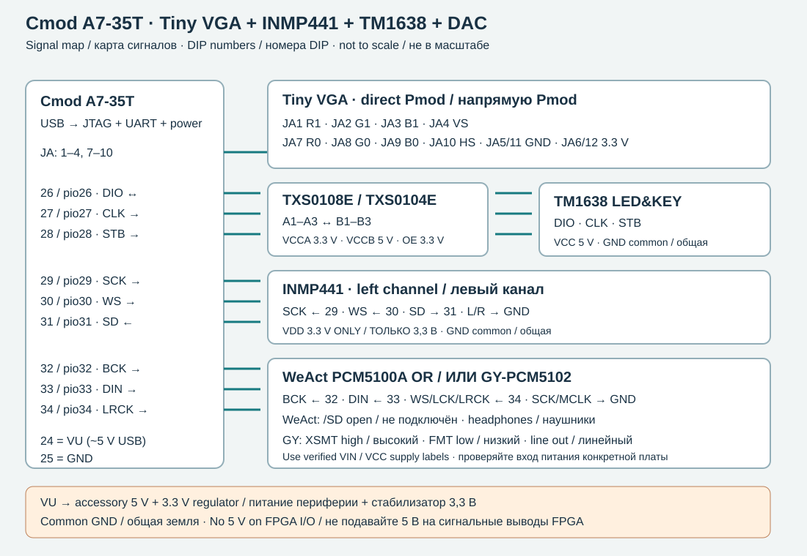

# Cmod A7-35T: сборка на макетной плате и первый запуск

Конфигурация: **cmod_a7_35** · Digilent Cmod A7-35T, ревизия B · подготовлено 16 ноября 2026 года.

[English instructions](assembly_en.html) · [Markdown](assembly_ru.md) · [Сведения о реализации](README.md)

Конфигурация соединяет Tiny VGA через разъём Pmod, микрофон INMP441 с интерфейсом I²S, модуль TM1638 LED&KEY и один из двух звуковых модулей, описанных ниже. Девять сигнальных проводов периферии подключаются к последовательным выводам DIP **26–34**. Номера выводов DIP, контактов Pmod и шариков корпуса FPGA — разные обозначения; пользуйтесь таблицами.

Код и временные соотношения сигналов проверены моделированием. Графический пример и пример микрофонного монитора также прошли синтез, трассировку и создание файлов конфигурации в Vivado 2026.1 с положительным запасом по setup/hold для путей с временными ограничениями. Исходный XDC не задаёт внешние задержки ввода-вывода. **Физическая сборка, совместимость монитора и воспроизведение звука ещё требуют проверки на плате.**

## 1. Компоненты и размещение

- **Digilent Cmod A7-35T**, не вариант 15T; кабель Micro-USB с передачей данных; компьютер с Vivado и поддержкой Artix-7.
- Макетная плата, короткие перемычки и мультиметр. Если модуль закрывает контактные группы, используйте две макетные платы или переходник DIP. Оба ряда выводов должны оставаться доступными и электрически раздельными.
- **Tiny VGA Pmod от mole99**, два бита на цвет; VGA-кабель и монитор. Digilent Pmod VGA, занимающий два разъёма Pmod, имеет другую распиновку и напрямую его не заменяет.
- Микрофонная плата **INMP441** с обозначениями VDD, GND, SCK, WS, SD и L/R.
- Обычный модуль **TM1638 LED&KEY**: восемь кнопок, восемь светодиодов, восемь семисегментных разрядов.
- Плата двунаправленного преобразователя уровней **TXS0108E** для трёх сигналов TM1638. Подойдёт и четырёхканальная TXS0104E с необходимыми тремя каналами. В инструкции используются A1/B1–A3/B3 и вход OE.
- Стабилизированный источник **3,3 В для периферии**, например плата стабилизатора с малым падением напряжения, питаемая от VU. Проверьте допустимый входной диапазон и запас по падению напряжения; установите требуемые производителем конденсаторы. Произвольный модуль «AMS1117» не обязательно обеспечит 3,3 В с любым USB-кабелем.
- Один ЦАП: **WeAct I2S Earphone Module PCM5100A Stereo HP AMP 32 Ω 160 mW** либо **GY-PCM5102 PCM5102A в формате pHAT**. Наушники подключаются к усиленному выходу WeAct; линейный выход GY требует активных колонок или отдельного усилителя.

Разместите Cmod так, чтобы противоположные выводы не замыкались контактными полосами макетной платы. Найдите вывод 1 по маркировке и [рисунку 8.1 руководства Digilent](https://digilent.com/reference/_media/reference/programmable-logic/cmod-a7/cmod_a7_rm.pdf#page=9), затем **24 = VU**, **25 = GND**, **26–34**. Ориентируйтесь на номера: вид снизу зеркален виду сверху. До подключения USB проверьте соединения мультиметром.

Преобразователь уровней и кабель TM1638 расположите возле 26–28, микрофон возле 29–31, ЦАП возле 32–34. Не закрывайте акустическое отверстие микрофона и не помещайте его вплотную к динамику. Рисунок показывает электрические соединения, а не точные координаты отверстий макетной платы.



## 2. Питание: сначала подключите и проверьте его

1. Перед перестановкой проводов отключите USB и все источники питания. Аналоговые выводы 15/16, SRAM и flash в этой сборке не используются.
2. При первом запуске питайте Cmod только через USB. По документации Digilent, при подключённом USB на **VU, вывод 24**, присутствует напряжение USB с падением на диоде — примерно 5 В. **Вывод 25 — земля.** Не подключайте внешний источник к VU одновременно с USB.
3. Соедините вывод 25 с общей шиной земли. Подключите к ней GND всех модулей и преобразователя уровней. Проверьте мультиметром разрывы шин макетной платы, прежде чем соединять их перемычками.
4. Подайте питание VU на VCC TM1638, VCCB преобразователя уровней и проверенный вход 5 V/VIN выбранного ЦАП. Учитывайте суммарный ток FPGA, индикатора и звука. При просадке напряжения или отключении USB используйте подходящий USB-источник либо отдельный стабилизированный источник для периферии. Во втором случае отсоедините провод VU от питания периферии; земли оставьте общими.
5. Вход стабилизатора 3,3 В подключите к той же шине питания периферии. Его выход **3,3 В** питает VDD INMP441 и VCCA преобразователя уровней. Не соединяйте этот выход с выходом 3,3 В Cmod на Pmod: Tiny VGA получает своё питание непосредственно через Pmod.
6. После появления обоих напряжений установите OE преобразователя в высокий уровень **VCCA = 3,3 В**. Соблюдайте схему включения и последовательность питания его платы. Не подтягивайте OE к 5 В. Если развязывающих конденсаторов на плате нет, добавьте их по документации. Делайте сигнальные провода короткими, без больших дополнительных ёмкостей.
7. До установки модулей измерьте VU и 3,3 В, проверьте общую землю. Не используйте сигнальные выводы FPGA как питание. Сигналы 5 В нельзя подключать к FPGA напрямую; особенно это касается DIO TM1638, по которому модуль возвращает данные.

Источники: [питание и разъёмы Cmod](https://digilent.com/reference/_media/reference/programmable-logic/cmod-a7/cmod_a7_rm.pdf), [TI TXS0108E](https://www.ti.com/lit/ds/symlink/txs0108e.pdf). Сторона A преобразователя работает при 3,3 В, сторона B — при 5 В.

## 3. Компактная распиновка периферии

Имена в XDC сохранены дословно. Все сопоставления функций находятся в `board_specific_top.sv`.

| Вывод DIP | Порт XDC/верхнего модуля | Шарик FPGA | Назначение | Куда подключать |
| --- | --- | --- | --- | --- |
| 26 | pio26 | R3 | Двунаправленные данные TM1638 | A1 преобразователя; B1 → DIO TM1638 |
| 27 | pio27 | T3 | Тактовый сигнал TM1638 | A2; B2 → CLK TM1638 |
| 28 | pio28 | R2 | Строб TM1638 | A3; B3 → STB TM1638 |
| 29 | pio29 | T1 | Битовый тактовый сигнал микрофона | SCK INMP441 |
| 30 | pio30 | T2 | Выбор слова микрофона | WS INMP441 |
| 31 | pio31 | U1 | Вход данных микрофона | SD INMP441 |
| 32 | pio32 | W2 | Битовый тактовый сигнал ЦАП | BCK WeAct или GY |
| 33 | pio33 | V2 | Данные на ЦАП | DIN WeAct или GY |
| 34 | pio34 | W3 | Тактовый сигнал слов ЦАП | WS WeAct или LCK/LRCK GY |

**L/R микрофона INMP441 соедините с землёй**, выбирая левый канал. VDD подключите к **3,3 В**, не к VU. Не путайте SCK и SD: SCK идёт из FPGA, SD возвращает данные в FPGA. [Документация INMP441](https://invensense.tdk.com/wp-content/uploads/2015/02/INMP441.pdf) описывает 24-битный выход I²S; верхний модуль принимает знаковый отсчёт левого канала.

При тактовой частоте системы 100 МГц существующий приёмник формирует около **3,125 МГц SCK и 48,828125 кГц WS**. Именно эти значения следует ожидать при измерении, а не ровно 3,072 МГц и 48 кГц.

## 4. Tiny VGA в разъёме Pmod

Совместите нумерацию контактов Tiny VGA и разъёма **JA** на Cmod. Контакты 5/11 — земля, 6/12 — 3,3 В. Проверьте ориентацию до подачи питания. При необходимости используйте только прямой Pmod-удлинитель без перестановки проводов.

| Контакт JA | Порт XDC/верхнего модуля | Шарик FPGA | Сигнал Tiny VGA |
| --- | --- | --- | --- |
| 1 | ja[0] | G17 | R1, старший бит красного |
| 2 | ja[1] | G19 | G1, старший бит зелёного |
| 3 | ja[2] | N18 | B1, старший бит синего |
| 4 | ja[3] | L18 | VS, кадровая синхронизация |
| 7 | ja[4] | H17 | R0, младший бит красного |
| 8 | ja[5] | H19 | G0, младший бит зелёного |
| 9 | ja[6] | J19 | B0, младший бит синего |
| 10 | ja[7] | K18 | HS, строчная синхронизация |

Получается **64 цвета, RGB222**. Во время гашения верхний модуль выдаёт чёрный цвет. Видимая область — 640 × 480, полная развёртка — 800 × 525. Частота пикселей — 25 МГц, строк — 31,25 кГц, кадров — примерно **59,524 Гц**. Это существующий в репозитории вариант с 25 МГц, а не номинальные 25,175 МГц VGA; совместимость следует проверить на вашем мониторе.

MMCM внутри FPGA преобразует 12 МГц генератора платы в 100 МГц. Переделывать `peripherals/vga.sv` не требуется. Основание распиновки — [таблица разработчика Tiny VGA](https://github.com/mole99/tiny-vga#tiny-vga-pinout).

## 5. Вариант ЦАП A: WeAct PCM5100A с усилителем наушников

В [официальной схеме WeAct V1.0](https://github.com/WeActStudio/WeActStudio.I2SEarphoneModuleV1/blob/master/Hardware/WeAct-I2SEarphoneModuleV1_V10%20SchDoc.pdf) показан семиконтактный разъём. Проверяйте маркировку своей платы: вид с обратной стороны меняет кажущийся порядок контактов.

| Контакт P1 WeAct | Обозначение | Соединение |
| --- | --- | --- |
| 1 | VCC | Шина питания периферии 5 В/VU с учётом допустимого тока |
| 2 | GND | Общая земля |
| 3 | /SD | Оставить неподключённым: в схеме V1.0 CTRL подтянут к 3,3 В; заземление выключает звук |
| 4 | MCLK / MC | Земля для трёхпроводного I²S |
| 5 | BCK / BC | DIP 32 Cmod |
| 6 | DIN / DI | DIP 33 Cmod |
| 7 | WS | DIP 34 Cmod |

На плате находятся стабилизатор 3,3 В, PCM5100A и усилитель наушников HT97226. Заводская схема выбирает I²S; перемычку деэмфазиса оставьте в исходном выключенном положении. Начните с тихого сигнала и подключите наушники к гнезду. Вход **/SD не является SD микрофона**: не соединяйте их и не подавайте на /SD напряжение 5 В.

## 6. Вариант ЦАП B: GY-PCM5102 / PCM5102A в формате pHAT

Под названием GY продаются разные печатные платы. Название товара не определяет однозначно порядок контактов и номера паяных перемычек. Подключайтесь по **обозначениям сигналов**, проверив схему стабилизатора и перемычки конкретного модуля; номера разъёма WeAct здесь неприменимы.

| Обозначение GY | Соединение или состояние |
| --- | --- |
| VIN / 5V | Шина 5 В только при подтверждённом входе через стабилизатор |
| 3V3, если имеется | По схеме питания конкретной платы; никогда не подавать сюда 5 В |
| GND | Общая земля |
| BCK / BCLK | DIP 32 Cmod |
| DIN / DATA | DIP 33 Cmod |
| LCK / LRCK / WS | DIP 34 Cmod |
| SCK / MCLK | Земля: внутренний PLL ЦАП использует BCK |
| XSMT / XMT | Высокий уровень от логической шины 3,3 В ЦАП для включения звука; проверьте имеющуюся подтяжку |
| FMT | Низкий уровень: I²S |
| FLT | Низкий уровень: фильтр с обычной задержкой |
| DEMP | Низкий уровень: деэмфазис выключен |

Перед добавлением проводов осмотрите паяные перемычки. Нельзя замыкать на землю вывод, уже соединённый перемычкой с питанием. Ревизия вашей GY-платы не задана, поэтому номера перемычек и физический порядок разъёма не предполагаются. Электрические настройки взяты из [документации TI PCM510xA](https://www.ti.com/lit/ds/symlink/pcm5102a.pdf).

Гнездо или площадки L/R GY обычно являются **линейными выходами**. Подключайте активные колонки либо отдельный усилитель наушников. Сам PCM5102A не рассчитан на непосредственное управление наушниками 32 Ω: TI указывает линейную нагрузку от 1 кΩ. Не соединяйте левый и правый выходы друг с другом.

Оба варианта работают с одной конфигурацией FPGA и тремя сигнальными проводами. Существующий передатчик помещает монофонический 16-битный `sound` в оба канала 32-битных слотов I²S, начиная на один бит позже изменения LRCK. Ожидаемые частоты: BCK **3,125 МГц**, LRCK **48,828125 кГц**, **64 периода BCK на стереокадр**. Провод внешнего MCLK не нужен; неиспользуемый выход MCLK передатчика остаётся внутри FPGA.

## 7. Кнопки, индикатор, GPIO и сброс

- **BTN0** сбрасывает MMCM и схему. Потеря захвата частоты также вызывает сброс; после восстановления захвата сброс снимается через три фронта системного тактового сигнала. При потере захвата нажмите и отпустите BTN0 для перезапуска MMCM.
- **BTN1** — кнопка лабораторной работы. По умолчанию её состояние объединяется по ИЛИ с `key[0]`; S1–S8 TM1638 соответствуют `key[0]`–`key[7]`.
- Движковых переключателей нет. Эти же кнопки TM1638 подаются на `sw[0]`–`sw[7]` как **входы без фиксации**. Для длительного удержания комбинации кнопки нужно держать нажатыми либо отдельно адаптировать ввод лабораторной работы.
- Два светодиода Cmod дублируют младшие два бита лабораторных светодиодов. TM1638 выводит восемь бит и восемь разрядов. Поддерживаются и общие макросы конкатенации; альтернативный порядок описан в сведениях о реализации.
- RGB-светодиод с активным низким уровнем горит красным во время сброса, зелёным при работе; синий выключен. Он показывает состояние тактирования и сброса, а не исправность всей периферии.
- `gpio[0]`–`gpio[7]` соответствуют DIP **1–8** и не пересекаются с периферией на 26–34. Оставьте их свободными, если лабораторная работа их не использует.
- Встроенный USB-UART передаёт данные в FPGA через `uart_txd_in`, в компьютер — через `uart_rxd_out`. Дополнительный UART-кабель не нужен.

## 8. Сборка проекта и последовательный запуск

В каталоге лабораторной работы запустите обычный выбор платы и укажите **cmod_a7_35**. Скрипт выбирает Vivado, кристалл **xc7a35tcpg236-1** и устройство программатора **xc7a35t_0**.

```bash
cd labs/2_graphics/2_1_rectangle_ellipse_parabola
./06_choose_another_fpga_board.bash
./03_synthesize_for_fpga.bash
```

После успешной сборки скрипт репозитория переходит к конфигурированию. Подключайте только проверенную сборку и читайте сообщения инструмента. Для повторного программирования используйте `./04_configure_fpga.bash`: это загрузка в энергозависимую конфигурацию FPGA, а не новая процедура записи flash.

1. Начните с Cmod и USB без периферии. Проверьте, что Vivado видит **35T**. После сборки изучите отчёты тактирования, временного анализа и DRC: должны присутствовать входные 12 МГц и выход MMCM около 100 МГц; необъяснённые ошибки выводов и временных ограничений нужно устранить.
2. Сняв питание, подключите Tiny VGA. Запустите графическую работу, проверьте форму, цвета и гашение. Изображение служит первой проверкой тактирования и видео.
3. Добавьте преобразователь уровней и TM1638. В `lab_specific_board_config.svh` включите `INSTANTIATE_TM1638_BOARD_CONTROLLER_MODULE`, если работе нужны кнопки и индикатор. Проверьте каждую кнопку и разряд до подключения звука.
4. Подключите INMP441. Включите `INSTANTIATE_MICROPHONE_INTERFACE_MODULE`, запустите `labs/3_music/3_0_oscilloscope`, произнесите звук или хлопните возле микрофона. Проверяйте изменение осциллограммы, а не только наличие тактового сигнала.
5. Подключите **один** из вариантов ЦАП. Включите `INSTANTIATE_SOUND_OUTPUT_INTERFACE_MODULE`. Сначала проверьте тон в `labs/3_music/3_3_note_synthesizer`, затем тракт микрофон–ЦАП в `labs/3_music/3_11_microphone_monitor`. Разнесите микрофон и динамик, чтобы избежать акустической обратной связи.
6. Если макрос периферии выключен, соответствующие выходы тактирования и данных неактивны, а значение входного сигнала равно нулю. Перестановка проводов не включает исключённый при сборке блок. Для графики нужен `INSTANTIATE_GRAPHICS_INTERFACE_MODULE`.

## 9. Поиск неисправностей

| Симптом | Что проверить сначала |
| --- | --- |
| RGB постоянно красный | BTN0 не удерживается; питание и генератор 12 МГц стабильны; MMCM захватил частоту; выбран нужный кристалл |
| Монитор не видит сигнал | Ориентация Tiny VGA; JA4 = VS, JA10 = HS; макрос графики; измеренные частоты синхронизации; поддержка монитором режима с 25 МГц |
| Неверные цвета или полосы за изображением | Таблица R1/R0, а не восьмицветная распиновка; гашение и порядок цветовых битов |
| Индикатор TM1638 работает, кнопки нет | DIO проходит через двунаправленный преобразователь; общая земля; обе шины питания и OE |
| Микрофон молчит | VDD = 3,3 В; L/R = GND; SD и SCK не перепутаны; включён макрос микрофона |
| Тактирование ЦАП есть, звука нет | Снято приглушение; режим I²S; SCK/MCLK заземлён; правильная нагрузка; лабораторная работа выдаёт ненулевой sound |
| USB отключается при включении индикатора/звука | Падение напряжения на кабеле или превышение доступного тока; остановиться и проверить питание |

## 10. Источники и воспроизводимость

- [Руководство Digilent Cmod A7](https://digilent.com/reference/_media/reference/programmable-logic/cmod-a7/cmod_a7_rm.pdf): плата, питание, разъёмы.
- [Исходный XDC Digilent, фиксированная ревизия](https://github.com/Digilent/digilent-xdc/blob/c8644a9fe31cc803789643124545d56b3bef4600/Cmod-A7-Master.xdc), [локальная неизменённая копия](reference/Cmod-A7-Master.xdc), [происхождение файла](reference/source.json).
- [Репозиторий разработчика Tiny VGA](https://github.com/mole99/tiny-vga): RGB222 и Pmod.
- [Репозиторий производителя WeAct](https://github.com/WeActStudio/WeActStudio.I2SEarphoneModuleV1): схема V1.0 и разъём.
- [TI PCM510xA](https://www.ti.com/lit/ds/symlink/pcm5102a.pdf), [TI TXS0108E](https://www.ti.com/lit/ds/symlink/txs0108e.pdf), [INMP441](https://invensense.tdk.com/wp-content/uploads/2015/02/INMP441.pdf).
- [AMD MMCME2_BASE](https://docs.amd.com/r/en-US/ug953-vivado-7series-libraries/MMCME2_BASE): примитив тактирования, захват частоты и сброс.

Запуск автоматических проверок из корня репозитория:

```bash
python3 scripts/tests/test_cmod_a7_35.py
python3 scripts/tests/test_board_menu.py
```

В функциональном тесте используется отдельная модель тактирования только для проверки. Проверяются сохранность и полнота ограничений выводов, развёртывание существующих лабораторных работ, полный кадр VGA и гашение, данные микрофона, передача I²S, UART/GPIO и сброс. Аналоговые уровни, качество сигналов на макетной плате, совместимость монитора и реальные процессы захвата MMCM этим тестом не проверяются.

## Приложение: исходное задание и русский перевод

### Original English prompt / Английский оригинал

```text
# Task

Create a new branch of basics_graphics_music called claude_cmod_a7 starting from main.
The branch should be called claude_cmod_a7 is you are claude and codex_cmod_a7 is you are codex.

Read board implementations:

* alinx_ax7035b
* arty_a7_100
* arty_a7_100_pmod_mic3
* arty_a7_35
* arty_a7_35_pmod_mic3
* basys3
* nexys4
* nexys4_ddr
* nexys_a7  
* nexys_a7_100
* nexys_a7_50 
* zybo_z7
* zzz_postponed_and_retired/cmod_a7

Specifically the files:

* board_specific.tcl
* board_specific_top.sv
* board_specific.xdc

Create a new board implementation cmod_a7_35 for Digilent Cmod A7-35T.

The existing zzz_postponed_and_retired/cmod_a7 is wrong.

Copy the following file into boards/cmod_a7_35/board_specific.xdc

https://github.com/Digilent/digilent-xdc/blob/master/Cmod-A7-Master.xdc

Uncomment only the necessary pins. Do not modify any pin names or definitions - only uncomment the existing.

All name mapping should be inside board_specific_top.sv.

Use Pmod socket to accomodate TinyVGA.

If necessary, write your own VGA interface module if basics-graphics-music/peripherals/vga.sv is not suitable.

Or alternatively propose a modification of basics-graphics-music/peripherals/vga.sv to accomodate the clock frequency.

Update the relevant bash scripts in scripts/steps

Create .md and HTML files with an instruction on how to assemble a breadboard with this board, microphone and either of the following DAC modules:

* WeAct I2S Earphone Module PCM5100A Stereo HP AMP 32Ω 160mW DAC Decoder Audio Board

* Interface I2S PCM5102A DAC Decoder GY-PCM5102 I2S Player Module For Raspberry Pi PHAT Format Board Digital PCM5102 Audio Board

When planning what pins to use for the TM1638, microphone and sound DAC connection, make them compact and easy to assemple.

Add this prompt as an appendix to .md and HTML files.

In addition to the instriction in English create an instruction in Russian (also .md and .html). In prompt appendix put both the original prompt in English and its transaction to Russian.
```

### Russian translation / Русский перевод

```text
# Задание

Создайте новую ветку basics_graphics_music с именем claude_cmod_a7, начиная с main.
Ветка должна называться claude_cmod_a7, если вы Claude, и codex_cmod_a7, если вы Codex.

Изучите реализации плат:

* alinx_ax7035b
* arty_a7_100
* arty_a7_100_pmod_mic3
* arty_a7_35
* arty_a7_35_pmod_mic3
* basys3
* nexys4
* nexys4_ddr
* nexys_a7
* nexys_a7_100
* nexys_a7_50
* zybo_z7
* zzz_postponed_and_retired/cmod_a7

В частности, файлы:

* board_specific.tcl
* board_specific_top.sv
* board_specific.xdc

Создайте новую реализацию платы cmod_a7_35 для Digilent Cmod A7-35T.

Существующая реализация zzz_postponed_and_retired/cmod_a7 неправильная.

Скопируйте следующий файл в boards/cmod_a7_35/board_specific.xdc:

https://github.com/Digilent/digilent-xdc/blob/master/Cmod-A7-Master.xdc

Раскомментируйте только необходимые выводы. Не изменяйте имена или определения выводов — только раскомментируйте существующие строки.

Все сопоставления имён должны находиться в board_specific_top.sv.

Используйте разъём Pmod для подключения TinyVGA.

При необходимости напишите собственный модуль интерфейса VGA, если basics-graphics-music/peripherals/vga.sv не подходит.

Либо предложите изменение basics-graphics-music/peripherals/vga.sv с учётом тактовой частоты.

Обновите соответствующие Bash-скрипты в scripts/steps.

Создайте файлы .md и HTML с инструкцией по сборке на макетной плате схемы с этой платой, микрофоном и одним из следующих модулей ЦАП:

* WeAct I2S Earphone Module PCM5100A Stereo HP AMP 32Ω 160mW DAC Decoder Audio Board

* Interface I2S PCM5102A DAC Decoder GY-PCM5102 I2S Player Module For Raspberry Pi PHAT Format Board Digital PCM5102 Audio Board

Планируя использование выводов для TM1638, микрофона и звукового ЦАП, сделайте соединения компактными и удобными для сборки.

Добавьте этот запрос в качестве приложения к файлам .md и HTML.

Кроме английской инструкции создайте русскую инструкцию (также .md и .html). В приложении с запросом приведите и английский оригинал, и его перевод на русский язык.
```

### Microphone clarification / Уточнение микрофона

The user selected: “INMP441 I²S microphone (recommended)”.

Пользователь выбрал: «Микрофон INMP441 с интерфейсом I²S (рекомендуется)».
