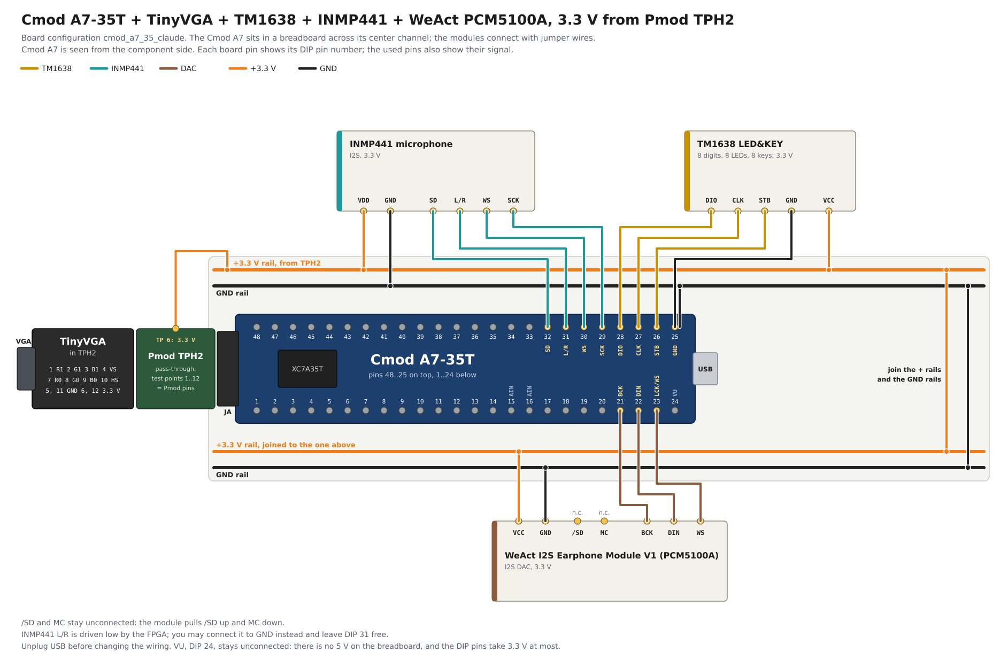
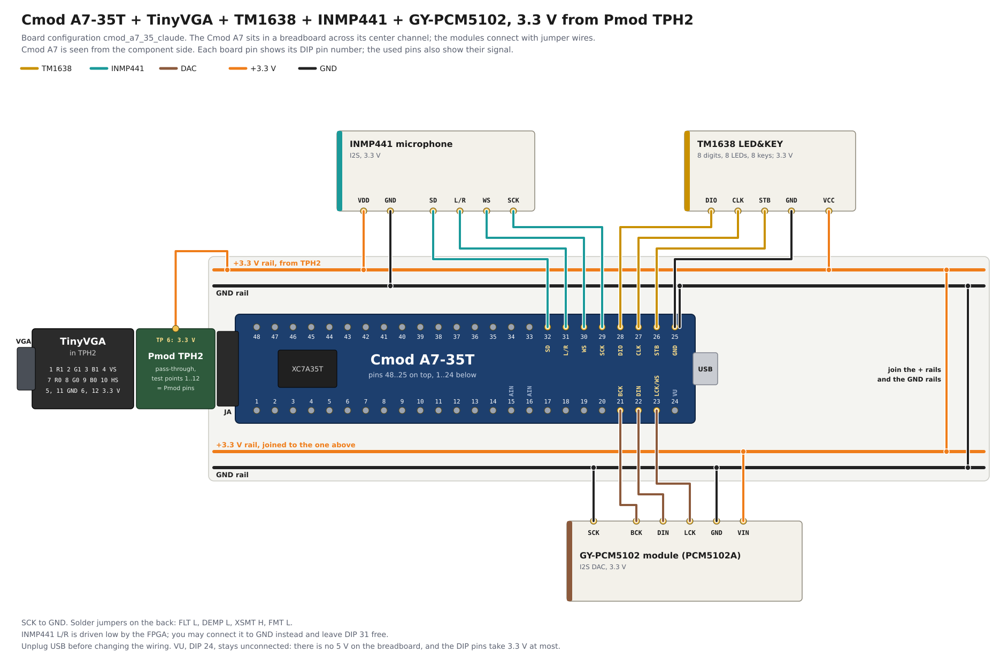
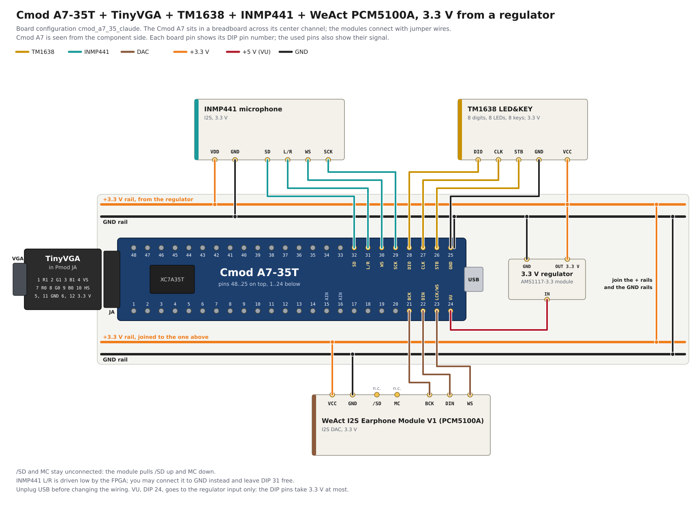
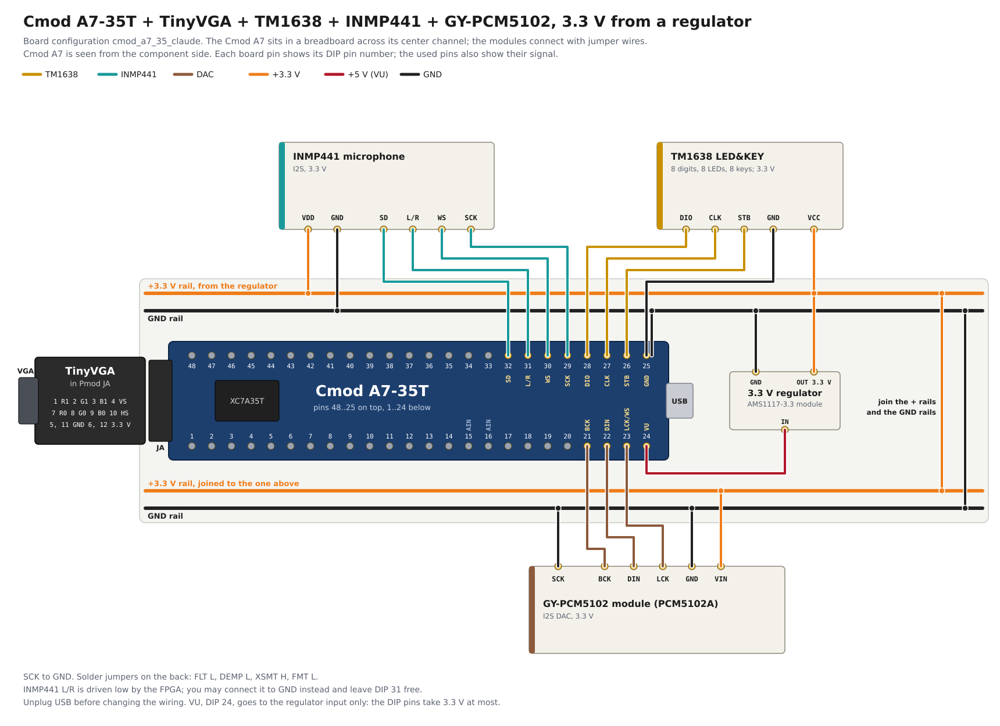

*Generated by Claude Opus 5.5 (`claude-opus-5-5`) in Claude Code 2.1.325, effort level xhigh, using prompt from Yuri Panchul. See the verbatim prompt in the [Appendix](#appendix-the-prompts).*

# Cmod A7-35T on a breadboard with TinyVGA, TM1638, a microphone and an I2S DAC

Board configuration `cmod_a7_35_claude`. Русская версия: [README_ru.md](README_ru.md).

[Digilent Cmod A7-35T](https://digilent.com/reference/programmable-logic/cmod-a7/start)
is an Artix-7 FPGA (XC7A35T-1CPG236C) on a 48-pin DIP module, 0.7 by 2.75 inches,
made to be pushed into a solderless breadboard. It has a 12 MHz oscillator,
two buttons, two LEDs, an RGB LED, a USB port for JTAG and UART, one Pmod
socket and 44 digital I/O pins on its DIP pins. This configuration adds:

* **TinyVGA** in the Pmod socket JA: a VGA output, 640x480, 2 bits per color;
* **TM1638 LED&KEY** module: 8 seven-segment digits, 8 LEDs and 8 keys;
* **INMP441** I2S microphone module;
* one of two I2S DAC modules for headphones or active speakers:
  * **WeAct I2S Earphone Module** with PCM5100A and a 32 Ω, 160 mW headphone amplifier;
  * the usual purple **GY-PCM5102** module with PCM5102A.

Both DAC modules use the same three FPGA pins, so the design is the same for
either of them; only the wiring of their power and configuration pins differs.

All the modules run from 3.3 V, and the DIP pins of Cmod A7 have no 3.3 V
pin. The instruction gives two ways to get it, and the FPGA design is the same
for both; see [Power](#power):

* **A: Pmod TPH2.** A Digilent pass-through between JA and TinyVGA brings the
  board's own 3.3 V from the Pmod socket. No 5 V on the breadboard.
* **B: a 3.3 V regulator.** A regulator module makes 3.3 V from VU, the USB
  5 V on DIP pin 24.

The older configuration in
[zzz_postponed_and_retired/cmod_a7](../zzz_postponed_and_retired/cmod_a7)
targets the wrong FPGA, XC7A15T, and is not used.

## Contents

* [Parts](#parts)
* [The pin plan](#the-pin-plan)
* [Power](#power)
* [Wiring diagrams](#wiring-diagrams)
* [Wiring tables](#wiring-tables)
* [Assembly, step by step](#assembly-step-by-step)
* [Building and running the labs](#building-and-running-the-labs)
* [Buttons and LEDs](#buttons-and-leds)
* [Clock and VGA](#clock-and-vga)
* [Troubleshooting](#troubleshooting)
* [Status](#status)
* [Files](#files)
* [Sources](#sources)
* [Appendix: the prompts](#appendix-the-prompts)

## Parts

| Part | Notes |
|------|-------|
| Digilent Cmod A7-35T | Not the 15T: the FPGA part in [board_specific.tcl](board_specific.tcl) is `xc7a35tcpg236-1`. |
| Micro-USB cable | A data cable, not a charge-only one. A right-angle plug keeps the cable off the breadboard. |
| Solderless breadboard | A full-size one, 830 holes, with a pair of power rails on each long side. |
| TinyVGA Pmod | By Leo Moser, [mole99/tiny-vga](https://github.com/mole99/tiny-vga). Bought assembled or ordered from JLCPCB: see [Where to get TinyVGA](#where-to-get-tinyvga). Plus a VGA cable and a monitor that accepts 640x480 at 60 Hz. |
| TM1638 LED&KEY module | 8 digits, 8 LEDs, 8 keys, a 5-pin header VCC, GND, STB, CLK, DIO. |
| INMP441 module | The round I2S microphone board with 6 pins. |
| One DAC module | WeAct I2S Earphone Module (PCM5100A) or GY-PCM5102 (PCM5102A). Headphones or active speakers with a 3.5 mm plug. |
| For variant A: Digilent Pmod TPH2 | A 12-pin pass-through with a test point for each Pmod pin. It goes between JA and TinyVGA. |
| For variant B: a 3.3 V regulator module | A 3-pin AMS1117-3.3 module, for example [Amazon B08CDMZMDN](https://www.amazon.com/dp/B08CDMZMDN), a pack of 20: 4.75 to 12 V in, 3.3 V out, up to 800 mA, about 8.6 x 12.3 mm, pins VIN, GND, VOUT. Any 3.3 V module that works from 5 V and gives at least 300 mA will do. |
| Jumper wires | Male-to-male for the breadboard, female-to-male for the module headers and the TPH2 test point. |
| Multimeter | To check the power rails before the modules are connected. |

### Where to get TinyVGA

TinyVGA, spelled Tiny VGA by its author, is an open hardware Pmod board by
Leo Moser. It was made for the chips of [Tiny Tapeout](https://tinytapeout.com/)
and works with any FPGA board that has a Pmod socket. Its repository,
[github.com/mole99/tiny-vga](https://github.com/mole99/tiny-vga), holds the
KiCad project, the pinout and the files for ordering it, under the CC BY-SA
4.0 license. The board has a right-angle 12-pin Pmod plug, a 74LVC245 buffer,
a resistor DAC of 2 bits for each color and a VGA socket. Its VCC must be
3.3 V, which JA gives.

There are two ways to get one.

**Buy it assembled.** The Tiny Tapeout store sells it as
[Tiny VGA Pmod](https://store.tinytapeout.com/products/TinyVGA-Pmod-p678647356),
fully assembled, for €15.00 in November 2026; the page shows the current
price and stock. The author does not sell it directly.

**Order it from JLCPCB.** The board is laid out to be made and assembled by
[JLCPCB](https://jlcpcb.com/), and the repository holds the files for that in
`pcb/jlcpcb/production_files/`:

| File | What it is |
|------|------------|
| `GERBER-tiny-vga.zip` | The Gerber files of the board |
| `BOM-tiny-vga.csv` | The parts list, with the LCSC part number of each part, the Pmod plug and the VGA socket included |
| `CPL-tiny-vga.csv` | The placement of the parts |

The steps, as in the README of the repository:

1. Create an account at JLCPCB.
2. Upload `GERBER-tiny-vga.zip`. The default options will do; you may change
   the quantity or the color of the board, and remove the order number.
3. Turn on PCB Assembly and keep its settings.
4. Click Next and upload `BOM-tiny-vga.csv` and `CPL-tiny-vga.csv`.
5. Check the placement of the parts in the preview: some may need to be
   rotated.
6. Check out.

A board costs less when several are ordered at once; the author suggests
ordering about ten and giving the spare ones to others nearby. The author is
not affiliated with JLCPCB.

## The pin plan

The DIP pins of Cmod A7 are numbered like the pins of a DIP chip seen from the
component side, with the Pmod socket at the top: pins 1 to 24 run down the
left side, pins 25 to 48 run up the right side. Pin 24, VU, and pin 25, GND,
are the two pins at the USB end; pins 15 and 16 are analog inputs.

All the module wiring is put in the 8 pins at the USB end of each side, next
to the power pins, so that the wires are short and grouped by module:

| DIP pins | Use | Why there |
|----------|-----|-----------|
| 21, 22, 23 | DAC BCK, DIN, LCK (WS on WeAct) | The same order as on the headers of both DAC modules. |
| 25, 26, 27, 28 | GND, TM1638 STB, CLK, DIO | The TM1638 header is VCC, GND, STB, CLK, DIO: DIP pins 25 to 28 meet header pins GND to DIO one to one, four parallel wires. |
| 29, 30, 31, 32 | INMP441 SCK, WS, L/R, SD | One row of the INMP441 module reads SCK, WS, L/R; SD is next to SCK in the other row. |

TinyVGA plugs into the Pmod socket JA, in variant A through Pmod TPH2. The remaining DIP pins stay
free, and the RGB LED, the buttons, the LEDs and the USB UART are on the board.

The constraint file [board_specific.xdc](board_specific.xdc) is
[Cmod-A7-Master.xdc](https://github.com/Digilent/digilent-xdc/blob/master/Cmod-A7-Master.xdc)
of Digilent, with only the lines of the used pins uncommented and nothing else
changed. So the ports keep Digilent's names, `pio21` for DIP pin 21, `ja[0]`
for Pmod pin 1, and so on, and all the mapping of these names to TM1638,
microphone, DAC and VGA signals is in
[board_specific_top.sv](board_specific_top.sv).

## Power

**The breadboard needs a source of 3.3 V.** The DIP pins of Cmod A7 have no
3.3 V output: of the 48 pins, 44 are FPGA I/O, 15 and 16 are analog inputs,
24 is VU and 25 is GND. The board's 3.3 V comes out only on pins 6 and 12 of
the Pmod socket JA, and TinyVGA takes that socket and uses them itself. The
reference manual says that when Cmod A7 is powered from USB, VU is driven
from the USB 5 V through a Schottky diode, so it is close to 5 V and can power
external circuits.

Choose one of two ways to bring 3.3 V to the breadboard:

| | A: Pmod TPH2 | B: 3.3 V regulator |
|---|--------------|--------------------|
| The part | Digilent Pmod TPH2: it passes all 12 Pmod pins straight through and has a test point for each, numbered as the Pmod pins | A 3.3 V regulator module, for example AMS1117-3.3 |
| Where it goes | Between JA and TinyVGA | In the free area of the breadboard beyond the USB end |
| Where the 3.3 V comes from | The 3.3 V rail of Cmod A7, from test point 6 of TPH2; test point 12 is 3.3 V as well | VU, DIP pin 24 |
| Power wires | One: test point 6 to the + rail | Three: DIP 24 to the input, the output to the + rail, GND to a GND rail |
| 5 V on the breadboard | None: VU stays unconnected | One wire, from DIP 24 to the regulator input |
| Current | The modules share the 0.6 A of the board's 3.3 V rail with the FPGA I/O, the SRAM, the LEDs and TinyVGA | The modules take their current from the regulator, not from the board's 3.3 V rail |
| TinyVGA | Sticks out 2 cm further, on TPH2 | Plugs straight into JA |

**Everything on the breadboard runs from 3.3 V, in both variants.** There is
no 5 V rail: the DIP pins have no series resistors and take 3.75 V at most,
so a 5 V rail along them would be one misplaced wire away from a damaged
FPGA. In variant B the only 5 V is the wire from DIP pin 24 to the regulator
input.

Use the two rail pairs of the breadboard like this:

| Rail pair | + rail | − rail |
|-----------|--------|--------|
| On the side of DIP pins 25 to 48 | +3.3 V, from test point 6 of TPH2 (A) or from the regulator output (B) | GND |
| On the side of DIP pins 1 to 24 | +3.3 V, joined to the other + rail | GND |

Connect the two + rails to each other, and the two GND rails to each other and
to DIP pin 25.

| Module | Supply | Why |
|--------|--------|-----|
| TM1638 | +3.3 V | Its DIO line drives an FPGA pin, and the module pulls DIO up to its own VCC. At 5 V that would put 5 V on the FPGA pin. |
| INMP441 | +3.3 V | Its supply range is 1.62 to 3.63 V. |
| WeAct PCM5100A | +3.3 V | VCC feeds the module's own 3.3 V regulator (ME6231), which powers the PCM5100A, and its headphone amplifier (HT97226). From 3.3 V the regulator gives about 3.2 V, within the 3.0 to 3.6 V that PCM5100A needs. |
| GY-PCM5102 | +3.3 V | VIN accepts 3.3 to 5 V. |

Warnings from the Cmod A7 reference manual:

* The DIP pins are connected straight to the FPGA, without series resistors.
  While the board is powered they take −0.4 to 3.75 V at most; never connect
  VU to a signal pin.
* While the board is not powered, the DIP pins take 0.55 V at most. Power
  every module from Cmod A7, as here, so that no module drives a pin of an
  unpowered FPGA.
* With USB connected, VU carries the USB voltage. Never connect another power
  supply to VU while USB is connected.
* The 3.3 V rail of Cmod A7 gives at most 0.6 A for the whole board: the
  FPGA I/O, the SRAM, the LEDs and the Pmod socket, TinyVGA included. In
  variant A it feeds all the modules on the breadboard as well; of these,
  TM1638 with all its LEDs lit at full brightness takes the most.

## Wiring diagrams

There is one diagram for each 3.3 V source and DAC module; only the power
wiring and the DAC differ. The diagrams show Cmod A7 from the component side,
turned so that the Pmod socket is on the left: DIP pins 48 to 25 are along the
top edge and 1 to 24 along the bottom edge.

### Variant A: 3.3 V from Pmod TPH2

With the WeAct I2S Earphone Module:



With GY-PCM5102:



### Variant B: 3.3 V from a regulator

With the WeAct I2S Earphone Module:



With GY-PCM5102:



Vector versions: [wiring_weact_tph2.svg](wiring_weact_tph2.svg),
[wiring_gy_pcm5102_tph2.svg](wiring_gy_pcm5102_tph2.svg),
[wiring_weact_regulator.svg](wiring_weact_regulator.svg),
[wiring_gy_pcm5102_regulator.svg](wiring_gy_pcm5102_regulator.svg).

### Microphone, DAC and regulator plugged into the breadboard

Instead of hanging the microphone and the DAC on female-to-male wires, you can
plug both straight into the breadboard, together with the regulator of variant B,
and connect their strips with male-to-male wires. Separate drawings show this layout:
[breadboard_weact.png](breadboard_weact.png) with the WeAct module and
[breadboard_gy_pcm5102.png](breadboard_gy_pcm5102.png) with GY-PCM5102; vector
versions [breadboard_weact.svg](breadboard_weact.svg) and
[breadboard_gy_pcm5102.svg](breadboard_gy_pcm5102.svg). In short:

* Cmod A7 goes in with DIP pins 25 to 48 in column c and 1 to 24 in column g.
  That leaves holes a and b free on one side, h, i and j on the other.
* INMP441 goes across the center channel like a 6-pin DIP chip, label side
  up, in rows 44 to 46: SCK, WS and L/R in column e, SD, VDD and GND in
  column f. Its L/R goes to the GND rail, so DIP 31 stays free.
* The DAC goes in by its header in column j, the WeAct module in rows 30 to
  36, GY-PCM5102 in rows 31 to 36. Its body and jack hang over the bottom
  rails and the edge of the breadboard, so its power and GND wires go to the
  top rails. Only the main header of GY-PCM5102 may go into the holes, and
  its outline in the drawing is approximate.
* The regulator, a 3-pin AMS1117-3.3 module, goes in by its header in column
  j, rows 24 to 26, so that VIN is in the strip of DIP 24, VU: no wire carries
  5 V. Its body hangs over the bottom rails; its GND goes to the GND rail at
  row 22 and its VOUT to the + rail at row 28.
* The drawing follows the pin order of the listing, VIN, GND, VOUT from the
  Cmod A7 end, and the outline of the module is approximate: check the labels
  on yours. If VIN is at the other end, connect the module with
  female-to-male wires as in the variant B wiring diagram instead.
* Keep the middle of rows 25 to 29 free for the USB plug.
* In variant A, leave the regulator out and wire test point 6 of TPH2 to the
  + rail as above. TinyVGA and TM1638 connect as in the wiring diagrams.

## Wiring tables

### Cmod A7 DIP pins

| DIP pin | FPGA pin | Port in board_specific.xdc | Signal | Connect to |
|--------:|---------:|----------------------------|--------|------------|
| 21 | N1 | `pio21` | `DAC_BCK` | DAC BCK |
| 22 | N2 | `pio22` | `DAC_DIN` | DAC DIN |
| 23 | P1 | `pio23` | `DAC_LCK` | GY-PCM5102 LCK, WeAct WS |
| 24 | — | — | VU, about 5 V | A: nothing. B: the regulator input, and nothing else |
| 25 | — | — | GND | GND rail and TM1638 GND |
| 26 | R3 | `pio26` | `TM_STB` | TM1638 STB |
| 27 | T3 | `pio27` | `TM_CLK` | TM1638 CLK |
| 28 | R2 | `pio28` | TM1638 DIO | TM1638 DIO |
| 29 | T1 | `pio29` | `MIC_SCK` | INMP441 SCK |
| 30 | T2 | `pio30` | `MIC_WS` | INMP441 WS |
| 31 | U1 | `pio31` | `MIC_LR` | INMP441 L/R |
| 32 | W2 | `pio32` | `MIC_SD` | INMP441 SD |

### TinyVGA in Pmod JA

TinyVGA follows the Pmod pinout: pins 5 and 11 are GND, 6 and 12 are 3.3 V,
the same as on JA, so it plugs in with no wires. In variant A, TPH2 goes in
between: TPH2 passes every pin straight through, so the table holds the same.

| Pmod pin | FPGA pin | Port | TinyVGA signal |
|---------:|---------:|------|----------------|
| 1 | G17 | `ja[0]` | R1, red MSB |
| 2 | G19 | `ja[1]` | G1, green MSB |
| 3 | N18 | `ja[2]` | B1, blue MSB |
| 4 | L18 | `ja[3]` | VS, vertical sync |
| 7 | H17 | `ja[4]` | R0, red LSB |
| 8 | H19 | `ja[5]` | G0, green LSB |
| 9 | J19 | `ja[6]` | B0, blue LSB |
| 10 | K18 | `ja[7]` | HS, horizontal sync |
| 5, 11 | — | — | GND |
| 6, 12 | — | — | 3.3 V |

### The 3.3 V source

Variant A, Pmod TPH2:

| TPH2 | Connect to |
|------|------------|
| Its Pmod plug | Pmod socket JA |
| Its Pmod socket | TinyVGA |
| Test point 6 | + rail on the side of DIP pins 25 to 48 |

Variant B, regulator module; the pins may be labeled VIN, GND, VOUT:

| Regulator pin | Connect to |
|---------------|------------|
| IN | DIP 24, VU |
| GND | GND rail |
| OUT | + rail on the side of DIP pins 25 to 48 |

VU is USB 5 V less the drop of a diode, so it can be a little under the 4.75 V for which
the AMS1117-3.3 module is rated. AMS1117 needs at most 1.3 V more at its input than at
its output, even at its full 800 mA, so 4.5 V at the input still gives at least 3.2 V;
step 5 of the assembly checks it.

In both variants, join the two + rails to each other.

### TM1638 LED&KEY

| TM1638 pin | Connect to |
|------------|------------|
| VCC | +3.3 V rail |
| GND | DIP 25 |
| STB | DIP 26 |
| CLK | DIP 27 |
| DIO | DIP 28 |

### INMP441

The module has two rows of three pins. Seen from the side with the labels,
one row reads SCK, WS, L/R and the other SD, VDD, GND, with SD next to SCK.

| INMP441 pin | Connect to |
|-------------|------------|
| SCK | DIP 29 |
| WS | DIP 30 |
| L/R | DIP 31 |
| SD | DIP 32 |
| VDD | +3.3 V rail |
| GND | GND rail |

The FPGA drives L/R low, which selects the left channel, as on the other boards
of the repository. You may instead connect L/R to GND and leave DIP 31 free.

### DAC: WeAct I2S Earphone Module V1 (PCM5100A)

Its 7-pin header reads VCC, GND, /SD, MC, BCK, DIN, WS.

| WeAct pin | Connect to |
|-----------|------------|
| VCC | +3.3 V rail |
| GND | GND rail |
| /SD | nothing: the module pulls it up, so the amplifier is on |
| MC | nothing: the module pulls it down, and the DAC makes its master clock from BCK |
| BCK | DIP 21 |
| DIN | DIP 22 |
| WS | DIP 23 |

There is nothing to set on this module: its schematic ties the FMT and FLT
pins of PCM5100A low, for I2S and the normal filter, and pulls DEMP low through
10 kΩ. Leave its solder jumper S1, de-emphasis, open. The 3.5 mm jack is for
headphones of 32 Ω or more.

### DAC: GY-PCM5102 (PCM5102A)

Its main header usually reads SCK, BCK, DIN, LCK, GND, VIN. The order differs
between versions of the board, so go by the labels.

| GY-PCM5102 pin | Connect to |
|----------------|------------|
| SCK | GND rail |
| BCK | DIP 21 |
| DIN | DIP 22 |
| LCK | DIP 23 |
| GND | GND rail |
| VIN | +3.3 V rail |

Before the first use, check the four solder jumpers on the back, marked
1 to 4 or H1L to H4L. For I2S they must be:

| Jumper | Pin of PCM5102A | Setting |
|--------|-----------------|---------|
| 1, H1L | FLT, filter | L |
| 2, H2L | DEMP, de-emphasis | L |
| 3, H3L | XSMT, soft mute | **H**, otherwise the DAC stays muted |
| 4, H4L | FMT, audio format | L, I2S |

Some boards come with these jumpers unsoldered or set wrong. If the SCK pad
of the board is bridged to GND, the SCK wire to GND is not needed, but it does
no harm. Never connect SCK to an FPGA pin: on a board with that bridge it
would short the pin to GND.

## Assembly, step by step

Work with the USB cable unplugged.

1. **Place Cmod A7.** Push it into the breadboard across the center channel,
   at one end of the breadboard, with the Pmod socket over the end of the
   breadboard and the USB connector pointing inward. DIP pins 1 and 48 go into
   the first row of holes. The two rows of pins are 0.6 inch apart, so one of
   them ends up one hole from the channel and the other two holes from it:
   every pin keeps two or three free holes in its row for the wires.
2. **Plug in TinyVGA.** In variant A, push TPH2 into JA, then TinyVGA into
   TPH2; in variant B, push TinyVGA straight into JA. Keep all component sides
   up, and check that pins 5, 6, 11 and 12, GND and VCC, meet those of the
   socket each time: a Pmod plugged in the wrong way puts 3.3 V on signal
   pins. The Pmod boards and the VGA cable hang off the end of the breadboard;
   support the cable so that its weight does not lever the Pmod socket.
3. **Make the GND rails.** Connect DIP pin 25 to the − rail on the side of
   pins 25 to 48, and connect the two − rails to each other at the far end of
   the breadboard. On many breadboards the rails are split in the middle, as a
   gap in their colored lines shows; bridge such gaps.
4. **Make the +3.3 V rails.** In variant A, connect test point 6 of TPH2 to
   the + rail on the side of pins 25 to 48 with a female-to-male wire, and
   leave DIP pin 24, VU, unconnected. In variant B, put the regulator module
   in the free area beyond the USB end; connect its input to DIP pin 24, VU,
   which is the only 5 V wire, its GND to a GND rail and its output to the
   + rail on the side of pins 25 to 48. In both variants, connect the two
   + rails to each other at the far end of the breadboard, bridging any gaps,
   as with the GND rails.
5. **Check the power.** Plug in USB. With the multimeter, both + rails should
   show 3.1 to 3.5 V against GND; in variant B the regulator input should
   show about 4.5 to 5 V. Unplug USB.
6. **Connect TM1638.** Four female-to-male wires from DIP pins 25, 26, 27 and
   28 to the TM1638 pins GND, STB, CLK and DIO, in this order, and one wire
   from VCC to the +3.3 V rail.
7. **Connect INMP441.** Wires from DIP pins 29, 30, 31 and 32 to SCK, WS, L/R
   and SD; VDD to the +3.3 V rail, GND to a GND rail.
8. **Connect the DAC.** Wires from DIP pins 21, 22 and 23 to BCK, DIN and LCK
   (WS on WeAct); VCC or VIN to the +3.3 V rail, GND to a GND rail. On
   GY-PCM5102 also connect SCK to GND and check the solder jumpers. On WeAct
   leave /SD and MC unconnected.
9. **Check the wiring** against the table [Cmod A7 DIP pins](#cmod-a7-dip-pins)
   once more: no signal pin of Cmod A7 may touch a + rail, and DIP pin 24, VU,
   goes nowhere in variant A and only to the regulator input in variant B.
10. Connect the VGA monitor and the headphones or speakers, then plug in USB.

## Building and running the labs

In a lab directory, choose the board once with
`./06_choose_another_fpga_board.bash` and pick `cmod_a7_35_claude`. Then
`./03_synthesize_for_fpga.bash` builds the design with Vivado and loads it into
the FPGA over USB. The scripts load the FPGA itself, not the flash memory of the
board, so the design is lost when the power goes off; `./04_configure_fpga.bash`
loads it again.

Good first labs:

* `labs/2_graphics/2_3_color_stripes`: the VGA output;
* `labs/1_basics/1_01_and_or_not_xor_de_morgan`: the TM1638 keys and LEDs;
* `labs/3_music/3_0_oscilloscope`: the microphone signal on the monitor;
  the microphone, the DAC and the TM1638 are all used by the labs in `labs/3_music`.

## Buttons and LEDs

| On Cmod A7 | FPGA pin | Port | Use |
|------------|---------:|------|-----|
| BTN0, BTN1 | A18, B18 | `btn[0]`, `btn[1]` | With TM1638, as in most labs: either button resets the design, and the labs take their keys from TM1638. Without TM1638: `key[0]` and `key[1]` of the labs. |
| LED1, LED2 | A17, C16 | `led[0]`, `led[1]` | `led[0]` and `led[1]` of the labs; TM1638 shows all eight. |
| RGB LED | B17, B16, C17 | `led0_b`, `led0_g`, `led0_r` | Off. Its pins are driven high, because it lights when a pin is low, and the default pull-downs of unused pins would make it glow. |
| USB UART | J17, J18 | `uart_txd_in`, `uart_rxd_out` | `uart_rx` and `uart_tx` of the labs. |

The design is also reset after loading, until the clock generator is ready.
Without TM1638 there is no reset button: both buttons are keys. With the
scripts of the repository as they are, though, TM1638 is always on for this
board; see [Status](#status). For a design without TM1638, with two buttons,
two LEDs and no seven-segment display, use
[cmod_a7_35_no_tm1638_claude](../cmod_a7_35_no_tm1638_claude/README.md).

## Clock and VGA

The oscillator of Cmod A7 runs at 12 MHz. The VGA module of the repository,
[peripherals/vga.sv](../../peripherals/vga.sv), makes its 25 MHz pixel rate
from a faster clock with a clock enable: it counts `CLK_MHZ / PIXEL_MHZ` cycles
of the clock per pixel. This needs a clock that is a multiple of 25 MHz. With
12 MHz, `CLK_MHZ / PIXEL_MHZ` is 0 and the module never produces a pixel, and a
pixel clock of 12 MHz cannot make the standard 640x480 at 60 Hz either, which
needs about 25 MHz.

So board_specific_top.sv starts with a clock generator of the FPGA, an MMCM,
that turns 12 MHz into 50 MHz:

```text
VCO = 12 MHz * 62.5 = 750 MHz   (the MMCM range is 600 to 1200 MHz)
clk = 750 MHz / 15  =  50 MHz
```

50 MHz is the clock of most boards in the repository, so `vga.sv` needs no
change, and the TM1638, microphone and DAC modules work at their usual rates:
the I2S bit clocks are 50 MHz / 16 = 3.125 MHz and the sample rate is
50 MHz / 1024 = 48.8 kHz. The picture is 640x480 at 25 MHz / (800 × 525) = 59.5 Hz.
The labs get `clk_mhz = 50`.

**Without the MMCM.** Two other board configurations use the same hardware
and wiring and run the whole design from the 12 MHz oscillator:
[cmod_a7_35_no_pll_tiny_vga_320_claude](../cmod_a7_35_no_pll_tiny_vga_320_claude/README.md) draws
320x480 with every pixel exactly two wide, at a line rate of 30 kHz that
some monitors refuse, and
[cmod_a7_35_no_pll_tiny_vga_304_claude](../cmod_a7_35_no_pll_tiny_vga_304_claude/README.md) draws 304x480 at
the standard line and frame rates. Their instructions compare the three.

**A proposed change to vga.sv, not made here.** `vga.sv` does not notice a
clock it cannot divide: with `CLK_MHZ` below `PIXEL_MHZ`, or not a multiple of
it, it silently produces no picture or a wrong one. A check at elaboration time
would turn this into a clear error message:

```systemverilog
    // The pixel rate is made with a clock enable every CLK_MHZ / PIXEL_MHZ
    // cycles, so CLK_MHZ has to be a multiple of PIXEL_MHZ, up to 16 times.

    if (   CLK_MHZ < PIXEL_MHZ
        || CLK_MHZ % PIXEL_MHZ != 0
        || CLK_MHZ / PIXEL_MHZ > 16 )
    begin : bad_clock
        $error ("vga: CLK_MHZ %0d is not a multiple of PIXEL_MHZ %0d",
                CLK_MHZ, PIXEL_MHZ);
    end
```

Whether every synthesis tool the repository uses accepts `$error` in a
generate block should be checked before this goes into `vga.sv`.

## Troubleshooting

| Symptom | Check |
|---------|-------|
| No picture | The monitor input and the VGA cable. TinyVGA, and TPH2 in variant A, plugged with GND and VCC on those of JA. The lab must use graphics. |
| TM1638 dark or wrong | VCC on +3.3 V. DIP 26, 27, 28 to STB, CLK, DIO, not reversed. DIP 25 to GND of the module. |
| No sound from GY-PCM5102 | Jumper 3, XSMT, set to H. SCK to GND. VIN on +3.3 V. |
| No sound from WeAct | /SD not connected to GND. VCC on +3.3 V. Headphones fully in the jack. |
| Microphone silent | VDD on +3.3 V. SD on DIP 32. L/R low, from DIP 31 or GND. |
| A + rail is low or dead | A: the wire on test point 6 or 12 of TPH2, not another one. B: the regulator input on DIP 24, VU. Both: the two + rails joined, and any gap in a split rail bridged. |
| The design is gone after unplugging USB | Expected: the scripts load the FPGA, not the flash. Run `./04_configure_fpga.bash`. |

## Status

Built with Vivado 2026.1 by the scripts of the repository, with no errors and
no critical warnings, and with all timing met at 50 MHz:

| Lab | Uses | LUTs | Registers | Worst setup slack |
|-----|------|-----:|----------:|------------------:|
| `labs/2_graphics/2_3_color_stripes` | VGA, TM1638 | 141 | 107 | 12.4 ns |
| `labs/3_music/3_0_oscilloscope` | VGA, TM1638, microphone, DAC | 273 | 196 | 13.9 ns |
| `labs/3_music/3_10_spectrum_analyzer` | VGA, TM1638, microphone, DAC | 2432 | 1536 | 8.4 ns |

**The Vivado script of the repository does not read the
`lab_specific_board_config.svh` of a lab.** `board_specific_top.sv` always gets
`peripherals/lab_specific_board_config.svh`, which turns on TM1638, VGA, the
microphone and the DAC. So `3_10_spectrum_analyzer`, which turns off TM1638 and
the sound output, is built with both. This holds for every Xilinx board of the
repository, not only for this one, and it means that with the scripts as they
are, the Cmod A7 buttons always reset the design.

The other branches of `board_specific_top.sv` were built with a direct Vivado
run that put a configuration file first on the include path:

| Lab | Configuration | LUTs | Registers | Worst setup slack |
|-----|---------------|-----:|----------:|------------------:|
| `labs/1_basics/1_01_and_or_not_xor_de_morgan` | No TM1638, VGA, microphone or DAC: the Cmod buttons and LEDs only | 1 | 0 | no clocked paths |
| `labs/3_music/3_10_spectrum_analyzer` | VGA, microphone and DAC without TM1638 | 2330 | 1477 | 1.7 ns |

Vivado also gives the design rule warning CFGBVS-1: the file of Digilent does
not set the `CFGBVS` and `CONFIG_VOLTAGE` properties, and this configuration
only uncomments lines of that file. The warning does not stop the bitstream.

Not yet tried on a real board.

## Files

| File | What it is |
|------|------------|
| [board_specific.xdc](board_specific.xdc) | Cmod-A7-Master.xdc of Digilent, only the used lines uncommented |
| [board_specific_top.sv](board_specific_top.sv) | Pin mapping, the 50 MHz clock generator, reset, and the instances of the lab, VGA, TM1638, microphone and DAC modules |
| [board_specific.tcl](board_specific.tcl) | FPGA part for Vivado |
| [generate_wiring_diagram.py](generate_wiring_diagram.py) | Makes the four wiring diagrams, `wiring_*.svg`; with a board name, those of cmod_a7_35_no_pll_tiny_vga_320_claude or cmod_a7_35_no_pll_tiny_vga_304_claude |
| `wiring_*.svg`, `wiring_*.png` | The wiring diagrams |
| [generate_breadboard_diagram.py](generate_breadboard_diagram.py) | Makes the two breadboard layouts, `breadboard_*.svg`; with a board name, those of the other two configurations |
| `breadboard_*.svg`, `breadboard_*.png` | The breadboard layouts with the microphone, the DAC and the regulator plugged in |
| README.md, README.html | This instruction in English |
| README_ru.md, README_ru.html | The same in Russian |
| [claude_prompt.txt](claude_prompt.txt) | The task file of the first prompt, as in the appendix |

The drawings come from [generate_wiring_diagram.py](generate_wiring_diagram.py)
and [generate_breadboard_diagram.py](generate_breadboard_diagram.py), which hold
a copy of the pin data; keep them in step with board_specific_top.sv.

```bash
python3 generate_wiring_diagram.py
python3 generate_breadboard_diagram.py

for f in wiring_*.svg breadboard_*.svg
do
    # ${f%.svg} is the file name without the .svg suffix
    inkscape "$f" --export-type=png --export-dpi=96 \
        --export-background=white --export-filename="${f%.svg}.png"
done
```

## Sources

* Digilent, *Cmod A7 Reference Manual*, Rev. B: power, DIP pins, Pmod socket,
  buttons and LEDs.
* Digilent, [Cmod-A7-Master.xdc](https://github.com/Digilent/digilent-xdc/blob/master/Cmod-A7-Master.xdc),
  the source of board_specific.xdc.
* Leo Moser, [Tiny VGA](https://github.com/mole99/tiny-vga): the Pmod pinout,
  the 3.3 V supply, the parts list and the steps of ordering it from JLCPCB.
* Tiny Tapeout store, [Tiny VGA Pmod](https://store.tinytapeout.com/products/TinyVGA-Pmod-p678647356):
  the assembled board and its price.
* Digilent, [Pmod TPH2 Reference Manual](https://digilent.com/reference/pmod/pmodtph2/reference-manual):
  the pass-through test point header.
* WeAct Studio, [I2S Earphone Module V1](https://github.com/WeActStudio/WeActStudio.I2SEarphoneModuleV1):
  the schematic and the header labels.
* GY-PCM5102: [mt32-pi wiki](https://github.com/dwhinham/mt32-pi/wiki/GY-PCM5102-DAC-module)
  and [Makerguides](https://www.makerguides.com/playing-audio-with-esp32-and-pcm5102/)
  on the solder jumpers, SCK and the supply.
* INMP441: [peripherals/inmp441.pdf](../../peripherals/inmp441.pdf) and
  [peripherals/inmp441.jpeg](../../peripherals/inmp441.jpeg) in this repository.

## Appendix: the prompts

The first prompt started the task; the follow-up prompts, sent in the same
Claude Code session, changed and extended it. All of them are verbatim, typos
included.

### The first prompt

Sent by Yuri Panchul in Claude Code on 16 November 2026 at 09:29 Pacific
time (UTC−8), verbatim:

```text
do a new task in cmod_a7/AGENTS.md
```

The file `~/claude/cmod_a7/AGENTS.md` it refers to, verbatim, typos included.
The same text is in [claude_prompt.txt](claude_prompt.txt).

```text
# Task

Create a new branch of basics_graphics_music called claude_cmod_a7 starting from main.
The branch should be called claude_cmod_a7 is you are claude and codex_cmod_a7 is you are codex.

Read board implementations:

* alinx_ax7035b
* arty_a7_100
* arty_a7_100_pmod_mic3
* arty_a7_35
* arty_a7_35_pmod_mic3
* basys3
* nexys4
* nexys4_ddr
* nexys_a7  
* nexys_a7_100
* nexys_a7_50 
* zybo_z7
* zzz_postponed_and_retired/cmod_a7

Specifically the files:

* board_specific.tcl
* board_specific_top.sv
* board_specific.xdc

Create a new board implementation cmod_a7_35 for Digilent Cmod A7-35T.

The existing zzz_postponed_and_retired/cmod_a7 is wrong.

Copy the following file into boards/cmod_a7_35/board_specific.xdc

https://github.com/Digilent/digilent-xdc/blob/master/Cmod-A7-Master.xdc

Uncomment only the necessary pins. Do not modify any pin names or definitions - only uncomment the existing.

All name mapping should be inside board_specific_top.sv.

Use Pmod socket to accomodate TinyVGA.

If necessary, write your own VGA interface module if basics-graphics-music/peripherals/vga.sv is not suitable.

Or alternatively propose a modification of basics-graphics-music/peripherals/vga.sv to accomodate the clock frequency.

Update the relevant bash scripts in scripts/steps

Create .md and HTML files with an instruction on how to assemble a breadboard with this board, microphone and either of the following DAC modules:

* WeAct I2S Earphone Module PCM5100A Stereo HP AMP 32Ω 160mW DAC Decoder Audio Board

* Interface I2S PCM5102A DAC Decoder GY-PCM5102 I2S Player Module For Raspberry Pi PHAT Format Board Digital PCM5102 Audio Board

When planning what pins to use for the TM1638, microphone and sound DAC connection, make them compact and easy to assemple.

Add this prompt as an appendix to .md and HTML files.

In addition to the instriction in English create an instruction in Russian (also .md and .html). In prompt appendix put both the original prompt in English and its transaction to Russian.
```

#### Russian translation

```text
Выполни новую задачу из cmod_a7/AGENTS.md
```

```text
# Задача

Создай новую ветку basics_graphics_music с именем claude_cmod_a7, начиная с main.
Ветка должна называться claude_cmod_a7, если ты Claude, и codex_cmod_a7, если ты Codex.

Прочитай реализации плат:

* alinx_ax7035b
* arty_a7_100
* arty_a7_100_pmod_mic3
* arty_a7_35
* arty_a7_35_pmod_mic3
* basys3
* nexys4
* nexys4_ddr
* nexys_a7
* nexys_a7_100
* nexys_a7_50
* zybo_z7
* zzz_postponed_and_retired/cmod_a7

А именно файлы:

* board_specific.tcl
* board_specific_top.sv
* board_specific.xdc

Создай новую реализацию платы cmod_a7_35 для Digilent Cmod A7-35T.

Существующая zzz_postponed_and_retired/cmod_a7 неправильная.

Скопируй следующий файл в boards/cmod_a7_35/board_specific.xdc

https://github.com/Digilent/digilent-xdc/blob/master/Cmod-A7-Master.xdc

Раскомментируй только нужные выводы. Не изменяй никакие имена выводов и определения — только раскомментируй существующие.

Всё сопоставление имён должно быть внутри board_specific_top.sv.

Используй разъём Pmod для подключения TinyVGA.

Если нужно, напиши свой модуль интерфейса VGA, если basics-graphics-music/peripherals/vga.sv не подходит.

Или же предложи изменение basics-graphics-music/peripherals/vga.sv, чтобы он работал с этой тактовой частотой.

Обнови соответствующие bash-скрипты в scripts/steps

Создай файлы .md и HTML с инструкцией о том, как собрать на макетной плате схему с этой платой, микрофоном и одним из следующих модулей ЦАП:

* WeAct I2S Earphone Module PCM5100A Stereo HP AMP 32Ω 160mW DAC Decoder Audio Board

* Interface I2S PCM5102A DAC Decoder GY-PCM5102 I2S Player Module For Raspberry Pi PHAT Format Board Digital PCM5102 Audio Board

Выбирая выводы для подключения TM1638, микрофона и звукового ЦАП, сделай подключение компактным и простым для сборки.

Добавь этот промпт приложением к файлам .md и HTML.

Кроме инструкции на английском, создай инструкцию на русском (тоже .md и .html). В приложение с промптом помести и исходный промпт на английском, и его перевод на русский.
```

### Follow-up prompts

Sent by Yuri Panchul in the same Claude Code session on 16 November 2026,
verbatim. The times are Pacific time (UTC−8).

**11:05**:

```text
Why did you put 5V? It should work with 3.3V. Is 5V necessary?
```

**11:23**:

```text
Why do you need a regulator now? Are you dumb?
```

**11:28**:

```text
Are you saying the board has not 3.3V pin ouside Pmod?
```

**11:31**:

```text
Can you drive 3.3V using digital pin with logic 1?
```

**18:32**:

```text
what if I use this part : https://digilent.com/shop/pmod-tph2-12-pin-test-point-header/
```

**18:36**, sent while the answer to the previous one was in progress:

```text
No, I need two variants: with TPH2 and with voltage regulator. You need to update the instruction so a user can do either way
```

**18:44**:

```text
commit
```

**18:44**:

```text
push
```

**18:52**:

```text
add all other prompts to the appendix in the instruction verbatim in English, plus a Russian translation in Russian instruction. Next, in a separate file create a breadboard diagram with microphone and sound DAC inserted straight to the breadboard.
```

**21:39**:

```text
commit and push
```

**21:41**:

```text
Add the following regulator to the variant of breadboard where microphone and dac are also inserted into breadboard https://www.amazon.com/dp/B08CDMZMDN?ref=ppx_yo2ov_dt_b_fed_asin_title
```

**22:10**:

```text
Is it possible to run VGA on 12 MHz without PLL?
```

**22:23**:

```text
create two other configurations called cmod_a7_35_no_pll_vga_320 and cmod_a7_35_no_pll_304 and implement A and B. Document everything inside directories.
```

**22:25**, sent while the answer to the previous one was in progress:

```text
also make pictures with weact in addition to gy
```

**23:04**:

```text
rename cmod_a7_35_no_pll_304 to cmod_a7_35_no_pll_vga_304
```

**23:17**:

```text
keep README.csv with CR-LF for now; I will fix it later; first commint and push, then create 3 new configurations that do not use tm1638, just have 2 buttons, 2 leds and no 7-segement display: cmod_a7_35_no_tm1638
cmod_a7_35_no_pll_vga_304_no_tm1638
cmod_a7_35_no_pll_vga_320_no_tm1638
```

**23:53**:

```text
commit and push
```

**00:29 on 17 November**:

```text
check the changes I did manually. Tell why they are needed
```

**00:37 on 17 November**:

```text
yes, fix the catalog, then commit and push
```

**00:43 on 17 November**:

```text
Add to all your cmod_a7 configurations suffix _claude. Update all the relevant files.
```

**00:56 on 17 November**:

```text
commit and push
```

**09:47 on 17 November**:

```text
convert all mentions to vga in configuration names and the related texts to tiny_vga. Specifically mention TinyVGA in documentation, repository https://github.com/mole99/tiny-vga and where to buy it retail or order from JLCPCB. Make sure to add this and other previous and follow-up related prompt as appendices to the instructions you generate.
```

**10:20 on 17 November**:

```text
commit and push; then rename cmod_a7_35_claude to cmod_a7_35_claude_tiny_vga_640 and cmod_a7_35_no_tm1638_claude into cmod_a7_35_tiny_vga_640_no_tm1638_claude
```

Yuri Panchul also ran the shell command
`git -C ~/claude/basics-graphics-music push origin claude_cmod_a7` twice, at
18:45 and 18:46; it is a command, not a prompt, and is left out above.
