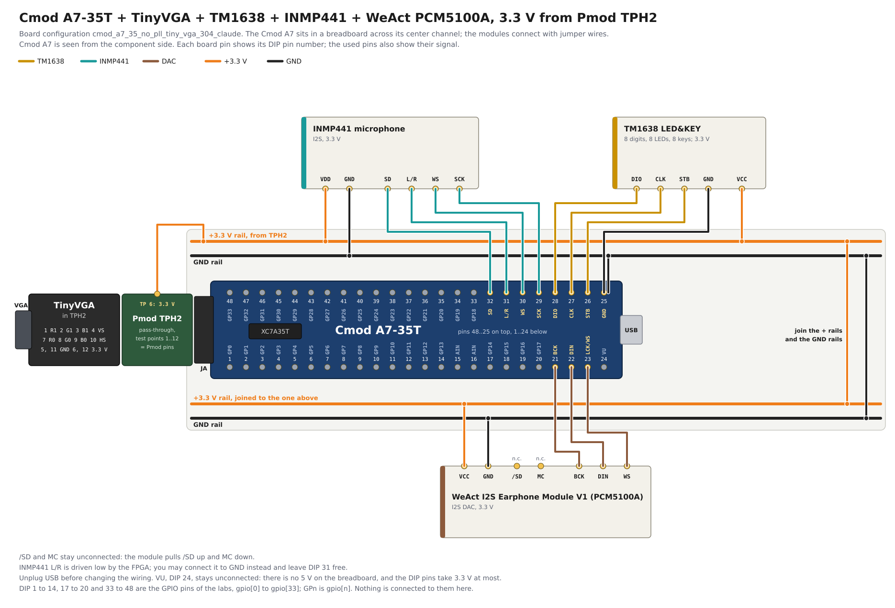
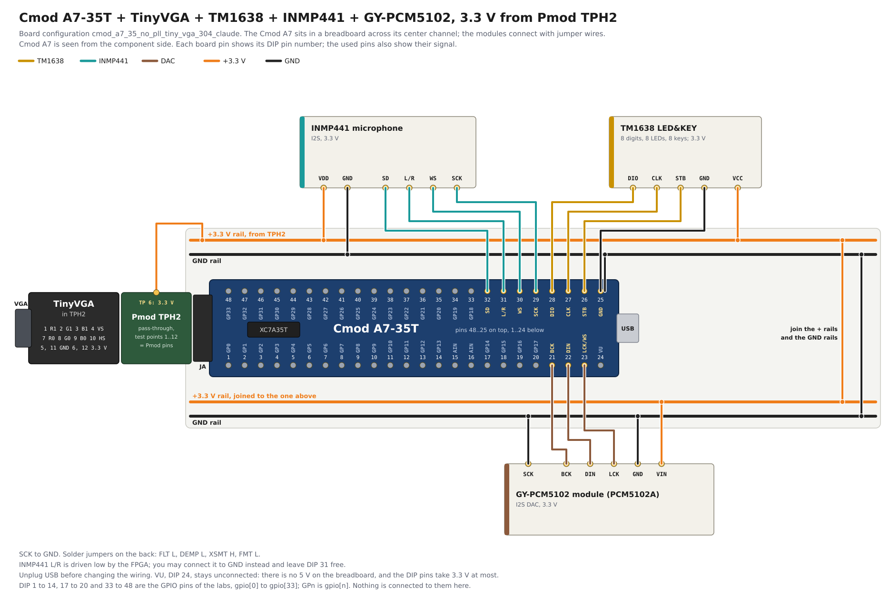
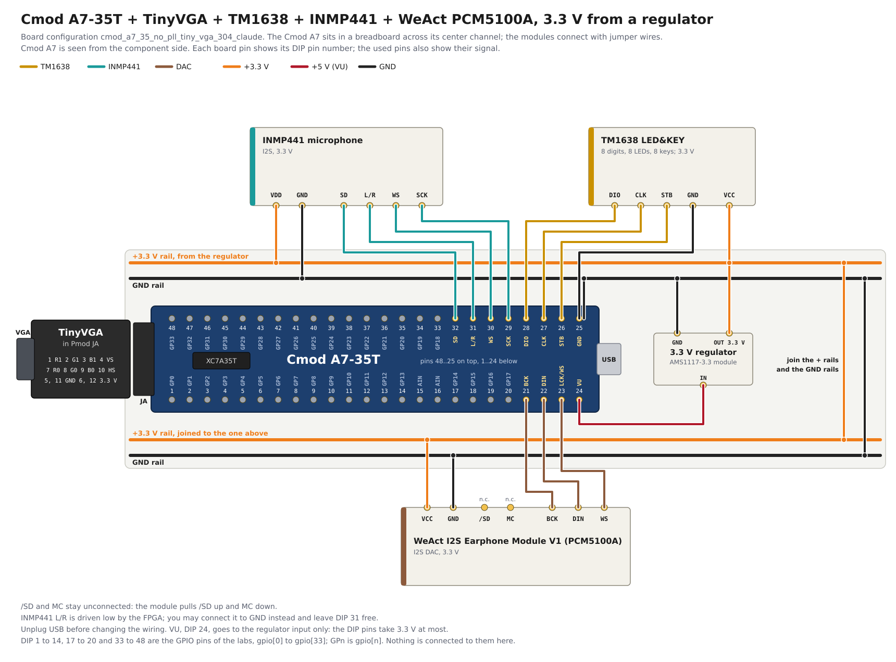
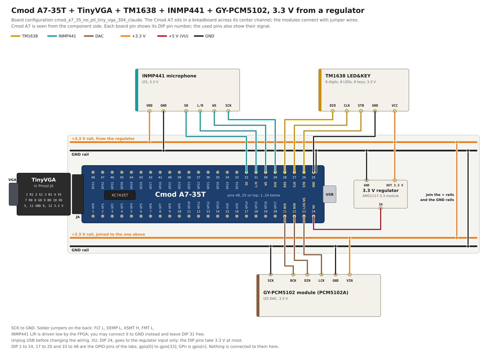

*Создано Claude Opus 5.5 (`claude-opus-5-5`) в Claude Code 2.1.325, уровень усилий xhigh, по промпту Юрия Панчула. Дословный промпт — в [приложении](#приложение-промпты).*

# Cmod A7-35T без MMCM: TinyVGA 304x480 со стандартными частотами

Конфигурация платы `cmod_a7_35_no_pll_tiny_vga_304_claude`. English version: [README.md](README.md).

Эта конфигурация использует оборудование и соединения
[cmod_a7_35_tiny_vga_640_claude](../cmod_a7_35_tiny_vga_640_claude/README_ru.md): Digilent Cmod A7-35T на макетной
плате с TinyVGA, TM1638, микрофоном INMP441 и ЦАП I2S. Отличается только
проект для ПЛИС. В нём нет генератора тактовой частоты, ни MMCM, ни PLL: весь
проект работает от кварцевого генератора Cmod A7 на 12 МГц.

Стандартной картинке 640x480 при 60 Гц нужна частота пикселей 25,175 МГц,
которую из 12 МГц без генератора тактовой частоты не получить. Здесь частота
пикселей — сами 12 МГц, а каждая часть строки сохраняет свою стандартную
длительность, поэтому частоты строк и кадров — как у 640x480: 31,50 кГц и
59,99 Гц. **Упражнения рисуют на экране 304x480**, а монитор, который
принимает сигнал за 640x480, показывает каждый пиксель шириной 2,1 пикселя из
640: одни пиксели выглядят шириной 2, другие 3.

## Содержание

* [Какую конфигурацию выбрать](#какую-конфигурацию-выбрать)
* [Синхронизация VGA](#синхронизация-vga)
* [Что ещё меняется на 12 МГц](#что-ещё-меняется-на-12-мгц)
* [Оборудование и соединения](#оборудование-и-соединения)
* [Сборка и запуск упражнений](#сборка-и-запуск-упражнений)
* [Состояние](#состояние)
* [Файлы](#файлы)
* [Приложение: промпты](#приложение-промпты)

## Какую конфигурацию выбрать

У трёх конфигураций общие оборудование, выводы и соединения:

| | [cmod_a7_35_tiny_vga_640_claude](../cmod_a7_35_tiny_vga_640_claude/README_ru.md) | [cmod_a7_35_no_pll_tiny_vga_320_claude](../cmod_a7_35_no_pll_tiny_vga_320_claude/README_ru.md) | cmod_a7_35_no_pll_tiny_vga_304_claude, эта |
|---|---|---|---|
| Тактовая частота проекта | 50 МГц от MMCM | 12 МГц, кварцевый генератор | 12 МГц, кварцевый генератор |
| Экран, на котором рисуют упражнения | 640x480 | 320x480 | 304x480 |
| Ширина пикселя на мониторе, в пикселях из 640 | 1 | 2 | 2,1: одни 2, другие 3 |
| Частота строк | 31,25 кГц | 30,0 кГц | 31,50 кГц |
| Частота кадров | 59,5 Гц | 57,1 Гц | 59,99 Гц |
| Мониторы | Принимают | Некоторые не принимают 30 кГц | Принимают как 640x480 |
| Частота выборок микрофона | 48,8 кГц | 11,7 кГц | 11,7 кГц |
| Частота выборок ЦАП | 48,8 кГц | 46,9 кГц | 46,9 кГц |

Каждая из трёх есть и без TM1638, с двумя кнопками, двумя светодиодами и без
семисегментного индикатора: [cmod_a7_35_tiny_vga_640_no_tm1638_claude](../cmod_a7_35_tiny_vga_640_no_tm1638_claude/README_ru.md), [cmod_a7_35_no_pll_tiny_vga_304_no_tm1638_claude](../cmod_a7_35_no_pll_tiny_vga_304_no_tm1638_claude/README_ru.md), [cmod_a7_35_no_pll_tiny_vga_320_no_tm1638_claude](../cmod_a7_35_no_pll_tiny_vga_320_no_tm1638_claude/README_ru.md).

Выберите эту конфигурацию для проекта без генератора тактовой частоты,
который монитор принимает за обычный 640x480. Цена — непривычная ширина 304
и пиксели слегка неодинаковой ширины, заметные на тонких вертикальных линиях
и мелком тексте. У
[cmod_a7_35_no_pll_tiny_vga_320_claude](../cmod_a7_35_no_pll_tiny_vga_320_claude/README_ru.md)
пиксели ровно в два, но частоту строк некоторые мониторы не принимают; у
[cmod_a7_35_tiny_vga_640_claude](../cmod_a7_35_tiny_vga_640_claude/README_ru.md) полные 640x480.

## Синхронизация VGA

[peripherals/vga.sv](../../peripherals/vga.sv) получает горизонтальную
синхронизацию через параметры, поэтому используется без изменений.
Модуль верхнего уровня передаёт синхронизацию из таблицы ниже; когда `CLK_MHZ` и
`PIXEL_MHZ` оба равны 12, `vga.sv` переходит к следующему пикселю на каждом
такте. Вертикальная синхронизация стандартная.

| Часть строки | Стандарт 640x480, 25,175 МГц | Эта конфигурация, 12 МГц |
|--------------|------------------------------|--------------------------|
| Видимая часть | 640 пикселей, 25,42 мкс | 304 такта, 25,33 мкс |
| Передний порог | 16 пикселей, 0,64 мкс | 8 тактов, 0,67 мкс |
| Синхроимпульс, низкий уровень | 96 пикселей, 3,81 мкс | 46 тактов, 3,83 мкс |
| Задний порог | 48 пикселей, 1,91 мкс | 23 такта, 1,92 мкс |
| Вся строка | 800 пикселей, 31,78 мкс, 31,47 кГц | 381 такт, 31,75 мкс, 31,50 кГц |
| Кадр | 525 строк, 59,94 Гц | 525 строк, 59,99 Гц |

Каждая часть строки отличается от стандартной длительности не больше чем на
0,1 мкс, а частоты строк и кадров — меньше чем на 0,1 %, в пределах допуска
VGA. Число тактов в строке, 381, даёт самое близкое значение: такт 12 МГц не
позволяет разделить строку на стандартные 800 частей.

Монитор, который принимает сигнал за 640x480, считывает видимую часть каждой
строки в своих 640 точках. При 304 пикселях каждый пиксель занимает 640 / 304
= 2,1 точки, поэтому большинство пикселей занимает 2 точки, а примерно каждый
десятый — 3. На картинке из больших областей это незаметно; на узоре из полос
шириной в пиксель — заметно. Если картинка сдвинута или размыта,
воспользуйтесь автоматической настройкой монитора.

Упражнения видят `screen_width = 304` и `screen_height = 480`. Упражнение,
которое берёт размеры рисунка из этих параметров, заполняет экран, растянутый
примерно вдвое по ширине: круг выглядит эллипсом. Упражнение, которое рисует
по постоянным координатам дальше x = 303, рисует за пределами экрана.

Моделирование `vga.sv` с этими параметрами на 12 МГц показало строку в 381
такт, синхроимпульс в 46 тактов, 304 видимых такта в строке, кадр из 525
строк, из них 480 видимых, и вертикальный синхроимпульс в 2 строки:
31,496 кГц и 59,993 Гц.

Полной строке из 640 пикселей на 12 МГц понадобилось бы по два пикселя за
такт, по одному на каждом фронте, через выходные регистры двойной скорости
(DDR) ПЛИС. Упражнения репозитория дают один пиксель за такт, поэтому здесь
этого нет.

## Что ещё меняется на 12 МГц

board_specific_top.sv определяет `CMOD_A7_NO_PLL_SCREEN_WIDTH` равным 304 и включает
модуль верхнего уровня из [cmod_a7_35_tiny_vga_640_claude](../cmod_a7_35_tiny_vga_640_claude/README_ru.md), который с этим
макросом делает такие изменения:

* **Нет MMCM.** Тактовый сигнал проекта — вход генератора, `sysclk`. Его вывод
  L17 может принимать тактовый сигнал, и Vivado ставит на него глобальный
  тактовый буфер. Ограничение на тактовую частоту, 83,33 нс, — из файла
  Digilent в board_specific.xdc.
* **Все модули получают `clk_mhz = 12`**: упражнение, TM1638, микрофон и ЦАП.
  Они выводят из него свои временные параметры.
* **Сброс.** Без MMCM нечего ждать. Цепочка сброса после конфигурации состоит
  из единиц, поэтому проект стартует в сбросе и выходит из него на третьем
  фронте такта. С TM1638 любая кнопка Cmod сбрасывает проект, как в
  cmod_a7_35_tiny_vga_640_claude.
* **Микрофон.** Приёмник выдаёт SCK 12 МГц / 16 = 0,75 МГц, в пределах
  0,5–3,2 МГц для INMP441, и частоту выборок 12 МГц / 1024 = 11,7 кГц. Это
  пропускает звук примерно до 5,8 кГц: хватает для голоса и музыкальных нот,
  а упражнения, показывающие спектр, покажут более узкий.
* **ЦАП.** Выход I2S даёт BCK 3 МГц и частоту выборок 12 МГц / 256 = 46,9 кГц
  с теми же соотношениями, что и на 50 МГц.
* **TM1638.** Его драйвер делит `clk_mhz` до своей последовательной частоты,
  поэтому работает как раньше.

## Оборудование и соединения

Детали, источник 3,3 В, сборка и таблицы соединений — те же, что у
[cmod_a7_35_tiny_vga_640_claude](../cmod_a7_35_tiny_vga_640_claude/README_ru.md); следуйте её инструкции. Выводы
коротко:

| Cmod A7 | Подключить к |
|---------|--------------|
| Pmod JA | TinyVGA |
| DIP с 1 по 14, с 17 по 20 | GPIO упражнений, с `gpio[0]` по `gpio[17]`; свободны |
| DIP 21, 22, 23 | ЦАП BCK, DIN и LCK у GY-PCM5102 или WS у WeAct |
| DIP 24, VU | Вариант A: ничего. Вариант B: только вход стабилизатора |
| DIP 25, 26, 27, 28 | Шина GND и TM1638 GND, STB, CLK, DIO |
| DIP 29, 30, 31, 32 | INMP441 SCK, WS, L/R, SD |
| DIP с 33 по 48 | GPIO упражнений, с `gpio[18]` по `gpio[33]`; свободны |

**TinyVGA.** Выход VGA — это TinyVGA, плата Pmod, которую сделал Leo Moser, в
разъёме Pmod JA; её проект лежит в
[github.com/mole99/tiny-vga](https://github.com/mole99/tiny-vga). Магазин Tiny
Tapeout продаёт её собранной под названием
[Tiny VGA Pmod](https://store.tinytapeout.com/products/TinyVGA-Pmod-p678647356),
за 15,00 € в ноябре 2026 года. Её можно и заказать собранной на JLCPCB по
файлам `GERBER-tiny-vga.zip`, `BOM-tiny-vga.csv` и `CPL-tiny-vga.csv` из
каталога `pcb/jlcpcb/production_files/` репозитория; шаги описаны в разделе
[Где взять TinyVGA](../cmod_a7_35_tiny_vga_640_claude/README_ru.md#где-взять-tinyvga)
инструкции cmod_a7_35_tiny_vga_640_claude.

Рисунки в этом каталоге — рисунки cmod_a7_35_tiny_vga_640_claude с именем этой конфигурации, для
обоих модулей ЦАП: WeAct I2S Earphone Module (PCM5100A) и GY-PCM5102
(PCM5102A). Надписи на рисунках — на английском.

### Вариант A: 3,3 В от Pmod TPH2





### Вариант B: 3,3 В от стабилизатора





### Микрофон, ЦАП и стабилизатор, вставленные в макетную плату

[breadboard_weact.png](breadboard_weact.png) с модулем WeAct и
[breadboard_gy_pcm5102.png](breadboard_gy_pcm5102.png) с GY-PCM5102
показывают микрофон, ЦАП и стабилизатор варианта B, вставленные прямо в
макетную плату. Векторные версии всех рисунков — файлы `.svg` с теми же
именами.

## Сборка и запуск упражнений

В каталоге упражнения один раз выберите плату командой
`./06_choose_another_fpga_board.bash` и укажите `cmod_a7_35_no_pll_tiny_vga_304_claude`.
Затем собирайте и загружайте, как для [cmod_a7_35_tiny_vga_640_claude](../cmod_a7_35_tiny_vga_640_claude/README_ru.md):

```bash
./03_synthesize_for_fpga.bash
./04_configure_fpga.bash
```

Скрипты используют Vivado для всех плат, имя которых начинается с `cmod_a7`,
поэтому для этой конфигурации скрипты менять не нужно. Как и для cmod_a7_35_tiny_vga_640_claude,
скрипты загружают ПЛИС, а не флеш-память: после отключения USB проекта нет.

## Состояние

Собрано в Vivado 2026.1 без ошибок и без критических предупреждений, все
временные ограничения выполнены на 12 МГц, при периоде такта 83,3 нс:

| Упражнение | Конфигурация | LUT | Регистры | Худший запас по setup |
|------------|--------------|----:|---------:|----------------------:|
| `labs/2_graphics/2_3_color_stripes` | VGA, TM1638, микрофон, ЦАП | 124 | 99 | 77,7 нс |
| `labs/3_music/3_0_oscilloscope` | VGA, TM1638, микрофон, ЦАП | 241 | 190 | 74,9 нс |
| `labs/3_music/3_10_spectrum_analyzer` | VGA, TM1638, микрофон, ЦАП | 2415 | 1528 | 68,9 нс |
| `labs/3_music/3_10_spectrum_analyzer` | VGA, микрофон, ЦАП, без TM1638 | 2358 | 1471 | 74,8 нс |

Сборки читают исходники так же, как скрипты, с
`peripherals/lab_specific_board_config.svh`, который включает TM1638, VGA,
микрофон и ЦАП; для последней строки взят файл конфигурации без TM1638. Как
объясняет инструкция cmod_a7_35_tiny_vga_640_claude, скрипт Vivado в репозитории не читает
`lab_specific_board_config.svh` упражнения. Vivado выдаёт предупреждение
правил проектирования CFGBVS-1, как и для cmod_a7_35_tiny_vga_640_claude; оно не мешает
созданию битового потока. В каждой сборке Vivado использовал один
глобальный тактовый буфер для частоты 12 МГц и ни одного MMCM или PLL.

Сборки выше сделаны до 18 ноября, когда у шести конфигураций появились общий
модуль верхнего уровня, восемь выводов GPIO и RGB-светодиод, а 21 ноября
выводов GPIO стало 34. После этих изменений
[scripts/tests/test_cmod_a7_35_claude.py](../../scripts/tests/test_cmod_a7_35_claude.py) собрал для этой конфигурации
`labs/3_music/3_11_microphone_monitor` в Vivado 2026.1: 2017 LUT,
1361 регистр, худший запас по setup 67,0 нс, все временные
ограничения выполнены.

**На реальной плате и мониторе ещё не проверено.**

## Файлы

| Файл | Что это |
|------|---------|
| [board_specific.xdc](board_specific.xdc) | Тот же, что в cmod_a7_35_tiny_vga_640_claude: Cmod-A7-Master.xdc от Digilent, раскомментированы только используемые строки |
| [board_specific_top.sv](board_specific_top.sv) | Определяет `CMOD_A7_NO_PLL_SCREEN_WIDTH` равным 304 и включает модуль верхнего уровня из cmod_a7_35_tiny_vga_640_claude, который тогда работает целиком на 12 МГц с этой синхронизацией VGA |
| [board_specific.tcl](board_specific.tcl) | Микросхема ПЛИС для Vivado |
| `wiring_*.svg`, `wiring_*.png` | Схемы соединений для обоих модулей ЦАП и обоих источников 3,3 В |
| `breadboard_*.svg`, `breadboard_*.png` | Раскладки на макетной плате для обоих модулей ЦАП |
| README.md, README.html | Эта инструкция на английском |
| README_ru.md, README_ru.html | Она же на русском |

Рисунки делают генераторы cmod_a7_35_tiny_vga_640_claude, запущенные с именем этой конфигурации:

```bash
cd ../cmod_a7_35_tiny_vga_640_claude
python3 generate_wiring_diagram.py cmod_a7_35_no_pll_tiny_vga_304_claude
python3 generate_breadboard_diagram.py cmod_a7_35_no_pll_tiny_vga_304_claude
cd ../cmod_a7_35_no_pll_tiny_vga_304_claude

for f in wiring_*.svg breadboard_*.svg
do
    # ${f%.svg} is the file name without the .svg suffix
    inkscape "$f" --export-type=png --export-dpi=96 \
        --export-background=white --export-filename="${f%.svg}.png"
done
```

## Приложение: промпты

Оборудование и соединения появились из промптов в приложении к
[cmod_a7_35_tiny_vga_640_claude](../cmod_a7_35_tiny_vga_640_claude/README_ru.md#приложение-промпты). Эта конфигурация
появилась из следующих промптов, которые Юрий Панчул отправил в том же сеансе
Claude Code 16 и 17 ноября 2026 года, дословно, с переводом на русский. Здесь
все промпты сеанса, начиная с первого об этой конфигурации, включая просьбы
сделать коммит и push; последующие промпты, которые касаются этой
конфигурации, тоже добавляются сюда. Промпты называют конфигурации так, как
они назывались в то время: суффикс `_claude` появился в 00:43, `tiny_` — в
09:47, а `tiny_vga_640` — в 10:20 17 ноября. Время — тихоокеанское (UTC−8).

**22:10**, вопрос; в ответе были предложены две синхронизации: A для
cmod_a7_35_no_pll_tiny_vga_320_claude и B для этой конфигурации:

```text
Is it possible to run VGA on 12 MHz without PLL?
```

```text
Можно ли запустить VGA на 12 МГц без PLL?
```

**22:23**:

```text
create two other configurations called cmod_a7_35_no_pll_vga_320 and cmod_a7_35_no_pll_304 and implement A and B. Document everything inside directories.
```

```text
создай две другие конфигурации с именами cmod_a7_35_no_pll_vga_320 и cmod_a7_35_no_pll_304 и реализуй A и B. Документируй всё внутри каталогов.
```

**22:25**, отправлен, пока готовился ответ на предыдущий:

```text
also make pictures with weact in addition to gy
```

```text
ещё сделай рисунки с WeAct в дополнение к GY
```

**23:04**:

```text
rename cmod_a7_35_no_pll_304 to cmod_a7_35_no_pll_vga_304
```

```text
переименуй cmod_a7_35_no_pll_304 в cmod_a7_35_no_pll_vga_304
```

**23:17**:

```text
keep README.csv with CR-LF for now; I will fix it later; first commint and push, then create 3 new configurations that do not use tm1638, just have 2 buttons, 2 leds and no 7-segement display: cmod_a7_35_no_tm1638
cmod_a7_35_no_pll_vga_304_no_tm1638
cmod_a7_35_no_pll_vga_320_no_tm1638
```

```text
пока оставь README.csv с CR-LF, я исправлю это позже; сначала сделай коммит и push, затем создай 3 новые конфигурации, которые не используют TM1638, а имеют только 2 кнопки, 2 светодиода и никакого семисегментного индикатора: cmod_a7_35_no_tm1638
cmod_a7_35_no_pll_vga_304_no_tm1638
cmod_a7_35_no_pll_vga_320_no_tm1638
```

**23:53**:

```text
commit and push
```

```text
сделай коммит и push
```

**00:29, 17 ноября**, о суффиксах `_vga_320`, `_vga_304` и `_no_pll`, которые
Юрий Панчул добавил в меню плат в `scripts/steps/00_setup.source_bash`, чтобы
меню показывало конфигурации без MMCM под `cmod_a7_35`:

```text
check the changes I did manually. Tell why they are needed
```

```text
проверь изменения, которые я сделал вручную. Объясни, зачем они нужны
```

**00:37, 17 ноября**; в каталоге `boards/README.csv` снова осталась одна
строка для физической платы, `cmod_a7_35`:

```text
yes, fix the catalog, then commit and push
```

```text
да, исправь каталог, затем сделай коммит и push
```

**00:43, 17 ноября**:

```text
Add to all your cmod_a7 configurations suffix _claude. Update all the relevant files.
```

```text
Добавь ко всем своим конфигурациям cmod_a7 суффикс _claude. Обнови все связанные файлы.
```

**00:56, 17 ноября**:

```text
commit and push
```

```text
сделай коммит и push
```

**09:47, 17 ноября**; он добавил `tiny_` перед `vga` в имена конфигураций без
MMCM и абзац о TinyVGA в раздел
[Оборудование и соединения](#оборудование-и-соединения):

```text
convert all mentions to vga in configuration names and the related texts to tiny_vga. Specifically mention TinyVGA in documentation, repository https://github.com/mole99/tiny-vga and where to buy it retail or order from JLCPCB. Make sure to add this and other previous and follow-up related prompt as appendices to the instructions you generate.
```

```text
замени все упоминания vga в именах конфигураций и в связанных с ними текстах на tiny_vga. Отдельно упомяни в документации TinyVGA, репозиторий https://github.com/mole99/tiny-vga и где купить его в розницу или заказать на JLCPCB. Обязательно добавь этот и другие предыдущие и последующие связанные промпты в приложения к инструкциям, которые ты создаёшь.
```

**10:20, 17 ноября**:

```text
commit and push; then rename cmod_a7_35_claude to cmod_a7_35_claude_tiny_vga_640 and cmod_a7_35_no_tm1638_claude into cmod_a7_35_tiny_vga_640_no_tm1638_claude
```

```text
сделай коммит и push; затем переименуй cmod_a7_35_claude в cmod_a7_35_claude_tiny_vga_640, а cmod_a7_35_no_tm1638_claude — в cmod_a7_35_tiny_vga_640_no_tm1638_claude
```

**19:00, 17 ноября**:

```text
commit and push
```

```text
сделай коммит и push
```

**19:47, 17 ноября**:

```text
commit and push
```

```text
сделай коммит и push
```

**20:29, 17 ноября**; по нему сделан отчёт, который сравнивает эти
конфигурации с конфигурациями Codex,
[claude_cmod_a7_compare_1.html](../../misc/ai_sessions/20261118_cmod_a7_support/claude/claude_cmod_a7_compare_1.html):

```text
review your compatitor's cmod_a7 board implementations, search bor bugs and good ideas to adopt, make a competitive report in a new html file.
```

```text
сделай обзор реализаций плат cmod_a7 у твоего конкурента, поищи ошибки и хорошие идеи, которые стоит перенять, и сделай отчёт о сравнении в новом файле HTML.
```

**20:35, 18 ноября**, — ответ на вопрос, писать ли в столбце TM1638
строки каталога `cmod_a7_35` «всегда» или «на выбор»; теперь там «на выбор»:

```text
yes, should say either
```

```text
да, должно быть «на выбор»
```

**20:43, 18 ноября**:

```text
commit and push
```

```text
сделай коммит и push
```

**20:45, 18 ноября**; по нему сделана русская версия этого отчёта,
[claude_cmod_a7_compare_1_ru.html](../../misc/ai_sessions/20261118_cmod_a7_support/claude/claude_cmod_a7_compare_1_ru.html):

```text
generate a Russian version of the competitive report
```

```text
сделай русскую версию отчёта о сравнении
```

**21:05, 18 ноября**; по нему оба отчёта, ссылки на которые даны выше,
добавлены в `misc/ai_sessions/20261118_cmod_a7_support/claude`:

```text
Add your reports to basics-graphics-music/misc/ai_sessions/20261118_cmod_a7_support/claude
```

```text
добавь свои отчёты в basics-graphics-music/misc/ai_sessions/20261118_cmod_a7_support/claude
```

**21:58, 18 ноября**:

```text
commit and push
```

```text
сделай коммит и push
```

**22:11, 18 ноября**; по нему составлен список изменений после чтения обзора
этих конфигураций, сделанного Codex:

```text
read your competitor report. List what you would change in your solution.
```

```text
прочитай отчёт своего конкурента. Перечисли, что бы ты изменил в своём решении.
```

**22:20, 18 ноября**, — ответ на пункт 1 этого списка (исправить конфигурации
без TM1638); по нему исправлены восемь лабораторных работ, а после
промпта в 22:37 — десять, а не файлы платы:

```text
1. No, keep 1-digit 7-segment. This should be fixed in the examples later. Same thing for sw. Don't pad, this should be fixed in example using generate and padding. Yes, do the lab fix.
```

```text
1. Нет, оставь семисегментный индикатор на одну цифру. Это нужно будет исправить в примерах позже. То же самое для sw. Не дополняй, это нужно исправить в примере с помощью generate и дополнения. Да, исправь лабораторные.
```

**22:26, 18 ноября**, — набран в ответ на пункты 2–7 этого списка, но не
отправлен, потому что компьютер упал. Текст прочитан с фотографии экрана,
присланной в 22:39:

```text
2. merge - yes. 3 - how large are the tests? 4. don't sync the buttons. We did not have these issues yet with our labs, when we have, we will add the synchronizers. these buttons may already have the internal synchronizers (check it and report). 5. yes, correct. 6. yes, reject. 7. OK.
```

```text
2. Объединить — да. 3 — насколько большие тесты? 4. Не синхронизируй кнопки. У нас пока не было таких проблем с нашими лабораторными; когда будут, добавим синхронизаторы. Возможно, у этих кнопок уже есть внутренние синхронизаторы (проверь и доложи). 5. Да, исправь. 6. Да, отклонить. 7. OK.
```

**22:35, 18 ноября**, после сбоя; по нему перечислена незаконченная работа:

```text
recover from computer crash while you were working in this directory. List what you were doing
```

```text
восстановись после сбоя компьютера, пока ты работал в этом каталоге. Перечисли, что ты делал
```

**22:37, 18 ноября**; по нему исправленные лабораторные собраны в Vivado и
исправлены ещё две лабораторные со счётчиком Гейгера, всего десять:

```text
yes, rerun Vivado and fix the Geiger labs
```

```text
да, перезапусти Vivado и исправь лабораторные со счётчиком Гейгера
```

**22:39, 18 ноября**, с фотографией экрана; по нему перечислено, как понят
ответ выше, и работа ждала подтверждения:

```text
recognize my response from this picture [Image #1] . List everything and confirm before working on it
```

```text
распознай мой ответ на этой картинке [Image #1] . Перечисли всё и подтверди, прежде чем браться за работу
```

**22:47, 18 ноября**; по нему добавлены тесты, три полных модуля верхнего
уровня объединены в один, режим с разделённым DIO отклонён, добавлены
выводы GPIO, RGB-светодиод и файлы TinyVGA одной ревизии, исправлены
инструкции к ЦАП, а общий скрипт Vivado отмечен как TODO. Идея оставить
DIP 26–28 неуправляемыми объяснена, и предложено от неё отказаться:

```text
Add the tests. Why do you want to make DIP 26–28 undriven? Explain. Don't do 8 now, but note it in the report with TODO.
```

```text
Добавь тесты. Зачем ты хочешь оставить DIP 26–28 неуправляемыми? Объясни. Пункт 8 сейчас не делай, но отметь его в отчёте как TODO.
```

**19:19, 19 ноября**; сборки Vivado для раздела «Состояние»
cmod_a7_35_tiny_vga_640_claude не начались, потому что скрипт, который ждал
окончания предыдущего запуска Vivado, всё время находил собственную
командную строку. Сборки запущены, добавлен тест упражнения с выключенными
TM1638, VGA, микрофоном и ЦАП, тест Vivado теперь считает Slice LUT, как
отчёт Vivado об использовании ресурсов, а не ячейки LUT, раздел «Состояние»
обновлён:

```text
are you done?
```

```text
Готово?
```

**21:09, 19 ноября**; исправленное упражнение со счётчиком Гейгера
скопировано в `labs/6_misc/6_1_geiger_muller_radiation_counter_claude`,
`6_1_geiger_muller_radiation_counter` и
`6_1_geiger_muller_radiation_counter_on_tang_nano_9k` возвращены к прежнему
виду, тесты теперь проверяют копию:

```text
Save your version of geiger_muller into 6_1_geiger_muller_radiation_counter_claude. Revert other geiger_muller variants. The first one was for DE10-Lite, the second is a work in progress. I will take care of them.
```

```text
Сохрани свою версию geiger_muller в 6_1_geiger_muller_radiation_counter_claude. Верни остальные варианты geiger_muller к прежнему виду. Первый был для DE10-Lite, второй ещё в работе. Ими займусь я.
```

**21:15, 19 ноября**, после исправления имён параметров в
`4_2_5_optimized_ff_fifo_view_2_data_layout`, внесённого Юрием Панчулом;
тесты снова прошли, а
исправленные упражнения и копия упражнения со счётчиком Гейгера прошли
элаборацию для семи размеров платы:

```text
is it fine now?
```

```text
Теперь всё в порядке?
```

**23:38, 19 ноября**; сделанное выше закоммичено и отправлено:

```text
commit and push
```

```text
сделай коммит и push
```

**23:52, 19 ноября**; оказалось, что обзор конфигураций Codex уже лежит в
`misc/ai_sessions/20261118_cmod_a7_support/claude` как
`claude_cmod_a7_compare_1`, и был задан вопрос, какие файлы имелись в виду;
вопрос пока открыт:

```text
move cmod a7 review files to ai_sessions
```

```text
перенеси файлы обзора cmod a7 в ai_sessions
```

**23:58, 19 ноября**; объяснена идея оставить DIP 26–28 неуправляемыми в
конфигурациях без TM1638 и рекомендовано по-прежнему держать STB и CLK в
высоком уровне:

```text
what is the issue with DIP 26-28?
```

```text
в чём проблема с DIP 26-28?
```

**23:58, 19 ноября**, минутой позже; конфигурация
cmod_a7_35_claude_tiny_vga_640 переименована в cmod_a7_35_tiny_vga_640_claude,
и старое имя заменено везде, кроме цитат промптов:

```text
Also rename cmod_a7_35_claude_tiny_vga_640 into cmod_a7_35_tiny_vga_640_claude
```

```text
Ещё переименуй cmod_a7_35_claude_tiny_vga_640 в cmod_a7_35_tiny_vga_640_claude
```

**00:09, 20 ноября**; переименование закоммичено и отправлено:

```text
commit and push
```

```text
сделай коммит и push
```

**16:36, 21 ноября**; объяснено, что восемь выводов GPIO взяты из
конфигураций Codex, а не из ограничений платы:

```text
put this on hold. switch back to cmod a7 branch . what is the reason you use only 8 gpio pins for the user in cmod a7?
```

```text
отложи это. переключись обратно на ветку cmod a7. по какой причине ты даёшь пользователю в cmod a7 только 8 выводов gpio?
```

**16:41, 21 ноября**; все 34 цифровых вывода DIP, не занятые TM1638,
микрофоном и ЦАП, стали выводами GPIO упражнений, с `gpio[0]` по
`gpio[33]`:

```text
don't pay attention to Geiger or other labs for gpio matter for this board. Make all gpios available to the user except for the pins used by tm1638, microphone and dac.
```

```text
не обращай внимания на Geiger и другие упражнения в вопросе gpio для этой платы. Сделай все gpio доступными пользователю, кроме выводов, занятых tm1638, микрофоном и ЦАП.
```

**18:41, 21 ноября**; 34 вывода GPIO закоммичены и отправлены:

```text
commit and push
```

```text
сделай коммит и push
```
