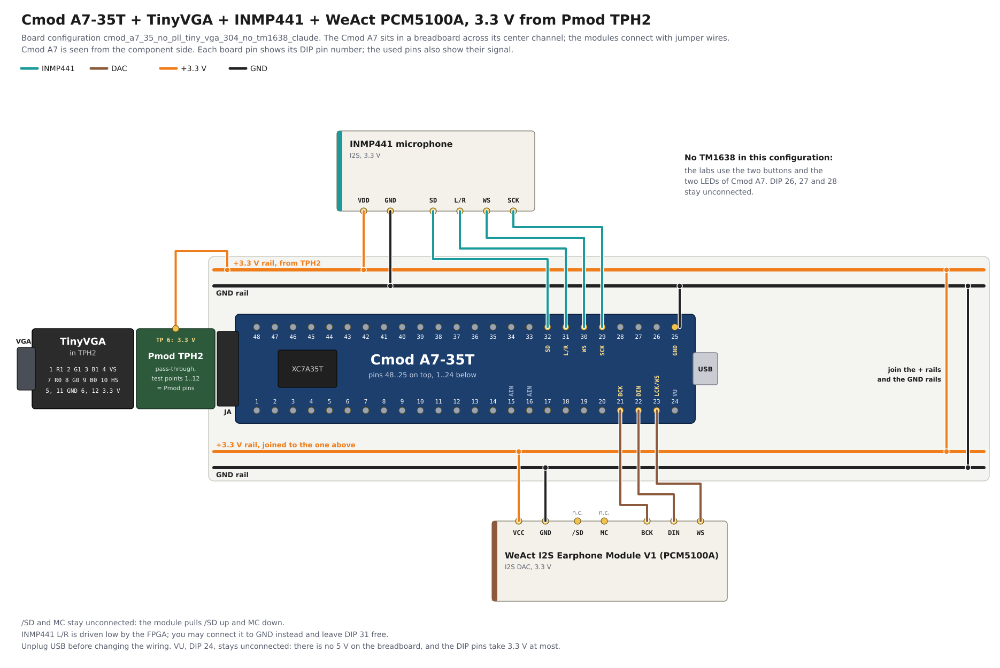
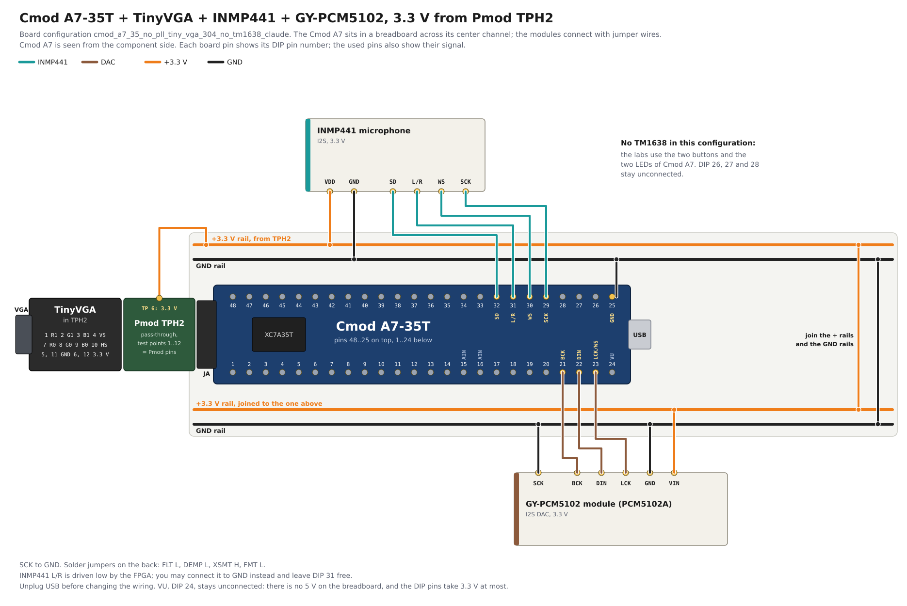
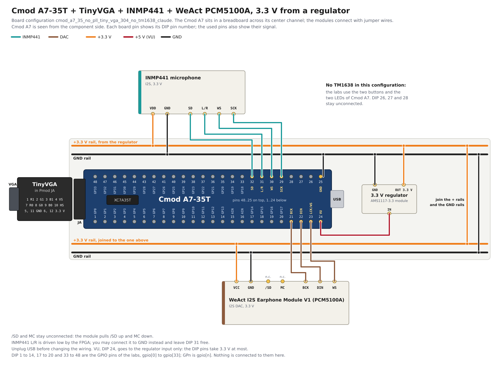
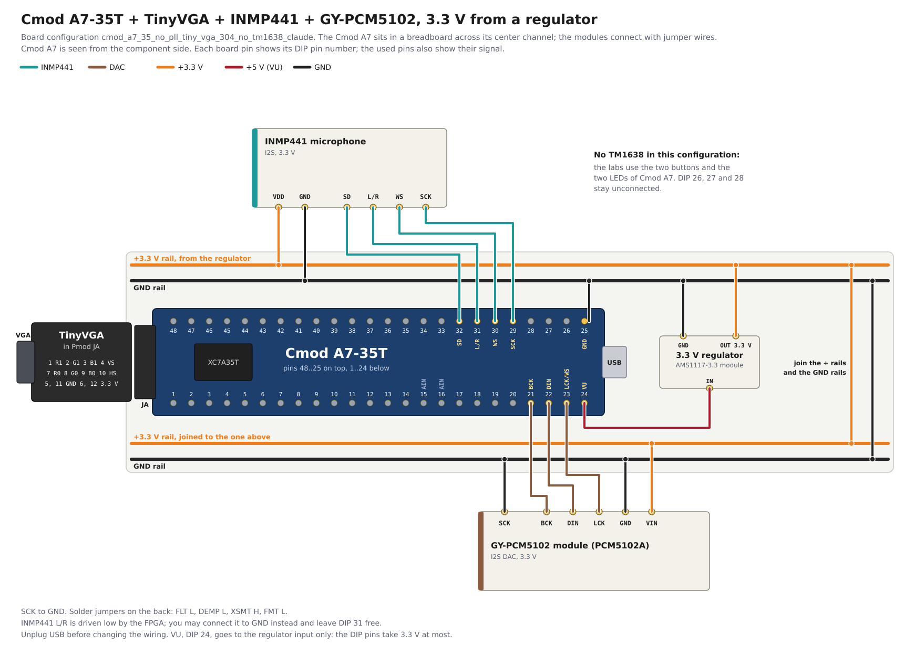

*Создано Claude Opus 5.5 (`claude-opus-5-5`) в Claude Code 2.1.325, уровень усилий xhigh, по промпту Юрия Панчула. Дословный промпт — в [приложении](#приложение-промпты).*

# Cmod A7-35T без TM1638 и без MMCM: TinyVGA 304x480

Конфигурация платы `cmod_a7_35_no_pll_tiny_vga_304_no_tm1638_claude`. English version: [README.md](README.md).

Это [cmod_a7_35_no_pll_tiny_vga_304_claude](../cmod_a7_35_no_pll_tiny_vga_304_claude/README_ru.md) без модуля TM1638. **Упражнения
получают две кнопки Cmod A7 в качестве своих кнопок и два её светодиода в
качестве своих светодиодов, а семисегментного индикатора нет.** Всё остальное
— как у cmod_a7_35_no_pll_tiny_vga_304_claude: тактовая частота 12 МГц без MMCM, VGA 304x480 со стандартными частотами строк и кадров, микрофон, ЦАП, выводы и соединения. Другие конфигурации без TM1638 —
[cmod_a7_35_tiny_vga_640_no_tm1638_claude](../cmod_a7_35_tiny_vga_640_no_tm1638_claude/README_ru.md), [cmod_a7_35_no_pll_tiny_vga_320_no_tm1638_claude](../cmod_a7_35_no_pll_tiny_vga_320_no_tm1638_claude/README_ru.md).

## Содержание

* [Чем отличается](#чем-отличается)
* [Как это сделано](#как-это-сделано)
* [Оборудование и соединения](#оборудование-и-соединения)
* [Сборка и запуск упражнений](#сборка-и-запуск-упражнений)
* [Состояние](#состояние)
* [Файлы](#файлы)
* [Приложение: промпты](#приложение-промпты)

## Чем отличается

| | [cmod_a7_35_no_pll_tiny_vga_304_claude](../cmod_a7_35_no_pll_tiny_vga_304_claude/README_ru.md) | cmod_a7_35_no_pll_tiny_vga_304_no_tm1638_claude, эта |
|---|---|---|
| Кнопки упражнений | 8 кнопок TM1638 | BTN0 и BTN1 на Cmod A7: `key[0]` и `key[1]`, они же `sw[0]` и `sw[1]` |
| Светодиоды упражнений | 8 светодиодов TM1638, первые два также на LED1 и LED2 Cmod A7 | LED1 и LED2 на Cmod A7: `led[0]` и `led[1]` |
| Семисегментный индикатор | 8 разрядов TM1638 | Нет |
| Кнопка сброса | Любая кнопка Cmod | Нет: обе кнопки — это кнопки упражнений |
| DIP 26, 27, 28 | TM1638 STB, CLK, DIO | Не подключены |

Нажатая кнопка даёт 1; светодиод горит при 1. Упражнения получают один
разряд семисегментного индикатора, который никуда не идёт, поэтому
упражнение, управляющее индикатором, собирается и работает, а вывод на
индикатор теряется. Так же теряется всё, что упражнение показывает на
светодиодах после первых двух.

После загрузки проект находится в сбросе первые три такта. Ни одна кнопка его не сбрасывает: чтобы начать упражнение
заново, загрузите ПЛИС ещё раз командой `./04_configure_fpga.bash`.

Проект держит выводы DIP 26 и 27, STB и CLK модуля TM1638 в cmod_a7_35_no_pll_tiny_vga_304_claude, в
высоком уровне и не управляет выводом DIP 28. Оставьте эти три вывода
неподключёнными.

## Как это сделано

В [board_specific_top.sv](board_specific_top.sv) две строки кода. Он
определяет `FORCE_NO_INSTANTIATE_TM1638_BOARD_CONTROLLER_MODULE` и включает
`board_specific_top.sv` из cmod_a7_35_no_pll_tiny_vga_304_claude, который тогда не создаёт TM1638, хотя
`peripherals/lab_specific_board_config.svh` его включает. Другие платы
репозитория без TM1638, например `tang_nano_9k_hdmi_no_tm1638`, сделаны так
же, но некоторые из них рисуют виртуальный TM1638 на экране; эта не рисует.

[board_specific.xdc](board_specific.xdc) — тот же, что у cmod_a7_35_no_pll_tiny_vga_304_claude. Строки
выводов DIP 26, 27 и 28 в нём остаются раскомментированными, потому что у
включённого модуля верхнего уровня эти порты есть.

## Оборудование и соединения

Детали, источник 3,3 В, сборка и таблицы соединений — как у
[cmod_a7_35_no_pll_tiny_vga_304_claude](../cmod_a7_35_no_pll_tiny_vga_304_claude/README_ru.md), но без TM1638: не ставьте модуль и его
пять проводов. Вывод DIP 25 по-прежнему идёт на шину GND. Выводы коротко:

| Cmod A7 | Подключить к |
|---------|--------------|
| Pmod JA | TinyVGA |
| DIP 21, 22, 23 | ЦАП BCK, DIN и LCK у GY-PCM5102 или WS у WeAct |
| DIP 24, VU | Вариант A: ничего. Вариант B: только вход стабилизатора |
| DIP 25 | Шина GND |
| DIP 26, 27, 28 | Ничего |
| DIP 29, 30, 31, 32 | INMP441 SCK, WS, L/R, SD |

**TinyVGA.** Выход VGA — это TinyVGA, плата Pmod, которую сделал Leo Moser, в
разъёме Pmod JA; её проект лежит в
[github.com/mole99/tiny-vga](https://github.com/mole99/tiny-vga). Магазин Tiny
Tapeout продаёт её собранной под названием
[Tiny VGA Pmod](https://store.tinytapeout.com/products/TinyVGA-Pmod-p678647356),
за 15,00 € в ноябре 2026 года. Её можно и заказать собранной на JLCPCB по
файлам `GERBER-tiny-vga.zip`, `BOM-tiny-vga.csv` и `CPL-tiny-vga.csv` из
каталога `pcb/jlcpcb/production_files/` репозитория; шаги описаны в разделе
[Где взять TinyVGA](../cmod_a7_35_claude_tiny_vga_640/README_ru.md#где-взять-tinyvga)
инструкции cmod_a7_35_claude_tiny_vga_640.

На рисунках этого каталога нет TM1638; они есть для обоих модулей ЦАП: WeAct
I2S Earphone Module (PCM5100A) и GY-PCM5102 (PCM5102A). Надписи на рисунках —
на английском.

### Вариант A: 3,3 В от Pmod TPH2





### Вариант B: 3,3 В от стабилизатора





### Микрофон, ЦАП и стабилизатор, вставленные в макетную плату

[breadboard_weact.png](breadboard_weact.png) с модулем WeAct и
[breadboard_gy_pcm5102.png](breadboard_gy_pcm5102.png) с GY-PCM5102
показывают микрофон, ЦАП и стабилизатор варианта B, вставленные прямо в
макетную плату. Векторные версии всех рисунков — файлы `.svg` с теми же
именами.

## Сборка и запуск упражнений

В каталоге упражнения один раз выберите плату командой
`./06_choose_another_fpga_board.bash` и укажите `cmod_a7_35_no_pll_tiny_vga_304_no_tm1638_claude`. Затем собирайте и
загружайте, как для [cmod_a7_35_no_pll_tiny_vga_304_claude](../cmod_a7_35_no_pll_tiny_vga_304_claude/README_ru.md):

```bash
./03_synthesize_for_fpga.bash
./04_configure_fpga.bash
```

Скрипты используют Vivado для всех плат, имя которых начинается с `cmod_a7`,
поэтому для этой конфигурации скрипты менять не нужно.

## Состояние

Собрано в Vivado 2026.1 с файлом конфигурации скриптов,
`peripherals/lab_specific_board_config.svh`, который включает TM1638: сборки
показывают, что эта конфигурация всё равно его не создаёт.

| Упражнение | LUT | Регистры | Худший запас по setup |
|------------|----:|---------:|----------------------:|
| `labs/1_basics/1_05_7seven_segment_letter` | 44 | 44 | 79,1 нс |
| `labs/2_graphics/2_3_color_stripes` | 61 | 45 | 78,7 нс |
| `labs/3_music/3_10_spectrum_analyzer` | 2358 | 1471 | 74,8 нс |

Во всех сборках нет ошибок и критических предупреждений, и все временные
ограничения выполнены на 12 МГц, при периоде такта 83,3 нс, без MMCM и PLL.
Ни в одном нетлисте нет модуля TM1638. Vivado выдаёт предупреждение правил
проектирования CFGBVS-1, как и для cmod_a7_35_claude_tiny_vga_640; оно не мешает созданию
битового потока.

**На реальной плате ещё не проверено.**

## Файлы

| Файл | Что это |
|------|---------|
| [board_specific_top.sv](board_specific_top.sv) | Определяет `FORCE_NO_INSTANTIATE_TM1638_BOARD_CONTROLLER_MODULE` и включает модуль верхнего уровня из cmod_a7_35_no_pll_tiny_vga_304_claude |
| [board_specific.xdc](board_specific.xdc) | Тот же, что в cmod_a7_35_no_pll_tiny_vga_304_claude |
| [board_specific.tcl](board_specific.tcl) | Микросхема ПЛИС для Vivado |
| `wiring_*.svg`, `wiring_*.png` | Схемы соединений без TM1638 для обоих модулей ЦАП и обоих источников 3,3 В |
| `breadboard_*.svg`, `breadboard_*.png` | Раскладки на макетной плате без TM1638 для обоих модулей ЦАП |
| README.md, README.html | Эта инструкция на английском |
| README_ru.md, README_ru.html | Она же на русском |

Рисунки делают генераторы cmod_a7_35_claude_tiny_vga_640, запущенные с именем этой конфигурации;
для каждого имени, в котором есть `_no_tm1638`, они не рисуют TM1638:

```bash
cd ../cmod_a7_35_claude_tiny_vga_640
python3 generate_wiring_diagram.py cmod_a7_35_no_pll_tiny_vga_304_no_tm1638_claude
python3 generate_breadboard_diagram.py cmod_a7_35_no_pll_tiny_vga_304_no_tm1638_claude
cd ../cmod_a7_35_no_pll_tiny_vga_304_no_tm1638_claude

for f in wiring_*.svg breadboard_*.svg
do
    # ${f%.svg} is the file name without the .svg suffix
    inkscape "$f" --export-type=png --export-dpi=96 \
        --export-background=white --export-filename="${f%.svg}.png"
done
```

## Приложение: промпты

Остальной проект появился из промптов в приложении к
[cmod_a7_35_no_pll_tiny_vga_304_claude](../cmod_a7_35_no_pll_tiny_vga_304_claude/README_ru.md#приложение-промпты). Эта конфигурация
появилась из следующих промптов, которые Юрий Панчул отправил в том же сеансе
Claude Code 16 и 17 ноября 2026 года, дословно, с переводом на русский. Здесь
все промпты сеанса, начиная с первого об этой конфигурации, включая просьбы
сделать коммит и push; последующие промпты, которые касаются этой
конфигурации, тоже добавляются сюда. Промпты называют конфигурации так, как
они назывались в то время: суффикс `_claude` появился в 00:43, `tiny_` — в
09:47, а `tiny_vga_640` — в 10:20 17 ноября. Время — тихоокеанское (UTC−8).

**23:17**:

```text
keep README.csv with CR-LF for now; I will fix it later; first commint and push, then create 3 new configurations that do not use tm1638, just have 2 buttons, 2 leds and no 7-segement display: cmod_a7_35_no_tm1638
cmod_a7_35_no_pll_vga_304_no_tm1638
cmod_a7_35_no_pll_vga_320_no_tm1638
```

```text
пока оставь README.csv с CR-LF, я исправлю это позже; сначала сделай коммит и push, затем создай 3 новые конфигурации, которые не используют TM1638, а имеют только 2 кнопки, 2 светодиода и никакого семисегментного индикатора: cmod_a7_35_no_tm1638
cmod_a7_35_no_pll_vga_304_no_tm1638
cmod_a7_35_no_pll_vga_320_no_tm1638
```

**23:53**:

```text
commit and push
```

```text
сделай коммит и push
```

**00:29, 17 ноября**, о суффиксах `_vga_320`, `_vga_304` и `_no_pll`, которые
Юрий Панчул добавил в меню плат в `scripts/steps/00_setup.source_bash`, чтобы
меню показывало конфигурации без MMCM под `cmod_a7_35`:

```text
check the changes I did manually. Tell why they are needed
```

```text
проверь изменения, которые я сделал вручную. Объясни, зачем они нужны
```

**00:37, 17 ноября**; в каталоге `boards/README.csv` снова осталась одна
строка для физической платы, `cmod_a7_35`:

```text
yes, fix the catalog, then commit and push
```

```text
да, исправь каталог, затем сделай коммит и push
```

**00:43, 17 ноября**:

```text
Add to all your cmod_a7 configurations suffix _claude. Update all the relevant files.
```

```text
Добавь ко всем своим конфигурациям cmod_a7 суффикс _claude. Обнови все связанные файлы.
```

**00:56, 17 ноября**:

```text
commit and push
```

```text
сделай коммит и push
```

**09:47, 17 ноября**; он добавил `tiny_` перед `vga` в имена конфигураций без
MMCM и абзац о TinyVGA в раздел
[Оборудование и соединения](#оборудование-и-соединения):

```text
convert all mentions to vga in configuration names and the related texts to tiny_vga. Specifically mention TinyVGA in documentation, repository https://github.com/mole99/tiny-vga and where to buy it retail or order from JLCPCB. Make sure to add this and other previous and follow-up related prompt as appendices to the instructions you generate.
```

```text
замени все упоминания vga в именах конфигураций и в связанных с ними текстах на tiny_vga. Отдельно упомяни в документации TinyVGA, репозиторий https://github.com/mole99/tiny-vga и где купить его в розницу или заказать на JLCPCB. Обязательно добавь этот и другие предыдущие и последующие связанные промпты в приложения к инструкциям, которые ты создаёшь.
```

**10:20, 17 ноября**:

```text
commit and push; then rename cmod_a7_35_claude to cmod_a7_35_claude_tiny_vga_640 and cmod_a7_35_no_tm1638_claude into cmod_a7_35_tiny_vga_640_no_tm1638_claude
```

```text
сделай коммит и push; затем переименуй cmod_a7_35_claude в cmod_a7_35_claude_tiny_vga_640, а cmod_a7_35_no_tm1638_claude — в cmod_a7_35_tiny_vga_640_no_tm1638_claude
```

**19:00, 17 ноября**:

```text
commit and push
```

```text
сделай коммит и push
```

**19:47, 17 ноября**:

```text
commit and push
```

```text
сделай коммит и push
```

**20:29, 17 ноября**; по нему сделан отчёт, который сравнивает эти
конфигурации с конфигурациями Codex,
[claude_cmod_a7_compare_1.html](../../misc/ai_sessions/20261118_cmod_a7_support/claude/claude_cmod_a7_compare_1.html):

```text
review your compatitor's cmod_a7 board implementations, search bor bugs and good ideas to adopt, make a competitive report in a new html file.
```

```text
сделай обзор реализаций плат cmod_a7 у твоего конкурента, поищи ошибки и хорошие идеи, которые стоит перенять, и сделай отчёт о сравнении в новом файле HTML.
```

**20:35, 18 ноября**, — ответ на вопрос, писать ли в столбце TM1638
строки каталога `cmod_a7_35` «всегда» или «на выбор»; теперь там «на выбор»:

```text
yes, should say either
```

```text
да, должно быть «на выбор»
```

**20:43, 18 ноября**:

```text
commit and push
```

```text
сделай коммит и push
```

**20:45, 18 ноября**; по нему сделана русская версия этого отчёта,
[claude_cmod_a7_compare_1_ru.html](../../misc/ai_sessions/20261118_cmod_a7_support/claude/claude_cmod_a7_compare_1_ru.html):

```text
generate a Russian version of the competitive report
```

```text
сделай русскую версию отчёта о сравнении
```

**21:05, 18 ноября**; по нему оба отчёта, ссылки на которые даны выше,
добавлены в `misc/ai_sessions/20261118_cmod_a7_support/claude`:

```text
Add your reports to basics-graphics-music/misc/ai_sessions/20261118_cmod_a7_support/claude
```

```text
добавь свои отчёты в basics-graphics-music/misc/ai_sessions/20261118_cmod_a7_support/claude
```

**21:58, 18 ноября**:

```text
commit and push
```

```text
сделай коммит и push
```
