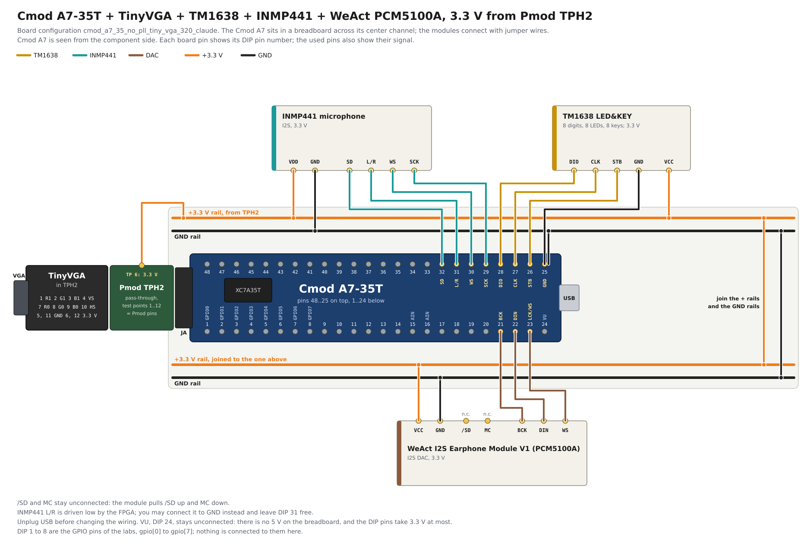
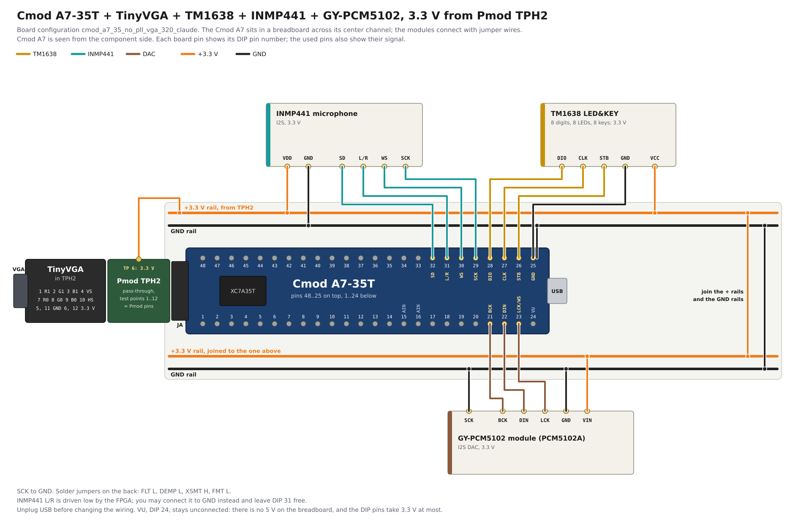
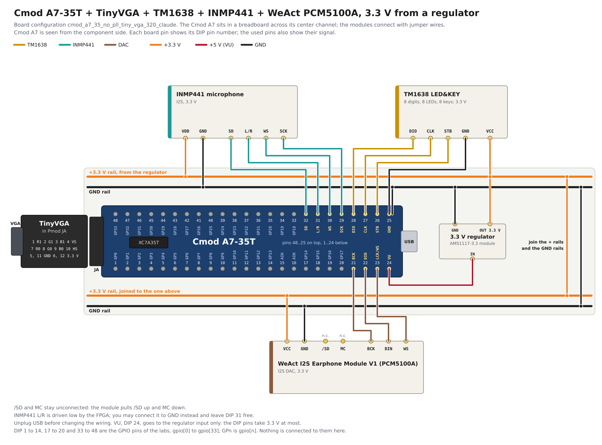
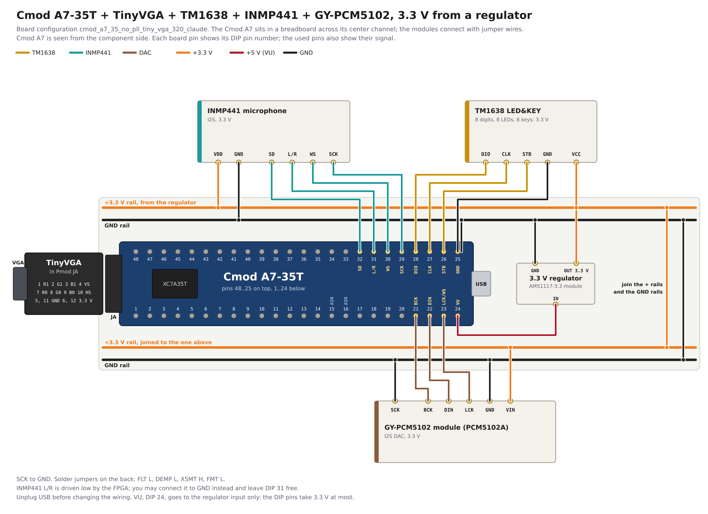

*Создано Claude Opus 5.5 (`claude-opus-5-5`) в Claude Code 2.1.325, уровень усилий xhigh, по промпту Юрия Панчула. Дословный промпт — в [приложении](#приложение-промпты).*

# Cmod A7-35T без MMCM: TinyVGA 320x480 от генератора 12 МГц

Конфигурация платы `cmod_a7_35_no_pll_tiny_vga_320_claude`. English version: [README.md](README.md).

Эта конфигурация использует оборудование и соединения
[cmod_a7_35_claude_tiny_vga_640](../cmod_a7_35_claude_tiny_vga_640/README_ru.md): Digilent Cmod A7-35T на макетной
плате с TinyVGA, TM1638, микрофоном INMP441 и ЦАП I2S. Отличается только
проект для ПЛИС. В нём нет генератора тактовой частоты, ни MMCM, ни PLL: весь
проект работает от кварцевого генератора Cmod A7 на 12 МГц.

Стандартной картинке 640x480 при 60 Гц нужна частота пикселей 25,175 МГц,
которую из 12 МГц без генератора тактовой частоты не получить. Здесь частота
пикселей — сами 12 МГц, поэтому в строке вдвое меньше пикселей: **упражнения
рисуют на экране 320x480, а монитор показывает каждый пиксель шириной в два
пикселя из 640.** Частота строк — 30,0 кГц вместо 31,47 кГц, и **некоторые
мониторы её не принимают**.

## Содержание

* [Какую конфигурацию выбрать](#какую-конфигурацию-выбрать)
* [Синхронизация VGA](#синхронизация-vga)
* [Что ещё меняется на 12 МГц](#что-ещё-меняется-на-12-мгц)
* [Оборудование и соединения](#оборудование-и-соединения)
* [Сборка и запуск упражнений](#сборка-и-запуск-упражнений)
* [Состояние](#состояние)
* [Файлы](#файлы)
* [Приложение: промпты](#приложение-промпты)

## Какую конфигурацию выбрать

У трёх конфигураций общие оборудование, выводы и соединения:

| | [cmod_a7_35_claude_tiny_vga_640](../cmod_a7_35_claude_tiny_vga_640/README_ru.md) | cmod_a7_35_no_pll_tiny_vga_320_claude, эта | [cmod_a7_35_no_pll_tiny_vga_304_claude](../cmod_a7_35_no_pll_tiny_vga_304_claude/README_ru.md) |
|---|---|---|---|
| Тактовая частота проекта | 50 МГц от MMCM | 12 МГц, кварцевый генератор | 12 МГц, кварцевый генератор |
| Экран, на котором рисуют упражнения | 640x480 | 320x480 | 304x480 |
| Ширина пикселя на мониторе, в пикселях из 640 | 1 | 2 | 2,1: одни 2, другие 3 |
| Частота строк | 31,25 кГц | 30,0 кГц | 31,50 кГц |
| Частота кадров | 59,5 Гц | 57,1 Гц | 59,99 Гц |
| Мониторы | Принимают | Некоторые не принимают 30 кГц | Принимают как 640x480 |
| Частота выборок микрофона | 48,8 кГц | 11,7 кГц | 11,7 кГц |
| Частота выборок ЦАП | 48,8 кГц | 46,9 кГц | 46,9 кГц |

Каждая из трёх есть и без TM1638, с двумя кнопками, двумя светодиодами и без
семисегментного индикатора: [cmod_a7_35_tiny_vga_640_no_tm1638_claude](../cmod_a7_35_tiny_vga_640_no_tm1638_claude/README_ru.md), [cmod_a7_35_no_pll_tiny_vga_304_no_tm1638_claude](../cmod_a7_35_no_pll_tiny_vga_304_no_tm1638_claude/README_ru.md), [cmod_a7_35_no_pll_tiny_vga_320_no_tm1638_claude](../cmod_a7_35_no_pll_tiny_vga_320_no_tm1638_claude/README_ru.md).

Выберите эту конфигурацию, чтобы увидеть проект без генератора тактовой
частоты с ровными пикселями шириной ровно в два пикселя монитора. Если
монитор не показывает картинку или сообщает, что режим вне диапазона,
возьмите [cmod_a7_35_no_pll_tiny_vga_304_claude](../cmod_a7_35_no_pll_tiny_vga_304_claude/README_ru.md), у
которой синхронизация близка к стандартной, или
[cmod_a7_35_claude_tiny_vga_640](../cmod_a7_35_claude_tiny_vga_640/README_ru.md).

## Синхронизация VGA

[peripherals/vga.sv](../../peripherals/vga.sv) получает горизонтальную
синхронизацию через параметры, поэтому используется без изменений.
board_specific_top.sv передаёт синхронизацию из таблицы ниже; когда `CLK_MHZ` и
`PIXEL_MHZ` оба равны 12, `vga.sv` переходит к следующему пикселю на каждом
такте. Вертикальная синхронизация стандартная.

| Часть строки | Стандарт 640x480, 25,175 МГц | Эта конфигурация, 12 МГц |
|--------------|------------------------------|--------------------------|
| Видимая часть | 640 пикселей, 25,42 мкс | 320 тактов, 26,67 мкс |
| Передний порог | 16 пикселей, 0,64 мкс | 8 тактов, 0,67 мкс |
| Синхроимпульс, низкий уровень | 96 пикселей, 3,81 мкс | 48 тактов, 4,00 мкс |
| Задний порог | 48 пикселей, 1,91 мкс | 24 такта, 2,00 мкс |
| Вся строка | 800 пикселей, 31,78 мкс, 31,47 кГц | 400 тактов, 33,33 мкс, 30,00 кГц |
| Кадр | 525 строк, 59,94 Гц | 525 строк, 57,14 Гц |

Каждое число тактов в правом столбце — половина числа пикселей стандарта,
поэтому монитор получает сигнал 640x480 от частоты пикселей 24 МГц, где каждый
пиксель повторён дважды. Запуск 640x480 от 24 МГц — известный приём: многие
мониторы его показывают. Но 30 кГц — самая низкая частота строк, которую многие
мониторы вообще принимают, и некоторые её не принимают. Если картинка есть, но
сдвинута или размыта, воспользуйтесь автоматической настройкой монитора.

Упражнения видят `screen_width = 320` и `screen_height = 480`. Упражнение,
которое берёт размеры рисунка из этих параметров, заполняет экран, растянутый
вдвое по ширине: круг выглядит эллипсом. Упражнение, которое рисует по
постоянным координатам дальше x = 319, рисует за пределами экрана.

Моделирование `vga.sv` с этими параметрами на 12 МГц показало строку в 400
тактов, синхроимпульс в 48 тактов, 320 видимых тактов в строке, кадр из 525
строк, из них 480 видимых, и вертикальный синхроимпульс в 2 строки: 30,000 кГц
и 57,143 Гц.

Полной строке из 640 пикселей на 12 МГц понадобилось бы по два пикселя за
такт, по одному на каждом фронте, через выходные регистры двойной скорости
(DDR) ПЛИС. Упражнения репозитория дают один пиксель за такт, поэтому здесь
этого нет.

## Что ещё меняется на 12 МГц

board_specific_top.sv — это файл [cmod_a7_35_claude_tiny_vga_640](../cmod_a7_35_claude_tiny_vga_640/README_ru.md) с
такими изменениями:

* **Нет MMCM.** Тактовый сигнал проекта — вход генератора, `sysclk`. Его вывод
  L17 может принимать тактовый сигнал, и Vivado ставит на него глобальный
  тактовый буфер. Ограничение на тактовую частоту, 83,33 нс, — из файла
  Digilent в board_specific.xdc.
* **Все модули получают `clk_mhz = 12`**: упражнение, TM1638, микрофон и ЦАП.
  Они выводят из него свои временные параметры.
* **Сброс.** Без MMCM нечего ждать. Цепочка сброса после конфигурации состоит
  из единиц, поэтому проект стартует в сбросе и выходит из него на третьем
  фронте такта. С TM1638 любая кнопка Cmod сбрасывает проект, как в
  cmod_a7_35_claude_tiny_vga_640.
* **Микрофон.** Приёмник выдаёт SCK 12 МГц / 16 = 0,75 МГц, в пределах
  0,5–3,2 МГц для INMP441, и частоту выборок 12 МГц / 1024 = 11,7 кГц. Это
  пропускает звук примерно до 5,8 кГц: хватает для голоса и музыкальных нот,
  а упражнения, показывающие спектр, покажут более узкий.
* **ЦАП.** Выход I2S даёт BCK 3 МГц и частоту выборок 12 МГц / 256 = 46,9 кГц
  с теми же соотношениями, что и на 50 МГц.
* **TM1638.** Его драйвер делит `clk_mhz` до своей последовательной частоты,
  поэтому работает как раньше.

## Оборудование и соединения

Детали, источник 3,3 В, сборка и таблицы соединений — те же, что у
[cmod_a7_35_claude_tiny_vga_640](../cmod_a7_35_claude_tiny_vga_640/README_ru.md); следуйте её инструкции. Выводы
коротко:

| Cmod A7 | Подключить к |
|---------|--------------|
| Pmod JA | TinyVGA |
| DIP 21, 22, 23 | ЦАП BCK, DIN и LCK у GY-PCM5102 или WS у WeAct |
| DIP 24, VU | Вариант A: ничего. Вариант B: только вход стабилизатора |
| DIP 25, 26, 27, 28 | Шина GND и TM1638 GND, STB, CLK, DIO |
| DIP 29, 30, 31, 32 | INMP441 SCK, WS, L/R, SD |

**TinyVGA.** Выход VGA — это TinyVGA, плата Pmod, которую сделал Leo Moser, в
разъёме Pmod JA; её проект лежит в
[github.com/mole99/tiny-vga](https://github.com/mole99/tiny-vga). Магазин Tiny
Tapeout продаёт её собранной под названием
[Tiny VGA Pmod](https://store.tinytapeout.com/products/TinyVGA-Pmod-p678647356),
за 15,00 € в ноябре 2026 года. Её можно и заказать собранной на JLCPCB по
файлам `GERBER-tiny-vga.zip`, `BOM-tiny-vga.csv` и `CPL-tiny-vga.csv` из
каталога `pcb/jlcpcb/production_files/` репозитория; шаги описаны в разделе
[Где взять TinyVGA](../cmod_a7_35_claude_tiny_vga_640/README_ru.md#где-взять-tinyvga)
инструкции cmod_a7_35_claude_tiny_vga_640.

Рисунки в этом каталоге — рисунки cmod_a7_35_claude_tiny_vga_640 с именем этой конфигурации, для
обоих модулей ЦАП: WeAct I2S Earphone Module (PCM5100A) и GY-PCM5102
(PCM5102A). Надписи на рисунках — на английском.

### Вариант A: 3,3 В от Pmod TPH2





### Вариант B: 3,3 В от стабилизатора





### Микрофон, ЦАП и стабилизатор, вставленные в макетную плату

[breadboard_weact.png](breadboard_weact.png) с модулем WeAct и
[breadboard_gy_pcm5102.png](breadboard_gy_pcm5102.png) с GY-PCM5102
показывают микрофон, ЦАП и стабилизатор варианта B, вставленные прямо в
макетную плату. Векторные версии всех рисунков — файлы `.svg` с теми же
именами.

## Сборка и запуск упражнений

В каталоге упражнения один раз выберите плату командой
`./06_choose_another_fpga_board.bash` и укажите `cmod_a7_35_no_pll_tiny_vga_320_claude`.
Затем собирайте и загружайте, как для [cmod_a7_35_claude_tiny_vga_640](../cmod_a7_35_claude_tiny_vga_640/README_ru.md):

```bash
./03_synthesize_for_fpga.bash
./04_configure_fpga.bash
```

Скрипты используют Vivado для всех плат, имя которых начинается с `cmod_a7`,
поэтому для этой конфигурации скрипты менять не нужно. Как и для cmod_a7_35_claude_tiny_vga_640,
скрипты загружают ПЛИС, а не флеш-память: после отключения USB проекта нет.

## Состояние

Собрано в Vivado 2026.1 без ошибок и без критических предупреждений, все
временные ограничения выполнены на 12 МГц, при периоде такта 83,3 нс:

| Упражнение | Конфигурация | LUT | Регистры | Худший запас по setup |
|------------|--------------|----:|---------:|----------------------:|
| `labs/2_graphics/2_3_color_stripes` | VGA, TM1638, микрофон, ЦАП | 117 | 99 | 76,8 нс |
| `labs/3_music/3_0_oscilloscope` | VGA, TM1638, микрофон, ЦАП | 230 | 190 | 75,5 нс |
| `labs/3_music/3_10_spectrum_analyzer` | VGA, TM1638, микрофон, ЦАП | 2412 | 1528 | 64,2 нс |
| `labs/3_music/3_10_spectrum_analyzer` | VGA, микрофон, ЦАП, без TM1638 | 2340 | 1471 | 68,1 нс |

Сборки читают исходники так же, как скрипты, с
`peripherals/lab_specific_board_config.svh`, который включает TM1638, VGA,
микрофон и ЦАП; для последней строки взят файл конфигурации без TM1638. Как
объясняет инструкция cmod_a7_35_claude_tiny_vga_640, скрипт Vivado в репозитории не читает
`lab_specific_board_config.svh` упражнения. Vivado выдаёт предупреждение
правил проектирования CFGBVS-1, как и для cmod_a7_35_claude_tiny_vga_640; оно не мешает
созданию битового потока. В каждой сборке Vivado использовал один
глобальный тактовый буфер для частоты 12 МГц и ни одного MMCM или PLL.

**На реальной плате и мониторе ещё не проверено.** Примет ли конкретный
монитор строку 30 кГц — главный открытый вопрос этой конфигурации.

## Файлы

| Файл | Что это |
|------|---------|
| [board_specific.xdc](board_specific.xdc) | Тот же, что в cmod_a7_35_claude_tiny_vga_640: Cmod-A7-Master.xdc от Digilent, раскомментированы только используемые строки |
| [board_specific_top.sv](board_specific_top.sv) | Назначение выводов, сброс, синхронизация VGA и экземпляры упражнения, модулей VGA, TM1638, микрофона и ЦАП, всё на 12 МГц |
| [board_specific.tcl](board_specific.tcl) | Микросхема ПЛИС для Vivado |
| `wiring_*.svg`, `wiring_*.png` | Схемы соединений для обоих модулей ЦАП и обоих источников 3,3 В |
| `breadboard_*.svg`, `breadboard_*.png` | Раскладки на макетной плате для обоих модулей ЦАП |
| README.md, README.html | Эта инструкция на английском |
| README_ru.md, README_ru.html | Она же на русском |

Рисунки делают генераторы cmod_a7_35_claude_tiny_vga_640, запущенные с именем этой конфигурации:

```bash
cd ../cmod_a7_35_claude_tiny_vga_640
python3 generate_wiring_diagram.py cmod_a7_35_no_pll_tiny_vga_320_claude
python3 generate_breadboard_diagram.py cmod_a7_35_no_pll_tiny_vga_320_claude
cd ../cmod_a7_35_no_pll_tiny_vga_320_claude

for f in wiring_*.svg breadboard_*.svg
do
    # ${f%.svg} is the file name without the .svg suffix
    inkscape "$f" --export-type=png --export-dpi=96 \
        --export-background=white --export-filename="${f%.svg}.png"
done
```

## Приложение: промпты

Оборудование и соединения появились из промптов в приложении к
[cmod_a7_35_claude_tiny_vga_640](../cmod_a7_35_claude_tiny_vga_640/README_ru.md#приложение-промпты). Эта конфигурация
появилась из следующих промптов, которые Юрий Панчул отправил в том же сеансе
Claude Code 16 и 17 ноября 2026 года, дословно, с переводом на русский. Здесь
все промпты сеанса, начиная с первого об этой конфигурации, включая просьбы
сделать коммит и push; последующие промпты, которые касаются этой
конфигурации, тоже добавляются сюда. Промпты называют конфигурации так, как
они назывались в то время: суффикс `_claude` появился в 00:43, `tiny_` — в
09:47, а `tiny_vga_640` — в 10:20 17 ноября. Время — тихоокеанское (UTC−8).

**22:10**, вопрос; в ответе были предложены две синхронизации: A для этой
конфигурации и B для cmod_a7_35_no_pll_tiny_vga_304_claude:

```text
Is it possible to run VGA on 12 MHz without PLL?
```

```text
Можно ли запустить VGA на 12 МГц без PLL?
```

**22:23**:

```text
create two other configurations called cmod_a7_35_no_pll_vga_320 and cmod_a7_35_no_pll_304 and implement A and B. Document everything inside directories.
```

```text
создай две другие конфигурации с именами cmod_a7_35_no_pll_vga_320 и cmod_a7_35_no_pll_304 и реализуй A и B. Документируй всё внутри каталогов.
```

**22:25**, отправлен, пока готовился ответ на предыдущий:

```text
also make pictures with weact in addition to gy
```

```text
ещё сделай рисунки с WeAct в дополнение к GY
```

**23:04**:

```text
rename cmod_a7_35_no_pll_304 to cmod_a7_35_no_pll_vga_304
```

```text
переименуй cmod_a7_35_no_pll_304 в cmod_a7_35_no_pll_vga_304
```

**23:17**:

```text
keep README.csv with CR-LF for now; I will fix it later; first commint and push, then create 3 new configurations that do not use tm1638, just have 2 buttons, 2 leds and no 7-segement display: cmod_a7_35_no_tm1638
cmod_a7_35_no_pll_vga_304_no_tm1638
cmod_a7_35_no_pll_vga_320_no_tm1638
```

```text
пока оставь README.csv с CR-LF, я исправлю это позже; сначала сделай коммит и push, затем создай 3 новые конфигурации, которые не используют TM1638, а имеют только 2 кнопки, 2 светодиода и никакого семисегментного индикатора: cmod_a7_35_no_tm1638
cmod_a7_35_no_pll_vga_304_no_tm1638
cmod_a7_35_no_pll_vga_320_no_tm1638
```

**23:53**:

```text
commit and push
```

```text
сделай коммит и push
```

**00:29, 17 ноября**, о суффиксах `_vga_320`, `_vga_304` и `_no_pll`, которые
Юрий Панчул добавил в меню плат в `scripts/steps/00_setup.source_bash`, чтобы
меню показывало конфигурации без MMCM под `cmod_a7_35`:

```text
check the changes I did manually. Tell why they are needed
```

```text
проверь изменения, которые я сделал вручную. Объясни, зачем они нужны
```

**00:37, 17 ноября**; в каталоге `boards/README.csv` снова осталась одна
строка для физической платы, `cmod_a7_35`:

```text
yes, fix the catalog, then commit and push
```

```text
да, исправь каталог, затем сделай коммит и push
```

**00:43, 17 ноября**:

```text
Add to all your cmod_a7 configurations suffix _claude. Update all the relevant files.
```

```text
Добавь ко всем своим конфигурациям cmod_a7 суффикс _claude. Обнови все связанные файлы.
```

**00:56, 17 ноября**:

```text
commit and push
```

```text
сделай коммит и push
```

**09:47, 17 ноября**; он добавил `tiny_` перед `vga` в имена конфигураций без
MMCM и абзац о TinyVGA в раздел
[Оборудование и соединения](#оборудование-и-соединения):

```text
convert all mentions to vga in configuration names and the related texts to tiny_vga. Specifically mention TinyVGA in documentation, repository https://github.com/mole99/tiny-vga and where to buy it retail or order from JLCPCB. Make sure to add this and other previous and follow-up related prompt as appendices to the instructions you generate.
```

```text
замени все упоминания vga в именах конфигураций и в связанных с ними текстах на tiny_vga. Отдельно упомяни в документации TinyVGA, репозиторий https://github.com/mole99/tiny-vga и где купить его в розницу или заказать на JLCPCB. Обязательно добавь этот и другие предыдущие и последующие связанные промпты в приложения к инструкциям, которые ты создаёшь.
```

**10:20, 17 ноября**:

```text
commit and push; then rename cmod_a7_35_claude to cmod_a7_35_claude_tiny_vga_640 and cmod_a7_35_no_tm1638_claude into cmod_a7_35_tiny_vga_640_no_tm1638_claude
```

```text
сделай коммит и push; затем переименуй cmod_a7_35_claude в cmod_a7_35_claude_tiny_vga_640, а cmod_a7_35_no_tm1638_claude — в cmod_a7_35_tiny_vga_640_no_tm1638_claude
```

**19:00, 17 ноября**:

```text
commit and push
```

```text
сделай коммит и push
```

**19:47, 17 ноября**:

```text
commit and push
```

```text
сделай коммит и push
```

**20:29, 17 ноября**; по нему сделан отчёт, который сравнивает эти
конфигурации с конфигурациями Codex; отчёт лежит вне репозитория:

```text
review your compatitor's cmod_a7 board implementations, search bor bugs and good ideas to adopt, make a competitive report in a new html file.
```

```text
сделай обзор реализаций плат cmod_a7 у твоего конкурента, поищи ошибки и хорошие идеи, которые стоит перенять, и сделай отчёт о сравнении в новом файле HTML.
```

**20:35, 18 ноября**, — ответ на вопрос, писать ли в столбце TM1638
строки каталога `cmod_a7_35` «всегда» или «на выбор»; теперь там «на выбор»:

```text
yes, should say either
```

```text
да, должно быть «на выбор»
```

**20:43, 18 ноября**:

```text
commit and push
```

```text
сделай коммит и push
```
