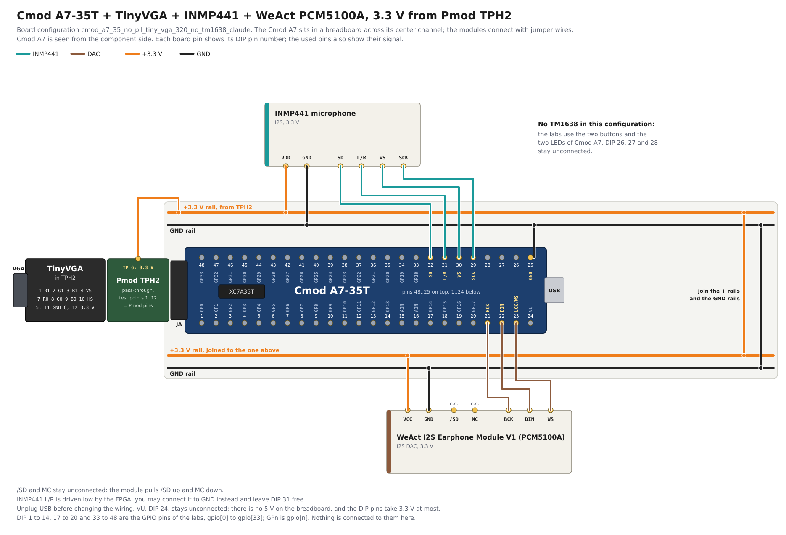
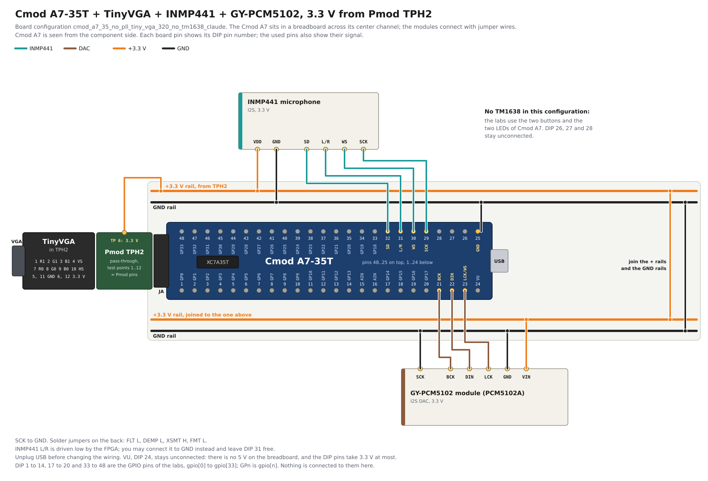
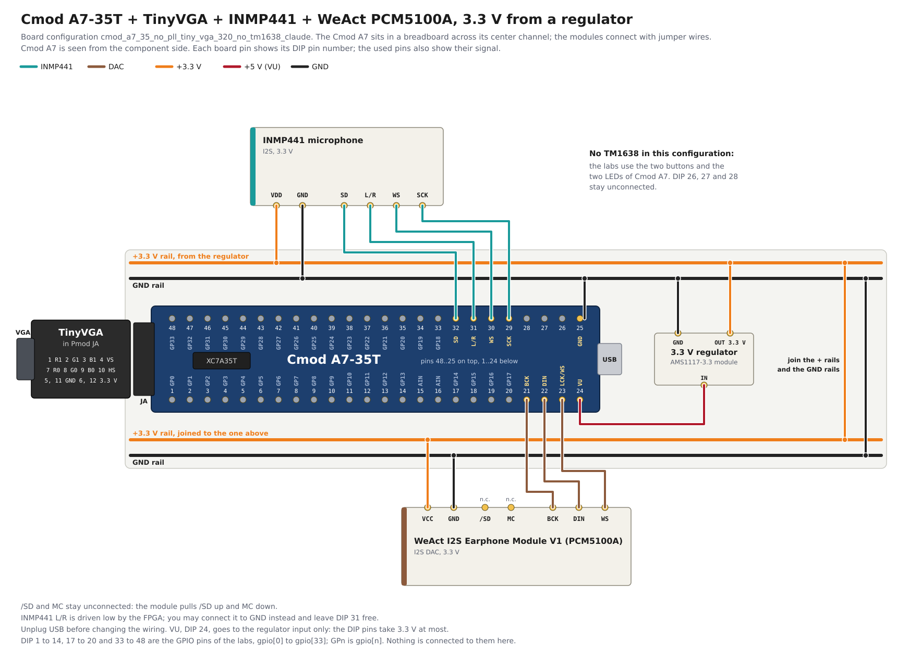
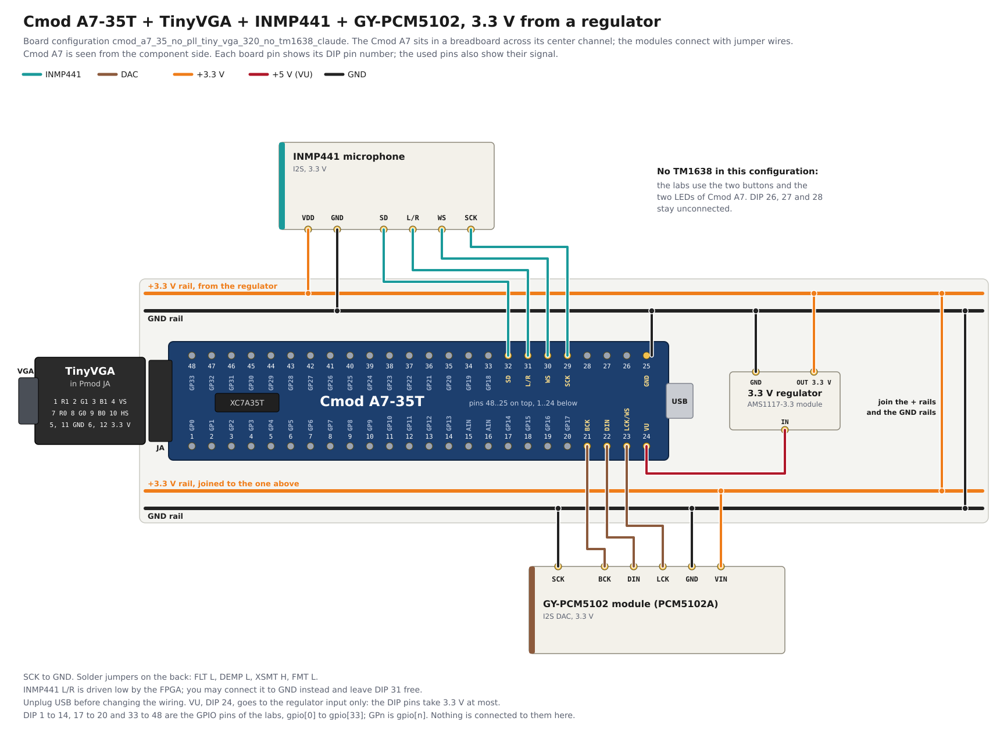

*Generated by Claude Opus 5.5 (`claude-opus-5-5`) in Claude Code 2.1.325, effort level xhigh, using prompt from Yuri Panchul. See the verbatim prompt in the [Appendix](#appendix-the-prompts).*

# Cmod A7-35T without TM1638 and without an MMCM: TinyVGA 320x480

Board configuration `cmod_a7_35_no_pll_tiny_vga_320_no_tm1638_claude`. Русская версия: [README_ru.md](README_ru.md).

This is [cmod_a7_35_no_pll_tiny_vga_320_claude](../cmod_a7_35_no_pll_tiny_vga_320_claude/README.md) without the TM1638 module. **The
labs get the two buttons of Cmod A7 as their keys and its two LEDs as their
LEDs, and there is no seven-segment display.** Everything else is that of
cmod_a7_35_no_pll_tiny_vga_320_claude: the 12 MHz clock without an MMCM, VGA 320x480 with pixels of exactly two at a line rate of 30 kHz that some monitors refuse, the microphone, the DAC, the pins and the wiring. The other configurations without TM1638 are
[cmod_a7_35_tiny_vga_640_no_tm1638_claude](../cmod_a7_35_tiny_vga_640_no_tm1638_claude/README.md), [cmod_a7_35_no_pll_tiny_vga_304_no_tm1638_claude](../cmod_a7_35_no_pll_tiny_vga_304_no_tm1638_claude/README.md).

## Contents

* [What is different](#what-is-different)
* [How it is made](#how-it-is-made)
* [The hardware and the wiring](#the-hardware-and-the-wiring)
* [Building and running the labs](#building-and-running-the-labs)
* [Status](#status)
* [Files](#files)
* [Appendix: the prompts](#appendix-the-prompts)

## What is different

| | [cmod_a7_35_no_pll_tiny_vga_320_claude](../cmod_a7_35_no_pll_tiny_vga_320_claude/README.md) | cmod_a7_35_no_pll_tiny_vga_320_no_tm1638_claude, this one |
|---|---|---|
| Keys of the labs | 8 keys of TM1638 | BTN0 and BTN1 of Cmod A7: `key[0]` and `key[1]`, also `sw[0]` and `sw[1]` |
| LEDs of the labs | 8 LEDs of TM1638, the first two also on LED1 and LED2 of Cmod A7 | LED1 and LED2 of Cmod A7: `led[0]` and `led[1]` |
| Seven-segment display | 8 digits of TM1638 | None |
| Reset button | Either Cmod button | None: both buttons are keys |
| DIP 26, 27, 28 | TM1638 STB, CLK, DIO | Unconnected |

A button gives 1 when pressed; an LED lights on 1. The labs get one
seven-segment digit that goes nowhere, so a lab that drives a display builds
and runs, and its display output is lost. Whatever a lab shows on LEDs
beyond the first two is lost the same way.

The design is in reset for the first three clock cycles after loading. No button resets it: to start a lab again, load the FPGA again
with `./04_configure_fpga.bash`.

The design keeps DIP 26 and 27, the STB and CLK of TM1638 in cmod_a7_35_no_pll_tiny_vga_320_claude, high,
and does not drive DIP 28. Leave the three pins unconnected.

## How it is made

[board_specific_top.sv](board_specific_top.sv) has three lines of code. It
defines `CMOD_A7_NO_PLL_SCREEN_WIDTH` as 320, as cmod_a7_35_no_pll_tiny_vga_320_claude does, and
`FORCE_NO_INSTANTIATE_TM1638_BOARD_CONTROLLER_MODULE`, and includes the
`board_specific_top.sv` of cmod_a7_35_tiny_vga_640_claude, the top level of all six configurations,
which then runs at 12 MHz and leaves out TM1638 even
though `peripherals/lab_specific_board_config.svh` turns it on. Other boards
of the repository without TM1638, such as `tang_nano_9k_hdmi_no_tm1638`, are
made the same way, but some of them draw a virtual TM1638 on the screen; this
one does not.

[board_specific.xdc](board_specific.xdc) is the one of cmod_a7_35_no_pll_tiny_vga_320_claude. It keeps the
lines of DIP 26, 27 and 28 uncommented, because the included top level still
has these ports.

## The hardware and the wiring

The parts, the 3.3 V source, the assembly and the wiring tables are those of
[cmod_a7_35_no_pll_tiny_vga_320_claude](../cmod_a7_35_no_pll_tiny_vga_320_claude/README.md) without TM1638: leave out the module and
its five wires. DIP 25 still goes to the GND rail. The pins in short:

| Cmod A7 | Connect to |
|---------|------------|
| Pmod JA | TinyVGA |
| DIP 21, 22, 23 | DAC BCK, DIN, and LCK of GY-PCM5102 or WS of WeAct |
| DIP 24, VU | Variant A: nothing. Variant B: the regulator input only |
| DIP 25 | GND rail |
| DIP 26, 27, 28 | Nothing |
| DIP 29, 30, 31, 32 | INMP441 SCK, WS, L/R, SD |

**TinyVGA.** The VGA output is TinyVGA, the Pmod board of Leo Moser, in Pmod
socket JA; its design files are in
[github.com/mole99/tiny-vga](https://github.com/mole99/tiny-vga). The Tiny
Tapeout store sells it assembled as
[Tiny VGA Pmod](https://store.tinytapeout.com/products/TinyVGA-Pmod-p678647356),
€15.00 in November 2026. It can also be ordered assembled from JLCPCB with
`GERBER-tiny-vga.zip`, `BOM-tiny-vga.csv` and `CPL-tiny-vga.csv` from
`pcb/jlcpcb/production_files/` of the repository; the steps are in
[Where to get TinyVGA](../cmod_a7_35_tiny_vga_640_claude/README.md#where-to-get-tinyvga)
of cmod_a7_35_tiny_vga_640_claude.

The drawings of this directory have no TM1638, for both DAC modules, WeAct
I2S Earphone Module (PCM5100A) and GY-PCM5102 (PCM5102A).

### Variant A: 3.3 V from Pmod TPH2





### Variant B: 3.3 V from a regulator





### Microphone, DAC and regulator plugged into the breadboard

[breadboard_weact.png](breadboard_weact.png) with the WeAct module and
[breadboard_gy_pcm5102.png](breadboard_gy_pcm5102.png) with GY-PCM5102 show
the microphone, the DAC and the regulator of variant B plugged straight into
the breadboard. The vector versions of all drawings are the `.svg` files of
the same names.

## Building and running the labs

In a lab directory, choose the board once with
`./06_choose_another_fpga_board.bash` and pick `cmod_a7_35_no_pll_tiny_vga_320_no_tm1638_claude`. Then build and load
as for [cmod_a7_35_no_pll_tiny_vga_320_claude](../cmod_a7_35_no_pll_tiny_vga_320_claude/README.md):

```bash
./03_synthesize_for_fpga.bash
./04_configure_fpga.bash
```

The scripts use Vivado for every board whose name starts with `cmod_a7`, so
this configuration needs no change of the scripts.

## Status

Built with Vivado 2026.1 with the configuration file of the scripts,
`peripherals/lab_specific_board_config.svh`, which turns TM1638 on: the
builds show that this configuration leaves it out all the same.

| Lab | LUTs | Registers | Worst setup slack |
|-----|-----:|----------:|------------------:|
| `labs/1_basics/1_05_7seven_segment_letter` | 41 | 44 | 79.3 ns |
| `labs/2_graphics/2_3_color_stripes` | 54 | 45 | 79.2 ns |
| `labs/3_music/3_10_spectrum_analyzer` | 2340 | 1471 | 68.1 ns |

All builds have no errors and no critical warnings, and meet all timing at
12 MHz, a clock period of 83.3 ns, with no MMCM or PLL. None of the netlists
has a TM1638 module. Vivado gives the design rule warning CFGBVS-1, as for
cmod_a7_35_tiny_vga_640_claude; it does not stop the bitstream.

The builds above are from before 18 November, when the six configurations got one
shared top level, eight GPIO pins and the RGB LED, and on 21 November the GPIO
grew to 34 pins. After these changes [scripts/tests/test_cmod_a7_35_claude.py](../../scripts/tests/test_cmod_a7_35_claude.py)
built `labs/3_music/3_11_microphone_monitor` for this configuration with
Vivado 2026.1: 1879 LUTs, 1259 registers, worst setup slack 71.2 ns,
all timing met.

**Not yet tried on a real board.**

## Files

| File | What it is |
|------|------------|
| [board_specific_top.sv](board_specific_top.sv) | Defines `CMOD_A7_NO_PLL_SCREEN_WIDTH` as 320 and `FORCE_NO_INSTANTIATE_TM1638_BOARD_CONTROLLER_MODULE` and includes the top level of cmod_a7_35_tiny_vga_640_claude |
| [board_specific.xdc](board_specific.xdc) | The same as in cmod_a7_35_no_pll_tiny_vga_320_claude |
| [board_specific.tcl](board_specific.tcl) | FPGA part for Vivado |
| `wiring_*.svg`, `wiring_*.png` | The wiring diagrams without TM1638, for both DAC modules and both 3.3 V sources |
| `breadboard_*.svg`, `breadboard_*.png` | The breadboard layouts without TM1638, for both DAC modules |
| README.md, README.html | This instruction in English |
| README_ru.md, README_ru.html | The same in Russian |

The drawings come from the generators of cmod_a7_35_tiny_vga_640_claude, run with the name of
this configuration; they leave out TM1638 for every name with
`_no_tm1638` in it:

```bash
cd ../cmod_a7_35_tiny_vga_640_claude
python3 generate_wiring_diagram.py cmod_a7_35_no_pll_tiny_vga_320_no_tm1638_claude
python3 generate_breadboard_diagram.py cmod_a7_35_no_pll_tiny_vga_320_no_tm1638_claude
cd ../cmod_a7_35_no_pll_tiny_vga_320_no_tm1638_claude

for f in wiring_*.svg breadboard_*.svg
do
    # ${f%.svg} is the file name without the .svg suffix
    inkscape "$f" --export-type=png --export-dpi=96 \
        --export-background=white --export-filename="${f%.svg}.png"
done
```

## Appendix: the prompts

The rest of the design comes from the prompts in the appendix of
[cmod_a7_35_no_pll_tiny_vga_320_claude](../cmod_a7_35_no_pll_tiny_vga_320_claude/README.md#appendix-the-prompts). This configuration
comes from the following prompts, sent by Yuri Panchul in the same Claude
Code session on 16 and 17 November 2026, verbatim. They are all the prompts
of the session from the first one about this configuration on, the requests
to commit and push included, and the prompts that follow and concern this
configuration are added here too. The prompts name the configurations as
they were called then: the suffix `_claude` came at 00:43, `tiny_` at
09:47 and `tiny_vga_640` at 10:20 on 17 November. The times are Pacific time (UTC−8).

**23:17**:

```text
keep README.csv with CR-LF for now; I will fix it later; first commint and push, then create 3 new configurations that do not use tm1638, just have 2 buttons, 2 leds and no 7-segement display: cmod_a7_35_no_tm1638
cmod_a7_35_no_pll_vga_304_no_tm1638
cmod_a7_35_no_pll_vga_320_no_tm1638
```

**23:53**:

```text
commit and push
```

**00:29 on 17 November**, about the suffixes `_vga_320`, `_vga_304` and
`_no_pll` that Yuri Panchul had added to the board menu in
`scripts/steps/00_setup.source_bash`, so that the menu lists the
configurations without an MMCM under `cmod_a7_35`:

```text
check the changes I did manually. Tell why they are needed
```

**00:37 on 17 November**; the catalog `boards/README.csv` went back to one
line for the physical board, `cmod_a7_35`:

```text
yes, fix the catalog, then commit and push
```

**00:43 on 17 November**:

```text
Add to all your cmod_a7 configurations suffix _claude. Update all the relevant files.
```

**00:56 on 17 November**:

```text
commit and push
```

**09:47 on 17 November**; it added `tiny_` before `vga` in the names of the
configurations without an MMCM and the paragraph on TinyVGA in
[The hardware and the wiring](#the-hardware-and-the-wiring):

```text
convert all mentions to vga in configuration names and the related texts to tiny_vga. Specifically mention TinyVGA in documentation, repository https://github.com/mole99/tiny-vga and where to buy it retail or order from JLCPCB. Make sure to add this and other previous and follow-up related prompt as appendices to the instructions you generate.
```

**10:20 on 17 November**:

```text
commit and push; then rename cmod_a7_35_claude to cmod_a7_35_claude_tiny_vga_640 and cmod_a7_35_no_tm1638_claude into cmod_a7_35_tiny_vga_640_no_tm1638_claude
```

**19:00 on 17 November**:

```text
commit and push
```

**19:47 on 17 November**:

```text
commit and push
```

**20:29 on 17 November**; it produced a report that compares these
configurations with those of Codex,
[claude_cmod_a7_compare_1.html](../../misc/ai_sessions/20261118_cmod_a7_support/claude/claude_cmod_a7_compare_1.html):

```text
review your compatitor's cmod_a7 board implementations, search bor bugs and good ideas to adopt, make a competitive report in a new html file.
```

**20:35 on 18 November**, the answer to whether the TM1638 column of the
catalog row `cmod_a7_35` should say "always" or "either"; it now says "either":

```text
yes, should say either
```

**20:43 on 18 November**:

```text
commit and push
```

**20:45 on 18 November**; it produced a Russian version of that report,
[claude_cmod_a7_compare_1_ru.html](../../misc/ai_sessions/20261118_cmod_a7_support/claude/claude_cmod_a7_compare_1_ru.html):

```text
generate a Russian version of the competitive report
```

**21:05 on 18 November**; it added both reports, linked above, to
`misc/ai_sessions/20261118_cmod_a7_support/claude`:

```text
Add your reports to basics-graphics-music/misc/ai_sessions/20261118_cmod_a7_support/claude
```

**21:58 on 18 November**:

```text
commit and push
```

**22:11 on 18 November**; it produced a list of changes after reading Codex's
review of these configurations:

```text
read your competitor report. List what you would change in your solution.
```

**22:20 on 18 November**, answering item 1 of that list (fix the
configurations without TM1638); it fixed eight labs, ten after the 22:37
prompt, instead of the board files:

```text
1. No, keep 1-digit 7-segment. This should be fixed in the examples later. Same thing for sw. Don't pad, this should be fixed in example using generate and padding. Yes, do the lab fix.
```

**22:26 on 18 November**, typed in answer to items 2 to 7 of that list but
never sent, because the computer crashed. The text is read from a photo of
the screen, sent at 22:39:

```text
2. merge - yes. 3 - how large are the tests? 4. don't sync the buttons. We did not have these issues yet with our labs, when we have, we will add the synchronizers. these buttons may already have the internal synchronizers (check it and report). 5. yes, correct. 6. yes, reject. 7. OK.
```

**22:35 on 18 November**, after the crash; it listed the unfinished work:

```text
recover from computer crash while you were working in this directory. List what you were doing
```

**22:37 on 18 November**; it built the fixed labs with Vivado and fixed the
two Geiger counter labs as well, ten labs in all:

```text
yes, rerun Vivado and fix the Geiger labs
```

**22:39 on 18 November**, with the photo of the screen; it listed how it
read the reply above and waited for a confirmation:

```text
recognize my response from this picture [Image #1] . List everything and confirm before working on it
```

**22:47 on 18 November**; it added the tests, merged the three full top
levels into one, rejected the split DIO mode, added the GPIO pins, the RGB
LED and the TinyVGA files of one revision, corrected the DAC instructions,
and marked the shared Vivado script as a TODO. It explained the idea of
leaving DIP 26 to 28 undriven and proposed to drop it:

```text
Add the tests. Why do you want to make DIP 26–28 undriven? Explain. Don't do 8 now, but note it in the report with TODO.
```

**19:19 on 19 November**; the Vivado builds for the Status of
cmod_a7_35_tiny_vga_640_claude had not started, because the script that
waited for the previous Vivado run kept finding its own command line. It
started them, added a test of a lab with TM1638, VGA, the microphone and the
DAC all turned off, made the Vivado test count Slice LUTs, as the
utilization report of Vivado does, instead of LUT cells, and updated the
Status:

```text
are you done?
```

**21:09 on 19 November**; it copied the fixed Geiger counter lab into
`labs/6_misc/6_1_geiger_muller_radiation_counter_claude`, reverted
`6_1_geiger_muller_radiation_counter` and
`6_1_geiger_muller_radiation_counter_on_tang_nano_9k`, and made the tests use
the copy:

```text
Save your version of geiger_muller into 6_1_geiger_muller_radiation_counter_claude. Revert other geiger_muller variants. The first one was for DE10-Lite, the second is a work in progress. I will take care of them.
```

**21:15 on 19 November**, after Yuri Panchul corrected the parameter names
in `4_2_5_optimized_ff_fifo_view_2_data_layout`; the tests passed again, and
the edited labs and the Geiger counter copy elaborated for seven board sizes:

```text
is it fine now?
```

**23:38 on 19 November**; it committed and pushed the work above:

```text
commit and push
```

**23:52 on 19 November**; it found that its review of the Codex
configurations was already in `misc/ai_sessions/20261118_cmod_a7_support/claude`
as `claude_cmod_a7_compare_1` and asked which files were meant; the question
is still open:

```text
move cmod a7 review files to ai_sessions
```

**23:58 on 19 November**; it explained the idea of leaving DIP 26 to 28
undriven in the configurations without TM1638 and recommended keeping STB and
CLK driven high:

```text
what is the issue with DIP 26-28?
```

**23:58 on 19 November**, a minute later; it renamed the configuration
cmod_a7_35_claude_tiny_vga_640 to cmod_a7_35_tiny_vga_640_claude and replaced
the old name everywhere except in the quoted prompts:

```text
Also rename cmod_a7_35_claude_tiny_vga_640 into cmod_a7_35_tiny_vga_640_claude
```

**00:09 on 20 November**; it committed and pushed the rename:

```text
commit and push
```

**16:36 on 21 November**; it answered that the eight GPIO pins came from
the configurations of Codex, not from a limit of the board:

```text
put this on hold. switch back to cmod a7 branch . what is the reason you use only 8 gpio pins for the user in cmod a7?
```

**16:41 on 21 November**; it made all 34 digital DIP pins that TM1638, the
microphone and the DAC do not use the GPIO pins of the labs, `gpio[0]` to
`gpio[33]`:

```text
don't pay attention to Geiger or other labs for gpio matter for this board. Make all gpios available to the user except for the pins used by tm1638, microphone and dac.
```

**18:41 on 21 November**; it committed and pushed the 34 GPIO pins:

```text
commit and push
```
