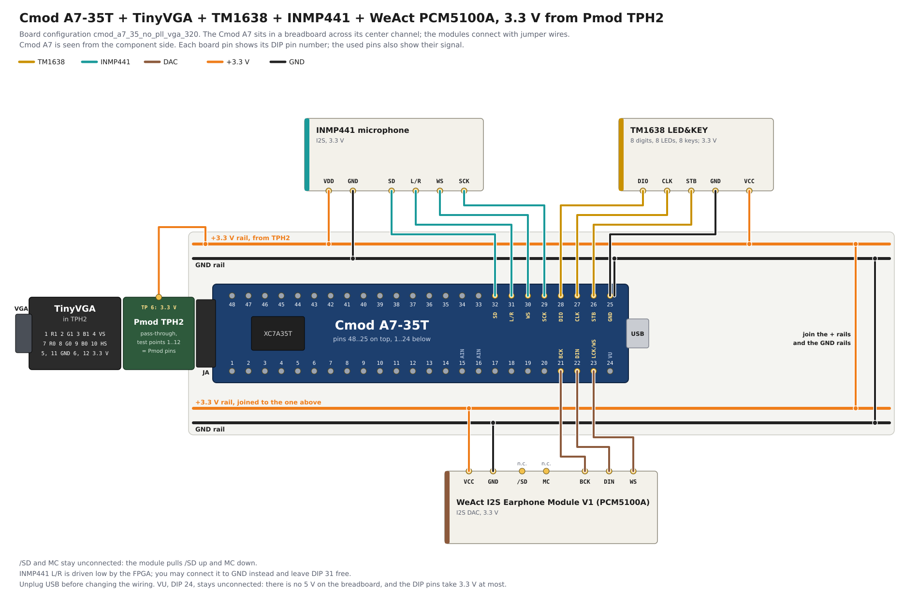
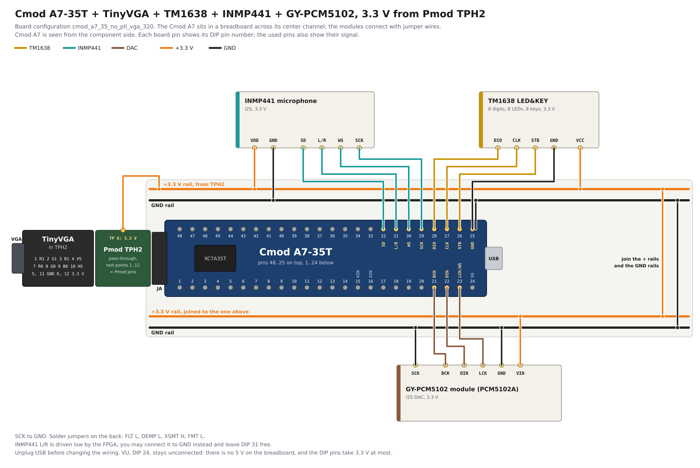
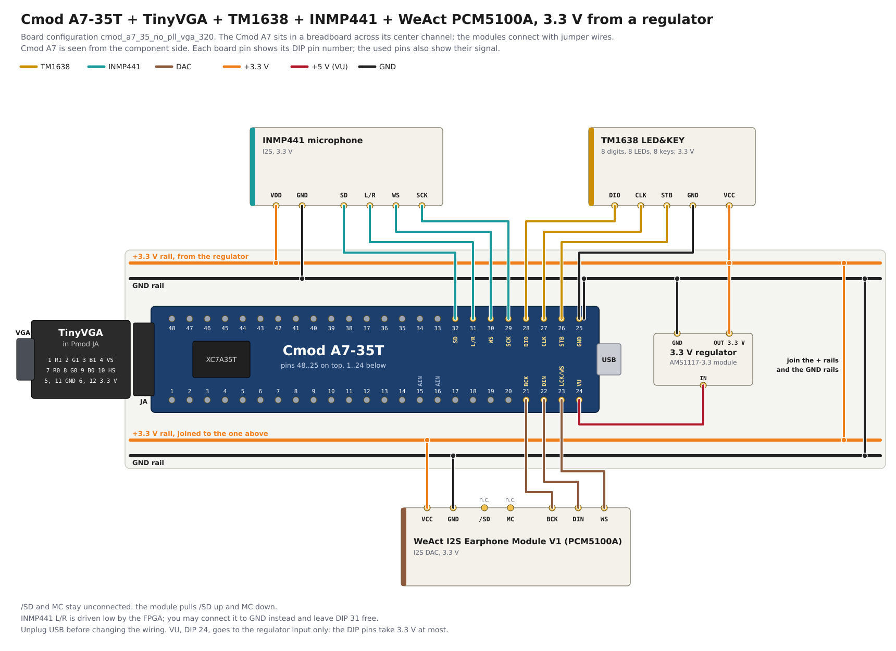
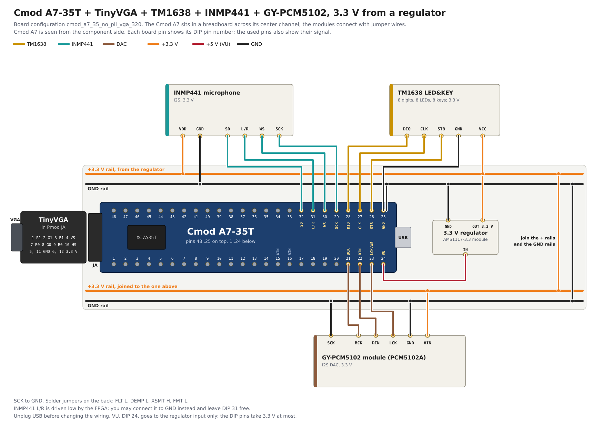

*Generated by Claude Opus 5.5 (`claude-opus-5-5`) in Claude Code 2.1.325, effort level xhigh, using prompt from Yuri Panchul. See the verbatim prompt in the [Appendix](#appendix-the-prompts).*

# Cmod A7-35T without an MMCM: VGA 320x480 from the 12 MHz oscillator

Board configuration `cmod_a7_35_no_pll_vga_320`. Русская версия: [README_ru.md](README_ru.md).

This configuration uses the hardware and the wiring of
[cmod_a7_35](../cmod_a7_35/README.md): Digilent Cmod A7-35T on a breadboard
with TinyVGA, TM1638, an INMP441 microphone and an I2S DAC. Only the FPGA
design differs. It has no clock generator, no MMCM or PLL: the whole design
runs on the 12 MHz oscillator of Cmod A7.

The standard 640x480 picture at 60 Hz needs a pixel clock of 25.175 MHz,
which 12 MHz cannot give without a clock generator. Here the pixel clock is
12 MHz itself, so a line has half as many pixels: **the labs draw on a
screen of 320x480, and the monitor shows each pixel two pixels of 640 wide.**
The line rate is 30.0 kHz instead of 31.47 kHz, and **some monitors refuse
it**.

## Contents

* [Which configuration to choose](#which-configuration-to-choose)
* [VGA timing](#vga-timing)
* [What else changes at 12 MHz](#what-else-changes-at-12-mhz)
* [The hardware and the wiring](#the-hardware-and-the-wiring)
* [Building and running the labs](#building-and-running-the-labs)
* [Status](#status)
* [Files](#files)
* [Appendix: the prompts](#appendix-the-prompts)

## Which configuration to choose

The three configurations share the hardware, the pins and the wiring:

| | [cmod_a7_35](../cmod_a7_35/README.md) | cmod_a7_35_no_pll_vga_320, this one | [cmod_a7_35_no_pll_vga_304](../cmod_a7_35_no_pll_vga_304/README.md) |
|---|---|---|---|
| Clock of the design | 50 MHz from an MMCM | 12 MHz, the oscillator | 12 MHz, the oscillator |
| Screen the labs draw on | 640x480 | 320x480 | 304x480 |
| Width of a pixel on the monitor, in pixels of 640 | 1 | 2 | 2.1: some 2, some 3 |
| Line rate | 31.25 kHz | 30.0 kHz | 31.50 kHz |
| Frame rate | 59.5 Hz | 57.1 Hz | 59.99 Hz |
| Monitors | Accept it | Some refuse 30 kHz | Accept it as 640x480 |
| Microphone sample rate | 48.8 kHz | 11.7 kHz | 11.7 kHz |
| DAC sample rate | 48.8 kHz | 46.9 kHz | 46.9 kHz |

Choose this configuration to see a design without a clock generator with
clean pixels of exactly two monitor pixels each. If your monitor shows no
picture or reports the mode as out of range, use
[cmod_a7_35_no_pll_vga_304](../cmod_a7_35_no_pll_vga_304/README.md), whose timing is
close to the standard one, or [cmod_a7_35](../cmod_a7_35/README.md).

## VGA timing

[peripherals/vga.sv](../../peripherals/vga.sv) takes its horizontal timing as
parameters, so it is used unchanged. board_specific_top.sv passes the timing
below; with `CLK_MHZ` and `PIXEL_MHZ` both 12, `vga.sv` moves to the next pixel
on every clock. The vertical timing is the standard one.

| Part of a line | Standard 640x480, 25.175 MHz | This configuration, 12 MHz |
|----------------|------------------------------|----------------------------|
| Visible | 640 pixels, 25.42 µs | 320 clocks, 26.67 µs |
| Front porch | 16 pixels, 0.64 µs | 8 clocks, 0.67 µs |
| Sync pulse, low | 96 pixels, 3.81 µs | 48 clocks, 4.00 µs |
| Back porch | 48 pixels, 1.91 µs | 24 clocks, 2.00 µs |
| Whole line | 800 pixels, 31.78 µs, 31.47 kHz | 400 clocks, 33.33 µs, 30.00 kHz |
| Frame | 525 lines, 59.94 Hz | 525 lines, 57.14 Hz |

Each clock count of the right column is half the pixel count of the
standard, so the monitor gets the signal of 640x480 run from a 24 MHz pixel
clock, with every pixel repeated. Running 640x480 from 24 MHz is a known trick: many monitors
show it. But 30 kHz is the lowest line rate that many monitors accept at all,
and some refuse it. If the picture is there but shifted or blurred, use the
automatic adjustment of the monitor.

The labs see `screen_width = 320` and `screen_height = 480`. A lab that sizes
its drawing from these parameters fills the screen, stretched twice in width:
a circle looks like an ellipse. A lab that draws at fixed coordinates beyond
x = 319 draws outside the screen.

A simulation of `vga.sv` with these parameters at 12 MHz measured a line of
400 clocks, a sync pulse of 48 clocks, 320 visible clocks a line, a frame of
525 lines with 480 visible, and a vertical sync pulse of 2 lines: 30.000 kHz
and 57.143 Hz.

A full 640 pixel line at 12 MHz would need two pixels a clock, one on each
edge of the clock, with the double data rate output registers of the FPGA.
The labs of the repository give one pixel a clock, so this is not done here.

## What else changes at 12 MHz

board_specific_top.sv is the one of [cmod_a7_35](../cmod_a7_35/README.md) with
these changes:

* **No MMCM.** The clock of the design is the oscillator input, `sysclk`. Its
  pin, L17, is a clock-capable pin, and Vivado puts a global clock buffer on it.
  The constraint of the clock, 83.33 ns, is the one of Digilent in
  board_specific.xdc.
* **All modules get `clk_mhz = 12`**: the lab, TM1638, the microphone and the
  DAC. They derive their timing from it.
* **Reset.** Without an MMCM there is no lock to wait for. The reset chain is
  all ones after configuration, so the design starts in reset and leaves it on
  the third clock edge. With TM1638, either Cmod button resets the design, as
  in cmod_a7_35.
* **Microphone.** The receiver makes SCK of 12 MHz / 16 = 0.75 MHz, within the
  0.5 to 3.2 MHz of INMP441, and a sample rate of 12 MHz / 1024 = 11.7 kHz.
  That passes sound up to about 5.8 kHz: enough for the voice and for musical
  notes, while the labs that show a spectrum show a narrower one.
* **DAC.** The I2S output makes BCK of 3 MHz and a sample rate of
  12 MHz / 256 = 46.9 kHz, with the same ratios as at 50 MHz.
* **TM1638.** Its driver divides `clk_mhz` down to its serial clock, so it
  works as before.

## The hardware and the wiring

The parts, the 3.3 V source, the assembly and the wiring tables are those of
[cmod_a7_35](../cmod_a7_35/README.md); follow its instruction. The pins in
short:

| Cmod A7 | Connect to |
|---------|------------|
| Pmod JA | TinyVGA |
| DIP 21, 22, 23 | DAC BCK, DIN, and LCK of GY-PCM5102 or WS of WeAct |
| DIP 24, VU | Variant A: nothing. Variant B: the regulator input only |
| DIP 25, 26, 27, 28 | GND rail and TM1638 GND, STB, CLK, DIO |
| DIP 29, 30, 31, 32 | INMP441 SCK, WS, L/R, SD |

The drawings of this directory are those of cmod_a7_35 with the name of this
configuration, for both DAC modules, WeAct I2S Earphone Module (PCM5100A) and
GY-PCM5102 (PCM5102A).

### Variant A: 3.3 V from Pmod TPH2





### Variant B: 3.3 V from a regulator





### Microphone, DAC and regulator plugged into the breadboard

[breadboard_weact.png](breadboard_weact.png) with the WeAct module and
[breadboard_gy_pcm5102.png](breadboard_gy_pcm5102.png) with GY-PCM5102 show
the microphone, the DAC and the regulator of variant B plugged straight into
the breadboard. The vector versions of all drawings are the `.svg` files of
the same names.

## Building and running the labs

In a lab directory, choose the board once with
`./06_choose_another_fpga_board.bash` and pick `cmod_a7_35_no_pll_vga_320`.
Then build and load as for [cmod_a7_35](../cmod_a7_35/README.md):

```bash
./03_synthesize_for_fpga.bash
./04_configure_fpga.bash
```

The scripts use Vivado for every board whose name starts with `cmod_a7`, so
this configuration needs no change of the scripts. As with cmod_a7_35, the
scripts load the FPGA, not the flash: the design is gone when USB is
unplugged.

## Status

Built with Vivado 2026.1, with no errors and no critical warnings, and with
all timing met at 12 MHz, a clock period of 83.3 ns:

| Lab | Configuration | LUTs | Registers | Worst setup slack |
|-----|---------------|-----:|----------:|------------------:|
| `labs/2_graphics/2_3_color_stripes` | VGA, TM1638, microphone, DAC | 117 | 99 | 76.8 ns |
| `labs/3_music/3_0_oscilloscope` | VGA, TM1638, microphone, DAC | 230 | 190 | 75.5 ns |
| `labs/3_music/3_10_spectrum_analyzer` | VGA, TM1638, microphone, DAC | 2412 | 1528 | 64.2 ns |
| `labs/3_music/3_10_spectrum_analyzer` | VGA, microphone, DAC, no TM1638 | 2340 | 1471 | 68.1 ns |

The builds read the sources the way the scripts do, with
`peripherals/lab_specific_board_config.svh`, which turns on TM1638, VGA, the
microphone and the DAC; the last line used a configuration file without
TM1638. As the instruction of cmod_a7_35 explains, the Vivado script of the
repository does not read the `lab_specific_board_config.svh` of a lab.
Vivado gives the design rule warning CFGBVS-1, as for cmod_a7_35; it does not
stop the bitstream. In every build Vivado used one global clock buffer for
the 12 MHz clock and no MMCM or PLL.

**Not yet tried on a real board or a monitor.** Whether a given monitor
accepts the 30 kHz line is the open question of this configuration.

## Files

| File | What it is |
|------|------------|
| [board_specific.xdc](board_specific.xdc) | The same as in cmod_a7_35: Cmod-A7-Master.xdc of Digilent, only the used lines uncommented |
| [board_specific_top.sv](board_specific_top.sv) | Pin mapping, reset, the VGA timing and the instances of the lab, VGA, TM1638, microphone and DAC modules, all at 12 MHz |
| [board_specific.tcl](board_specific.tcl) | FPGA part for Vivado |
| `wiring_*.svg`, `wiring_*.png` | The wiring diagrams, for both DAC modules and both 3.3 V sources |
| `breadboard_*.svg`, `breadboard_*.png` | The breadboard layouts, for both DAC modules |
| README.md, README.html | This instruction in English |
| README_ru.md, README_ru.html | The same in Russian |

The drawings come from the generators of cmod_a7_35, run with the name of
this configuration:

```bash
cd ../cmod_a7_35
python3 generate_wiring_diagram.py cmod_a7_35_no_pll_vga_320
python3 generate_breadboard_diagram.py cmod_a7_35_no_pll_vga_320
cd ../cmod_a7_35_no_pll_vga_320

for f in wiring_*.svg breadboard_*.svg
do
    # ${f%.svg} is the file name without the .svg suffix
    inkscape "$f" --export-type=png --export-dpi=96 \
        --export-background=white --export-filename="${f%.svg}.png"
done
```

## Appendix: the prompts

The hardware and the wiring come from the prompts in the appendix of
[cmod_a7_35](../cmod_a7_35/README.md#appendix-the-prompts). This configuration
comes from the following prompts, sent by Yuri Panchul in the same Claude
Code session on 16 November 2026, verbatim. The times are Pacific time
(UTC−8).

**22:10**, a question; the answer proposed two timings, A for this
configuration and B for cmod_a7_35_no_pll_vga_304:

```text
Is it possible to run VGA on 12 MHz without PLL?
```

**22:23**:

```text
create two other configurations called cmod_a7_35_no_pll_vga_320 and cmod_a7_35_no_pll_304 and implement A and B. Document everything inside directories.
```

**22:25**, sent while the answer to the previous one was in progress:

```text
also make pictures with weact in addition to gy
```

**23:04**:

```text
rename cmod_a7_35_no_pll_304 to cmod_a7_35_no_pll_vga_304
```
