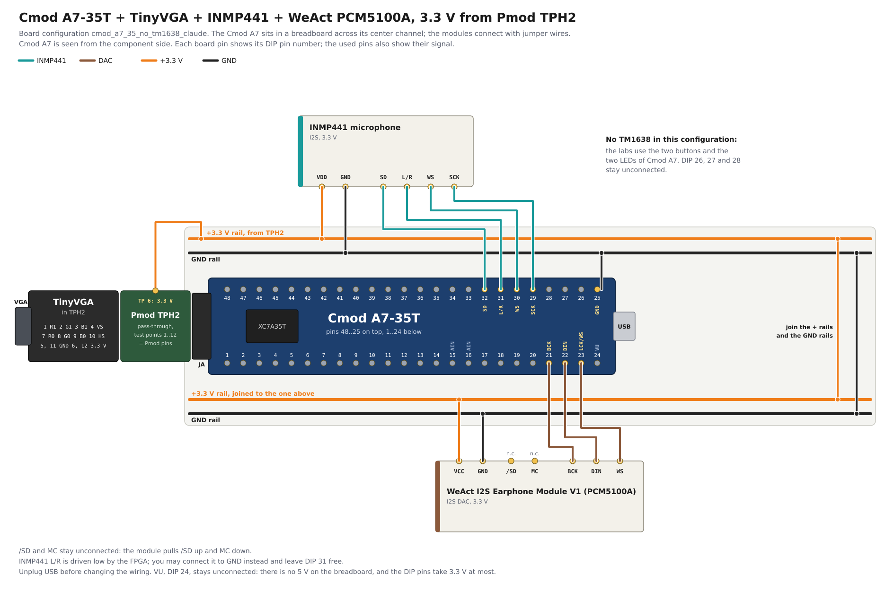
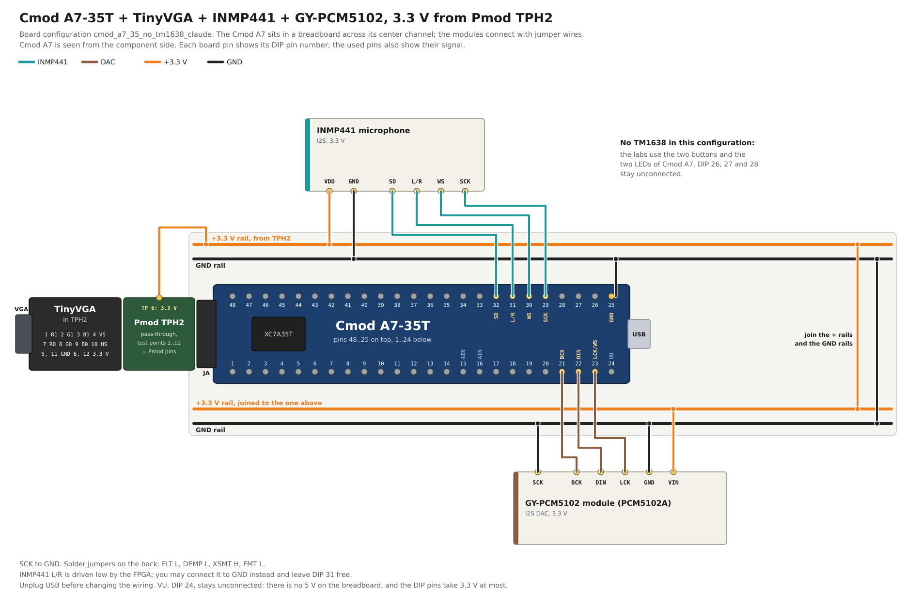
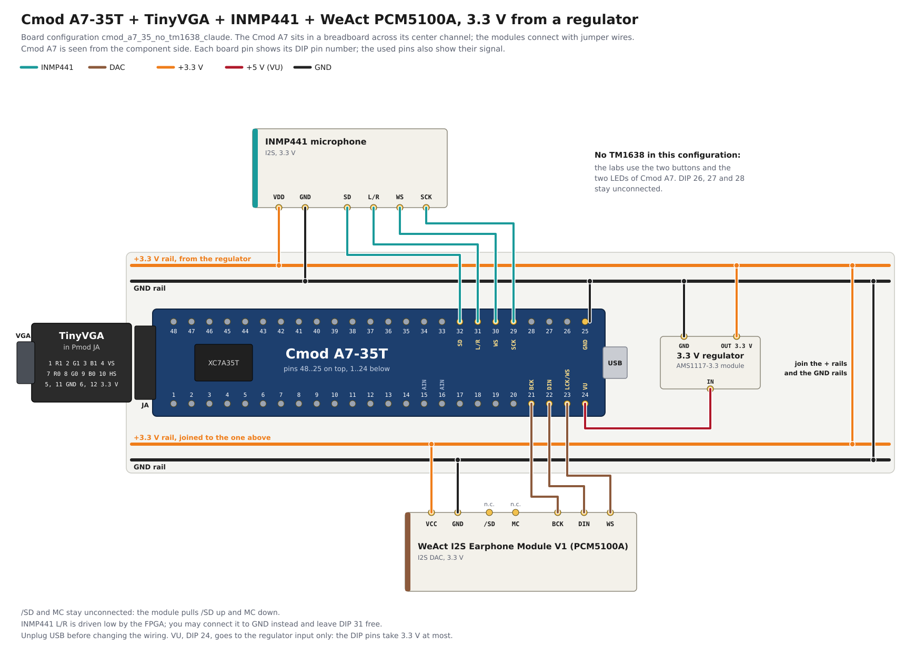
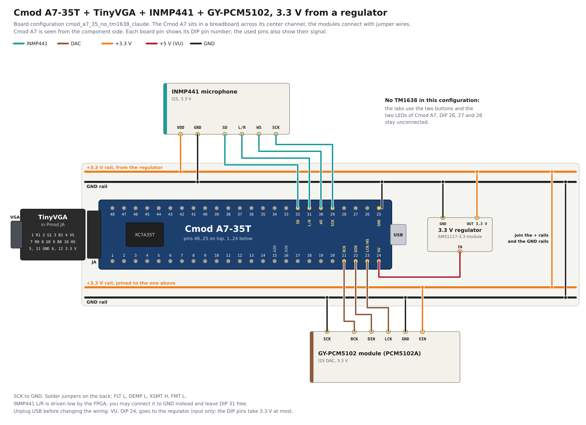

*Generated by Claude Opus 5.5 (`claude-opus-5-5`) in Claude Code 2.1.325, effort level xhigh, using prompt from Yuri Panchul. See the verbatim prompt in the [Appendix](#appendix-the-prompts).*

# Cmod A7-35T without TM1638: two buttons and two LEDs

Board configuration `cmod_a7_35_no_tm1638_claude`. Русская версия: [README_ru.md](README_ru.md).

This is [cmod_a7_35_claude](../cmod_a7_35_claude/README.md) without the TM1638 module. **The
labs get the two buttons of Cmod A7 as their keys and its two LEDs as their
LEDs, and there is no seven-segment display.** Everything else is that of
cmod_a7_35_claude: VGA 640x480 through TinyVGA, the microphone, the DAC, the 50 MHz clock from the MMCM, the pins and the wiring. The other configurations without TM1638 are
[cmod_a7_35_no_pll_vga_304_no_tm1638_claude](../cmod_a7_35_no_pll_vga_304_no_tm1638_claude/README.md), [cmod_a7_35_no_pll_vga_320_no_tm1638_claude](../cmod_a7_35_no_pll_vga_320_no_tm1638_claude/README.md).

## Contents

* [What is different](#what-is-different)
* [How it is made](#how-it-is-made)
* [The hardware and the wiring](#the-hardware-and-the-wiring)
* [Building and running the labs](#building-and-running-the-labs)
* [Status](#status)
* [Files](#files)
* [Appendix: the prompts](#appendix-the-prompts)

## What is different

| | [cmod_a7_35_claude](../cmod_a7_35_claude/README.md) | cmod_a7_35_no_tm1638_claude, this one |
|---|---|---|
| Keys of the labs | 8 keys of TM1638 | BTN0 and BTN1 of Cmod A7: `key[0]` and `key[1]`, also `sw[0]` and `sw[1]` |
| LEDs of the labs | 8 LEDs of TM1638, the first two also on LED1 and LED2 of Cmod A7 | LED1 and LED2 of Cmod A7: `led[0]` and `led[1]` |
| Seven-segment display | 8 digits of TM1638 | None |
| Reset button | Either Cmod button | None: both buttons are keys |
| DIP 26, 27, 28 | TM1638 STB, CLK, DIO | Unconnected |

A button gives 1 when pressed; an LED lights on 1. The labs get one
seven-segment digit that goes nowhere, so a lab that drives a display builds
and runs, and its display output is lost. Whatever a lab shows on LEDs
beyond the first two is lost the same way.

The design is in reset after loading until the MMCM locks. No button resets it: to start a lab again, load the FPGA again
with `./04_configure_fpga.bash`.

The design keeps DIP 26 and 27, the STB and CLK of TM1638 in cmod_a7_35_claude, high,
and does not drive DIP 28. Leave the three pins unconnected.

## How it is made

[board_specific_top.sv](board_specific_top.sv) has two lines of code. It
defines `FORCE_NO_INSTANTIATE_TM1638_BOARD_CONTROLLER_MODULE` and includes
the `board_specific_top.sv` of cmod_a7_35_claude, which then leaves out TM1638 even
though `peripherals/lab_specific_board_config.svh` turns it on. Other boards
of the repository without TM1638, such as `tang_nano_9k_hdmi_no_tm1638`, are
made the same way, but some of them draw a virtual TM1638 on the screen; this
one does not.

[board_specific.xdc](board_specific.xdc) is the one of cmod_a7_35_claude. It keeps the
lines of DIP 26, 27 and 28 uncommented, because the included top level still
has these ports.

## The hardware and the wiring

The parts, the 3.3 V source, the assembly and the wiring tables are those of
[cmod_a7_35_claude](../cmod_a7_35_claude/README.md) without TM1638: leave out the module and
its five wires. DIP 25 still goes to the GND rail. The pins in short:

| Cmod A7 | Connect to |
|---------|------------|
| Pmod JA | TinyVGA |
| DIP 21, 22, 23 | DAC BCK, DIN, and LCK of GY-PCM5102 or WS of WeAct |
| DIP 24, VU | Variant A: nothing. Variant B: the regulator input only |
| DIP 25 | GND rail |
| DIP 26, 27, 28 | Nothing |
| DIP 29, 30, 31, 32 | INMP441 SCK, WS, L/R, SD |

The drawings of this directory have no TM1638, for both DAC modules, WeAct
I2S Earphone Module (PCM5100A) and GY-PCM5102 (PCM5102A).

### Variant A: 3.3 V from Pmod TPH2





### Variant B: 3.3 V from a regulator





### Microphone, DAC and regulator plugged into the breadboard

[breadboard_weact.png](breadboard_weact.png) with the WeAct module and
[breadboard_gy_pcm5102.png](breadboard_gy_pcm5102.png) with GY-PCM5102 show
the microphone, the DAC and the regulator of variant B plugged straight into
the breadboard. The vector versions of all drawings are the `.svg` files of
the same names.

## Building and running the labs

In a lab directory, choose the board once with
`./06_choose_another_fpga_board.bash` and pick `cmod_a7_35_no_tm1638_claude`. Then build and load
as for [cmod_a7_35_claude](../cmod_a7_35_claude/README.md):

```bash
./03_synthesize_for_fpga.bash
./04_configure_fpga.bash
```

The scripts use Vivado for every board whose name starts with `cmod_a7`, so
this configuration needs no change of the scripts.

## Status

Built with Vivado 2026.1 with the configuration file of the scripts,
`peripherals/lab_specific_board_config.svh`, which turns TM1638 on: the
builds show that this configuration leaves it out all the same.

| Lab | LUTs | Registers | Worst setup slack |
|-----|-----:|----------:|------------------:|
| `labs/1_basics/1_05_7seven_segment_letter` | 43 | 50 | 15.6 ns |
| `labs/2_graphics/2_3_color_stripes` | 56 | 51 | 15.3 ns |
| `labs/3_music/3_10_spectrum_analyzer` | 2330 | 1477 | 1.8 ns |

All builds have no errors and no critical warnings, and meet all timing at
50 MHz, a clock period of 20 ns, with the MMCM of cmod_a7_35_claude. None of the
netlists has a TM1638 module. Vivado gives the design rule warning CFGBVS-1,
as for cmod_a7_35_claude; it does not stop the bitstream.

**Not yet tried on a real board.**

## Files

| File | What it is |
|------|------------|
| [board_specific_top.sv](board_specific_top.sv) | Defines `FORCE_NO_INSTANTIATE_TM1638_BOARD_CONTROLLER_MODULE` and includes the top level of cmod_a7_35_claude |
| [board_specific.xdc](board_specific.xdc) | The same as in cmod_a7_35_claude |
| [board_specific.tcl](board_specific.tcl) | FPGA part for Vivado |
| `wiring_*.svg`, `wiring_*.png` | The wiring diagrams without TM1638, for both DAC modules and both 3.3 V sources |
| `breadboard_*.svg`, `breadboard_*.png` | The breadboard layouts without TM1638, for both DAC modules |
| README.md, README.html | This instruction in English |
| README_ru.md, README_ru.html | The same in Russian |

The drawings come from the generators of cmod_a7_35_claude, run with the name of
this configuration; they leave out TM1638 for every name with
`_no_tm1638` in it:

```bash
cd ../cmod_a7_35_claude
python3 generate_wiring_diagram.py cmod_a7_35_no_tm1638_claude
python3 generate_breadboard_diagram.py cmod_a7_35_no_tm1638_claude
cd ../cmod_a7_35_no_tm1638_claude

for f in wiring_*.svg breadboard_*.svg
do
    # ${f%.svg} is the file name without the .svg suffix
    inkscape "$f" --export-type=png --export-dpi=96 \
        --export-background=white --export-filename="${f%.svg}.png"
done
```

## Appendix: the prompts

The rest of the design comes from the prompts in the appendix of
[cmod_a7_35_claude](../cmod_a7_35_claude/README.md#appendix-the-prompts). This configuration
comes from the following prompt, sent by Yuri Panchul in the same Claude Code
session on 16 November 2026, verbatim. The time is Pacific time (UTC−8).

**23:17**:

```text
keep README.csv with CR-LF for now; I will fix it later; first commint and push, then create 3 new configurations that do not use tm1638, just have 2 buttons, 2 leds and no 7-segement display: cmod_a7_35_no_tm1638
cmod_a7_35_no_pll_vga_304_no_tm1638
cmod_a7_35_no_pll_vga_320_no_tm1638
```

**00:43 on 17 November**:

```text
Add to all your cmod_a7 configurations suffix _claude. Update all the relevant files.
```
