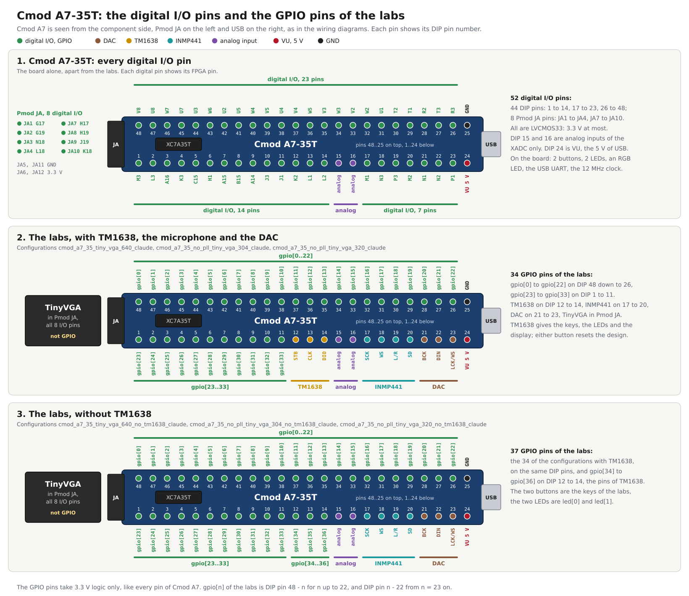
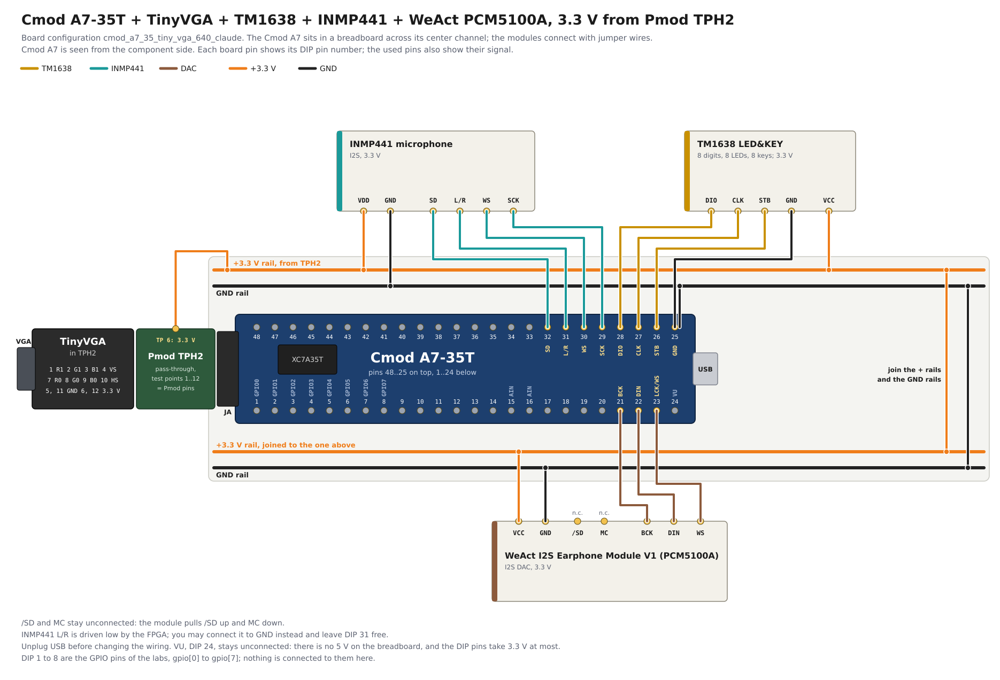
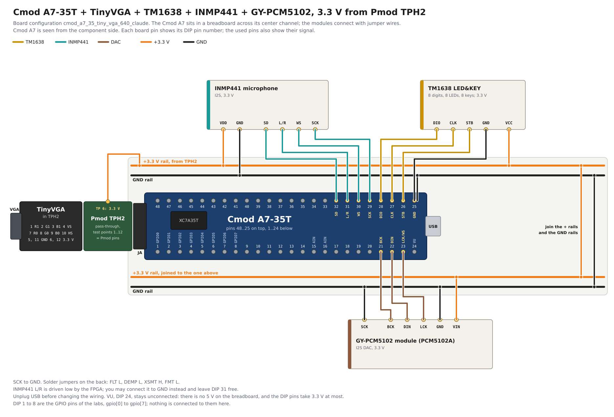
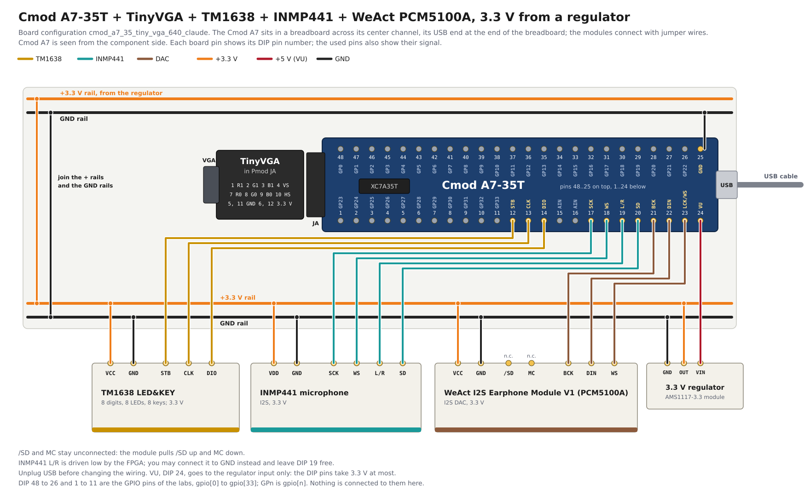
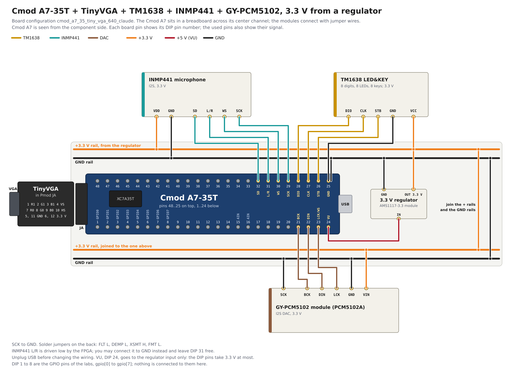
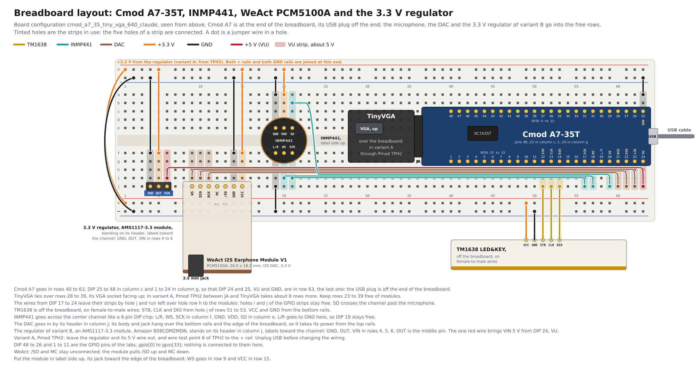
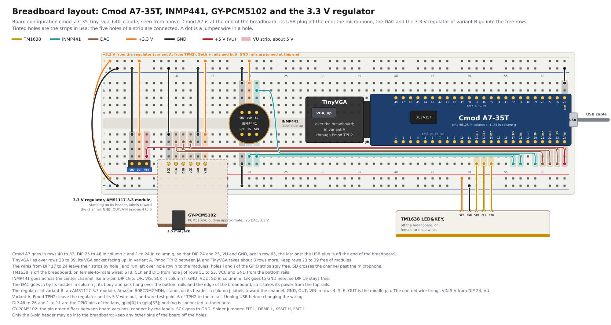
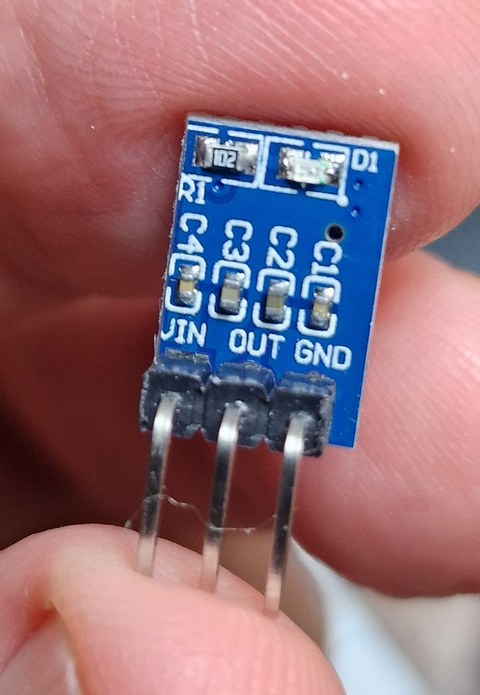

*Generated by Claude Opus 5.5 (`claude-opus-5-5`) in Claude Code 2.1.325, effort level xhigh, using prompt from Yuri Panchul. See the verbatim prompt in the [Appendix](#appendix-the-prompts).*

# Cmod A7-35T on a breadboard with TinyVGA, TM1638, a microphone and an I2S DAC

Board configuration `cmod_a7_35_tiny_vga_640_claude`. Русская версия: [README_ru.md](README_ru.md).

[Digilent Cmod A7-35T](https://digilent.com/reference/programmable-logic/cmod-a7/start)
is an Artix-7 FPGA (XC7A35T-1CPG236C) on a 48-pin DIP module, 0.7 by 2.75 inches,
made to be pushed into a solderless breadboard. It has a 12 MHz oscillator,
two buttons, two LEDs, an RGB LED, a USB port for JTAG and UART, one Pmod
socket and 44 digital I/O pins on its DIP pins. This configuration adds:

* **TinyVGA** in the Pmod socket JA: a VGA output, 640x480, 2 bits per color;
* **TM1638 LED&KEY** module: 8 seven-segment digits, 8 LEDs and 8 keys;
* **INMP441** I2S microphone module;
* one of two I2S DAC modules:
  * **WeAct I2S Earphone Module** with PCM5100A and a 32 Ω, 160 mW headphone
    amplifier, for headphones or active speakers;
  * the usual purple **GY-PCM5102** module with PCM5102A, whose line output
    is for active speakers or an amplifier, not for headphones.

The 34 digital DIP pins that the modules do not use are the GPIO pins of the
labs, `gpio[0]` to `gpio[33]`, free for circuits of your own: a whole side of
the board, DIP 26 to 48, and DIP 1 to 11. Without TM1638 its three pins are
`gpio[34]` to `gpio[36]` as well.

Both DAC modules use the same three FPGA pins, so the design is the same for
either of them; only the wiring of their power and configuration pins differs.

All the modules run from 3.3 V, and the DIP pins of Cmod A7 have no 3.3 V
pin. The instruction gives two ways to get it, and the FPGA design is the same
for both; see [Power](#power):

* **A: Pmod TPH2.** A Digilent pass-through between JA and TinyVGA brings the
  board's own 3.3 V from the Pmod socket. No 5 V on the breadboard.
* **B: a 3.3 V regulator.** A regulator module makes 3.3 V from VU, the USB
  5 V on DIP pin 24.

The older configuration in
[zzz_postponed_and_retired/cmod_a7](../zzz_postponed_and_retired/cmod_a7)
targets the wrong FPGA, XC7A15T, and is not used.

## Contents

* [Parts](#parts)
* [The pin plan](#the-pin-plan)
* [Power](#power)
* [Wiring diagrams](#wiring-diagrams)
* [Wiring tables](#wiring-tables)
* [Assembly, step by step](#assembly-step-by-step)
* [Building and running the labs](#building-and-running-the-labs)
* [Buttons and LEDs](#buttons-and-leds)
* [Clock and VGA](#clock-and-vga)
* [The other five configurations](#the-other-five-configurations)
* [Troubleshooting](#troubleshooting)
* [Status](#status)
* [Files](#files)
* [Sources](#sources)
* [Appendix: the prompts](#appendix-the-prompts)

## Parts

| Part | Notes |
|------|-------|
| Digilent Cmod A7-35T | Not the 15T: the FPGA part in [board_specific.tcl](board_specific.tcl) is `xc7a35tcpg236-1`. |
| Micro-USB cable | A data cable, not a charge-only one. A right-angle plug keeps the cable off the breadboard. |
| Solderless breadboard | A full-size one, 830 holes, with a pair of power rails on each long side. |
| TinyVGA Pmod | By Leo Moser, [mole99/tiny-vga](https://github.com/mole99/tiny-vga). Bought assembled or ordered from JLCPCB: see [Where to get TinyVGA](#where-to-get-tinyvga). Plus a VGA cable and a monitor that accepts 640x480 at 60 Hz. |
| TM1638 LED&KEY module | 8 digits, 8 LEDs, 8 keys, a 5-pin header VCC, GND, STB, CLK, DIO. |
| INMP441 module | The round I2S microphone board with 6 pins. |
| One DAC module | WeAct I2S Earphone Module (PCM5100A) or GY-PCM5102 (PCM5102A). For WeAct, headphones of 32 Ω or more or active speakers; for GY-PCM5102, active speakers or an amplifier, because its output is line level. Both with a 3.5 mm plug. |
| For variant A: Digilent Pmod TPH2 | A 12-pin pass-through with a test point for each Pmod pin. It goes between JA and TinyVGA. |
| For variant B: a 3.3 V regulator module | A 3-pin AMS1117-3.3 module, for example [Amazon B08CDMZMDN](https://www.amazon.com/dp/B08CDMZMDN), a pack of 20: 4.75 to 12 V in, 3.3 V out, up to 800 mA, about 8.6 x 12.3 mm, with a power LED and the pins VIN, OUT, GND, in this order, on a right-angle header. Any 3.3 V module that works from 5 V and gives at least 300 mA will do. |
| Jumper wires | Male-to-male for the breadboard, female-to-male for the module headers and the TPH2 test point. |
| Multimeter | To check the power rails before the modules are connected. |

### Where to get TinyVGA

TinyVGA, spelled Tiny VGA by its author, is an open hardware Pmod board by
Leo Moser. It was made for the chips of [Tiny Tapeout](https://tinytapeout.com/)
and works with any FPGA board that has a Pmod socket. Its repository,
[github.com/mole99/tiny-vga](https://github.com/mole99/tiny-vga), holds the
KiCad project, the pinout and the files for ordering it, under the CC BY-SA
4.0 license. The board has a right-angle 12-pin Pmod plug, a 74LVC245 buffer,
a resistor DAC of 2 bits for each color and a VGA socket. Its VCC must be
3.3 V, which JA gives.

There are two ways to get one.

**Buy it assembled.** The Tiny Tapeout store sells it as
[Tiny VGA Pmod](https://store.tinytapeout.com/products/TinyVGA-Pmod-p678647356),
fully assembled, for €15.00 in November 2026; the page shows the current
price and stock. The author does not sell it directly.

**Order it from JLCPCB.** The board is laid out to be made and assembled by
[JLCPCB](https://jlcpcb.com/), and the repository holds the files for that in
`pcb/jlcpcb/production_files/`. Take all three files from one revision. The
links below are to revision
[a081ae63](https://github.com/mole99/tiny-vga/tree/a081ae634119aae719237aee5c6b5e53549d1c81/pcb/jlcpcb/production_files),
the latest in November 2026:

| File | What it is |
|------|------------|
| [GERBER-tiny-vga.zip](https://raw.githubusercontent.com/mole99/tiny-vga/a081ae634119aae719237aee5c6b5e53549d1c81/pcb/jlcpcb/production_files/GERBER-tiny-vga.zip) | The Gerber files of the board |
| [BOM-tiny-vga.csv](https://raw.githubusercontent.com/mole99/tiny-vga/a081ae634119aae719237aee5c6b5e53549d1c81/pcb/jlcpcb/production_files/BOM-tiny-vga.csv) | The parts list, with the LCSC part number of each part. The two connectors are J1, the Pmod plug, LCSC C2935938, and J2, the VGA socket, LCSC C138387. |
| [CPL-tiny-vga.csv](https://raw.githubusercontent.com/mole99/tiny-vga/a081ae634119aae719237aee5c6b5e53549d1c81/pcb/jlcpcb/production_files/CPL-tiny-vga.csv) | The placement of the parts |

The steps, as in the README of the repository:

1. Create an account at JLCPCB.
2. Upload `GERBER-tiny-vga.zip`. The default options will do; you may change
   the quantity or the color of the board, and remove the order number.
3. Turn on PCB Assembly and keep its settings.
4. Click Next and upload `BOM-tiny-vga.csv` and `CPL-tiny-vga.csv`.
5. Check the placement of the parts in the preview: some may need to be
   rotated.
6. Check that the order has both connectors, J1 (C2935938) and J2
   (C138387). Both are through-hole parts; without them the board comes
   without its Pmod plug and VGA socket.
7. Check out.

A board costs less when several are ordered at once; the author suggests
ordering about ten and giving the spare ones to others nearby. The author is
not affiliated with JLCPCB.

## The pin plan

The DIP pins of Cmod A7 are numbered like the pins of a DIP chip seen from the
component side, with the Pmod socket at the top: pins 1 to 24 run down the
left side, pins 25 to 48 run up the right side. Pin 24, VU, and pin 25, GND,
are the two pins at the USB end; pins 15 and 16 are analog inputs.

All the modules are on the side of DIP 1 to 24, near its USB end, so that the
other side, DIP 26 to 48, is free from end to end:

| DIP pins | Use | Why there |
|----------|-----|-----------|
| 48 down to 26 | GPIO pins of the labs, `gpio[0]` on DIP 48 to `gpio[22]` on DIP 26 | A whole side of free pins, numbered from the Pmod end. |
| 1 to 11 | GPIO pins of the labs, `gpio[23]` on DIP 1 to `gpio[33]` on DIP 11 | The other free pins, numbered on from the Pmod end of the other side. |
| 12, 13, 14 | TM1638 STB, CLK, DIO; without TM1638, `gpio[34]` to `gpio[36]` | The order of STB, CLK and DIO on the TM1638 header: three parallel wires. |
| 15, 16 | Unused | Analog inputs only. |
| 17, 18, 19, 20 | INMP441 SCK, WS, L/R, SD | One row of the INMP441 module reads SCK, WS, L/R; SD is next to SCK in the other row. |
| 21, 22, 23 | DAC BCK, DIN, LCK (WS on WeAct) | The same order as on the headers of both DAC modules. |
| 24, 25 | VU and GND | The power pins at the USB end. |

Every digital DIP pin that the modules do not use is a GPIO pin of the labs,
free for circuits of your own: 34 with TM1638 and 37 without it. `gpio[n]` is
DIP 48 − n for n up to 22, and DIP n − 22 from n = 23 on.

TinyVGA plugs into the Pmod socket JA, in variant A through Pmod TPH2. The RGB
LED, the buttons, the LEDs and the USB UART are on the board.
The GPIO pins take 3.3 V logic only, like every DIP pin; see the warnings
under [Power](#power).

[gpio_layouts.png](gpio_layouts.png) shows the pins three ways: every
digital I/O pin of Cmod A7 apart from the labs, the GPIO pins of the labs
with TM1638, the microphone and the DAC, and those without TM1638.



The constraint file [board_specific.xdc](board_specific.xdc) is
[Cmod-A7-Master.xdc](https://github.com/Digilent/digilent-xdc/blob/master/Cmod-A7-Master.xdc)
of Digilent, with only the lines of the used pins uncommented and nothing else
changed. So the ports keep Digilent's names, `pio21` for DIP pin 21, `ja[0]`
for Pmod pin 1, and so on, and all the mapping of these names to TM1638,
microphone, DAC and VGA signals is in
[board_specific_top.sv](board_specific_top.sv).

## Power

**The breadboard needs a source of 3.3 V.** The DIP pins of Cmod A7 have no
3.3 V output: of the 48 pins, 44 are FPGA I/O, 15 and 16 are analog inputs,
24 is VU and 25 is GND. The board's 3.3 V comes out only on pins 6 and 12 of
the Pmod socket JA, and TinyVGA takes that socket and uses them itself. The
reference manual says that when Cmod A7 is powered from USB, VU is driven
from the USB 5 V through a Schottky diode, so it is close to 5 V and can power
external circuits.

Choose one of two ways to bring 3.3 V to the breadboard:

| | A: Pmod TPH2 | B: 3.3 V regulator |
|---|--------------|--------------------|
| The part | Digilent Pmod TPH2: it passes all 12 Pmod pins straight through and has a test point for each, numbered as the Pmod pins | A 3.3 V regulator module, for example AMS1117-3.3 |
| Where it goes | Between JA and TinyVGA | Away from the DIP pins: in the free rows beyond TinyVGA, or off the breadboard on wires |
| Where the 3.3 V comes from | The 3.3 V rail of Cmod A7, from test point 6 of TPH2; test point 12 is 3.3 V as well | VU, DIP pin 24 |
| Power wires | One: test point 6 to the + rail | Three: DIP 24 to the input, the output to the + rail, GND to a GND rail |
| 5 V on the breadboard | None: VU stays unconnected | One wire, from DIP 24 to the regulator input |
| Current | The modules share the 0.6 A of the board's 3.3 V rail with the FPGA I/O, the SRAM, the LEDs and TinyVGA | The modules take their current from the regulator, not from the board's 3.3 V rail |
| TinyVGA | Sticks out 2 cm further, on TPH2 | Plugs straight into JA |

**Everything on the breadboard runs from 3.3 V, in both variants.** There is
no 5 V rail: the DIP pins have no series resistors and take 3.75 V at most,
so a 5 V rail along them would be one misplaced wire away from a damaged
FPGA. In variant B the only 5 V is the wire from DIP pin 24 to the regulator
input.

Use the two rail pairs of the breadboard like this:

| Rail pair | + rail | − rail |
|-----------|--------|--------|
| On the side of DIP pins 25 to 48 | +3.3 V, from test point 6 of TPH2 (A); the regulator output (B) may go to either + rail | GND |
| On the side of DIP pins 1 to 24 | +3.3 V, joined to the other + rail | GND |

Connect the two + rails to each other, and the two GND rails to each other and
to DIP pin 25.

| Module | Supply | Why |
|--------|--------|-----|
| TM1638 | +3.3 V | Its DIO line drives an FPGA pin, and the module pulls DIO up to its own VCC. At 5 V that would put 5 V on the FPGA pin. |
| INMP441 | +3.3 V | Its supply range is 1.62 to 3.63 V. |
| WeAct PCM5100A | +3.3 V | VCC feeds the module's own 3.3 V regulator (ME6231), which powers the PCM5100A, and its headphone amplifier (HT97226). From 3.3 V the regulator gives about 3.2 V, within the 3.0 to 3.6 V that PCM5100A needs, but with little margin: check it as in step 11 of the assembly. |
| GY-PCM5102 | +3.3 V | VIN is listed as 3.3 to 5 V. The usual board feeds PCM5102A through regulators of its own, so from 3.3 V the chip gets a little less; boards differ, so check it as in step 11 of the assembly. |

Warnings from the Cmod A7 reference manual:

* The DIP pins are connected straight to the FPGA, without series resistors.
  While the board is powered they take −0.4 to 3.75 V at most; never connect
  VU to a signal pin.
* While the board is not powered, the DIP pins take 0.55 V at most. Power
  every module from Cmod A7, as here, so that no module drives a pin of an
  unpowered FPGA.
* With USB connected, VU carries the USB voltage. Never connect another power
  supply to VU while USB is connected.
* The 3.3 V rail of Cmod A7 gives at most 0.6 A for the whole board: the
  FPGA I/O, the SRAM, the LEDs and the Pmod socket, TinyVGA included. In
  variant A it feeds all the modules on the breadboard as well; of these,
  TM1638 with all its LEDs lit at full brightness takes the most.

## Wiring diagrams

There is one diagram for each 3.3 V source and DAC module; only the power
wiring and the DAC differ. The diagrams show Cmod A7 from the component side,
turned so that the Pmod socket is on the left: DIP pins 48 to 25 are along the
top edge and 1 to 24 along the bottom edge. The USB end of Cmod A7 is at the
end of the breadboard, so that the USB cable leaves it, and TinyVGA lies over
the breadboard at the other end. All six configurations use these drawings;
[without TM1638](#without-tm1638), leave out the module and its five wires.

### Variant A: 3.3 V from Pmod TPH2

With the WeAct I2S Earphone Module:



With GY-PCM5102:



### Variant B: 3.3 V from a regulator

With the WeAct I2S Earphone Module:



With GY-PCM5102:



Vector versions: [wiring_weact_tph2.svg](wiring_weact_tph2.svg),
[wiring_gy_pcm5102_tph2.svg](wiring_gy_pcm5102_tph2.svg),
[wiring_weact_regulator.svg](wiring_weact_regulator.svg),
[wiring_gy_pcm5102_regulator.svg](wiring_gy_pcm5102_regulator.svg).

### Microphone, DAC and regulator plugged into the breadboard

Instead of hanging the microphone and the DAC on female-to-male wires, you can
plug both straight into the breadboard, together with the regulator of variant B,
and connect their strips with male-to-male wires, as the two drawings below
show. In short:

* Cmod A7 goes in at the end of the breadboard, rows 40 to 63, with DIP pins
  25 to 48 in column c and 1 to 24 in column g: DIP 24 and 25, VU and GND, are
  in row 63, the last one. The USB plug is off the end of the breadboard, so
  the USB cable does not cross it. That leaves holes a and b free on one side,
  h, i and j on the other.
* TinyVGA, in JA at the other end of Cmod A7, lies over rows 28 to 39, its
  VGA socket facing up. In variant A, TPH2 between JA and TinyVGA takes about
  8 rows more: keep rows 23 to 39 free of modules.
* The modules go into the free rows at the far end: the regulator in rows 4 to
  6, the DAC in rows 9 to 15 and INMP441 in rows 19 to 21. The wires from DIP
  17 to 24 leave their strips by hole j and run left over hole row h, so that
  holes i and j of the GPIO strips stay free.
* INMP441 goes across the center channel like a 6-pin DIP chip, label side
  up: L/R, WS and SCK in column f, GND, VDD and SD in column e. Its L/R goes
  to the GND rail, so DIP 19 stays free; the wire of SD crosses the channel
  just past the microphone.
* The DAC goes in by its header in column j. Its body and jack hang over the
  bottom rails and the edge of the breadboard, so its power and GND wires go
  to the top rails. Only the main header of GY-PCM5102 may go into the holes,
  and its outline in the drawing is approximate.
* The regulator, a 3-pin AMS1117-3.3 module, stands on its right-angle header
  in column j, away from the DIP pins of Cmod A7, where there is room for it.
  Its labels face the channel: GND in row 4, OUT in row 5, VIN in row 6. OUT
  is the middle pin, not GND. Its board then stands between column j and the
  bottom rails, and hole i stays free. One wire, the only one with 5 V, brings
  VU from the strip of DIP 24 to VIN. GND and OUT go to the top rails, because
  the board of the module is in the way of the bottom ones.
* TM1638 stays off the breadboard, on female-to-male wires as in the wiring
  diagrams: STB, CLK and DIO from hole j of rows 51 to 53, VCC and GND from
  the bottom rails.
* In variant A, leave the regulator and its 5 V wire out and wire test point
  6 of TPH2 to the + rail as above.

With the WeAct I2S Earphone Module:



With GY-PCM5102:



Vector versions: [breadboard_weact.svg](breadboard_weact.svg),
[breadboard_gy_pcm5102.svg](breadboard_gy_pcm5102.svg).

The regulator module of Amazon B08CDMZMDN, label side: its pins are VIN,
OUT and GND, in this order, on a right-angle header, so the module stands on
the breadboard. D1 is its power LED.



## Wiring tables

### Cmod A7 DIP pins

| DIP pin | FPGA pin | Port in board_specific.xdc | Signal | Connect to |
|--------:|---------:|----------------------------|--------|------------|
| 1 | M3 | `pio1` | `gpio[23]` | Free: GPIO of the labs |
| 2 | L3 | `pio2` | `gpio[24]` | Free: GPIO of the labs |
| 3 | A16 | `pio3` | `gpio[25]` | Free: GPIO of the labs |
| 4 | K3 | `pio4` | `gpio[26]` | Free: GPIO of the labs |
| 5 | C15 | `pio5` | `gpio[27]` | Free: GPIO of the labs |
| 6 | H1 | `pio6` | `gpio[28]` | Free: GPIO of the labs |
| 7 | A15 | `pio7` | `gpio[29]` | Free: GPIO of the labs |
| 8 | B15 | `pio8` | `gpio[30]` | Free: GPIO of the labs |
| 9 | A14 | `pio9` | `gpio[31]` | Free: GPIO of the labs |
| 10 | J3 | `pio10` | `gpio[32]` | Free: GPIO of the labs |
| 11 | J1 | `pio11` | `gpio[33]` | Free: GPIO of the labs |
| 12 | K2 | `pio12` | `TM_STB`; without TM1638 `gpio[34]` | TM1638 STB; without TM1638, free |
| 13 | L1 | `pio13` | `TM_CLK`; without TM1638 `gpio[35]` | TM1638 CLK; without TM1638, free |
| 14 | L2 | `pio14` | TM1638 DIO; without TM1638 `gpio[36]` | TM1638 DIO; without TM1638, free |
| 15, 16 | — | — | Analog inputs | Nothing |
| 17 | M1 | `pio17` | `MIC_SCK` | INMP441 SCK |
| 18 | N3 | `pio18` | `MIC_WS` | INMP441 WS |
| 19 | P3 | `pio19` | `MIC_LR` | INMP441 L/R |
| 20 | M2 | `pio20` | `MIC_SD` | INMP441 SD |
| 21 | N1 | `pio21` | `DAC_BCK` | DAC BCK |
| 22 | N2 | `pio22` | `DAC_DIN` | DAC DIN |
| 23 | P1 | `pio23` | `DAC_LCK` | GY-PCM5102 LCK, WeAct WS |
| 24 | — | — | VU, about 5 V | A: nothing. B: the regulator input, and nothing else |
| 25 | — | — | GND | GND rail |
| 26 | R3 | `pio26` | `gpio[22]` | Free: GPIO of the labs |
| 27 | T3 | `pio27` | `gpio[21]` | Free: GPIO of the labs |
| 28 | R2 | `pio28` | `gpio[20]` | Free: GPIO of the labs |
| 29 | T1 | `pio29` | `gpio[19]` | Free: GPIO of the labs |
| 30 | T2 | `pio30` | `gpio[18]` | Free: GPIO of the labs |
| 31 | U1 | `pio31` | `gpio[17]` | Free: GPIO of the labs |
| 32 | W2 | `pio32` | `gpio[16]` | Free: GPIO of the labs |
| 33 | V2 | `pio33` | `gpio[15]` | Free: GPIO of the labs |
| 34 | W3 | `pio34` | `gpio[14]` | Free: GPIO of the labs |
| 35 | V3 | `pio35` | `gpio[13]` | Free: GPIO of the labs |
| 36 | W5 | `pio36` | `gpio[12]` | Free: GPIO of the labs |
| 37 | V4 | `pio37` | `gpio[11]` | Free: GPIO of the labs |
| 38 | U4 | `pio38` | `gpio[10]` | Free: GPIO of the labs |
| 39 | V5 | `pio39` | `gpio[9]` | Free: GPIO of the labs |
| 40 | W4 | `pio40` | `gpio[8]` | Free: GPIO of the labs |
| 41 | U5 | `pio41` | `gpio[7]` | Free: GPIO of the labs |
| 42 | U2 | `pio42` | `gpio[6]` | Free: GPIO of the labs |
| 43 | W6 | `pio43` | `gpio[5]` | Free: GPIO of the labs |
| 44 | U3 | `pio44` | `gpio[4]` | Free: GPIO of the labs |
| 45 | U7 | `pio45` | `gpio[3]` | Free: GPIO of the labs |
| 46 | W7 | `pio46` | `gpio[2]` | Free: GPIO of the labs |
| 47 | U8 | `pio47` | `gpio[1]` | Free: GPIO of the labs |
| 48 | V8 | `pio48` | `gpio[0]` | Free: GPIO of the labs |

### TinyVGA in Pmod JA

TinyVGA follows the Pmod pinout: pins 5 and 11 are GND, 6 and 12 are 3.3 V,
the same as on JA, so it plugs in with no wires. In variant A, TPH2 goes in
between: TPH2 passes every pin straight through, so the table holds the same.

| Pmod pin | FPGA pin | Port | TinyVGA signal |
|---------:|---------:|------|----------------|
| 1 | G17 | `ja[0]` | R1, red MSB |
| 2 | G19 | `ja[1]` | G1, green MSB |
| 3 | N18 | `ja[2]` | B1, blue MSB |
| 4 | L18 | `ja[3]` | VS, vertical sync |
| 7 | H17 | `ja[4]` | R0, red LSB |
| 8 | H19 | `ja[5]` | G0, green LSB |
| 9 | J19 | `ja[6]` | B0, blue LSB |
| 10 | K18 | `ja[7]` | HS, horizontal sync |
| 5, 11 | — | — | GND |
| 6, 12 | — | — | 3.3 V |

### The 3.3 V source

Variant A, Pmod TPH2:

| TPH2 | Connect to |
|------|------------|
| Its Pmod plug | Pmod socket JA |
| Its Pmod socket | TinyVGA |
| Test point 6 | + rail on the side of DIP pins 25 to 48 |

Variant B, the regulator module. Its pins are labeled VIN, OUT and GND, in
this order: OUT is the middle pin, not GND.

| Regulator pin | Connect to |
|---------------|------------|
| VIN | DIP 24, VU |
| OUT | A + rail; the two are joined |
| GND | GND rail |

VU is USB 5 V less the drop of a diode, so it can be a little under the 4.75 V for which
the AMS1117-3.3 module is rated. AMS1117 needs at most 1.3 V more at its input than at
its output, even at its full 800 mA, so 4.5 V at the input still gives at least 3.2 V;
step 5 of the assembly checks it.

In both variants, join the two + rails to each other.

### TM1638 LED&KEY

| TM1638 pin | Connect to |
|------------|------------|
| VCC | +3.3 V rail |
| GND | GND rail |
| STB | DIP 12 |
| CLK | DIP 13 |
| DIO | DIP 14 |

### INMP441

The module has two rows of three pins. Seen from the side with the labels,
one row reads SCK, WS, L/R and the other SD, VDD, GND, with SD next to SCK.

| INMP441 pin | Connect to |
|-------------|------------|
| SCK | DIP 17 |
| WS | DIP 18 |
| L/R | DIP 19 |
| SD | DIP 20 |
| VDD | +3.3 V rail |
| GND | GND rail |

The FPGA drives L/R low, which selects the left channel, as on the other boards
of the repository. You may instead connect L/R to GND and leave DIP 19 free.

### DAC: WeAct I2S Earphone Module V1 (PCM5100A)

Its 7-pin header reads VCC, GND, /SD, MC, BCK, DIN, WS.

| WeAct pin | Connect to |
|-----------|------------|
| VCC | +3.3 V rail |
| GND | GND rail |
| /SD | nothing: the module pulls it up, so the amplifier is on |
| MC | nothing: the module pulls it down, and the DAC makes its master clock from BCK |
| BCK | DIP 21 |
| DIN | DIP 22 |
| WS | DIP 23 |

There is nothing to set on this module: its schematic ties the FMT and FLT
pins of PCM5100A low, for I2S and the normal filter, and pulls DEMP low through
10 kΩ. Leave its solder jumper S1, de-emphasis, open. The 3.5 mm jack is for
headphones of 32 Ω or more.

### DAC: GY-PCM5102 (PCM5102A)

Its main header usually reads SCK, BCK, DIN, LCK, GND, VIN. The order differs
between versions of the board, so go by the labels.

| GY-PCM5102 pin | Connect to |
|----------------|------------|
| SCK | GND rail |
| BCK | DIP 21 |
| DIN | DIP 22 |
| LCK | DIP 23 |
| GND | GND rail |
| VIN | +3.3 V rail |

Before the first use, check the four solder jumpers on the back, marked
1 to 4 or H1L to H4L. For I2S they must be:

| Jumper | Pin of PCM5102A | Setting |
|--------|-----------------|---------|
| 1, H1L | FLT, filter | L |
| 2, H2L | DEMP, de-emphasis | L |
| 3, H3L | XSMT, soft mute | **H**, otherwise the DAC stays muted |
| 4, H4L | FMT, audio format | L, I2S |

Some boards come with these jumpers unsoldered or set wrong. If the SCK pad
of the board is bridged to GND, the SCK wire to GND is not needed, but it does
no harm. Never connect SCK to an FPGA pin: on a board with that bridge it
would short the pin to GND.

**Its 3.5 mm jack is a line output.** PCM5102A drives loads of 1 kΩ or more,
such as the input of active speakers or of an amplifier, not headphones of
32 Ω. Of the two modules, only WeAct has a headphone amplifier.

## Assembly, step by step

Work with the USB cable unplugged.

1. **Place Cmod A7.** Push it into the breadboard across the center channel,
   at one end of the breadboard, with the USB connector over the end of the
   breadboard and the Pmod socket pointing inward. DIP pins 24 and 25, VU and
   GND, go into the last row of holes, so that the USB cable leaves the
   breadboard without crossing it. The two rows of pins are 0.6 inch apart,
   so one of them ends up one hole from the channel and the other two holes
   from it: every pin keeps two or three free holes in its row for the wires.
2. **Plug in TinyVGA.** In variant A, push TPH2 into JA, then TinyVGA into
   TPH2; in variant B, push TinyVGA straight into JA. Keep all component sides
   up, and check that pins 5, 6, 11 and 12, GND and VCC, meet those of the
   socket each time: a Pmod plugged in the wrong way puts 3.3 V on signal
   pins. The Pmod boards lie over the breadboard and the VGA socket of
   TinyVGA faces up; support the VGA cable so that its weight does not lever
   the Pmod socket. Keep the rows under them free of modules.
3. **Make the GND rails.** Connect DIP pin 25 to the − rail on the side of
   pins 25 to 48, and connect the two − rails to each other at the far end of
   the breadboard. On many breadboards the rails are split in the middle, as a
   gap in their colored lines shows; bridge such gaps.
4. **Make the +3.3 V rails.** In variant A, connect test point 6 of TPH2 to
   the + rail on the side of pins 25 to 48 with a female-to-male wire, and
   leave DIP pin 24, VU, unconnected. In variant B, put the regulator module
   in the free rows at the far end of the breadboard, away from the DIP pins;
   connect its VIN to DIP pin 24, VU, which is the only 5 V wire, its GND to
   a GND rail and its OUT, the middle pin, to a + rail. In both variants,
   connect the two + rails to each other at the far end of the breadboard,
   bridging any gaps, as with the GND rails.
5. **Check the power.** Plug in USB. With the multimeter, both + rails should
   show 3.2 to 3.5 V against GND; in variant B the LED of the regulator
   module lights, and its VIN should show about 4.5 to 5 V. Below 3.2 V the
   DAC has too little margin: find the cause first. Unplug USB.
6. **Connect TM1638.** Three female-to-male wires from DIP pins 12, 13 and
   14 to the TM1638 pins STB, CLK and DIO, in this order, and two from its
   GND and VCC to a GND rail and the +3.3 V rail. Without TM1638, skip this.
7. **Connect INMP441.** Wires from DIP pins 17, 18, 19 and 20 to SCK, WS, L/R
   and SD; VDD to the +3.3 V rail, GND to a GND rail.
8. **Connect the DAC.** Wires from DIP pins 21, 22 and 23 to BCK, DIN and LCK
   (WS on WeAct); VCC or VIN to the +3.3 V rail, GND to a GND rail. On
   GY-PCM5102 also connect SCK to GND and check the solder jumpers. On WeAct
   leave /SD and MC unconnected.
9. **Check the wiring** against the table [Cmod A7 DIP pins](#cmod-a7-dip-pins)
   once more: no signal pin of Cmod A7 may touch a + rail, and DIP pin 24, VU,
   goes nowhere in variant A and only to the regulator input in variant B.
10. Connect the VGA monitor, and headphones (WeAct only) or active speakers,
    then plug in USB.
11. **Check the supply of the DAC under load.** Load a lab that plays sound,
    for example one from `labs/3_music`, and while it plays, measure VCC on
    WeAct or VIN on GY-PCM5102 against GND, on the pins of the module
    itself: it should show 3.2 V or more. PCM510xA needs at least 3.0 V, and
    both modules feed it through a regulator of their own, which takes a
    little. Where you can reach the output of that regulator, for example
    across its output capacitor, it should show 3.0 V or more. If the supply
    is lower, check the + rail wiring; in variant A, try variant B, whose
    regulator feeds only the modules.

## Building and running the labs

In a lab directory, choose the board once with
`./06_choose_another_fpga_board.bash` and pick `cmod_a7_35_tiny_vga_640_claude`. Then
`./03_synthesize_for_fpga.bash` builds the design with Vivado and loads it into
the FPGA over USB. The scripts load the FPGA itself, not the flash memory of the
board, so the design is lost when the power goes off; `./04_configure_fpga.bash`
loads it again. The other five configurations are built the same way; see
[The other five configurations](#the-other-five-configurations).

Good first labs:

* `labs/2_graphics/2_3_color_stripes`: the VGA output;
* `labs/1_basics/1_01_and_or_not_xor_de_morgan`: the TM1638 keys and LEDs;
* `labs/3_music/3_0_oscilloscope`: the microphone signal on the monitor;
  the microphone, the DAC and the TM1638 are all used by the labs in `labs/3_music`.

## Buttons and LEDs

| On Cmod A7 | FPGA pin | Port | Use |
|------------|---------:|------|-----|
| BTN0, BTN1 | A18, B18 | `btn[0]`, `btn[1]` | With TM1638, as in most labs: either button resets the design, and the labs take their keys from TM1638. Without TM1638: `key[0]` and `key[1]` of the labs. |
| LED1, LED2 | A17, C16 | `led[0]`, `led[1]` | `led[0]` and `led[1]` of the labs; TM1638 shows all eight. |
| RGB LED | B17, B16, C17 | `led0_b`, `led0_g`, `led0_r` | Red while the design is in reset, green while it runs; blue is not used. It lights when a pin is low. At full brightness it dazzles, so the design lights it 1/16 of the time, at 12 MHz / 4096 = 2.9 kHz. |
| USB UART | J17, J18 | `uart_txd_in`, `uart_rxd_out` | `uart_rx` and `uart_tx` of the labs. |

The design is also reset after loading, until the clock generator is ready.
Without TM1638 there is no reset button: both buttons are keys. With the
scripts of the repository as they are, though, TM1638 is always on for this
board; see [Status](#status). For a design without TM1638, with two buttons,
two LEDs and no seven-segment display, use one of the configurations
[without TM1638](#without-tm1638).

## Clock and VGA

The oscillator of Cmod A7 runs at 12 MHz. The VGA module of the repository,
[peripherals/vga.sv](../../peripherals/vga.sv), makes its 25 MHz pixel rate
from a faster clock with a clock enable: it counts `CLK_MHZ / PIXEL_MHZ` cycles
of the clock per pixel. This needs a clock that is a multiple of 25 MHz. With
12 MHz, `CLK_MHZ / PIXEL_MHZ` is 0 and the module never produces a pixel, and a
pixel clock of 12 MHz cannot make the standard 640x480 at 60 Hz either, which
needs about 25 MHz.

So board_specific_top.sv starts with a clock generator of the FPGA, an MMCM,
that turns 12 MHz into 50 MHz:

```text
VCO = 12 MHz * 62.5 = 750 MHz   (the MMCM range is 600 to 1200 MHz)
clk = 750 MHz / 15  =  50 MHz
```

50 MHz is the clock of most boards in the repository, so `vga.sv` needs no
change, and the TM1638, microphone and DAC modules work at their usual rates:
the I2S bit clocks are 50 MHz / 16 = 3.125 MHz and the sample rate is
50 MHz / 1024 = 48.8 kHz. The picture is 640x480 at 25 MHz / (800 × 525) = 59.5 Hz.
The labs get `clk_mhz = 50`.

**Without the MMCM.** Two other board configurations use the same hardware
and wiring and run the whole design from the 12 MHz oscillator:
`cmod_a7_35_no_pll_tiny_vga_320_claude` draws
320x480 with every pixel exactly two wide, at a line rate of 30 kHz that
some monitors refuse, and
`cmod_a7_35_no_pll_tiny_vga_304_claude` draws 304x480 at
the standard line and frame rates.
[Without the MMCM](#without-the-mmcm-320x480-and-304x480) compares the three.

**A proposed change to vga.sv, not made here.** `vga.sv` does not notice a
clock it cannot divide: with `CLK_MHZ` below `PIXEL_MHZ`, or not a multiple of
it, it silently produces no picture or a wrong one. A check at elaboration time
would turn this into a clear error message:

```systemverilog
    // The pixel rate is made with a clock enable every CLK_MHZ / PIXEL_MHZ
    // cycles, so CLK_MHZ has to be a multiple of PIXEL_MHZ, up to 16 times.

    if (   CLK_MHZ < PIXEL_MHZ
        || CLK_MHZ % PIXEL_MHZ != 0
        || CLK_MHZ / PIXEL_MHZ > 16 )
    begin : bad_clock
        $error ("vga: CLK_MHZ %0d is not a multiple of PIXEL_MHZ %0d",
                CLK_MHZ, PIXEL_MHZ);
    end
```

Whether every synthesis tool the repository uses accepts `$error` in a
generate block should be checked before this goes into `vga.sv`.

## The other five configurations

The six configurations share the hardware, the pins, the wiring, the drawings
and the top level, [board_specific_top.sv](board_specific_top.sv) of this
directory. Each of the other five directories holds only a
`board_specific_top.sv` that defines one or two macros and includes this one,
the same `board_specific.xdc`, `board_specific.tcl`, and a short README that
points here.

| Configuration | Clock of the design | Screen of the labs | TM1638 | Its board_specific_top.sv defines |
|---------------|---------------------|--------------------|--------|-----------------------------------|
| `cmod_a7_35_tiny_vga_640_claude`, this one | 50 MHz from the MMCM | 640x480 | Yes | Nothing, it is the top level |
| `cmod_a7_35_tiny_vga_640_no_tm1638_claude` | 50 MHz from the MMCM | 640x480 | No | `FORCE_NO_INSTANTIATE_TM1638_BOARD_CONTROLLER_MODULE` |
| `cmod_a7_35_no_pll_tiny_vga_320_claude` | 12 MHz, the oscillator | 320x480 | Yes | `CMOD_A7_NO_PLL_SCREEN_WIDTH` as 320 |
| `cmod_a7_35_no_pll_tiny_vga_320_no_tm1638_claude` | 12 MHz, the oscillator | 320x480 | No | Both |
| `cmod_a7_35_no_pll_tiny_vga_304_claude` | 12 MHz, the oscillator | 304x480 | Yes | `CMOD_A7_NO_PLL_SCREEN_WIDTH` as 304 |
| `cmod_a7_35_no_pll_tiny_vga_304_no_tm1638_claude` | 12 MHz, the oscillator | 304x480 | No | Both |

Build any of them as in [Building and running the labs](#building-and-running-the-labs),
with its name picked in `./06_choose_another_fpga_board.bash`; the scripts use
Vivado for every board whose name starts with `cmod_a7`. [Status](#status)
gives the Vivado figures of all six.

### Without the MMCM: 320x480 and 304x480

`cmod_a7_35_no_pll_tiny_vga_320_claude` and
`cmod_a7_35_no_pll_tiny_vga_304_claude`, and their versions without TM1638,
have no clock generator, no MMCM or PLL: the whole design runs on the 12 MHz
oscillator of Cmod A7. The standard 640x480 picture at 60 Hz needs a pixel
clock of 25.175 MHz, which 12 MHz cannot give without a clock generator, so
the pixel clock is 12 MHz itself:

* **320x480.** A line has half as many pixels: the labs draw on a screen of
  320x480, and the monitor shows each pixel two pixels of 640 wide. The line
  rate is 30.0 kHz instead of 31.47 kHz, and **some monitors refuse it**.
* **304x480.** Each part of a line keeps its standard length in time, so the
  line and frame rates are those of 640x480: 31.50 kHz and 59.99 Hz. The
  monitor, which takes the signal for 640x480, shows each pixel 2.1 pixels of
  640 wide: some pixels look 2 and some 3 pixels wide.

| | cmod_a7_35_tiny_vga_640_claude | cmod_a7_35_no_pll_tiny_vga_320_claude | cmod_a7_35_no_pll_tiny_vga_304_claude |
|---|---|---|---|
| Clock of the design | 50 MHz from an MMCM | 12 MHz, the oscillator | 12 MHz, the oscillator |
| Screen the labs draw on | 640x480 | 320x480 | 304x480 |
| Width of a pixel on the monitor, in pixels of 640 | 1 | 2 | 2.1: some 2, some 3 |
| Line rate | 31.25 kHz | 30.0 kHz | 31.50 kHz |
| Frame rate | 59.5 Hz | 57.1 Hz | 59.99 Hz |
| Monitors | Accept it | Some refuse 30 kHz | Accept it as 640x480 |
| Microphone sample rate | 48.8 kHz | 11.7 kHz | 11.7 kHz |
| DAC sample rate | 48.8 kHz | 46.9 kHz | 46.9 kHz |

Choose 320x480 to see a design without a clock generator with clean pixels of
exactly two monitor pixels each. If your monitor shows no picture or reports
the mode as out of range, use 304x480, whose timing is close to the standard
one, so that a monitor takes it for ordinary 640x480. The price of 304 is the
odd width and pixels of slightly uneven width, visible on thin vertical lines
and small text. For the full 640x480, use this configuration. Neither 320 nor
304 has been tried on a real board or a monitor yet; whether a given monitor
accepts the 30 kHz line of 320 is the open question.

**VGA timing.** [peripherals/vga.sv](../../peripherals/vga.sv) takes its
horizontal timing as parameters, so it is used unchanged. The top level passes
the timing below; with `CLK_MHZ` and `PIXEL_MHZ` both 12, `vga.sv` moves to
the next pixel on every clock. The vertical timing is the standard one.

| Part of a line | Standard 640x480, 25.175 MHz | 320x480 at 12 MHz | 304x480 at 12 MHz |
|----------------|------------------------------|-------------------|-------------------|
| Visible | 640 pixels, 25.42 µs | 320 clocks, 26.67 µs | 304 clocks, 25.33 µs |
| Front porch | 16 pixels, 0.64 µs | 8 clocks, 0.67 µs | 8 clocks, 0.67 µs |
| Sync pulse, low | 96 pixels, 3.81 µs | 48 clocks, 4.00 µs | 46 clocks, 3.83 µs |
| Back porch | 48 pixels, 1.91 µs | 24 clocks, 2.00 µs | 23 clocks, 1.92 µs |
| Whole line | 800 pixels, 31.78 µs, 31.47 kHz | 400 clocks, 33.33 µs, 30.00 kHz | 381 clocks, 31.75 µs, 31.50 kHz |
| Frame | 525 lines, 59.94 Hz | 525 lines, 57.14 Hz | 525 lines, 59.99 Hz |

For 320x480, each clock count is half the pixel count of the standard, so the
monitor gets the signal of 640x480 run from a 24 MHz pixel clock, with every
pixel repeated. Running 640x480 from 24 MHz is a known trick: many monitors
show it. But 30 kHz is the lowest line rate that many monitors accept at all,
and some refuse it.

For 304x480, each part of the line is within 0.1 µs of its standard length,
and the line and frame rates are within 0.1 % of the standard ones, inside the
tolerance of VGA. The number of clocks a line, 381, is the one that comes
closest: the 12 MHz clock cannot divide a line into the standard 800 parts. A
monitor that takes the signal for 640x480 samples the visible part of each
line at its own 640 points. With 304 pixels, each pixel covers 640 / 304 = 2.1
points, so most pixels take 2 points and every tenth or so takes 3. On a
picture of large areas this does not show; on a pattern of one-pixel stripes
it does.

With either, if the picture is there but shifted or blurred, use the automatic
adjustment of the monitor.

The labs see `screen_width` of 320 or 304 and `screen_height = 480`. A lab
that sizes its drawing from these parameters fills the screen, stretched about
twice in width: a circle looks like an ellipse. A lab that draws at fixed
coordinates beyond x = 319, or x = 303, draws outside the screen.

A simulation of `vga.sv` with these parameters at 12 MHz measured, for
320x480, a line of 400 clocks, a sync pulse of 48 clocks and 320 visible
clocks a line: 30.000 kHz and 57.143 Hz; for 304x480, a line of 381 clocks, a
sync pulse of 46 clocks and 304 visible clocks a line: 31.496 kHz and
59.993 Hz. Both had a frame of 525 lines with 480 visible and a vertical sync
pulse of 2 lines.

A full 640 pixel line at 12 MHz would need two pixels a clock, one on each
edge of the clock, with the double data rate output registers of the FPGA.
The labs of the repository give one pixel a clock, so this is not done here.

**What else changes at 12 MHz.** With `CMOD_A7_NO_PLL_SCREEN_WIDTH` defined,
board_specific_top.sv makes these changes:

* **No MMCM.** The clock of the design is the oscillator input, `sysclk`. Its
  pin, L17, is a clock-capable pin, and Vivado puts a global clock buffer on it.
  The constraint of the clock, 83.33 ns, is the one of Digilent in
  board_specific.xdc.
* **All modules get `clk_mhz = 12`**: the lab, TM1638, the microphone and the
  DAC. They derive their timing from it.
* **Reset.** Without an MMCM there is no lock to wait for. The reset chain is
  all ones after configuration, so the design starts in reset and leaves it on
  the third clock edge. With TM1638, either Cmod button resets the design, as
  at 50 MHz.
* **Microphone.** The receiver makes SCK of 12 MHz / 16 = 0.75 MHz, within the
  0.5 to 3.2 MHz of INMP441, and a sample rate of 12 MHz / 1024 = 11.7 kHz.
  That passes sound up to about 5.8 kHz: enough for the voice and for musical
  notes, while the labs that show a spectrum show a narrower one.
* **DAC.** The I2S output makes BCK of 3 MHz and a sample rate of
  12 MHz / 256 = 46.9 kHz, with the same ratios as at 50 MHz.
* **TM1638.** Its driver divides `clk_mhz` down to its serial clock, so it
  works as before.

### Without TM1638

`cmod_a7_35_tiny_vga_640_no_tm1638_claude`,
`cmod_a7_35_no_pll_tiny_vga_320_no_tm1638_claude` and
`cmod_a7_35_no_pll_tiny_vga_304_no_tm1638_claude` are the three
configurations above without the TM1638 module. **The labs get the two
buttons of Cmod A7 as their keys and its two LEDs as their LEDs, and there is
no seven-segment display, and DIP 12 to 14, the pins of TM1638, are three
more GPIO pins.** Everything else, the clock, VGA, the microphone, the DAC and
the other pins, is that of the same configuration with TM1638. For the
wiring, leave out the module and its five wires.

| | With TM1638 | Without TM1638 |
|---|---|---|
| Keys of the labs | 8 keys of TM1638 | BTN0 and BTN1 of Cmod A7: `key[0]` and `key[1]`, also `sw[0]` and `sw[1]` |
| LEDs of the labs | 8 LEDs of TM1638, the first two also on LED1 and LED2 of Cmod A7 | LED1 and LED2 of Cmod A7: `led[0]` and `led[1]` |
| Seven-segment display | 8 digits of TM1638 | None |
| Reset button | Either Cmod button | None: both buttons are keys |
| DIP 12, 13, 14 | TM1638 STB, CLK, DIO | `gpio[34]` to `gpio[36]` |
| GPIO pins of the labs | 34 | 37 |

A button gives 1 when pressed; an LED lights on 1. The labs get one
seven-segment digit that goes nowhere, so a lab that drives a display builds
and runs, and its display output is lost. Whatever a lab shows on LEDs
beyond the first two is lost the same way.

The design is in reset after loading until the MMCM locks, or at 12 MHz for
the first three clock cycles. No button resets it: to start a lab again, load
the FPGA again with `./04_configure_fpga.bash`.

`gpio[0]` to `gpio[33]` are on the same DIP pins as with TM1638, so a circuit
on the GPIO pins works with all six configurations.

Their board_specific_top.sv defines
`FORCE_NO_INSTANTIATE_TM1638_BOARD_CONTROLLER_MODULE`, and for 320 and 304
also `CMOD_A7_NO_PLL_SCREEN_WIDTH`, and includes the top level of this
directory, which then leaves out TM1638 even though
`peripherals/lab_specific_board_config.svh` turns it on. Other boards of the
repository without TM1638, such as `tang_nano_9k_hdmi_no_tm1638`, are made the
same way, but some of them draw a virtual TM1638 on the screen; these do not.
Their board_specific.xdc is the one of this directory, with the lines of all
44 digital DIP pins uncommented: the included top level has a port for each.

## Troubleshooting

| Symptom | Check |
|---------|-------|
| No picture | The monitor input and the VGA cable. TinyVGA, and TPH2 in variant A, plugged with GND and VCC on those of JA. The lab must use graphics. |
| TM1638 dark or wrong | VCC on +3.3 V, GND on a GND rail. DIP 12, 13, 14 to STB, CLK, DIO, not reversed. |
| No sound from GY-PCM5102 | Jumper 3, XSMT, set to H. SCK to GND. VIN on +3.3 V. |
| Weak or distorted sound from GY-PCM5102 | Its output is line level: use active speakers or an amplifier, not headphones. |
| No sound from WeAct | /SD not connected to GND. VCC on +3.3 V. Headphones fully in the jack. |
| Sound that crackles or drops out | The supply of the DAC under load, step 11 of the assembly. |
| Microphone silent | VDD on +3.3 V. SD on DIP 20. L/R low, from DIP 19 or GND. |
| A + rail is low or dead | A: the wire on test point 6 or 12 of TPH2, not another one. B: VIN of the regulator on DIP 24, VU, and OUT, its middle pin, on a + rail; its LED lights when VIN has power. Both: the two + rails joined, and any gap in a split rail bridged. |
| The design is gone after unplugging USB | Expected: the scripts load the FPGA, not the flash. Run `./04_configure_fpga.bash`. |

## Status

Built with Vivado 2026.1 on 19 November 2026, after the six configurations got
one shared top level, with no errors and no critical warnings, and with all
timing met at 50 MHz. The builds ran
[scripts/tests/build_cmod_a7_35_claude.tcl](../../scripts/tests/build_cmod_a7_35_claude.tcl),
which reads the same sources with the same include path as the Vivado script
of the repository:

| Lab | Uses | LUTs | Registers | Worst setup slack |
|-----|------|-----:|----------:|------------------:|
| `labs/2_graphics/2_3_color_stripes` | VGA, TM1638 | 129 | 119 | 14.5 ns |
| `labs/3_music/3_0_oscilloscope` | VGA, TM1638, microphone, DAC | 265 | 208 | 14.4 ns |
| `labs/3_music/3_10_spectrum_analyzer` | VGA, TM1638, microphone, DAC | 2403 | 1548 | 8.9 ns |

**TODO: the Vivado script of the repository does not read the
`lab_specific_board_config.svh` of a lab.** `board_specific_top.sv` always gets
`peripherals/lab_specific_board_config.svh`, which turns on TM1638, VGA, the
microphone and the DAC. So `3_10_spectrum_analyzer`, which turns off TM1638 and
the sound output, is built with both. This holds for every Xilinx board of the
repository, not only for this one, and it means that with the scripts as they
are, the Cmod A7 buttons always reset the design. The fix is to put the lab
directory first on the include path in
[scripts/fpga/xilinx_vivado_synthesize.tcl](../../scripts/fpga/xilinx_vivado_synthesize.tcl).
It changes the builds of every Xilinx board, so it is left for a change of its
own.

With cmod_a7_35_tiny_vga_640_no_tm1638_claude, which has VGA, the microphone
and the DAC but no TM1638, `3_10_spectrum_analyzer` took 2332 LUTs and
1489 registers, with a worst setup slack of 9.5 ns.

[scripts/tests/test_cmod_a7_35_claude.py](../../scripts/tests/test_cmod_a7_35_claude.py)
checks all six configurations without a board, with Icarus Verilog, in about
a minute:

* every `board_specific.xdc` is the file of Digilent with only some lines
  uncommented, and its ports are exactly the ports of the top level;
* all labs of `labs/1_basics` and eleven others elaborate with every
  configuration, and so does a lab with TM1638, VGA, the microphone and the
  DAC all turned off. Among them are the eight labs fixed for a board with two
  keys, two LEDs and one digit, and
  `labs/6_misc/6_1_geiger_muller_radiation_counter_claude`, a copy of the
  Geiger counter lab with the same kind of fixes;
* `SPLIT_TM1638_DIO_INOUT_SIGNAL` stops the build with an error;
* a simulation with a test lab and models of the MMCM, the microphone and the
  DAC checks every pin of the board: clock and reset, VGA timing and colors,
  microphone, DAC, buttons, LEDs, RGB LED, GPIO, UART and TM1638.

With `BGM_TEST_VIVADO=1` the test also builds
`labs/3_music/3_11_microphone_monitor`, which uses VGA, TM1638, the microphone
and the DAC, with Vivado for each configuration, one at a time, about three
minutes each. It checks the number of MMCMs, the TM1638 controller, that
there are no latches, the timing and the bitstream. Vivado is
`$XILINX_VIVADO/bin/vivado` or `vivado` on `PATH`. Run it from the root of the
repository:

```bash
python3 scripts/tests/test_cmod_a7_35_claude.py
BGM_TEST_VIVADO=1 python3 scripts/tests/test_cmod_a7_35_claude.py
```

The Vivado run of 21 November 2026, after the pins of the modules moved to
DIP 12 to 23:

| Configuration | Clock; TM1638 | LUTs | Registers | Worst setup slack |
|---------------|---------------|-----:|----------:|------------------:|
| `cmod_a7_35_tiny_vga_640_claude` | 50 MHz from the MMCM; with TM1638 | 1980 | 1365 | 7.5 ns |
| `cmod_a7_35_tiny_vga_640_no_tm1638_claude` | 50 MHz from the MMCM; no TM1638 | 1872 | 1261 | 11.8 ns |
| `cmod_a7_35_no_pll_tiny_vga_304_claude` | 12 MHz, no MMCM; with TM1638 | 2017 | 1361 | 68.9 ns |
| `cmod_a7_35_no_pll_tiny_vga_304_no_tm1638_claude` | 12 MHz, no MMCM; no TM1638 | 1878 | 1259 | 71.2 ns |
| `cmod_a7_35_no_pll_tiny_vga_320_claude` | 12 MHz, no MMCM; with TM1638 | 2016 | 1361 | 63.4 ns |
| `cmod_a7_35_no_pll_tiny_vga_320_no_tm1638_claude` | 12 MHz, no MMCM; no TM1638 | 1880 | 1259 | 70.7 ns |

Vivado also gives the design rule warning CFGBVS-1: the file of Digilent does
not set the `CFGBVS` and `CONFIG_VOLTAGE` properties, and this configuration
only uncomments lines of that file. The warning does not stop the bitstream.

Not yet tried on a real board.

## Files

| File | What it is |
|------|------------|
| [board_specific.xdc](board_specific.xdc) | Cmod-A7-Master.xdc of Digilent, only the used lines uncommented |
| [board_specific_top.sv](board_specific_top.sv) | The top level of all six Cmod A7 configurations of Claude: pin mapping, the 50 MHz clock generator or the 12 MHz clock, reset, the RGB LED, and the instances of the lab, VGA, TM1638, microphone and DAC modules. The other five configurations define one or two macros and include it. |
| [board_specific.tcl](board_specific.tcl) | FPGA part for Vivado |
| [generate_wiring_diagram.py](generate_wiring_diagram.py) | Makes the four wiring diagrams, `wiring_*.svg` |
| `wiring_*.svg`, `wiring_*.png` | The wiring diagrams |
| [generate_breadboard_diagram.py](generate_breadboard_diagram.py) | Makes the two breadboard layouts, `breadboard_*.svg` |
| `breadboard_*.svg`, `breadboard_*.png` | The breadboard layouts with the microphone, the DAC and the regulator plugged in |
| [generate_gpio_diagram.py](generate_gpio_diagram.py) | Makes `gpio_layouts.svg` |
| `gpio_layouts.svg`, `gpio_layouts.png` | The digital I/O pins of Cmod A7 and the GPIO pins of the labs, with and without TM1638 |
| [regulator.jpg](regulator.jpg) | A photo of the regulator module of variant B, Amazon B08CDMZMDN, with the labels of its pins |
| README.md, README.html | This instruction in English |
| README_ru.md, README_ru.html | The same in Russian |
| [claude_prompt.txt](claude_prompt.txt) | The task file of the first prompt, as in the appendix |
| [scripts/tests/test_cmod_a7_35_claude.py](../../scripts/tests/test_cmod_a7_35_claude.py) | The tests of the six configurations, with their testbench in [scripts/tests/fixtures/cmod_a7_35_claude](../../scripts/tests/fixtures/cmod_a7_35_claude) and the Vivado script [build_cmod_a7_35_claude.tcl](../../scripts/tests/build_cmod_a7_35_claude.tcl); see [Status](#status) |

The drawings come from [generate_wiring_diagram.py](generate_wiring_diagram.py),
[generate_breadboard_diagram.py](generate_breadboard_diagram.py) and
[generate_gpio_diagram.py](generate_gpio_diagram.py), which hold a copy of the
pin data; keep them in step with board_specific_top.sv.

```bash
python3 generate_wiring_diagram.py
python3 generate_breadboard_diagram.py
python3 generate_gpio_diagram.py

for f in wiring_*.svg breadboard_*.svg gpio_layouts.svg
do
    # ${f%.svg} is the file name without the .svg suffix
    inkscape "$f" --export-type=png --export-dpi=96 \
        --export-background=white --export-filename="${f%.svg}.png"
done
```

## Sources

* Digilent, *Cmod A7 Reference Manual*, Rev. B: power, DIP pins, Pmod socket,
  buttons and LEDs.
* Digilent, [Cmod-A7-Master.xdc](https://github.com/Digilent/digilent-xdc/blob/master/Cmod-A7-Master.xdc),
  the source of board_specific.xdc.
* Leo Moser, [Tiny VGA](https://github.com/mole99/tiny-vga): the Pmod pinout,
  the 3.3 V supply, the parts list and the steps of ordering it from JLCPCB.
* Tiny Tapeout store, [Tiny VGA Pmod](https://store.tinytapeout.com/products/TinyVGA-Pmod-p678647356):
  the assembled board and its price.
* Digilent, [Pmod TPH2 Reference Manual](https://digilent.com/reference/pmod/pmodtph2/reference-manual):
  the pass-through test point header.
* WeAct Studio, [I2S Earphone Module V1](https://github.com/WeActStudio/WeActStudio.I2SEarphoneModuleV1):
  the schematic and the header labels.
* Texas Instruments, [PCM5102A](https://www.ti.com/product/PCM5102A) data
  sheet, PCM510xA: the 1 kΩ minimum load of the line output and the 3.0 V
  minimum supply.
* GY-PCM5102: [mt32-pi wiki](https://github.com/dwhinham/mt32-pi/wiki/GY-PCM5102-DAC-module)
  and [Makerguides](https://www.makerguides.com/playing-audio-with-esp32-and-pcm5102/)
  on the solder jumpers, SCK and the supply.
* INMP441: [peripherals/inmp441.pdf](../../peripherals/inmp441.pdf) and
  [peripherals/inmp441.jpeg](../../peripherals/inmp441.jpeg) in this repository.

## Appendix: the prompts

The first prompt started the task; the follow-up prompts, sent in the same
Claude Code session, changed and extended it. All of them are verbatim, typos
included.

### The first prompt

Sent by Yuri Panchul in Claude Code on 16 November 2026 at 09:29 Pacific
time (UTC−8), verbatim:

```text
do a new task in cmod_a7/AGENTS.md
```

The file `~/claude/cmod_a7/AGENTS.md` it refers to, verbatim, typos included.
The same text is in [claude_prompt.txt](claude_prompt.txt).

```text
# Task

Create a new branch of basics_graphics_music called claude_cmod_a7 starting from main.
The branch should be called claude_cmod_a7 is you are claude and codex_cmod_a7 is you are codex.

Read board implementations:

* alinx_ax7035b
* arty_a7_100
* arty_a7_100_pmod_mic3
* arty_a7_35
* arty_a7_35_pmod_mic3
* basys3
* nexys4
* nexys4_ddr
* nexys_a7  
* nexys_a7_100
* nexys_a7_50 
* zybo_z7
* zzz_postponed_and_retired/cmod_a7

Specifically the files:

* board_specific.tcl
* board_specific_top.sv
* board_specific.xdc

Create a new board implementation cmod_a7_35 for Digilent Cmod A7-35T.

The existing zzz_postponed_and_retired/cmod_a7 is wrong.

Copy the following file into boards/cmod_a7_35/board_specific.xdc

https://github.com/Digilent/digilent-xdc/blob/master/Cmod-A7-Master.xdc

Uncomment only the necessary pins. Do not modify any pin names or definitions - only uncomment the existing.

All name mapping should be inside board_specific_top.sv.

Use Pmod socket to accomodate TinyVGA.

If necessary, write your own VGA interface module if basics-graphics-music/peripherals/vga.sv is not suitable.

Or alternatively propose a modification of basics-graphics-music/peripherals/vga.sv to accomodate the clock frequency.

Update the relevant bash scripts in scripts/steps

Create .md and HTML files with an instruction on how to assemble a breadboard with this board, microphone and either of the following DAC modules:

* WeAct I2S Earphone Module PCM5100A Stereo HP AMP 32Ω 160mW DAC Decoder Audio Board

* Interface I2S PCM5102A DAC Decoder GY-PCM5102 I2S Player Module For Raspberry Pi PHAT Format Board Digital PCM5102 Audio Board

When planning what pins to use for the TM1638, microphone and sound DAC connection, make them compact and easy to assemple.

Add this prompt as an appendix to .md and HTML files.

In addition to the instriction in English create an instruction in Russian (also .md and .html). In prompt appendix put both the original prompt in English and its transaction to Russian.
```

#### Russian translation

```text
Выполни новую задачу из cmod_a7/AGENTS.md
```

```text
# Задача

Создай новую ветку basics_graphics_music с именем claude_cmod_a7, начиная с main.
Ветка должна называться claude_cmod_a7, если ты Claude, и codex_cmod_a7, если ты Codex.

Прочитай реализации плат:

* alinx_ax7035b
* arty_a7_100
* arty_a7_100_pmod_mic3
* arty_a7_35
* arty_a7_35_pmod_mic3
* basys3
* nexys4
* nexys4_ddr
* nexys_a7
* nexys_a7_100
* nexys_a7_50
* zybo_z7
* zzz_postponed_and_retired/cmod_a7

А именно файлы:

* board_specific.tcl
* board_specific_top.sv
* board_specific.xdc

Создай новую реализацию платы cmod_a7_35 для Digilent Cmod A7-35T.

Существующая zzz_postponed_and_retired/cmod_a7 неправильная.

Скопируй следующий файл в boards/cmod_a7_35/board_specific.xdc

https://github.com/Digilent/digilent-xdc/blob/master/Cmod-A7-Master.xdc

Раскомментируй только нужные выводы. Не изменяй никакие имена выводов и определения — только раскомментируй существующие.

Всё сопоставление имён должно быть внутри board_specific_top.sv.

Используй разъём Pmod для подключения TinyVGA.

Если нужно, напиши свой модуль интерфейса VGA, если basics-graphics-music/peripherals/vga.sv не подходит.

Или же предложи изменение basics-graphics-music/peripherals/vga.sv, чтобы он работал с этой тактовой частотой.

Обнови соответствующие bash-скрипты в scripts/steps

Создай файлы .md и HTML с инструкцией о том, как собрать на макетной плате схему с этой платой, микрофоном и одним из следующих модулей ЦАП:

* WeAct I2S Earphone Module PCM5100A Stereo HP AMP 32Ω 160mW DAC Decoder Audio Board

* Interface I2S PCM5102A DAC Decoder GY-PCM5102 I2S Player Module For Raspberry Pi PHAT Format Board Digital PCM5102 Audio Board

Выбирая выводы для подключения TM1638, микрофона и звукового ЦАП, сделай подключение компактным и простым для сборки.

Добавь этот промпт приложением к файлам .md и HTML.

Кроме инструкции на английском, создай инструкцию на русском (тоже .md и .html). В приложение с промптом помести и исходный промпт на английском, и его перевод на русский.
```

### Follow-up prompts

Sent by Yuri Panchul in the same Claude Code session on 16 November 2026,
verbatim. The times are Pacific time (UTC−8).

**11:05**:

```text
Why did you put 5V? It should work with 3.3V. Is 5V necessary?
```

**11:23**:

```text
Why do you need a regulator now? Are you dumb?
```

**11:28**:

```text
Are you saying the board has not 3.3V pin ouside Pmod?
```

**11:31**:

```text
Can you drive 3.3V using digital pin with logic 1?
```

**18:32**:

```text
what if I use this part : https://digilent.com/shop/pmod-tph2-12-pin-test-point-header/
```

**18:36**, sent while the answer to the previous one was in progress:

```text
No, I need two variants: with TPH2 and with voltage regulator. You need to update the instruction so a user can do either way
```

**18:44**:

```text
commit
```

**18:44**:

```text
push
```

**18:52**:

```text
add all other prompts to the appendix in the instruction verbatim in English, plus a Russian translation in Russian instruction. Next, in a separate file create a breadboard diagram with microphone and sound DAC inserted straight to the breadboard.
```

**21:39**:

```text
commit and push
```

**21:41**:

```text
Add the following regulator to the variant of breadboard where microphone and dac are also inserted into breadboard https://www.amazon.com/dp/B08CDMZMDN?ref=ppx_yo2ov_dt_b_fed_asin_title
```

**22:10**:

```text
Is it possible to run VGA on 12 MHz without PLL?
```

**22:23**:

```text
create two other configurations called cmod_a7_35_no_pll_vga_320 and cmod_a7_35_no_pll_304 and implement A and B. Document everything inside directories.
```

**22:25**, sent while the answer to the previous one was in progress:

```text
also make pictures with weact in addition to gy
```

**23:04**:

```text
rename cmod_a7_35_no_pll_304 to cmod_a7_35_no_pll_vga_304
```

**23:17**:

```text
keep README.csv with CR-LF for now; I will fix it later; first commint and push, then create 3 new configurations that do not use tm1638, just have 2 buttons, 2 leds and no 7-segement display: cmod_a7_35_no_tm1638
cmod_a7_35_no_pll_vga_304_no_tm1638
cmod_a7_35_no_pll_vga_320_no_tm1638
```

**23:53**:

```text
commit and push
```

**00:29 on 17 November**:

```text
check the changes I did manually. Tell why they are needed
```

**00:37 on 17 November**:

```text
yes, fix the catalog, then commit and push
```

**00:43 on 17 November**:

```text
Add to all your cmod_a7 configurations suffix _claude. Update all the relevant files.
```

**00:56 on 17 November**:

```text
commit and push
```

**09:47 on 17 November**:

```text
convert all mentions to vga in configuration names and the related texts to tiny_vga. Specifically mention TinyVGA in documentation, repository https://github.com/mole99/tiny-vga and where to buy it retail or order from JLCPCB. Make sure to add this and other previous and follow-up related prompt as appendices to the instructions you generate.
```

**10:20 on 17 November**:

```text
commit and push; then rename cmod_a7_35_claude to cmod_a7_35_claude_tiny_vga_640 and cmod_a7_35_no_tm1638_claude into cmod_a7_35_tiny_vga_640_no_tm1638_claude
```

**19:00 on 17 November**:

```text
commit and push
```

**19:47 on 17 November**:

```text
commit and push
```

**20:29 on 17 November**; it produced a report that compares these
configurations with those of Codex,
[claude_cmod_a7_compare_1.html](../../misc/ai_sessions/20261118_cmod_a7_support/claude/claude_cmod_a7_compare_1.html):

```text
review your compatitor's cmod_a7 board implementations, search bor bugs and good ideas to adopt, make a competitive report in a new html file.
```

**20:35 on 18 November**, the answer to whether the TM1638 column of the
catalog row `cmod_a7_35` should say "always" or "either"; it now says "either":

```text
yes, should say either
```

**20:43 on 18 November**:

```text
commit and push
```

**20:45 on 18 November**; it produced a Russian version of that report,
[claude_cmod_a7_compare_1_ru.html](../../misc/ai_sessions/20261118_cmod_a7_support/claude/claude_cmod_a7_compare_1_ru.html):

```text
generate a Russian version of the competitive report
```

**21:05 on 18 November**; it added both reports, linked above, to
`misc/ai_sessions/20261118_cmod_a7_support/claude`:

```text
Add your reports to basics-graphics-music/misc/ai_sessions/20261118_cmod_a7_support/claude
```

**21:58 on 18 November**:

```text
commit and push
```

**22:11 on 18 November**; it produced a list of changes after reading Codex's
review of these configurations:

```text
read your competitor report. List what you would change in your solution.
```

**22:20 on 18 November**, answering item 1 of that list (fix the
configurations without TM1638); it fixed eight labs, ten after the 22:37
prompt, instead of the board files:

```text
1. No, keep 1-digit 7-segment. This should be fixed in the examples later. Same thing for sw. Don't pad, this should be fixed in example using generate and padding. Yes, do the lab fix.
```

**22:26 on 18 November**, typed in answer to items 2 to 7 of that list but
never sent, because the computer crashed. The text is read from a photo of
the screen, sent at 22:39:

```text
2. merge - yes. 3 - how large are the tests? 4. don't sync the buttons. We did not have these issues yet with our labs, when we have, we will add the synchronizers. these buttons may already have the internal synchronizers (check it and report). 5. yes, correct. 6. yes, reject. 7. OK.
```

**22:35 on 18 November**, after the crash; it listed the unfinished work:

```text
recover from computer crash while you were working in this directory. List what you were doing
```

**22:37 on 18 November**; it built the fixed labs with Vivado and fixed the
two Geiger counter labs as well, ten labs in all:

```text
yes, rerun Vivado and fix the Geiger labs
```

**22:39 on 18 November**, with the photo of the screen; it listed how it
read the reply above and waited for a confirmation:

```text
recognize my response from this picture [Image #1] . List everything and confirm before working on it
```

**22:47 on 18 November**; it added the tests, merged the three full top
levels into one, rejected the split DIO mode, added the GPIO pins, the RGB
LED and the TinyVGA files of one revision, corrected the DAC instructions,
and marked the shared Vivado script as a TODO. It explained the idea of
leaving DIP 26 to 28 undriven and proposed to drop it:

```text
Add the tests. Why do you want to make DIP 26–28 undriven? Explain. Don't do 8 now, but note it in the report with TODO.
```

**19:19 on 19 November**; the Vivado builds for the Status of
cmod_a7_35_tiny_vga_640_claude had not started, because the script that
waited for the previous Vivado run kept finding its own command line. It
started them, added a test of a lab with TM1638, VGA, the microphone and the
DAC all turned off, made the Vivado test count Slice LUTs, as the
utilization report of Vivado does, instead of LUT cells, and updated the
Status:

```text
are you done?
```

**21:09 on 19 November**; it copied the fixed Geiger counter lab into
`labs/6_misc/6_1_geiger_muller_radiation_counter_claude`, reverted
`6_1_geiger_muller_radiation_counter` and
`6_1_geiger_muller_radiation_counter_on_tang_nano_9k`, and made the tests use
the copy:

```text
Save your version of geiger_muller into 6_1_geiger_muller_radiation_counter_claude. Revert other geiger_muller variants. The first one was for DE10-Lite, the second is a work in progress. I will take care of them.
```

**21:15 on 19 November**, after Yuri Panchul corrected the parameter names
in `4_2_5_optimized_ff_fifo_view_2_data_layout`; the tests passed again, and
the edited labs and the Geiger counter copy elaborated for seven board sizes:

```text
is it fine now?
```

**23:38 on 19 November**; it committed and pushed the work above:

```text
commit and push
```

**23:52 on 19 November**; it found that its review of the Codex
configurations was already in `misc/ai_sessions/20261118_cmod_a7_support/claude`
as `claude_cmod_a7_compare_1` and asked which files were meant; the question
is still open:

```text
move cmod a7 review files to ai_sessions
```

**23:58 on 19 November**; it explained the idea of leaving DIP 26 to 28
undriven in the configurations without TM1638 and recommended keeping STB and
CLK driven high:

```text
what is the issue with DIP 26-28?
```

**23:58 on 19 November**, a minute later; it renamed the configuration
cmod_a7_35_claude_tiny_vga_640 to cmod_a7_35_tiny_vga_640_claude and replaced
the old name everywhere except in the quoted prompts:

```text
Also rename cmod_a7_35_claude_tiny_vga_640 into cmod_a7_35_tiny_vga_640_claude
```

**00:09 on 20 November**; it committed and pushed the rename:

```text
commit and push
```

**16:36 on 21 November**; it answered that the eight GPIO pins came from
the configurations of Codex, not from a limit of the board:

```text
put this on hold. switch back to cmod a7 branch . what is the reason you use only 8 gpio pins for the user in cmod a7?
```

**16:41 on 21 November**; it made all 34 digital DIP pins that TM1638, the
microphone and the DAC do not use the GPIO pins of the labs, `gpio[0]` to
`gpio[33]`:

```text
don't pay attention to Geiger or other labs for gpio matter for this board. Make all gpios available to the user except for the pins used by tm1638, microphone and dac.
```

**18:41 on 21 November**; it committed and pushed the 34 GPIO pins:

```text
commit and push
```

**18:47 on 21 November**; it drew gpio_layouts.png: every digital I/O pin
of Cmod A7, the GPIO pins of the labs with TM1638, the microphone and the DAC,
and those without TM1638:

```text
draw a picture with three layouts: board with all available digital gpio pins marked (without the context of bgm), board with gpio available pins on a config with tm1638 (and mic and dac), board in a config without tm1638.
```

**19:15 on 21 November**; it kept the drawings, gpio_layouts.png among
them, only in this directory, removed them and the HTML files from the other
five, cut their READMEs to short pointers to this one, and moved what was
particular to them into
[The other five configurations](#the-other-five-configurations):

```text
no, keep this file only in one configuration cmod_a7_35_tiny_vga_640_claude, the main one. Generally, remove all the identical pictures from other cmod_a7 configuration directories. There are too many of them. It is enough to keep a short README.md file pointing to the main configuration in English and in Russian for documentation. implement it
```

**19:36 on 21 November**; it committed and pushed the pin picture and the
short READMEs of the other five configurations:

```text
commit and push
```

**19:38 on 21 November**; it tagged commit ed9a4168 as
`cmod_a7_pin_layout_1_claude` and pushed the tag:

```text
put a git tag cmod_a7_pin_layout_1_claude in the repo so we can restore this version if necessary
```

**19:57 on 21 November**; it moved INMP441 to DIP 17 to 20 and TM1638 to DIP
12 to 14, numbered the GPIO pins from DIP 48 down to 26 and on from DIP 1 to
11, made DIP 12 to 14 `gpio[34]` to `gpio[36]` without TM1638, and moved
Cmod A7 to the end of the breadboard, with the regulator away from its pins.
The prompt says `GPIO [24]` and `pins 48-24`; DIP 25 and 24 are GND and VU,
so the GPIO pins of that side end with `gpio[22]` on DIP 26, as the next part
of the prompt, `GPIO [23]` on DIP 1, needs:

```text
Now I want big changes to increase usability 

1. Put INMP pins to pins 17-20.

2. Put TM1638 pins to pins 12-14, but only for configuration with TM1638.

3. Make GPIO[0], GPIO[1] ... GPIO [24] to be pins 48-24 and GPIO [23] ... GPIO 33] to be pins 1-11. Then for no_TM1638 also map GPIO [34] ... [36] to 12..14.

4. I want to put the board on a breadboard in a way that 5V and GND are the last, not in the middle of the breadboard. The issue with the current breadboard layout - USB cable crosses the board. I am not worried of VGA cable because VGA connector faces up on this board.

5. the voltage  regulator can be outside the board pins because it is too tight near the FPGA board pins anyway.
```

**22:23 on 21 November**; it committed and pushed the new pin plan, the
tests, the drawings and the READMEs:

```text
commit and push
```

**22:25 on 21 November**; the two breadboard layouts, linked from the text
until then, now show in
[Microphone, DAC and regulator plugged into the breadboard](#microphone-dac-and-regulator-plugged-into-the-breadboard):

```text
why didn't you put breadboard_gy_pcm5102.png breadboard_weact.png to README?
```

**22:49 on 21 November**; it committed and pushed the breadboard layouts
shown in the README:

```text
commit and push
```

**22:54 on 21 November**; it checked the regulator of variant B against the
listing, without changing anything: Amazon refused to serve the page, and the
listing as found by search agrees with the README in the chip, the voltages,
the current and the size, but nothing shows the order of the pins, so check
the labels on the module:

```text
check whether this voltage regulator is compatible with the regulator I bought https://www.amazon.com/dp/B08CDMZMDN
```

**23:24 on 21 November**; the photo of the module, outside the repository,
shows its pins labeled VIN, OUT and GND, in this order, on a
right-angle header, and a power LED; the drawings had GND in the middle. The
breadboard layouts now stand the module on its header, labels toward the
channel, with GND, OUT and VIN in rows 4, 5 and 6; the wiring diagrams, the
parts list, the regulator table, the assembly steps and troubleshooting
follow the labels:

```text
See the photo picture ~/claude/cmod_a7/regulator.jpg
```

**23:32 on 21 November**; the photo is now regulator.jpg in this directory,
480 pixels wide and without its metadata, shown after the breadboard layouts:

```text
yes, add it
```

**23:37 on 21 November**; it committed and pushed the pin order of the
regulator and its photo:

```text
commit and push
```

**23:38 on 21 November**; it tagged commit 628ca988 as
`cmod_a7_pin_layout_2_claude` and pushed the tag:

```text
put a git tag cmod_a7_pin_layout_2_claude
```

**23:38 on 21 November**; it committed and pushed the two entries above in
this appendix:

```text
commit and push
```

**23:39 on 21 November**; it produced a second report that compares these
configurations with those of Codex, at commit 3f16c1de of Codex's branch,
[claude_cmod_a7_compare_2.html](../../misc/ai_sessions/20261118_cmod_a7_support/claude/claude_cmod_a7_compare_2.html):

```text
make a comprehensive review against your competitor; generate an HTML file, add it to the repo
```

**08:03 on 22 November**; it made the Russian version of that report,
[claude_cmod_a7_compare_2_ru.html](../../misc/ai_sessions/20261118_cmod_a7_support/claude/claude_cmod_a7_compare_2_ru.html), and linked the two:

```text
add Russian version
```

**22:39 on 23 November**; it committed and pushed the two reports and the
entries above:

```text
commit and push
```

Yuri Panchul also ran the shell command
`git -C ~/claude/basics-graphics-music push origin claude_cmod_a7` twice, at
18:45 and 18:46 on 16 November; it is a command, not a prompt, and is left
out above.
