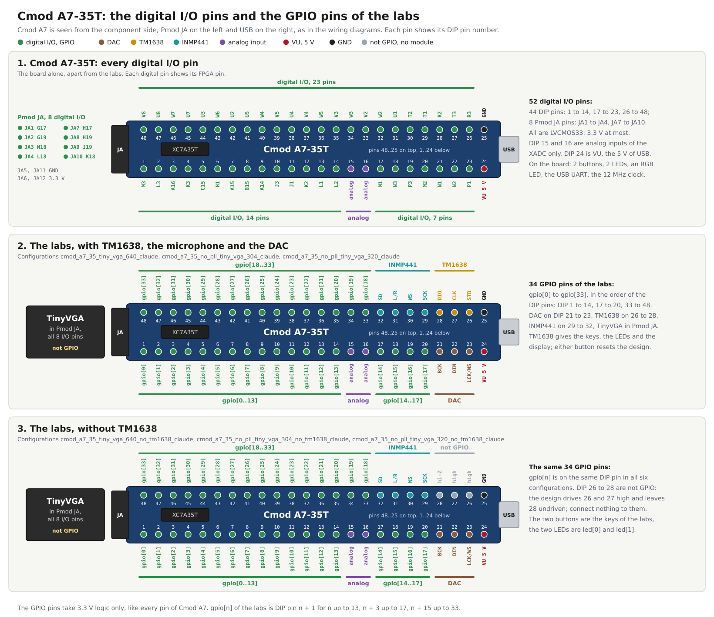
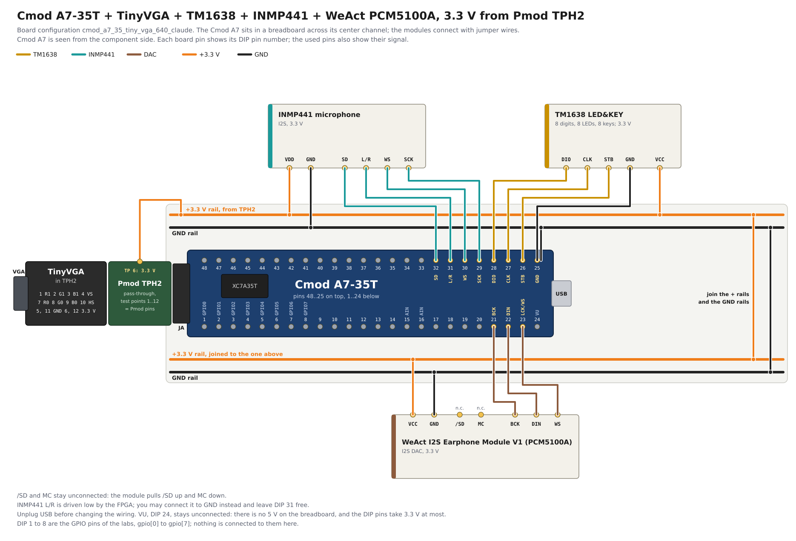
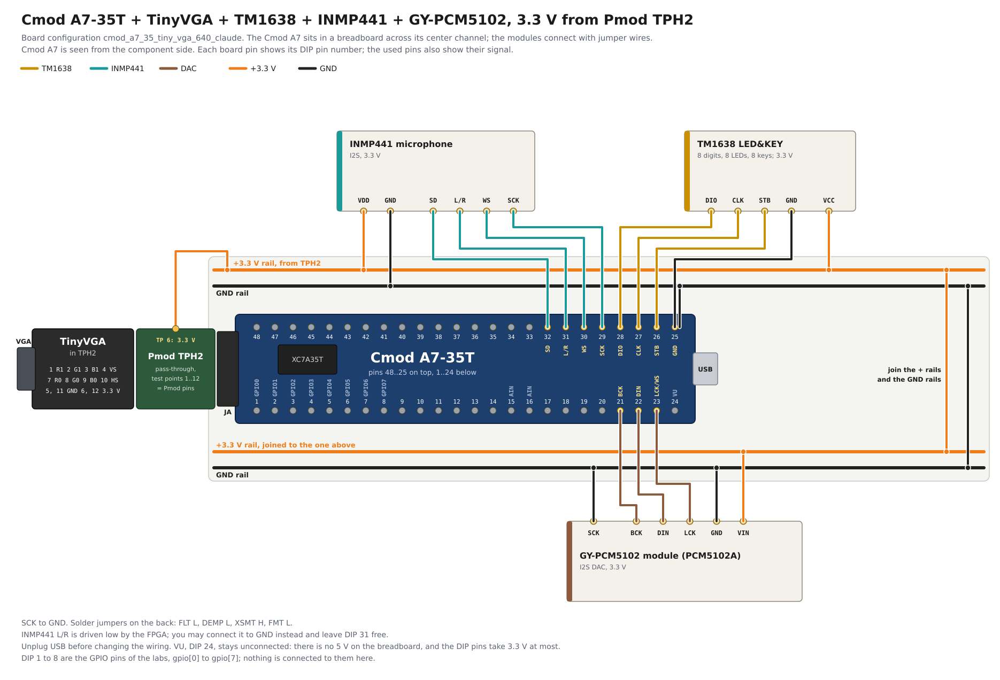
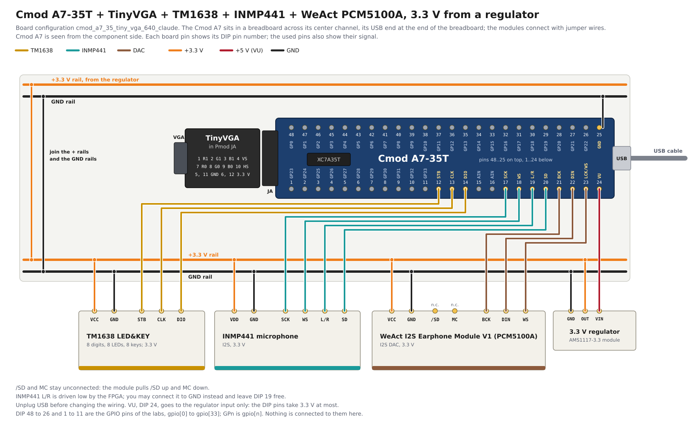
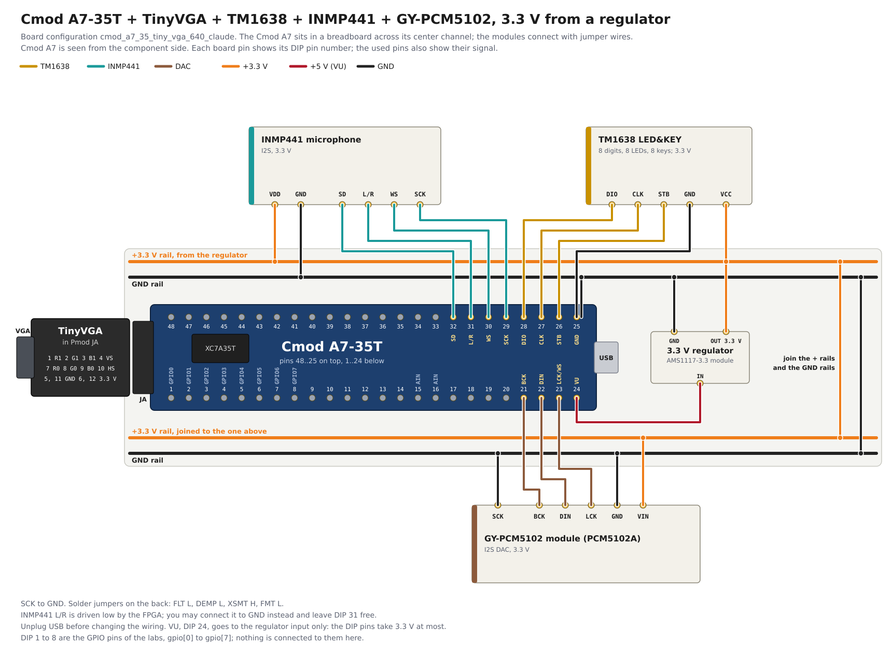

*Создано Claude Opus 5.5 (`claude-opus-5-5`) в Claude Code 2.1.325, уровень усилий xhigh, по промпту Юрия Панчула. Дословный промпт — в [приложении](#приложение-промпты).*

# Cmod A7-35T на макетной плате с TinyVGA, TM1638, микрофоном и ЦАП I2S

Конфигурация платы `cmod_a7_35_tiny_vga_640_claude`. English version: [README.md](README.md).

[Digilent Cmod A7-35T](https://digilent.com/reference/programmable-logic/cmod-a7/start)
— это ПЛИС Artix-7 (XC7A35T-1CPG236C) на модуле в корпусе DIP с 48 выводами,
размером 0,7 на 2,75 дюйма, который вставляется прямо в беспаечную макетную
плату. На модуле есть генератор 12 МГц, две кнопки, два светодиода,
RGB-светодиод, порт USB для JTAG и UART, один разъём Pmod и 44 цифровых
вывода ввода-вывода на выводах DIP. Эта конфигурация добавляет к нему:

* **TinyVGA** в разъёме Pmod JA: выход VGA, 640x480, 2 бита на цвет;
* модуль **TM1638 LED&KEY**: 8 семисегментных индикаторов, 8 светодиодов и 8 кнопок;
* модуль микрофона I2S **INMP441**;
* один из двух модулей ЦАП I2S:
  * **WeAct I2S Earphone Module** с PCM5100A и усилителем для наушников
    32 Ом, 160 мВт — для наушников или активных колонок;
  * обычный фиолетовый модуль **GY-PCM5102** с PCM5102A, линейный выход
    которого — для активных колонок или усилителя, а не для наушников.

34 цифровых вывода DIP, не занятых модулями, — выводы GPIO упражнений,
с `gpio[0]` по `gpio[33]`, свободные для ваших собственных схем.

Оба модуля ЦАП подключаются к одним и тем же трём выводам ПЛИС, поэтому проект
для них один и тот же; отличается только подключение их питания и выводов настройки.

Все модули питаются от 3,3 В, а на выводах DIP модуля Cmod A7 вывода 3,3 В
нет. Инструкция даёт два способа получить это напряжение, и проект ПЛИС для
них один и тот же; см. раздел [Питание](#питание):

* **A: Pmod TPH2.** Проходной модуль Digilent между JA и TinyVGA выводит
  собственные 3,3 В модуля с разъёма Pmod. На макетной плате нет 5 В.
* **B: стабилизатор 3,3 В.** Модуль стабилизатора делает 3,3 В из VU — 5 В от
  USB на выводе DIP 24.

Старая конфигурация в
[zzz_postponed_and_retired/cmod_a7](../zzz_postponed_and_retired/cmod_a7)
рассчитана на другую ПЛИС, XC7A15T, и не используется.

## Содержание

* [Детали](#детали)
* [Распределение выводов](#распределение-выводов)
* [Питание](#питание)
* [Схемы подключения](#схемы-подключения)
* [Таблицы подключения](#таблицы-подключения)
* [Сборка по шагам](#сборка-по-шагам)
* [Сборка и запуск упражнений](#сборка-и-запуск-упражнений)
* [Кнопки и светодиоды](#кнопки-и-светодиоды)
* [Тактовая частота и VGA](#тактовая-частота-и-vga)
* [Остальные пять конфигураций](#остальные-пять-конфигураций)
* [Если что-то не работает](#если-что-то-не-работает)
* [Состояние](#состояние)
* [Файлы](#файлы)
* [Источники](#источники)
* [Приложение: промпты](#приложение-промпты)

## Детали

| Деталь | Примечание |
|--------|------------|
| Digilent Cmod A7-35T | Не 15T: в [board_specific.tcl](board_specific.tcl) указана ПЛИС `xc7a35tcpg236-1`. |
| Кабель micro-USB | Кабель для передачи данных, а не только для зарядки. Угловой штекер не даёт кабелю лежать на макетной плате. |
| Беспаечная макетная плата | Полноразмерная, на 830 отверстий, с парой шин питания вдоль каждой длинной стороны. |
| TinyVGA Pmod | Автор — Leo Moser, [mole99/tiny-vga](https://github.com/mole99/tiny-vga). Её покупают собранной или заказывают на JLCPCB: см. [Где взять TinyVGA](#где-взять-tinyvga). Ещё нужны кабель VGA и монитор, который принимает 640x480 при 60 Гц. |
| Модуль TM1638 LED&KEY | 8 индикаторов, 8 светодиодов, 8 кнопок, разъём из 5 выводов VCC, GND, STB, CLK, DIO. |
| Модуль INMP441 | Круглая плата микрофона I2S с 6 выводами. |
| Один модуль ЦАП | WeAct I2S Earphone Module (PCM5100A) или GY-PCM5102 (PCM5102A). Для WeAct — наушники сопротивлением от 32 Ом или активные колонки; для GY-PCM5102 — активные колонки или усилитель, потому что у него линейный выход. В обоих случаях со штекером 3,5 мм. |
| Для варианта A: Digilent Pmod TPH2 | Проходной модуль на 12 выводов с контрольной точкой для каждого вывода Pmod. Ставится между JA и TinyVGA. |
| Для варианта B: модуль стабилизатора 3,3 В | Модуль AMS1117-3.3 с 3 выводами, например [Amazon B08CDMZMDN](https://www.amazon.com/dp/B08CDMZMDN), набор из 20 штук: вход от 4,75 до 12 В, выход 3,3 В, до 800 мА, около 8,6 x 12,3 мм, выводы VIN, GND, VOUT. Подойдёт любой модуль на 3,3 В, который работает от 5 В и даёт не меньше 300 мА. |
| Провода-перемычки | «Папа-папа» для макетной платы, «мама-папа» для разъёмов модулей и контрольной точки TPH2. |
| Мультиметр | Чтобы проверить шины питания до подключения модулей. |

### Где взять TinyVGA

TinyVGA, у автора — Tiny VGA, это открытая плата Pmod, которую сделал Leo
Moser. Она создана для микросхем [Tiny Tapeout](https://tinytapeout.com/) и
работает с любой платой ПЛИС, у которой есть разъём Pmod. В её репозитории,
[github.com/mole99/tiny-vga](https://github.com/mole99/tiny-vga), лежат проект
KiCad, назначение выводов и файлы для заказа, под лицензией CC BY-SA 4.0. На
плате — угловая 12-контактная вилка Pmod, буфер 74LVC245, резисторный ЦАП на
2 бита для каждого цвета и разъём VGA. На её VCC должно быть 3,3 В, и JA их
даёт.

Получить её можно двумя способами.

**Купить собранной.** Магазин Tiny Tapeout продаёт её под названием
[Tiny VGA Pmod](https://store.tinytapeout.com/products/TinyVGA-Pmod-p678647356),
полностью собранной, за 15,00 € в ноябре 2026 года; текущие цену и наличие
показывает страница магазина. Сам автор её не продаёт.

**Заказать на JLCPCB.** Плата разведена так, чтобы её изготовил и собрал
[JLCPCB](https://jlcpcb.com/), и файлы для этого лежат в репозитории в
`pcb/jlcpcb/production_files/`. Берите все три файла из одной ревизии. Ссылки
ниже ведут на ревизию
[a081ae63](https://github.com/mole99/tiny-vga/tree/a081ae634119aae719237aee5c6b5e53549d1c81/pcb/jlcpcb/production_files),
последнюю в ноябре 2026 года:

| Файл | Что это |
|------|---------|
| [GERBER-tiny-vga.zip](https://raw.githubusercontent.com/mole99/tiny-vga/a081ae634119aae719237aee5c6b5e53549d1c81/pcb/jlcpcb/production_files/GERBER-tiny-vga.zip) | Файлы Gerber платы |
| [BOM-tiny-vga.csv](https://raw.githubusercontent.com/mole99/tiny-vga/a081ae634119aae719237aee5c6b5e53549d1c81/pcb/jlcpcb/production_files/BOM-tiny-vga.csv) | Список деталей с номером LCSC каждой детали. Два разъёма — J1, вилка Pmod, LCSC C2935938, и J2, разъём VGA, LCSC C138387. |
| [CPL-tiny-vga.csv](https://raw.githubusercontent.com/mole99/tiny-vga/a081ae634119aae719237aee5c6b5e53549d1c81/pcb/jlcpcb/production_files/CPL-tiny-vga.csv) | Расположение деталей |

Шаги — как в README репозитория:

1. Создайте учётную запись на JLCPCB.
2. Загрузите `GERBER-tiny-vga.zip`. Настройки по умолчанию подойдут; можно
   изменить количество или цвет платы и убрать номер заказа.
3. Включите PCB Assembly и оставьте его настройки как есть.
4. Нажмите Next и загрузите `BOM-tiny-vga.csv` и `CPL-tiny-vga.csv`.
5. Проверьте расположение деталей на предварительном просмотре: некоторые,
   возможно, придётся повернуть.
6. Проверьте, что в заказе есть оба разъёма, J1 (C2935938) и J2 (C138387).
   Оба монтируются в отверстия; без них плата придёт без вилки Pmod и
   разъёма VGA.
7. Оформите заказ.

Плата обходится дешевле, если заказать сразу несколько; автор советует
заказать штук десять и раздать лишние тем, кто живёт рядом. Автор не связан
с JLCPCB.

## Распределение выводов

Выводы DIP модуля Cmod A7 пронумерованы как выводы микросхемы в корпусе DIP,
если смотреть со стороны деталей и держать разъём Pmod сверху: выводы с 1 по
24 идут вниз по левой стороне, выводы с 25 по 48 — вверх по правой. Вывод 24,
VU, и вывод 25, GND, — два вывода у конца с разъёмом USB; выводы 15 и 16 —
аналоговые входы.

Все модули подключены к 8 выводам у конца с USB на каждой стороне, рядом
с выводами питания, чтобы провода были короткими и шли группами по модулям:

| Выводы DIP | Назначение | Почему здесь |
|------------|------------|--------------|
| С 1 по 14 | Выводы GPIO упражнений: `gpio[0]` на DIP 1, …, `gpio[13]` на DIP 14 | Каждый цифровой вывод DIP, не занятый модулями, — вывод GPIO упражнений, свободный для ваших собственных схем. Выводы GPIO пронумерованы по порядку выводов DIP. |
| С 17 по 20 | Выводы GPIO упражнений: `gpio[14]` на DIP 17, …, `gpio[17]` на DIP 20 | То же. |
| 21, 22, 23 | BCK, DIN, LCK ЦАП (на WeAct — WS) | Тот же порядок, что на разъёмах обоих модулей ЦАП. |
| 25, 26, 27, 28 | GND, STB, CLK, DIO модуля TM1638 | Разъём TM1638 — VCC, GND, STB, CLK, DIO: выводы DIP с 25 по 28 соединяются с выводами разъёма с GND по DIO один к одному, четырьмя параллельными проводами. |
| 29, 30, 31, 32 | SCK, WS, L/R, SD модуля INMP441 | Один ряд выводов INMP441 — SCK, WS, L/R; SD рядом с SCK во втором ряду. |
| С 33 по 48 | Выводы GPIO упражнений: `gpio[18]` на DIP 33, …, `gpio[33]` на DIP 48 | То же. |

TinyVGA вставляется в разъём Pmod JA, в варианте A — через Pmod TPH2. Выводы DIP 15 и 16,
аналоговые входы, не используются, а RGB-светодиод, кнопки, светодиоды и UART через USB находятся на
самом модуле. Выводы GPIO, как и все выводы DIP, допускают только логику
3,3 В; см. предупреждения в разделе [Питание](#питание).

[gpio_layouts.png](gpio_layouts.png) показывает выводы тремя способами: все
цифровые выводы ввода-вывода Cmod A7 вне упражнений, выводы GPIO упражнений
с TM1638, микрофоном и ЦАП, и они же без TM1638.



Файл ограничений [board_specific.xdc](board_specific.xdc) — это
[Cmod-A7-Master.xdc](https://github.com/Digilent/digilent-xdc/blob/master/Cmod-A7-Master.xdc)
от Digilent, в котором раскомментированы только строки используемых выводов,
а больше ничего не изменено. Поэтому у портов остались имена Digilent:
`pio21` для вывода DIP 21, `ja[0]` для вывода Pmod 1 и так далее, а всё
сопоставление этих имён сигналам TM1638, микрофона, ЦАП и VGA сделано в
[board_specific_top.sv](board_specific_top.sv).

## Питание

**Макетной плате нужен источник 3,3 В.** На выводах DIP модуля Cmod A7
выхода 3,3 В нет: из 48 выводов 44 — это вводы-выводы ПЛИС, 15 и 16 —
аналоговые входы, 24 — VU и 25 — GND. Напряжение 3,3 В модуля выведено только
на выводы 6 и 12 разъёма Pmod JA, а этот разъём занимает TinyVGA, который и сам
от них питается. Справочное руководство говорит, что при питании Cmod A7 от
USB на VU подаётся 5 В от USB через диод Шоттки, так что там почти 5 В, и от
VU можно питать внешние схемы.

Выберите один из двух способов подать 3,3 В на макетную плату:

| | A: Pmod TPH2 | B: стабилизатор 3,3 В |
|---|--------------|-----------------------|
| Деталь | Digilent Pmod TPH2: пропускает все 12 выводов Pmod насквозь, и у него есть контрольная точка для каждого, с теми же номерами, что у выводов Pmod | Модуль стабилизатора 3,3 В, например AMS1117-3.3 |
| Где стоит | Между JA и TinyVGA | На свободном месте макетной платы за концом с USB |
| Откуда 3,3 В | Шина 3,3 В модуля Cmod A7, с контрольной точки 6 модуля TPH2; контрольная точка 12 — тоже 3,3 В | VU, вывод DIP 24 |
| Провода питания | Один: от контрольной точки 6 к шине + | Три: от вывода DIP 24 ко входу, от выхода к шине +, GND к шине GND |
| 5 В на макетной плате | Нет: VU остаётся неподключённым | Один провод, от вывода DIP 24 ко входу стабилизатора |
| Ток | Модули делят 0,6 А шины 3,3 В модуля с вводами-выводами ПЛИС, SRAM, светодиодами и TinyVGA | Модули берут ток от стабилизатора, а не от шины 3,3 В модуля |
| TinyVGA | Выступает на 2 см дальше, на TPH2 | Вставляется прямо в JA |

**Всё на макетной плате питается от 3,3 В в обоих вариантах.** Шины 5 В нет:
на выводах DIP нет последовательных резисторов, и они выдерживают не больше
3,75 В, так что от шины 5 В вдоль них до сгоревшей ПЛИС был бы один неверно
вставленный провод. В варианте B 5 В есть только на проводе от вывода DIP 24
ко входу стабилизатора.

Используйте две пары шин питания макетной платы так:

| Пара шин | Шина + | Шина − |
|----------|--------|--------|
| Со стороны выводов DIP с 25 по 48 | +3,3 В, с контрольной точки 6 модуля TPH2 (A) или с выхода стабилизатора (B) | GND |
| Со стороны выводов DIP с 1 по 24 | +3,3 В, соединена с другой шиной + | GND |

Соедините обе шины + друг с другом, а обе шины GND — друг с другом и с выводом
DIP 25.

| Модуль | Питание | Почему |
|--------|---------|--------|
| TM1638 | +3,3 В | Его линия DIO подключена к выводу ПЛИС, а модуль подтягивает DIO к своему VCC. При 5 В на вывод ПЛИС попало бы 5 В. |
| INMP441 | +3,3 В | Допустимое напряжение питания — от 1,62 до 3,63 В. |
| WeAct PCM5100A | +3,3 В | VCC питает собственный стабилизатор 3,3 В модуля (ME6231), от которого работает PCM5100A, и усилитель для наушников (HT97226). При 3,3 В на входе стабилизатор даёт около 3,2 В — в пределах от 3,0 до 3,6 В, нужных PCM5100A, но с небольшим запасом: проверьте его, как в шаге 11 сборки. |
| GY-PCM5102 | +3,3 В | Для VIN указано от 3,3 до 5 В. Обычная плата питает PCM5102A через собственные стабилизаторы, поэтому при 3,3 В микросхема получает немного меньше; платы бывают разные, так что проверьте питание, как в шаге 11 сборки. |

Предупреждения из справочного руководства Cmod A7:

* Выводы DIP подключены к ПЛИС напрямую, без последовательных резисторов.
  Когда модуль включён, на них допустимо от −0,4 до 3,75 В, не больше; никогда
  не подключайте VU к сигнальному выводу.
* Когда модуль выключен, на выводах DIP допустимо не больше 0,55 В. Питайте
  все модули от Cmod A7, как здесь, чтобы ни один модуль не подавал сигнал на
  вывод выключенной ПЛИС.
* Когда подключён USB, на VU напряжение USB. Никогда не подключайте к VU
  другой источник питания, пока подключён USB.
* Шина 3,3 В модуля Cmod A7 даёт не больше 0,6 А на всю плату: вводы-выводы
  ПЛИС, SRAM, светодиоды и разъём Pmod, включая TinyVGA. В варианте A она
  питает ещё и все модули на макетной плате; больше всех из них потребляет
  TM1638, когда все его светодиоды горят с полной яркостью.

## Схемы подключения

Схема есть для каждого источника 3,3 В и каждого модуля ЦАП; отличаются
только подключение питания и ЦАП. На схемах Cmod A7 показан со стороны деталей
и повёрнут так, что разъём Pmod слева: выводы DIP с 48 по 25 идут вдоль
верхнего края, с 1 по 24 — вдоль нижнего. Надписи на схемах — на английском.
Все шесть конфигураций пользуются этими схемами; [без TM1638](#без-tm1638) не
ставьте модуль и его пять проводов.

### Вариант A: 3,3 В от Pmod TPH2

С модулем WeAct I2S Earphone Module:



С модулем GY-PCM5102:



### Вариант B: 3,3 В от стабилизатора

С модулем WeAct I2S Earphone Module:



С модулем GY-PCM5102:



Векторные версии: [wiring_weact_tph2.svg](wiring_weact_tph2.svg),
[wiring_gy_pcm5102_tph2.svg](wiring_gy_pcm5102_tph2.svg),
[wiring_weact_regulator.svg](wiring_weact_regulator.svg),
[wiring_gy_pcm5102_regulator.svg](wiring_gy_pcm5102_regulator.svg).

### Микрофон, ЦАП и стабилизатор, вставленные в макетную плату

Вместо того чтобы подвешивать микрофон и ЦАП на проводах «мама-папа», можно
вставить их прямо в макетную плату вместе со стабилизатором варианта B и
соединить их полосы проводами «папа-папа». Такую раскладку показывают отдельные рисунки:
[breadboard_weact.png](breadboard_weact.png) с модулем WeAct и
[breadboard_gy_pcm5102.png](breadboard_gy_pcm5102.png) с GY-PCM5102; векторные
версии — [breadboard_weact.svg](breadboard_weact.svg) и
[breadboard_gy_pcm5102.svg](breadboard_gy_pcm5102.svg). Коротко:

* Cmod A7 вставляется выводами DIP с 25 по 48 в столбец c, а с 1 по 24 — в
  столбец g. С одной стороны остаются свободными отверстия a и b, с другой —
  h, i и j.
* INMP441 встаёт поперёк центральной канавки, как микросхема DIP с 6
  выводами, надписями вверх, в ряды с 44 по 46: SCK, WS и L/R в столбце e, SD,
  VDD и GND в столбце f. Его L/R идёт на шину GND, поэтому вывод DIP 31
  остаётся свободным.
* ЦАП вставляется своим разъёмом в столбец j: модуль WeAct в ряды с 30 по 36,
  GY-PCM5102 в ряды с 31 по 36. Его плата и гнездо свисают над нижними шинами и
  краем макетной платы, поэтому провода его питания и GND идут к верхним
  шинам. В отверстия можно вставлять только основной разъём GY-PCM5102, а его
  контур на рисунке приблизительный.
* Стабилизатор, модуль AMS1117-3.3 с 3 выводами, вставляется своим разъёмом в
  столбец j, в ряды с 24 по 26, так что VIN попадает в полосу вывода DIP 24,
  VU: ни один провод не несёт 5 В. Его плата свисает над нижними шинами; его
  GND идёт на шину GND в ряду 22, а VOUT — на шину + в ряду 28.
* Рисунок следует порядку выводов из описания товара, VIN, GND, VOUT от конца
  Cmod A7, а контур модуля приблизительный: проверьте подписи на своём модуле.
  Если VIN на другом конце, подключите модуль проводами «мама-папа», как на
  схеме соединений варианта B.
* Середину рядов с 25 по 29 оставьте свободной для штекера USB.
* В варианте A стабилизатор не нужен: соедините контрольную точку 6 TPH2 с
  шиной +, как описано выше. TinyVGA и TM1638 подключаются, как на схемах
  соединений.

## Таблицы подключения

### Выводы DIP модуля Cmod A7

| Вывод DIP | Вывод ПЛИС | Порт в board_specific.xdc | Сигнал | Подключить к |
|----------:|-----------:|---------------------------|--------|--------------|
| 1 | M3 | `pio1` | `gpio[0]` | Свободен: GPIO упражнений |
| 2 | L3 | `pio2` | `gpio[1]` | Свободен: GPIO упражнений |
| 3 | A16 | `pio3` | `gpio[2]` | Свободен: GPIO упражнений |
| 4 | K3 | `pio4` | `gpio[3]` | Свободен: GPIO упражнений |
| 5 | C15 | `pio5` | `gpio[4]` | Свободен: GPIO упражнений |
| 6 | H1 | `pio6` | `gpio[5]` | Свободен: GPIO упражнений |
| 7 | A15 | `pio7` | `gpio[6]` | Свободен: GPIO упражнений |
| 8 | B15 | `pio8` | `gpio[7]` | Свободен: GPIO упражнений |
| 9 | A14 | `pio9` | `gpio[8]` | Свободен: GPIO упражнений |
| 10 | J3 | `pio10` | `gpio[9]` | Свободен: GPIO упражнений |
| 11 | J1 | `pio11` | `gpio[10]` | Свободен: GPIO упражнений |
| 12 | K2 | `pio12` | `gpio[11]` | Свободен: GPIO упражнений |
| 13 | L1 | `pio13` | `gpio[12]` | Свободен: GPIO упражнений |
| 14 | L2 | `pio14` | `gpio[13]` | Свободен: GPIO упражнений |
| 15, 16 | — | — | Аналоговые входы | Ничего |
| 17 | M1 | `pio17` | `gpio[14]` | Свободен: GPIO упражнений |
| 18 | N3 | `pio18` | `gpio[15]` | Свободен: GPIO упражнений |
| 19 | P3 | `pio19` | `gpio[16]` | Свободен: GPIO упражнений |
| 20 | M2 | `pio20` | `gpio[17]` | Свободен: GPIO упражнений |
| 21 | N1 | `pio21` | `DAC_BCK` | BCK ЦАП |
| 22 | N2 | `pio22` | `DAC_DIN` | DIN ЦАП |
| 23 | P1 | `pio23` | `DAC_LCK` | LCK GY-PCM5102, WS WeAct |
| 24 | — | — | VU, около 5 В | A: ничего. B: вход стабилизатора, и больше ничего |
| 25 | — | — | GND | шина GND и GND модуля TM1638 |
| 26 | R3 | `pio26` | `TM_STB` | STB TM1638 |
| 27 | T3 | `pio27` | `TM_CLK` | CLK TM1638 |
| 28 | R2 | `pio28` | DIO TM1638 | DIO TM1638 |
| 29 | T1 | `pio29` | `MIC_SCK` | SCK INMP441 |
| 30 | T2 | `pio30` | `MIC_WS` | WS INMP441 |
| 31 | U1 | `pio31` | `MIC_LR` | L/R INMP441 |
| 32 | W2 | `pio32` | `MIC_SD` | SD INMP441 |
| 33 | V2 | `pio33` | `gpio[18]` | Свободен: GPIO упражнений |
| 34 | W3 | `pio34` | `gpio[19]` | Свободен: GPIO упражнений |
| 35 | V3 | `pio35` | `gpio[20]` | Свободен: GPIO упражнений |
| 36 | W5 | `pio36` | `gpio[21]` | Свободен: GPIO упражнений |
| 37 | V4 | `pio37` | `gpio[22]` | Свободен: GPIO упражнений |
| 38 | U4 | `pio38` | `gpio[23]` | Свободен: GPIO упражнений |
| 39 | V5 | `pio39` | `gpio[24]` | Свободен: GPIO упражнений |
| 40 | W4 | `pio40` | `gpio[25]` | Свободен: GPIO упражнений |
| 41 | U5 | `pio41` | `gpio[26]` | Свободен: GPIO упражнений |
| 42 | U2 | `pio42` | `gpio[27]` | Свободен: GPIO упражнений |
| 43 | W6 | `pio43` | `gpio[28]` | Свободен: GPIO упражнений |
| 44 | U3 | `pio44` | `gpio[29]` | Свободен: GPIO упражнений |
| 45 | U7 | `pio45` | `gpio[30]` | Свободен: GPIO упражнений |
| 46 | W7 | `pio46` | `gpio[31]` | Свободен: GPIO упражнений |
| 47 | U8 | `pio47` | `gpio[32]` | Свободен: GPIO упражнений |
| 48 | V8 | `pio48` | `gpio[33]` | Свободен: GPIO упражнений |

### TinyVGA в разъёме Pmod JA

Выводы TinyVGA соответствуют стандарту Pmod: выводы 5 и 11 — GND, 6 и 12 —
3,3 В, как и у JA, поэтому TinyVGA вставляется без проводов. В варианте A
между ними стоит TPH2: он пропускает все выводы насквозь, так что таблица та
же.

| Вывод Pmod | Вывод ПЛИС | Порт | Сигнал TinyVGA |
|-----------:|-----------:|------|----------------|
| 1 | G17 | `ja[0]` | R1, старший бит красного |
| 2 | G19 | `ja[1]` | G1, старший бит зелёного |
| 3 | N18 | `ja[2]` | B1, старший бит синего |
| 4 | L18 | `ja[3]` | VS, кадровая синхронизация |
| 7 | H17 | `ja[4]` | R0, младший бит красного |
| 8 | H19 | `ja[5]` | G0, младший бит зелёного |
| 9 | J19 | `ja[6]` | B0, младший бит синего |
| 10 | K18 | `ja[7]` | HS, строчная синхронизация |
| 5, 11 | — | — | GND |
| 6, 12 | — | — | 3,3 В |

### Источник 3,3 В

Вариант A, Pmod TPH2:

| TPH2 | Подключить к |
|------|--------------|
| Его вилка Pmod | Разъём Pmod JA |
| Его розетка Pmod | TinyVGA |
| Контрольная точка 6 | Шина + со стороны выводов DIP с 25 по 48 |

Вариант B, модуль стабилизатора; выводы могут быть подписаны VIN, GND, VOUT:

| Вывод стабилизатора | Подключить к |
|---------------------|--------------|
| IN | Вывод DIP 24, VU |
| GND | Шина GND |
| OUT | Шина + со стороны выводов DIP с 25 по 48 |

VU — это 5 В от USB за вычетом падения на диоде, поэтому оно может быть чуть ниже
4,75 В, на которые рассчитан модуль AMS1117-3.3. AMS1117 нужно на входе не больше
чем на 1,3 В больше, чем на выходе, даже при полных 800 мА, так что 4,5 В на входе
всё равно дают не меньше 3,2 В; это проверяет шаг 5 сборки.

В обоих вариантах соедините обе шины + друг с другом.

### TM1638 LED&KEY

| Вывод TM1638 | Подключить к |
|--------------|--------------|
| VCC | шина +3,3 В |
| GND | DIP 25 |
| STB | DIP 26 |
| CLK | DIP 27 |
| DIO | DIP 28 |

### INMP441

У модуля два ряда по три вывода. Если смотреть со стороны надписей, в одном
ряду SCK, WS, L/R, в другом — SD, VDD, GND, причём SD рядом с SCK.

| Вывод INMP441 | Подключить к |
|---------------|--------------|
| SCK | DIP 29 |
| WS | DIP 30 |
| L/R | DIP 31 |
| SD | DIP 32 |
| VDD | шина +3,3 В |
| GND | шина GND |

ПЛИС подаёт на L/R низкий уровень, что выбирает левый канал, как на других
платах репозитория. Можно вместо этого подключить L/R к GND и оставить DIP 31
свободным.

### ЦАП: WeAct I2S Earphone Module V1 (PCM5100A)

На его разъёме 7 выводов: VCC, GND, /SD, MC, BCK, DIN, WS.

| Вывод WeAct | Подключить к |
|-------------|--------------|
| VCC | шина +3,3 В |
| GND | шина GND |
| /SD | никуда: модуль подтягивает его вверх, и усилитель включён |
| MC | никуда: модуль подтягивает его вниз, и ЦАП делает свою опорную частоту из BCK |
| BCK | DIP 21 |
| DIN | DIP 22 |
| WS | DIP 23 |

На этом модуле ничего настраивать не нужно: по его схеме выводы FMT и FLT
микросхемы PCM5100A соединены с землёй (формат I2S и обычный фильтр), а DEMP
подтянут к земле через 10 кОм. Перемычку S1 (коррекция предыскажений)
оставьте разомкнутой. Гнездо 3,5 мм — для наушников сопротивлением 32 Ом и
больше.

### ЦАП: GY-PCM5102 (PCM5102A)

Основной разъём обычно подписан SCK, BCK, DIN, LCK, GND, VIN. Порядок
выводов у разных версий платы бывает разным, поэтому ориентируйтесь на надписи.

| Вывод GY-PCM5102 | Подключить к |
|------------------|--------------|
| SCK | шина GND |
| BCK | DIP 21 |
| DIN | DIP 22 |
| LCK | DIP 23 |
| GND | шина GND |
| VIN | шина +3,3 В |

Перед первым включением проверьте четыре паяные перемычки на обратной стороне,
помеченные цифрами от 1 до 4 или H1L–H4L. Для I2S они должны стоять так:

| Перемычка | Вывод PCM5102A | Положение |
|-----------|----------------|-----------|
| 1, H1L | FLT, фильтр | L |
| 2, H2L | DEMP, коррекция предыскажений | L |
| 3, H3L | XSMT, мягкое отключение звука | **H**, иначе ЦАП молчит |
| 4, H4L | FMT, формат данных | L, I2S |

Бывает, что платы приходят с незапаянными или неправильно запаянными
перемычками. Если площадка SCK на плате соединена перемычкой с GND, провод
от SCK к GND не нужен, но и не мешает. Никогда не подключайте SCK к выводу
ПЛИС: на плате с такой перемычкой это замкнёт вывод на землю.

**Гнездо 3,5 мм этого модуля — линейный выход.** PCM5102A рассчитан на
нагрузку от 1 кОм, например вход активных колонок или усилителя, а не на
наушники сопротивлением 32 Ом. Из двух модулей усилитель для наушников есть
только у WeAct.

## Сборка по шагам

Собирайте при отключённом кабеле USB.

1. **Установите Cmod A7.** Вставьте его в макетную плату поперёк центральной
   канавки, у одного из концов макетной платы, так, чтобы разъём Pmod был над
   краем макетной платы, а разъём USB смотрел внутрь. Выводы DIP 1 и 48
   попадают в первый ряд отверстий. Ряды выводов отстоят друг от друга на 0,6
   дюйма, поэтому один ряд окажется в одном отверстии от канавки, а другой —
   в двух: у каждого вывода в его ряду остаётся два или три свободных
   отверстия для проводов.
2. **Вставьте TinyVGA.** В варианте A вставьте TPH2 в JA, затем TinyVGA в
   TPH2; в варианте B вставьте TinyVGA прямо в JA. Все платы должны быть
   обращены деталями вверх; каждый раз проверяйте, что выводы 5, 6, 11 и 12,
   GND и VCC, совпали с такими же выводами разъёма: модуль Pmod, вставленный
   наоборот, подаёт 3,3 В на сигнальные выводы. Платы Pmod и кабель VGA
   свисают с края макетной платы; подоприте кабель, чтобы его вес не
   выламывал разъём Pmod.
3. **Сделайте шины GND.** Соедините вывод DIP 25 с шиной − со стороны
   выводов с 25 по 48, а обе шины − — друг с другом на дальнем конце макетной
   платы. На многих макетных платах шины разорваны посередине, это видно по
   разрыву их цветных линий; такие разрывы соедините перемычками.
4. **Сделайте шины +3,3 В.** В варианте A проводом «мама-папа» соедините
   контрольную точку 6 модуля TPH2 с шиной + со стороны выводов с 25 по 48, а
   вывод DIP 24, VU, оставьте неподключённым. В варианте B поставьте модуль
   стабилизатора на свободное место за концом с USB; соедините его вход с
   выводом DIP 24, VU, — это единственный провод с 5 В, — GND с шиной GND, а
   выход с шиной + со стороны выводов с 25 по 48. В обоих вариантах соедините
   обе шины + друг с другом на дальнем конце макетной платы и, как у шин GND,
   соедините перемычками разрывы.
5. **Проверьте питание.** Подключите USB. Мультиметр должен показать на обеих
   шинах + от 3,2 до 3,5 В относительно GND; в варианте B на входе
   стабилизатора должно быть примерно от 4,5 до 5 В. Ниже 3,2 В у ЦАП
   остаётся слишком маленький запас: сначала найдите причину. Отключите USB.
6. **Подключите TM1638.** Четыре провода «мама-папа» от выводов DIP 25, 26, 27
   и 28 к выводам TM1638 GND, STB, CLK и DIO, именно в этом порядке, и один
   провод от VCC к шине +3,3 В.
7. **Подключите INMP441.** Провода от выводов DIP 29, 30, 31 и 32 к SCK, WS,
   L/R и SD; VDD — к шине +3,3 В, GND — к шине GND.
8. **Подключите ЦАП.** Провода от выводов DIP 21, 22 и 23 к BCK, DIN и LCK
   (на WeAct — WS); VCC или VIN — к шине +3,3 В, GND — к шине GND. На
   GY-PCM5102 ещё соедините SCK с GND и проверьте паяные перемычки. На WeAct
   оставьте /SD и MC неподключёнными.
9. **Проверьте подключение** ещё раз по таблице
   [Выводы DIP модуля Cmod A7](#выводы-dip-модуля-cmod-a7): ни один
   сигнальный вывод Cmod A7 не должен касаться шины +, а вывод DIP 24, VU,
   в варианте A никуда не подключён, а в варианте B идёт только на вход
   стабилизатора.
10. Подключите монитор VGA и наушники (только к WeAct) или активные колонки,
    затем подключите USB.
11. **Проверьте питание ЦАП под нагрузкой.** Загрузите упражнение, которое
    играет звук, например из `labs/3_music`, и пока звук играет, измерьте
    VCC на WeAct или VIN на GY-PCM5102 относительно GND на выводах самого
    модуля: должно быть не меньше 3,2 В. PCM510xA нужно не меньше 3,0 В, а
    оба модуля питают его через собственный стабилизатор, на котором немного
    теряется. Если доступен выход этого стабилизатора, например на его
    выходном конденсаторе, там должно быть не меньше 3,0 В. Если питание
    ниже, проверьте провода шины +; в варианте A попробуйте вариант B, где
    стабилизатор питает только модули.

## Сборка и запуск упражнений

В каталоге упражнения один раз выберите плату скриптом
`./06_choose_another_fpga_board.bash` — пункт `cmod_a7_35_tiny_vga_640_claude`. Затем
`./03_synthesize_for_fpga.bash` собирает проект в Vivado и загружает его в
ПЛИС через USB. Скрипты загружают саму ПЛИС, а не флеш-память модуля, поэтому
после отключения питания проект пропадает; `./04_configure_fpga.bash`
загружает его снова. Остальные пять конфигураций собираются так же; см.
[Остальные пять конфигураций](#остальные-пять-конфигураций).

Для начала подойдут упражнения:

* `labs/2_graphics/2_3_color_stripes` — выход VGA;
* `labs/1_basics/1_01_and_or_not_xor_de_morgan` — кнопки и светодиоды TM1638;
* `labs/3_music/3_0_oscilloscope` — сигнал микрофона на мониторе;
  микрофон, ЦАП и TM1638 используют упражнения в `labs/3_music`.

## Кнопки и светодиоды

| На Cmod A7 | Вывод ПЛИС | Порт | Назначение |
|------------|-----------:|------|------------|
| BTN0, BTN1 | A18, B18 | `btn[0]`, `btn[1]` | С TM1638, как в большинстве упражнений: любая из кнопок сбрасывает проект, а упражнения получают кнопки от TM1638. Без TM1638 — `key[0]` и `key[1]` упражнений. |
| LED1, LED2 | A17, C16 | `led[0]`, `led[1]` | `led[0]` и `led[1]` упражнений; TM1638 показывает все восемь. |
| RGB-светодиод | B17, B16, C17 | `led0_b`, `led0_g`, `led0_r` | Красный, пока проект в сбросе, зелёный, пока он работает; синий не используется. Светодиод горит при низком уровне на выводе. На полной яркости он слепит, поэтому проект зажигает его на 1/16 времени, с частотой 12 МГц / 4096 = 2,9 кГц. |
| UART через USB | J17, J18 | `uart_txd_in`, `uart_rxd_out` | `uart_rx` и `uart_tx` упражнений. |

Проект сбрасывается и после загрузки, пока не будет готов генератор тактовой
частоты. Без TM1638 кнопки сброса нет: обе кнопки — это кнопки упражнений.
Однако со скриптами репозитория в нынешнем виде TM1638 на этой плате включён
всегда; см. раздел [Состояние](#состояние). Для проекта без TM1638, с двумя
кнопками, двумя светодиодами и без семисегментного индикатора, возьмите одну из
конфигураций [без TM1638](#без-tm1638).

## Тактовая частота и VGA

Генератор Cmod A7 работает на 12 МГц. Модуль VGA репозитория,
[peripherals/vga.sv](../../peripherals/vga.sv), получает частоту пикселей
25 МГц из более высокой тактовой частоты с помощью разрешения такта: он
отсчитывает `CLK_MHZ / PIXEL_MHZ` тактов на пиксель. Для этого нужна частота,
кратная 25 МГц. При 12 МГц `CLK_MHZ / PIXEL_MHZ` равно 0, и модуль не выдаёт
ни одного пикселя; а частота пикселей 12 МГц не даёт и стандартного режима
640x480 при 60 Гц, которому нужно около 25 МГц.

Поэтому board_specific_top.sv начинается с генератора тактовой частоты ПЛИС,
MMCM, который превращает 12 МГц в 50 МГц:

```text
VCO = 12 MHz * 62.5 = 750 MHz   (диапазон MMCM — от 600 до 1200 МГц)
clk = 750 MHz / 15  =  50 MHz
```

50 МГц — тактовая частота большинства плат репозитория, поэтому `vga.sv`
менять не нужно, а модули TM1638, микрофона и ЦАП работают на своих обычных
частотах: тактовые частоты битов I2S — 50 МГц / 16 = 3,125 МГц, частота
выборок — 50 МГц / 1024 = 48,8 кГц. Изображение — 640x480 при
25 МГц / (800 × 525) = 59,5 Гц. Упражнения получают `clk_mhz = 50`.

**Без MMCM.** Две другие конфигурации платы используют то же оборудование и
соединения и запускают весь проект от генератора 12 МГц:
`cmod_a7_35_no_pll_tiny_vga_320_claude` рисует
320x480, каждый пиксель ровно в два, с частотой строк 30 кГц, которую
некоторые мониторы не принимают, а
`cmod_a7_35_no_pll_tiny_vga_304_claude` рисует 304x480
со стандартными частотами строк и кадров. Раздел
[Без MMCM](#без-mmcm-320x480-и-304x480) сравнивает все три.

**Предлагаемое изменение vga.sv, здесь не сделанное.** `vga.sv` не замечает
частоту, которую не может поделить: если `CLK_MHZ` меньше `PIXEL_MHZ` или не
кратна ей, модуль молча не выдаёт изображения или выдаёт неправильное.
Проверка при элаборации превратила бы это в понятное сообщение об ошибке:

```systemverilog
    // The pixel rate is made with a clock enable every CLK_MHZ / PIXEL_MHZ
    // cycles, so CLK_MHZ has to be a multiple of PIXEL_MHZ, up to 16 times.

    if (   CLK_MHZ < PIXEL_MHZ
        || CLK_MHZ % PIXEL_MHZ != 0
        || CLK_MHZ / PIXEL_MHZ > 16 )
    begin : bad_clock
        $error ("vga: CLK_MHZ %0d is not a multiple of PIXEL_MHZ %0d",
                CLK_MHZ, PIXEL_MHZ);
    end
```

Прежде чем вносить это в `vga.sv`, нужно проверить, что `$error` в блоке
generate принимают все средства синтеза, которыми пользуется репозиторий.

## Остальные пять конфигураций

У шести конфигураций общие оборудование, выводы, соединения, рисунки и
модуль верхнего уровня, [board_specific_top.sv](board_specific_top.sv) этого
каталога. В каждом из пяти других каталогов лежат только
`board_specific_top.sv`, который определяет один или два макроса и включает
этот, тот же `board_specific.xdc`, `board_specific.tcl` и короткий README со
ссылкой сюда.

| Конфигурация | Тактовая частота проекта | Экран упражнений | TM1638 | Её board_specific_top.sv определяет |
|--------------|--------------------------|------------------|--------|-------------------------------------|
| `cmod_a7_35_tiny_vga_640_claude`, эта | 50 МГц от MMCM | 640x480 | Есть | Ничего, это сам модуль верхнего уровня |
| `cmod_a7_35_tiny_vga_640_no_tm1638_claude` | 50 МГц от MMCM | 640x480 | Нет | `FORCE_NO_INSTANTIATE_TM1638_BOARD_CONTROLLER_MODULE` |
| `cmod_a7_35_no_pll_tiny_vga_320_claude` | 12 МГц, кварцевый генератор | 320x480 | Есть | `CMOD_A7_NO_PLL_SCREEN_WIDTH` равным 320 |
| `cmod_a7_35_no_pll_tiny_vga_320_no_tm1638_claude` | 12 МГц, кварцевый генератор | 320x480 | Нет | Оба |
| `cmod_a7_35_no_pll_tiny_vga_304_claude` | 12 МГц, кварцевый генератор | 304x480 | Есть | `CMOD_A7_NO_PLL_SCREEN_WIDTH` равным 304 |
| `cmod_a7_35_no_pll_tiny_vga_304_no_tm1638_claude` | 12 МГц, кварцевый генератор | 304x480 | Нет | Оба |

Любая из них собирается, как описано в разделе
[Сборка и запуск упражнений](#сборка-и-запуск-упражнений), с её именем,
выбранным в `./06_choose_another_fpga_board.bash`; скрипты используют Vivado
для каждой платы, имя которой начинается с `cmod_a7`. В разделе
[Состояние](#состояние) — данные Vivado для всех шести.

### Без MMCM: 320x480 и 304x480

У `cmod_a7_35_no_pll_tiny_vga_320_claude` и
`cmod_a7_35_no_pll_tiny_vga_304_claude`, а также у их вариантов без TM1638,
нет генератора тактовой частоты, ни MMCM, ни PLL: весь проект работает от
кварцевого генератора Cmod A7 на 12 МГц. Стандартной картинке 640x480 при
60 Гц нужна частота пикселей 25,175 МГц, которую из 12 МГц без генератора
тактовой частоты не получить, поэтому частота пикселей — сами 12 МГц:

* **320x480.** В строке вдвое меньше пикселей: упражнения рисуют на экране
  320x480, а монитор показывает каждый пиксель шириной в два пикселя из 640.
  Частота строк — 30,0 кГц вместо 31,47 кГц, и **некоторые мониторы её не
  принимают**.
* **304x480.** Каждая часть строки сохраняет свою стандартную длительность,
  поэтому частоты строк и кадров — как у 640x480: 31,50 кГц и 59,99 Гц.
  Монитор, который принимает сигнал за 640x480, показывает каждый пиксель
  шириной 2,1 пикселя из 640: одни пиксели выглядят шириной 2, другие 3.

| | cmod_a7_35_tiny_vga_640_claude | cmod_a7_35_no_pll_tiny_vga_320_claude | cmod_a7_35_no_pll_tiny_vga_304_claude |
|---|---|---|---|
| Тактовая частота проекта | 50 МГц от MMCM | 12 МГц, кварцевый генератор | 12 МГц, кварцевый генератор |
| Экран, на котором рисуют упражнения | 640x480 | 320x480 | 304x480 |
| Ширина пикселя на мониторе, в пикселях из 640 | 1 | 2 | 2,1: одни 2, другие 3 |
| Частота строк | 31,25 кГц | 30,0 кГц | 31,50 кГц |
| Частота кадров | 59,5 Гц | 57,1 Гц | 59,99 Гц |
| Мониторы | Принимают | Некоторые не принимают 30 кГц | Принимают как 640x480 |
| Частота выборок микрофона | 48,8 кГц | 11,7 кГц | 11,7 кГц |
| Частота выборок ЦАП | 48,8 кГц | 46,9 кГц | 46,9 кГц |

Выберите 320x480, чтобы увидеть проект без генератора тактовой частоты с
ровными пикселями шириной ровно в два пикселя монитора. Если монитор не
показывает картинку или сообщает, что режим вне диапазона, возьмите 304x480:
её синхронизация близка к стандартной, и монитор принимает её за обычный
640x480. Цена 304 — непривычная ширина и пиксели слегка неодинаковой ширины,
заметные на тонких вертикальных линиях и мелком тексте. Для полных 640x480
возьмите эту конфигурацию. Ни 320, ни 304 ещё не проверены на реальной плате и
мониторе; примет ли конкретный монитор частоту строк 30 кГц у 320 — открытый
вопрос.

**Синхронизация VGA.** [peripherals/vga.sv](../../peripherals/vga.sv)
получает горизонтальную синхронизацию через параметры, поэтому используется
без изменений. Модуль верхнего уровня передаёт синхронизацию из таблицы ниже;
когда `CLK_MHZ` и `PIXEL_MHZ` оба равны 12, `vga.sv` переходит к следующему
пикселю на каждом такте. Вертикальная синхронизация стандартная.

| Часть строки | Стандарт 640x480, 25,175 МГц | 320x480 на 12 МГц | 304x480 на 12 МГц |
|--------------|------------------------------|-------------------|-------------------|
| Видимая часть | 640 пикселей, 25,42 мкс | 320 тактов, 26,67 мкс | 304 такта, 25,33 мкс |
| Передний порог | 16 пикселей, 0,64 мкс | 8 тактов, 0,67 мкс | 8 тактов, 0,67 мкс |
| Синхроимпульс, низкий уровень | 96 пикселей, 3,81 мкс | 48 тактов, 4,00 мкс | 46 тактов, 3,83 мкс |
| Задний порог | 48 пикселей, 1,91 мкс | 24 такта, 2,00 мкс | 23 такта, 1,92 мкс |
| Вся строка | 800 пикселей, 31,78 мкс, 31,47 кГц | 400 тактов, 33,33 мкс, 30,00 кГц | 381 такт, 31,75 мкс, 31,50 кГц |
| Кадр | 525 строк, 59,94 Гц | 525 строк, 57,14 Гц | 525 строк, 59,99 Гц |

У 320x480 каждое число тактов — половина числа пикселей стандарта, поэтому
монитор получает сигнал 640x480 от частоты пикселей 24 МГц, где каждый пиксель
повторён дважды. Запуск 640x480 от 24 МГц — известный приём: многие мониторы
его показывают. Но 30 кГц — самая низкая частота строк, которую многие
мониторы вообще принимают, и некоторые её не принимают.

У 304x480 каждая часть строки отличается от стандартной длительности не больше
чем на 0,1 мкс, а частоты строк и кадров — меньше чем на 0,1 %, в пределах
допуска VGA. Число тактов в строке, 381, даёт самое близкое значение: такт
12 МГц не позволяет разделить строку на стандартные 800 частей. Монитор,
который принимает сигнал за 640x480, считывает видимую часть каждой строки в
своих 640 точках. При 304 пикселях каждый пиксель занимает 640 / 304 = 2,1
точки, поэтому большинство пикселей занимает 2 точки, а примерно каждый
десятый — 3. На картинке из больших областей это незаметно; на узоре из полос
шириной в пиксель — заметно.

В обоих случаях, если картинка есть, но сдвинута или размыта,
воспользуйтесь автоматической настройкой монитора.

Упражнения видят `screen_width`, равный 320 или 304, и `screen_height = 480`.
Упражнение, которое берёт размеры рисунка из этих параметров, заполняет экран,
растянутый примерно вдвое по ширине: круг выглядит эллипсом. Упражнение,
которое рисует по постоянным координатам дальше x = 319 или x = 303, рисует за
пределами экрана.

Моделирование `vga.sv` с этими параметрами на 12 МГц показало для 320x480
строку в 400 тактов, синхроимпульс в 48 тактов и 320 видимых тактов в строке:
30,000 кГц и 57,143 Гц; для 304x480 — строку в 381 такт, синхроимпульс в
46 тактов и 304 видимых такта в строке: 31,496 кГц и 59,993 Гц. В обоих
случаях кадр — 525 строк, из них 480 видимых, вертикальный синхроимпульс —
2 строки.

Полной строке из 640 пикселей на 12 МГц понадобилось бы по два пикселя за
такт, по одному на каждом фронте, через выходные регистры двойной скорости
(DDR) ПЛИС. Упражнения репозитория дают один пиксель за такт, поэтому здесь
этого нет.

**Что ещё меняется на 12 МГц.** Когда определён `CMOD_A7_NO_PLL_SCREEN_WIDTH`,
board_specific_top.sv делает такие изменения:

* **Нет MMCM.** Тактовый сигнал проекта — вход генератора, `sysclk`. Его вывод
  L17 может принимать тактовый сигнал, и Vivado ставит на него глобальный
  тактовый буфер. Ограничение на тактовую частоту, 83,33 нс, — из файла
  Digilent в board_specific.xdc.
* **Все модули получают `clk_mhz = 12`**: упражнение, TM1638, микрофон и ЦАП.
  Они выводят из него свои временные параметры.
* **Сброс.** Без MMCM нечего ждать. Цепочка сброса после конфигурации состоит
  из единиц, поэтому проект стартует в сбросе и выходит из него на третьем
  фронте такта. С TM1638 любая кнопка Cmod сбрасывает проект, как и на
  50 МГц.
* **Микрофон.** Приёмник выдаёт SCK 12 МГц / 16 = 0,75 МГц, в пределах
  0,5–3,2 МГц для INMP441, и частоту выборок 12 МГц / 1024 = 11,7 кГц. Это
  пропускает звук примерно до 5,8 кГц: хватает для голоса и музыкальных нот,
  а упражнения, показывающие спектр, покажут более узкий.
* **ЦАП.** Выход I2S даёт BCK 3 МГц и частоту выборок 12 МГц / 256 = 46,9 кГц
  с теми же соотношениями, что и на 50 МГц.
* **TM1638.** Его драйвер делит `clk_mhz` до своей последовательной частоты,
  поэтому работает как раньше.

### Без TM1638

`cmod_a7_35_tiny_vga_640_no_tm1638_claude`,
`cmod_a7_35_no_pll_tiny_vga_320_no_tm1638_claude` и
`cmod_a7_35_no_pll_tiny_vga_304_no_tm1638_claude` — три конфигурации выше без
модуля TM1638. **Упражнения получают две кнопки Cmod A7 в качестве своих
кнопок и два её светодиода в качестве своих светодиодов, а семисегментного
индикатора нет.** Всё остальное — тактовая частота, VGA, микрофон, ЦАП и
выводы — как у той же конфигурации с TM1638. При подключении не ставьте модуль
и его пять проводов; DIP 25 по-прежнему идёт на шину GND.

| | С TM1638 | Без TM1638 |
|---|---|---|
| Кнопки упражнений | 8 кнопок TM1638 | BTN0 и BTN1 на Cmod A7: `key[0]` и `key[1]`, они же `sw[0]` и `sw[1]` |
| Светодиоды упражнений | 8 светодиодов TM1638, первые два также на LED1 и LED2 Cmod A7 | LED1 и LED2 на Cmod A7: `led[0]` и `led[1]` |
| Семисегментный индикатор | 8 разрядов TM1638 | Нет |
| Кнопка сброса | Любая кнопка Cmod | Нет: обе кнопки — это кнопки упражнений |
| DIP 26, 27, 28 | TM1638 STB, CLK, DIO | Не подключены |

Нажатая кнопка даёт 1; светодиод горит при 1. Упражнения получают один
разряд семисегментного индикатора, который никуда не идёт, поэтому
упражнение, управляющее индикатором, собирается и работает, а вывод на
индикатор теряется. Так же теряется всё, что упражнение показывает на
светодиодах после первых двух.

После загрузки проект находится в сбросе, пока MMCM не захватит частоту, а на
12 МГц — первые три такта. Ни одна кнопка его не сбрасывает: чтобы начать
упражнение заново, загрузите ПЛИС ещё раз командой `./04_configure_fpga.bash`.

Проект держит выводы DIP 26 и 27, STB и CLK модуля TM1638, в высоком уровне и
не управляет выводом DIP 28. Оставьте эти три вывода неподключёнными; это не
выводы GPIO упражнений, поэтому `gpio[n]` находится на одном и том же выводе
DIP во всех шести конфигурациях.

Их board_specific_top.sv определяет
`FORCE_NO_INSTANTIATE_TM1638_BOARD_CONTROLLER_MODULE`, а у 320 и 304 ещё и
`CMOD_A7_NO_PLL_SCREEN_WIDTH`, и включает модуль верхнего уровня этого
каталога, который тогда не создаёт TM1638, хотя
`peripherals/lab_specific_board_config.svh` его включает. Другие платы
репозитория без TM1638, например `tang_nano_9k_hdmi_no_tm1638`, сделаны так
же, но некоторые из них рисуют виртуальный TM1638 на экране; эти не рисуют.
Их board_specific.xdc — тот же, что в этом каталоге: строки выводов DIP 26, 27
и 28 в нём остаются раскомментированными, потому что у включённого модуля
верхнего уровня эти порты есть.

## Если что-то не работает

| Признак | Что проверить |
|---------|---------------|
| Нет изображения | Вход монитора и кабель VGA. TinyVGA, а в варианте A и TPH2, вставлены так, что GND и VCC совпадают с GND и VCC разъёма JA. Упражнение должно использовать графику. |
| TM1638 не светится или показывает не то | VCC на +3,3 В. DIP 26, 27, 28 подключены к STB, CLK, DIO, не наоборот. DIP 25 подключён к GND модуля. |
| Нет звука с GY-PCM5102 | Перемычка 3, XSMT, в положении H. SCK на GND. VIN на +3,3 В. |
| Тихий или искажённый звук с GY-PCM5102 | У него линейный выход: подключайте активные колонки или усилитель, а не наушники. |
| Нет звука с WeAct | /SD не подключён к GND. VCC на +3,3 В. Штекер наушников вставлен до конца. |
| Звук трещит или пропадает | Питание ЦАП под нагрузкой, шаг 11 сборки. |
| Микрофон молчит | VDD на +3,3 В. SD на DIP 32. На L/R низкий уровень, от DIP 31 или от GND. |
| На шине + мало напряжения или его нет | A: провод на контрольной точке 6 или 12 модуля TPH2, а не на другой. B: вход стабилизатора на выводе DIP 24, VU. В обоих: шины + соединены, разрывы шин соединены перемычками. |
| После отключения USB проект пропал | Так и должно быть: скрипты загружают ПЛИС, а не флеш-память. Запустите `./04_configure_fpga.bash`. |

## Состояние

Собрано в Vivado 2026.1 19 ноября 2026 года, после того как у шести
конфигураций появился один общий модуль верхнего уровня, без ошибок и
критических предупреждений, все временные ограничения при 50 МГц выполнены.
Сборки запускал
[scripts/tests/build_cmod_a7_35_claude.tcl](../../scripts/tests/build_cmod_a7_35_claude.tcl),
который читает те же исходные файлы с тем же путём поиска включаемых файлов,
что и скрипт Vivado в репозитории:

| Упражнение | Что использует | LUT | Регистры | Худший запас по setup |
|------------|----------------|----:|---------:|----------------------:|
| `labs/2_graphics/2_3_color_stripes` | VGA, TM1638 | 129 | 119 | 14,5 нс |
| `labs/3_music/3_0_oscilloscope` | VGA, TM1638, микрофон, ЦАП | 265 | 208 | 14,4 нс |
| `labs/3_music/3_10_spectrum_analyzer` | VGA, TM1638, микрофон, ЦАП | 2403 | 1548 | 8,9 нс |

**TODO: скрипт Vivado в репозитории не читает `lab_specific_board_config.svh`
упражнения.** `board_specific_top.sv` всегда получает
`peripherals/lab_specific_board_config.svh`, который включает TM1638, VGA,
микрофон и ЦАП. Поэтому `3_10_spectrum_analyzer`, в котором TM1638 и вывод
звука выключены, собирается с ними. Так происходит на всех платах Xilinx в
репозитории, а не только на этой, и со скриптами в нынешнем виде кнопки Cmod A7
всегда сбрасывают проект. Исправление — поставить каталог упражнения первым в
пути поиска включаемых файлов в
[scripts/fpga/xilinx_vivado_synthesize.tcl](../../scripts/fpga/xilinx_vivado_synthesize.tcl).
Оно меняет сборку всех плат Xilinx, поэтому оставлено для отдельного изменения.

С cmod_a7_35_tiny_vga_640_no_tm1638_claude, где есть VGA, микрофон и ЦАП, но
нет TM1638, `3_10_spectrum_analyzer` занял 2332 LUT и 1489 регистров,
худший запас по setup — 9,5 нс.

[scripts/tests/test_cmod_a7_35_claude.py](../../scripts/tests/test_cmod_a7_35_claude.py)
проверяет все шесть конфигураций без платы, в Icarus Verilog, примерно за
минуту:

* каждый `board_specific.xdc` — это файл Digilent, в котором только
  раскомментированы некоторые строки, и его порты в точности совпадают с
  портами модуля верхнего уровня;
* все упражнения `labs/1_basics` и ещё одиннадцать проходят элаборацию с
  каждой конфигурацией, как и упражнение с выключенными TM1638, VGA,
  микрофоном и ЦАП. Среди них восемь упражнений, исправленных для платы с
  двумя кнопками, двумя светодиодами и одной цифрой, и
  `labs/6_misc/6_1_geiger_muller_radiation_counter_claude` — копия
  упражнения со счётчиком Гейгера с такими же исправлениями;
* `SPLIT_TM1638_DIO_INOUT_SIGNAL` останавливает сборку с ошибкой;
* моделирование с тестовым упражнением и моделями MMCM, микрофона и ЦАП
  проверяет каждый вывод платы: тактовый сигнал и сброс, временные параметры
  и цвета VGA, микрофон, ЦАП, кнопки, светодиоды, RGB-светодиод, GPIO, UART
  и TM1638.

С `BGM_TEST_VIVADO=1` тест ещё собирает в Vivado
`labs/3_music/3_11_microphone_monitor`, который использует VGA, TM1638,
микрофон и ЦАП, для каждой конфигурации по очереди, примерно по три минуты на
каждую. Он проверяет число MMCM, контроллер TM1638, отсутствие защёлок,
временные ограничения и файл конфигурации ПЛИС. Vivado берётся из
`$XILINX_VIVADO/bin/vivado` или `vivado` в `PATH`. Запускайте из корня
репозитория:

```bash
python3 scripts/tests/test_cmod_a7_35_claude.py
BGM_TEST_VIVADO=1 python3 scripts/tests/test_cmod_a7_35_claude.py
```

Запуск Vivado 19 ноября 2026 года; запуск 21 ноября, с 34 выводами GPIO,
дал те же цифры:

| Конфигурация | Тактовая частота; TM1638 | LUT | Регистры | Худший запас по setup |
|--------------|--------------------------|----:|---------:|----------------------:|
| `cmod_a7_35_tiny_vga_640_claude` | 50 МГц от MMCM; с TM1638 | 1980 | 1365 | 7,8 нс |
| `cmod_a7_35_tiny_vga_640_no_tm1638_claude` | 50 МГц от MMCM; без TM1638 | 1872 | 1261 | 4,9 нс |
| `cmod_a7_35_no_pll_tiny_vga_304_claude` | 12 МГц, без MMCM; с TM1638 | 2017 | 1361 | 67,0 нс |
| `cmod_a7_35_no_pll_tiny_vga_304_no_tm1638_claude` | 12 МГц, без MMCM; без TM1638 | 1881 | 1259 | 72,5 нс |
| `cmod_a7_35_no_pll_tiny_vga_320_claude` | 12 МГц, без MMCM; с TM1638 | 2007 | 1361 | 69,3 нс |
| `cmod_a7_35_no_pll_tiny_vga_320_no_tm1638_claude` | 12 МГц, без MMCM; без TM1638 | 1879 | 1259 | 71,2 нс |

Ещё Vivado выдаёт предупреждение проверки правил CFGBVS-1: в файле Digilent
не заданы свойства `CFGBVS` и `CONFIG_VOLTAGE`, а эта конфигурация только
раскомментирует строки этого файла. Это предупреждение не мешает созданию
файла конфигурации ПЛИС.

Ещё не проверено на настоящей плате.

## Файлы

| Файл | Что это |
|------|---------|
| [board_specific.xdc](board_specific.xdc) | Cmod-A7-Master.xdc от Digilent, раскомментированы только используемые строки |
| [board_specific_top.sv](board_specific_top.sv) | Верхний уровень всех шести конфигураций Cmod A7 от Claude: сопоставление выводов, генератор тактовой частоты 50 МГц или тактовая частота 12 МГц, сброс, RGB-светодиод и экземпляры модулей упражнения, VGA, TM1638, микрофона и ЦАП. Остальные пять конфигураций определяют один или два макроса и включают этот файл. |
| [board_specific.tcl](board_specific.tcl) | ПЛИС для Vivado |
| [generate_wiring_diagram.py](generate_wiring_diagram.py) | Создаёт четыре схемы подключения, `wiring_*.svg` |
| `wiring_*.svg`, `wiring_*.png` | Схемы подключения |
| [generate_breadboard_diagram.py](generate_breadboard_diagram.py) | Создаёт две раскладки на макетной плате, `breadboard_*.svg` |
| `breadboard_*.svg`, `breadboard_*.png` | Раскладки на макетной плате с вставленными микрофоном, ЦАП и стабилизатором |
| [generate_gpio_diagram.py](generate_gpio_diagram.py) | Создаёт `gpio_layouts.svg` |
| `gpio_layouts.svg`, `gpio_layouts.png` | Цифровые выводы Cmod A7 и выводы GPIO упражнений, с TM1638 и без него |
| README.md, README.html | Эта инструкция на английском |
| README_ru.md, README_ru.html | Эта инструкция на русском |
| [claude_prompt.txt](claude_prompt.txt) | Файл задачи из первого промпта, как в приложении |
| [scripts/tests/test_cmod_a7_35_claude.py](../../scripts/tests/test_cmod_a7_35_claude.py) | Тесты шести конфигураций; их тестбенч — в [scripts/tests/fixtures/cmod_a7_35_claude](../../scripts/tests/fixtures/cmod_a7_35_claude), скрипт Vivado — [build_cmod_a7_35_claude.tcl](../../scripts/tests/build_cmod_a7_35_claude.tcl); см. [Состояние](#состояние) |

Рисунки создают [generate_wiring_diagram.py](generate_wiring_diagram.py),
[generate_breadboard_diagram.py](generate_breadboard_diagram.py) и
[generate_gpio_diagram.py](generate_gpio_diagram.py), в которых есть копия
данных о выводах; при изменении board_specific_top.sv обновляйте и их.

```bash
python3 generate_wiring_diagram.py
python3 generate_breadboard_diagram.py
python3 generate_gpio_diagram.py

for f in wiring_*.svg breadboard_*.svg gpio_layouts.svg
do
    # ${f%.svg} — имя файла без расширения .svg
    inkscape "$f" --export-type=png --export-dpi=96 \
        --export-background=white --export-filename="${f%.svg}.png"
done
```

## Источники

* Digilent, *Cmod A7 Reference Manual*, Rev. B: питание, выводы DIP, разъём
  Pmod, кнопки и светодиоды.
* Digilent, [Cmod-A7-Master.xdc](https://github.com/Digilent/digilent-xdc/blob/master/Cmod-A7-Master.xdc),
  исходный файл для board_specific.xdc.
* Leo Moser, [Tiny VGA](https://github.com/mole99/tiny-vga): выводы Pmod,
  питание 3,3 В, список деталей и шаги заказа на JLCPCB.
* Магазин Tiny Tapeout, [Tiny VGA Pmod](https://store.tinytapeout.com/products/TinyVGA-Pmod-p678647356):
  собранная плата и её цена.
* Digilent, [Pmod TPH2 Reference Manual](https://digilent.com/reference/pmod/pmodtph2/reference-manual):
  проходной модуль с контрольными точками.
* WeAct Studio, [I2S Earphone Module V1](https://github.com/WeActStudio/WeActStudio.I2SEarphoneModuleV1):
  схема и надписи на разъёме.
* Texas Instruments, техническое описание [PCM5102A](https://www.ti.com/product/PCM5102A),
  PCM510xA: минимальная нагрузка линейного выхода 1 кОм и минимальное
  напряжение питания 3,0 В.
* GY-PCM5102: [вики mt32-pi](https://github.com/dwhinham/mt32-pi/wiki/GY-PCM5102-DAC-module)
  и [Makerguides](https://www.makerguides.com/playing-audio-with-esp32-and-pcm5102/)
  о паяных перемычках, SCK и питании.
* INMP441: [peripherals/inmp441.pdf](../../peripherals/inmp441.pdf) и
  [peripherals/inmp441.jpeg](../../peripherals/inmp441.jpeg) в этом репозитории.

## Приложение: промпты

Первый промпт поставил задачу, а последующие, отправленные в той же сессии
Claude Code, изменили и дополнили её. Все они приведены дословно, с опечатками
оригинала, и в переводе на русский.

### Первый промпт

Отправлен Юрием Панчулом в Claude Code 16 ноября 2026 года в 09:29 по
тихоокеанскому времени (UTC−8), дословно:

```text
do a new task in cmod_a7/AGENTS.md
```

Файл `~/claude/cmod_a7/AGENTS.md`, на который он ссылается, дословно, с
опечатками оригинала. Тот же текст — в [claude_prompt.txt](claude_prompt.txt).

```text
# Task

Create a new branch of basics_graphics_music called claude_cmod_a7 starting from main.
The branch should be called claude_cmod_a7 is you are claude and codex_cmod_a7 is you are codex.

Read board implementations:

* alinx_ax7035b
* arty_a7_100
* arty_a7_100_pmod_mic3
* arty_a7_35
* arty_a7_35_pmod_mic3
* basys3
* nexys4
* nexys4_ddr
* nexys_a7  
* nexys_a7_100
* nexys_a7_50 
* zybo_z7
* zzz_postponed_and_retired/cmod_a7

Specifically the files:

* board_specific.tcl
* board_specific_top.sv
* board_specific.xdc

Create a new board implementation cmod_a7_35 for Digilent Cmod A7-35T.

The existing zzz_postponed_and_retired/cmod_a7 is wrong.

Copy the following file into boards/cmod_a7_35/board_specific.xdc

https://github.com/Digilent/digilent-xdc/blob/master/Cmod-A7-Master.xdc

Uncomment only the necessary pins. Do not modify any pin names or definitions - only uncomment the existing.

All name mapping should be inside board_specific_top.sv.

Use Pmod socket to accomodate TinyVGA.

If necessary, write your own VGA interface module if basics-graphics-music/peripherals/vga.sv is not suitable.

Or alternatively propose a modification of basics-graphics-music/peripherals/vga.sv to accomodate the clock frequency.

Update the relevant bash scripts in scripts/steps

Create .md and HTML files with an instruction on how to assemble a breadboard with this board, microphone and either of the following DAC modules:

* WeAct I2S Earphone Module PCM5100A Stereo HP AMP 32Ω 160mW DAC Decoder Audio Board

* Interface I2S PCM5102A DAC Decoder GY-PCM5102 I2S Player Module For Raspberry Pi PHAT Format Board Digital PCM5102 Audio Board

When planning what pins to use for the TM1638, microphone and sound DAC connection, make them compact and easy to assemple.

Add this prompt as an appendix to .md and HTML files.

In addition to the instriction in English create an instruction in Russian (also .md and .html). In prompt appendix put both the original prompt in English and its transaction to Russian.
```

#### Перевод на русский

```text
Выполни новую задачу из cmod_a7/AGENTS.md
```

```text
# Задача

Создай новую ветку basics_graphics_music с именем claude_cmod_a7, начиная с main.
Ветка должна называться claude_cmod_a7, если ты Claude, и codex_cmod_a7, если ты Codex.

Прочитай реализации плат:

* alinx_ax7035b
* arty_a7_100
* arty_a7_100_pmod_mic3
* arty_a7_35
* arty_a7_35_pmod_mic3
* basys3
* nexys4
* nexys4_ddr
* nexys_a7
* nexys_a7_100
* nexys_a7_50
* zybo_z7
* zzz_postponed_and_retired/cmod_a7

А именно файлы:

* board_specific.tcl
* board_specific_top.sv
* board_specific.xdc

Создай новую реализацию платы cmod_a7_35 для Digilent Cmod A7-35T.

Существующая zzz_postponed_and_retired/cmod_a7 неправильная.

Скопируй следующий файл в boards/cmod_a7_35/board_specific.xdc

https://github.com/Digilent/digilent-xdc/blob/master/Cmod-A7-Master.xdc

Раскомментируй только нужные выводы. Не изменяй никакие имена выводов и определения — только раскомментируй существующие.

Всё сопоставление имён должно быть внутри board_specific_top.sv.

Используй разъём Pmod для подключения TinyVGA.

Если нужно, напиши свой модуль интерфейса VGA, если basics-graphics-music/peripherals/vga.sv не подходит.

Или же предложи изменение basics-graphics-music/peripherals/vga.sv, чтобы он работал с этой тактовой частотой.

Обнови соответствующие bash-скрипты в scripts/steps

Создай файлы .md и HTML с инструкцией о том, как собрать на макетной плате схему с этой платой, микрофоном и одним из следующих модулей ЦАП:

* WeAct I2S Earphone Module PCM5100A Stereo HP AMP 32Ω 160mW DAC Decoder Audio Board

* Interface I2S PCM5102A DAC Decoder GY-PCM5102 I2S Player Module For Raspberry Pi PHAT Format Board Digital PCM5102 Audio Board

Выбирая выводы для подключения TM1638, микрофона и звукового ЦАП, сделай подключение компактным и простым для сборки.

Добавь этот промпт приложением к файлам .md и HTML.

Кроме инструкции на английском, создай инструкцию на русском (тоже .md и .html). В приложение с промптом помести и исходный промпт на английском, и его перевод на русский.
```

### Последующие промпты

Отправлены Юрием Панчулом в той же сессии Claude Code 16 ноября 2026 года.
Время тихоокеанское (UTC−8). Каждый промпт дан сначала дословно на
английском, затем в переводе на русский.

**11:05**:

```text
Why did you put 5V? It should work with 3.3V. Is 5V necessary?
```

```text
Почему ты поставил 5 В? Всё должно работать от 3,3 В. 5 В действительно нужны?
```

**11:23**:

```text
Why do you need a regulator now? Are you dumb?
```

```text
Зачем теперь нужен стабилизатор? Ты что, тупой?
```

**11:28**:

```text
Are you saying the board has not 3.3V pin ouside Pmod?
```

```text
Ты хочешь сказать, что у платы нет вывода 3,3 В вне Pmod?
```

**11:31**:

```text
Can you drive 3.3V using digital pin with logic 1?
```

```text
Можно ли получить 3,3 В с цифрового вывода, выставив на нём логическую 1?
```

**18:32**:

```text
what if I use this part : https://digilent.com/shop/pmod-tph2-12-pin-test-point-header/
```

```text
а если я использую эту деталь: https://digilent.com/shop/pmod-tph2-12-pin-test-point-header/
```

**18:36**, отправлен, пока готовился ответ на предыдущий:

```text
No, I need two variants: with TPH2 and with voltage regulator. You need to update the instruction so a user can do either way
```

```text
Нет, мне нужны два варианта: с TPH2 и со стабилизатором напряжения. Обнови инструкцию так, чтобы пользователь мог сделать и так, и так
```

**18:44**:

```text
commit
```

```text
сделай коммит
```

**18:44**:

```text
push
```

```text
сделай push
```

**18:52**:

```text
add all other prompts to the appendix in the instruction verbatim in English, plus a Russian translation in Russian instruction. Next, in a separate file create a breadboard diagram with microphone and sound DAC inserted straight to the breadboard.
```

```text
добавь все остальные промпты в приложение к инструкции дословно на английском, а в русскую инструкцию — ещё и перевод на русский. Затем в отдельном файле создай схему макетной платы, в которой микрофон и звуковой ЦАП вставлены прямо в макетную плату.
```

**21:39**:

```text
commit and push
```

```text
сделай коммит и push
```

**21:41**:

```text
Add the following regulator to the variant of breadboard where microphone and dac are also inserted into breadboard https://www.amazon.com/dp/B08CDMZMDN?ref=ppx_yo2ov_dt_b_fed_asin_title
```

```text
Добавь вот этот стабилизатор в вариант макетной платы, где микрофон и ЦАП тоже вставлены в макетную плату https://www.amazon.com/dp/B08CDMZMDN?ref=ppx_yo2ov_dt_b_fed_asin_title
```

**22:10**:

```text
Is it possible to run VGA on 12 MHz without PLL?
```

```text
Можно ли запустить VGA на 12 МГц без PLL?
```

**22:23**:

```text
create two other configurations called cmod_a7_35_no_pll_vga_320 and cmod_a7_35_no_pll_304 and implement A and B. Document everything inside directories.
```

```text
создай две другие конфигурации с именами cmod_a7_35_no_pll_vga_320 и cmod_a7_35_no_pll_304 и реализуй A и B. Документируй всё внутри каталогов.
```

**22:25**, отправлен, пока готовился ответ на предыдущий:

```text
also make pictures with weact in addition to gy
```

```text
ещё сделай рисунки с WeAct в дополнение к GY
```

**23:04**:

```text
rename cmod_a7_35_no_pll_304 to cmod_a7_35_no_pll_vga_304
```

```text
переименуй cmod_a7_35_no_pll_304 в cmod_a7_35_no_pll_vga_304
```

**23:17**:

```text
keep README.csv with CR-LF for now; I will fix it later; first commint and push, then create 3 new configurations that do not use tm1638, just have 2 buttons, 2 leds and no 7-segement display: cmod_a7_35_no_tm1638
cmod_a7_35_no_pll_vga_304_no_tm1638
cmod_a7_35_no_pll_vga_320_no_tm1638
```

```text
пока оставь README.csv с CR-LF, я исправлю это позже; сначала сделай коммит и push, затем создай 3 новые конфигурации, которые не используют TM1638, а имеют только 2 кнопки, 2 светодиода и никакого семисегментного индикатора: cmod_a7_35_no_tm1638
cmod_a7_35_no_pll_vga_304_no_tm1638
cmod_a7_35_no_pll_vga_320_no_tm1638
```

**23:53**:

```text
commit and push
```

```text
сделай коммит и push
```

**00:29, 17 ноября**:

```text
check the changes I did manually. Tell why they are needed
```

```text
проверь изменения, которые я сделал вручную. Объясни, зачем они нужны
```

**00:37, 17 ноября**:

```text
yes, fix the catalog, then commit and push
```

```text
да, исправь каталог, затем сделай коммит и push
```

**00:43, 17 ноября**:

```text
Add to all your cmod_a7 configurations suffix _claude. Update all the relevant files.
```

```text
Добавь ко всем своим конфигурациям cmod_a7 суффикс _claude. Обнови все связанные файлы.
```

**00:56, 17 ноября**:

```text
commit and push
```

```text
сделай коммит и push
```

**09:47, 17 ноября**:

```text
convert all mentions to vga in configuration names and the related texts to tiny_vga. Specifically mention TinyVGA in documentation, repository https://github.com/mole99/tiny-vga and where to buy it retail or order from JLCPCB. Make sure to add this and other previous and follow-up related prompt as appendices to the instructions you generate.
```

```text
замени все упоминания vga в именах конфигураций и в связанных с ними текстах на tiny_vga. Отдельно упомяни в документации TinyVGA, репозиторий https://github.com/mole99/tiny-vga и где купить его в розницу или заказать на JLCPCB. Обязательно добавь этот и другие предыдущие и последующие связанные промпты в приложения к инструкциям, которые ты создаёшь.
```

**10:20, 17 ноября**:

```text
commit and push; then rename cmod_a7_35_claude to cmod_a7_35_claude_tiny_vga_640 and cmod_a7_35_no_tm1638_claude into cmod_a7_35_tiny_vga_640_no_tm1638_claude
```

```text
сделай коммит и push; затем переименуй cmod_a7_35_claude в cmod_a7_35_claude_tiny_vga_640, а cmod_a7_35_no_tm1638_claude — в cmod_a7_35_tiny_vga_640_no_tm1638_claude
```

**19:00, 17 ноября**:

```text
commit and push
```

```text
сделай коммит и push
```

**19:47, 17 ноября**:

```text
commit and push
```

```text
сделай коммит и push
```

**20:29, 17 ноября**; по нему сделан отчёт, который сравнивает эти
конфигурации с конфигурациями Codex,
[claude_cmod_a7_compare_1.html](../../misc/ai_sessions/20261118_cmod_a7_support/claude/claude_cmod_a7_compare_1.html):

```text
review your compatitor's cmod_a7 board implementations, search bor bugs and good ideas to adopt, make a competitive report in a new html file.
```

```text
сделай обзор реализаций плат cmod_a7 у твоего конкурента, поищи ошибки и хорошие идеи, которые стоит перенять, и сделай отчёт о сравнении в новом файле HTML.
```

**20:35, 18 ноября**, — ответ на вопрос, писать ли в столбце TM1638
строки каталога `cmod_a7_35` «всегда» или «на выбор»; теперь там «на выбор»:

```text
yes, should say either
```

```text
да, должно быть «на выбор»
```

**20:43, 18 ноября**:

```text
commit and push
```

```text
сделай коммит и push
```

**20:45, 18 ноября**; по нему сделана русская версия этого отчёта,
[claude_cmod_a7_compare_1_ru.html](../../misc/ai_sessions/20261118_cmod_a7_support/claude/claude_cmod_a7_compare_1_ru.html):

```text
generate a Russian version of the competitive report
```

```text
сделай русскую версию отчёта о сравнении
```

**21:05, 18 ноября**; по нему оба отчёта, ссылки на которые даны выше,
добавлены в `misc/ai_sessions/20261118_cmod_a7_support/claude`:

```text
Add your reports to basics-graphics-music/misc/ai_sessions/20261118_cmod_a7_support/claude
```

```text
добавь свои отчёты в basics-graphics-music/misc/ai_sessions/20261118_cmod_a7_support/claude
```

**21:58, 18 ноября**:

```text
commit and push
```

```text
сделай коммит и push
```

**22:11, 18 ноября**; по нему составлен список изменений после чтения обзора
этих конфигураций, сделанного Codex:

```text
read your competitor report. List what you would change in your solution.
```

```text
прочитай отчёт своего конкурента. Перечисли, что бы ты изменил в своём решении.
```

**22:20, 18 ноября**, — ответ на пункт 1 этого списка (исправить конфигурации
без TM1638); по нему исправлены восемь лабораторных работ, а после
промпта в 22:37 — десять, а не файлы платы:

```text
1. No, keep 1-digit 7-segment. This should be fixed in the examples later. Same thing for sw. Don't pad, this should be fixed in example using generate and padding. Yes, do the lab fix.
```

```text
1. Нет, оставь семисегментный индикатор на одну цифру. Это нужно будет исправить в примерах позже. То же самое для sw. Не дополняй, это нужно исправить в примере с помощью generate и дополнения. Да, исправь лабораторные.
```

**22:26, 18 ноября**, — набран в ответ на пункты 2–7 этого списка, но не
отправлен, потому что компьютер упал. Текст прочитан с фотографии экрана,
присланной в 22:39:

```text
2. merge - yes. 3 - how large are the tests? 4. don't sync the buttons. We did not have these issues yet with our labs, when we have, we will add the synchronizers. these buttons may already have the internal synchronizers (check it and report). 5. yes, correct. 6. yes, reject. 7. OK.
```

```text
2. Объединить — да. 3 — насколько большие тесты? 4. Не синхронизируй кнопки. У нас пока не было таких проблем с нашими лабораторными; когда будут, добавим синхронизаторы. Возможно, у этих кнопок уже есть внутренние синхронизаторы (проверь и доложи). 5. Да, исправь. 6. Да, отклонить. 7. OK.
```

**22:35, 18 ноября**, после сбоя; по нему перечислена незаконченная работа:

```text
recover from computer crash while you were working in this directory. List what you were doing
```

```text
восстановись после сбоя компьютера, пока ты работал в этом каталоге. Перечисли, что ты делал
```

**22:37, 18 ноября**; по нему исправленные лабораторные собраны в Vivado и
исправлены ещё две лабораторные со счётчиком Гейгера, всего десять:

```text
yes, rerun Vivado and fix the Geiger labs
```

```text
да, перезапусти Vivado и исправь лабораторные со счётчиком Гейгера
```

**22:39, 18 ноября**, с фотографией экрана; по нему перечислено, как понят
ответ выше, и работа ждала подтверждения:

```text
recognize my response from this picture [Image #1] . List everything and confirm before working on it
```

```text
распознай мой ответ на этой картинке [Image #1] . Перечисли всё и подтверди, прежде чем браться за работу
```

**22:47, 18 ноября**; по нему добавлены тесты, три полных модуля верхнего
уровня объединены в один, режим с разделённым DIO отклонён, добавлены
выводы GPIO, RGB-светодиод и файлы TinyVGA одной ревизии, исправлены
инструкции к ЦАП, а общий скрипт Vivado отмечен как TODO. Идея оставить
DIP 26–28 неуправляемыми объяснена, и предложено от неё отказаться:

```text
Add the tests. Why do you want to make DIP 26–28 undriven? Explain. Don't do 8 now, but note it in the report with TODO.
```

```text
Добавь тесты. Зачем ты хочешь оставить DIP 26–28 неуправляемыми? Объясни. Пункт 8 сейчас не делай, но отметь его в отчёте как TODO.
```

**19:19, 19 ноября**; сборки Vivado для раздела «Состояние»
cmod_a7_35_tiny_vga_640_claude не начались, потому что скрипт, который ждал
окончания предыдущего запуска Vivado, всё время находил собственную
командную строку. Сборки запущены, добавлен тест упражнения с выключенными
TM1638, VGA, микрофоном и ЦАП, тест Vivado теперь считает Slice LUT, как
отчёт Vivado об использовании ресурсов, а не ячейки LUT, раздел «Состояние»
обновлён:

```text
are you done?
```

```text
Готово?
```

**21:09, 19 ноября**; исправленное упражнение со счётчиком Гейгера
скопировано в `labs/6_misc/6_1_geiger_muller_radiation_counter_claude`,
`6_1_geiger_muller_radiation_counter` и
`6_1_geiger_muller_radiation_counter_on_tang_nano_9k` возвращены к прежнему
виду, тесты теперь проверяют копию:

```text
Save your version of geiger_muller into 6_1_geiger_muller_radiation_counter_claude. Revert other geiger_muller variants. The first one was for DE10-Lite, the second is a work in progress. I will take care of them.
```

```text
Сохрани свою версию geiger_muller в 6_1_geiger_muller_radiation_counter_claude. Верни остальные варианты geiger_muller к прежнему виду. Первый был для DE10-Lite, второй ещё в работе. Ими займусь я.
```

**21:15, 19 ноября**, после исправления имён параметров в
`4_2_5_optimized_ff_fifo_view_2_data_layout`, внесённого Юрием Панчулом;
тесты снова прошли, а
исправленные упражнения и копия упражнения со счётчиком Гейгера прошли
элаборацию для семи размеров платы:

```text
is it fine now?
```

```text
Теперь всё в порядке?
```

**23:38, 19 ноября**; сделанное выше закоммичено и отправлено:

```text
commit and push
```

```text
сделай коммит и push
```

**23:52, 19 ноября**; оказалось, что обзор конфигураций Codex уже лежит в
`misc/ai_sessions/20261118_cmod_a7_support/claude` как
`claude_cmod_a7_compare_1`, и был задан вопрос, какие файлы имелись в виду;
вопрос пока открыт:

```text
move cmod a7 review files to ai_sessions
```

```text
перенеси файлы обзора cmod a7 в ai_sessions
```

**23:58, 19 ноября**; объяснена идея оставить DIP 26–28 неуправляемыми в
конфигурациях без TM1638 и рекомендовано по-прежнему держать STB и CLK в
высоком уровне:

```text
what is the issue with DIP 26-28?
```

```text
в чём проблема с DIP 26-28?
```

**23:58, 19 ноября**, минутой позже; конфигурация
cmod_a7_35_claude_tiny_vga_640 переименована в cmod_a7_35_tiny_vga_640_claude,
и старое имя заменено везде, кроме цитат промптов:

```text
Also rename cmod_a7_35_claude_tiny_vga_640 into cmod_a7_35_tiny_vga_640_claude
```

```text
Ещё переименуй cmod_a7_35_claude_tiny_vga_640 в cmod_a7_35_tiny_vga_640_claude
```

**00:09, 20 ноября**; переименование закоммичено и отправлено:

```text
commit and push
```

```text
сделай коммит и push
```

**16:36, 21 ноября**; объяснено, что восемь выводов GPIO взяты из
конфигураций Codex, а не из ограничений платы:

```text
put this on hold. switch back to cmod a7 branch . what is the reason you use only 8 gpio pins for the user in cmod a7?
```

```text
отложи это. переключись обратно на ветку cmod a7. по какой причине ты даёшь пользователю в cmod a7 только 8 выводов gpio?
```

**16:41, 21 ноября**; все 34 цифровых вывода DIP, не занятые TM1638,
микрофоном и ЦАП, стали выводами GPIO упражнений, с `gpio[0]` по
`gpio[33]`:

```text
don't pay attention to Geiger or other labs for gpio matter for this board. Make all gpios available to the user except for the pins used by tm1638, microphone and dac.
```

```text
не обращай внимания на Geiger и другие упражнения в вопросе gpio для этой платы. Сделай все gpio доступными пользователю, кроме выводов, занятых tm1638, микрофоном и ЦАП.
```

**18:41, 21 ноября**; 34 вывода GPIO закоммичены и отправлены:

```text
commit and push
```

```text
сделай коммит и push
```

**18:47, 21 ноября**; нарисован gpio_layouts.png: все цифровые выводы
ввода-вывода Cmod A7, выводы GPIO упражнений с TM1638, микрофоном и ЦАП, и
они же без TM1638:

```text
draw a picture with three layouts: board with all available digital gpio pins marked (without the context of bgm), board with gpio available pins on a config with tm1638 (and mic and dac), board in a config without tm1638.
```

```text
нарисуй картинку с тремя раскладками: плата со всеми доступными цифровыми выводами gpio (вне контекста bgm), плата с доступными выводами gpio в конфигурации с tm1638 (а также микрофоном и ЦАП), плата в конфигурации без tm1638.
```

**19:15, 21 ноября**; рисунки, в том числе gpio_layouts.png, оставлены только в
этом каталоге, из пяти остальных удалены они и файлы HTML, их README
сокращены до коротких ссылок сюда, а то, что относилось только к ним,
перенесено в раздел
[Остальные пять конфигураций](#остальные-пять-конфигураций):

```text
no, keep this file only in one configuration cmod_a7_35_tiny_vga_640_claude, the main one. Generally, remove all the identical pictures from other cmod_a7 configuration directories. There are too many of them. It is enough to keep a short README.md file pointing to the main configuration in English and in Russian for documentation. implement it
```

```text
нет, оставь этот файл только в одной конфигурации, cmod_a7_35_tiny_vga_640_claude, основной. Вообще, удали все одинаковые картинки из каталогов других конфигураций cmod_a7. Их слишком много. Для документации достаточно оставить короткий файл README.md со ссылкой на основную конфигурацию, на английском и на русском. Сделай это
```

**19:36, 21 ноября**; рисунок выводов и короткие README остальных пяти
конфигураций закоммичены и отправлены:

```text
commit and push
```

```text
сделай коммит и push
```

Кроме того, Юрий Панчул дважды, 16 ноября в 18:45 и 18:46, выполнил команду
оболочки `git -C ~/claude/basics-graphics-music push origin claude_cmod_a7`; это
команда, а не промпт, поэтому её здесь нет.
