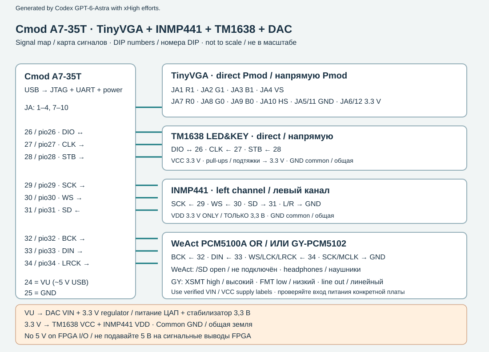
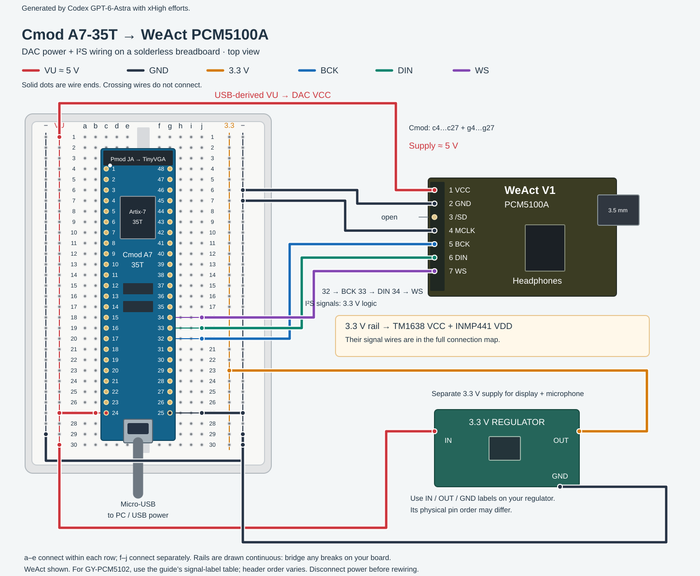

**Generated by Codex GPT-6-Astra with xHigh efforts.**

# Cmod A7-35T + TinyVGA: breadboard assembly and first run

TM1638 configurations: **cmod_a7_35_tiny_vga_codex**, **cmod_a7_35_tiny_vga_no_pll_codex** · Digilent Cmod A7-35T rev. B · prepared 16 November 2026.

[Русская инструкция](assembly_ru.html) · [Markdown](assembly_en.md) · [Implementation notes](README.md)

This configuration connects TinyVGA through the Pmod socket, an INMP441 I²S microphone, a TM1638 LED&KEY module, and either of the two audio boards below. **TM1638 runs from 3.3 V and connects directly to the FPGA.** The nine accessory signals occupy consecutive DIP positions **26–34**. Physical DIP numbers, FPGA package balls, and Pmod contact numbers are different numbering systems; use the tables below.

The code and simulated signal timing have been checked. The graphics and microphone-monitor examples also passed Vivado 2026.1 synthesis, routing and bitstream generation, with positive setup/hold margins on constrained paths. The master XDC leaves external I/O delays unspecified. **Physical assembly, monitor compatibility and audio playback still require a board trial.**

The frequencies and MMCM behavior below describe the default **cmod_a7_35_tiny_vga_codex** configuration. The optional **cmod_a7_35_tiny_vga_no_pll_codex** mode uses the same assembly; its differences are listed under TinyVGA.

**For the two no-TM1638 configurations, read [the differences below](assembly_en.html#no-tm1638) before wiring: both onboard buttons are lab keys, there is no external display, and the TM1638 branch is omitted from the drawings.**

## 1. Parts and physical arrangement

- Digilent **Cmod A7-35T**, not the 15T model; Micro-USB data cable and a computer with Vivado and Artix-7 device support.
- Breadboard space for the 48-pin module, short jumpers and a multimeter. Use two breadboards or a DIP breakout if the module hides the contact strips; both pin rows must remain accessible and electrically separate.
- **TinyVGA Pmod by mole99**, with two bits per colour, plus a VGA cable and monitor. A two-Pmod Digilent Pmod VGA has a different interface and is not a direct substitute.
- **INMP441** breakout with VDD, GND, SCK, WS, SD and L/R labels.
- Standard **TM1638 LED&KEY** board with eight buttons, eight LEDs and eight digits, operated at **3.3 V**. Its supply and signal pull-ups all use 3.3 V; no level translator is fitted.
- A regulated **3.3 V accessory supply** for TM1638 and INMP441, for example a low-dropout 3.3 V regulator breakout fed from the USB-derived VU rail. Choose a regulator whose input range and dropout suit the measured VU voltage and whose current and thermal ratings cover the display at maximum brightness plus the microphone; use its specified input/output capacitors. Do not assume every “AMS1117” module will regulate with every USB cable.
- One DAC: **WeAct I2S Earphone Module PCM5100A Stereo HP AMP 32 Ω 160 mW**, or **GY-PCM5102 PCM5102A pHAT-format I²S DAC**. Use headphones for the WeAct headphone jack; use an amplifier or powered speakers for the GY board’s line output.

Place the Cmod across separate breadboard contact groups. Identify pin 1 from the board marking and the [Digilent DIP drawing, Figure 8.1](https://digilent.com/reference/_media/reference/programmable-logic/cmod-a7/cmod_a7_rm.pdf#page=9), then locate **24 = VU**, **25 = GND**, and **26–34**. Use the printed numbers, not a guessed left/right orientation: turning the board over mirrors the view. Check continuity before plugging in USB.

Put the TM1638 cable near pins 26–28, the microphone near 29–31, and the DAC near 32–34. Keep the microphone opening unobstructed and away from speakers. The drawing is a connection map, not a scale drawing of breadboard holes.



### TinyVGA: retail purchase or JLCPCB assembly

**TinyVGA** means Leo Moser (mole99)'s single-Pmod RGB222 adapter from the [TinyVGA repository](https://github.com/mole99/tiny-vga). Configuration names use **tiny_vga** to identify this hardware; VGA still names the video signal standard and the shared `peripherals/vga.sv` timing module.

**Retail:** buy the assembled board from the [Tiny Tapeout store — Tiny VGA Pmod](https://store.tinytapeout.com/products/TinyVGA-Pmod-p678647356). The listing links to mole99's design and specifies that soldering is unnecessary. Check current stock, delivered price and shipping destinations on the store page. Source checked on 17 November 2026.

**JLCPCB:** use the [designer's ordering guide](https://github.com/mole99/tiny-vga#ordering-tiny-vga-at-jlcpcb) and [matching production files from revision a081ae63](https://github.com/mole99/tiny-vga/tree/a081ae634119aae719237aee5c6b5e53549d1c81/pcb/jlcpcb/production_files). Download all three files from the same revision:

| File | Purpose |
| --- | --- |
| [GERBER-tiny-vga.zip](https://raw.githubusercontent.com/mole99/tiny-vga/a081ae634119aae719237aee5c6b5e53549d1c81/pcb/jlcpcb/production_files/GERBER-tiny-vga.zip) | PCB fabrication |
| [BOM-tiny-vga.csv](https://raw.githubusercontent.com/mole99/tiny-vga/a081ae634119aae719237aee5c6b5e53549d1c81/pcb/jlcpcb/production_files/BOM-tiny-vga.csv) | Components and LCSC part identifiers |
| [CPL-tiny-vga.csv](https://raw.githubusercontent.com/mole99/tiny-vga/a081ae634119aae719237aee5c6b5e53549d1c81/pcb/jlcpcb/production_files/CPL-tiny-vga.csv) | Component positions, rotations and assembly side |

1. Open the [JLCPCB quotation page](https://jlcpcb.com/quote), upload the Gerber ZIP, inspect the board preview and select the quantity and fabrication options.
2. Enable PCB Assembly, then upload the BOM and CPL. The supplied placement file puts components on the **top** side. JLCPCB describes the Gerber/BOM/CPL ordering flow in its [assembly FAQ](https://jlcpcb.com/help/article/pcb-assembly-faqs).
3. Review every matched part and its availability. The BOM includes **J1: Pmod header, C2935938** and **J2: VGA connector, C138387**. Ensure the quote includes both through-hole connectors and a supported assembly service; JLCPCB offers through-hole assembly. If you intentionally omit connectors, obtain and solder them yourself. A bare-PCB order does not include components.
4. Inspect placement and connector orientation against the upstream PCB and photographs. Confirm each required component; merely uploading a BOM does not select every part for assembly. See [JLCPCB's component-confirmation guidance](https://jlcpcb.com/help/article/pcb-assembly-faqs-part-2).
5. Review the final assembly coverage, fabrication and component costs, delivery, and taxes before submitting the order. Save the selected design revision with the order.

## 2. Power wiring — complete this before signal wiring

1. Unplug USB and all supplies before moving wires. Leave the analog DIP pins 15/16, SRAM and flash connections unused.
2. Use USB as the board’s sole power source for the initial build. Digilent documents **VU, DIP 24**, as USB-derived power when USB is connected; it is approximately 5 V, with a diode drop. **DIP 25 is ground.** Never attach an external supply to VU while USB is connected.
3. Connect pin 25 to the common ground rail. Connect every accessory ground to that rail. Bridge split breadboard rails only after checking them with a meter.
4. Feed the DAC’s verified 5 V/VIN input and the **input of the 3.3 V accessory regulator** from the USB-derived VU rail. Allow for the combined FPGA, display and audio current: a connector is not an unlimited power supply. If the rails sag or the board disconnects, use a suitable powered USB source or a separate regulated accessory supply. With a separate accessory supply, disconnect the VU-to-accessory feed and keep only the grounds common.
5. Connect the regulator’s **3.3 V output to TM1638 VCC and INMP441 VDD**. The regulator must maintain 3.3 V with the display at maximum brightness. Do not connect this regulator output to the Cmod’s Pmod 3.3 V outputs; TinyVGA obtains its power directly through the Pmod socket.
6. Keep every TM1638 signal pull-up connected to the module’s **3.3 V VCC**. Wire DIO, CLK and STB directly to DIP 26, 27 and 28 respectively, using short wires. Keep TM1638 powered from 3.3 V with this direct connection; do not connect its VCC or pull-ups to VU/5 V.
7. Measure VU, accessory 3.3 V and the grounds before fitting the modules, then check the 3.3 V rail again with the display lit. No FPGA signal pin supplies power, and no 5 V signal is wired directly to the FPGA.

References: [Digilent power and DIP documentation](https://digilent.com/reference/_media/reference/programmable-logic/cmod-a7/cmod_a7_rm.pdf). [TM1638 library authors report successful 3.3 V supply and logic operation](https://github.com/bitbank2/tm1638). This assembly uses that arrangement; check the buttons and display on your module during bring-up. Titan’s [TM1638 data sheet](https://futuranet.it/futurashop/image/catalog/data/Download/TM1638_V1.3_EN.pdf#page=15) characterizes electrical behavior at 4.5–5.5 V, so it does not guarantee the 3.3 V operating point.

## 3. Compact accessory pin map

The names in the XDC are retained verbatim. All functional mapping is inside `board_specific_top.sv`.

| DIP position | XDC/top port | FPGA ball | Function | Wire destination |
| --- | --- | --- | --- | --- |
| 26 | pio26 | R3 | TM1638 bidirectional data | TM1638 DIO, direct 3.3 V logic |
| 27 | pio27 | T3 | TM1638 clock | TM1638 CLK, direct 3.3 V logic |
| 28 | pio28 | R2 | TM1638 strobe | TM1638 STB, direct 3.3 V logic |
| 29 | pio29 | T1 | Microphone bit clock | INMP441 SCK |
| 30 | pio30 | T2 | Microphone word select | INMP441 WS |
| 31 | pio31 | U1 | Microphone data input | INMP441 SD |
| 32 | pio32 | W2 | DAC bit clock | WeAct BCK or GY BCK |
| 33 | pio33 | V2 | DAC data output | WeAct DIN or GY DIN |
| 34 | pio34 | W3 | DAC word clock | WeAct WS or GY LCK/LRCK |

Connect **INMP441 L/R to ground** to select the left channel. Power it from the accessory **3.3 V** rail, never VU. Keep its SCK and SD labels distinct: SCK is a clock from the FPGA, SD is data back to the FPGA. The [INMP441 data sheet](https://invensense.tdk.com/wp-content/uploads/2015/02/INMP441.pdf) describes a 24-bit I²S output; the wrapper receives the left-channel signed sample.

With the common 100 MHz clock, the existing microphone receiver produces approximately **3.125 MHz SCK and 48.828125 kHz WS**. These are the expected measurement values, not exactly 3.072 MHz and 48 kHz.

## 4. TinyVGA on the Pmod socket

Fit TinyVGA with its numbered contacts aligned to Cmod **JA**. Contacts 5/11 are ground and 6/12 are 3.3 V; verify the connector orientation before applying power. Use a straight-through Pmod extension only if necessary.

| Physical JA contact | XDC/top port | FPGA ball | TinyVGA signal |
| --- | --- | --- | --- |
| 1 | ja[0] | G17 | R1, red MSB |
| 2 | ja[1] | G19 | G1, green MSB |
| 3 | ja[2] | N18 | B1, blue MSB |
| 4 | ja[3] | L18 | VS, vertical sync |
| 7 | ja[4] | H17 | R0, red LSB |
| 8 | ja[5] | H19 | G0, green LSB |
| 9 | ja[6] | J19 | B0, blue LSB |
| 10 | ja[7] | K18 | HS, horizontal sync |

This is **64-colour RGB222**. The wrapper forces RGB black during blanking. Timing uses 640 × 480 visible pixels, 800 × 525 total, a 25 MHz pixel rate, 31.25 kHz horizontal rate and about **59.524 Hz** vertical refresh. This follows the repository’s existing 25 MHz VGA convention, rather than the nominal 25.175 MHz VGA clock; verify acceptance by your monitor.

The FPGA’s MMCM converts the onboard 12 MHz oscillator to 100 MHz. No rewrite of `peripherals/vga.sv` is necessary. [TinyVGA’s designer pinout](https://github.com/mole99/tiny-vga#tiny-vga-pinout) is the mapping authority.

### Optional TinyVGA output without PLL or MMCM

In the board selector choose **cmod_a7_35 → cmod_a7_35_tiny_vga_no_pll_codex**. The FPGA runs directly from **12 MHz** through a BUFG. The lab receives **305 × 480** coordinates; timing is **382 clocks per line and 525 lines per frame**, giving **31.413613 kHz HS and 59.835453 Hz refresh**. Horizontal active/front/sync/back intervals are **305/8/46/23** clocks; vertical intervals are **480/10/2/33** lines. Both syncs are negative. These intervals approximate the analogue timings in the [IBM 640×480 timing chart](https://www.ibm.com/docs/TI0003M/p8egb/p8egb_supportedresolution.htm), rounded to 12 MHz cycles.

The monitor may report 640×480, but the design supplies only **305 independent colour samples per line**. Horizontal pixels are about twice as wide as vertical pixels on a 4:3 monitor. Layouts that assume 640 columns or square pixels may need adjustment. Physical monitor acceptance and alignment still need testing. See the [no-PLL configuration notes](../cmod_a7_35_tiny_vga_no_pll_codex/README.md).

Wiring and power remain as drawn. **DAC BCK = 3 MHz, LRCK = 46.875 kHz; microphone SCK = 750 kHz, WS = 11.71875 kHz.** The microphone sample rate and bandwidth decrease; its samples are held across several DAC frames. BTN0 releases reset after three 12 MHz edges, without waiting for clock lock. In the Vivado reports expect a single 12 MHz clock and **zero PLL/MMCM cells**. The DAC still uses its own internal PLL; this option removes the FPGA clock manager.

## 5. DAC option A: WeAct PCM5100A earphone board

**DAC power path: USB → Cmod VU (DIP 24) → WeAct VCC (P1 contact 1). Ground: Cmod DIP 25 → WeAct GND (P1 contact 2).** VU is near 5 V, reduced by the USB power-path diode. The module's onboard regulator supplies its 3.3 V circuitry; the I²S signals from the FPGA are also 3.3 V logic. The separate accessory regulator supplies TM1638 and INMP441.

The [official WeAct V1.0 schematic](https://github.com/WeActStudio/WeActStudio.I2SEarphoneModuleV1/blob/master/Hardware/WeAct-I2SEarphoneModuleV1_V10%20SchDoc.pdf) identifies a seven-contact header. Match the labels on your board; a photograph taken from the reverse side changes apparent order.

| WeAct P1 contact | Label | Connection |
| --- | --- | --- |
| 1 | VCC | Accessory 5 V/VU rail, subject to supply budget |
| 2 | GND | Common ground |
| 3 | /SD | Leave open: the V1.0 schematic pulls CTRL up to 3.3 V; grounding it mutes/shuts down |
| 4 | MCLK / MC | Ground for three-wire I²S operation |
| 5 | BCK / BC | Cmod DIP 32 |
| 6 | DIN / DI | Cmod DIP 33 |
| 7 | WS | Cmod DIP 34 |

The schematic contains a 3.3 V regulator, PCM5100A and an HT97226 headphone amplifier. The factory circuit selects I²S; leave the de-emphasis bridge in its default off state. Start with a quiet signal and connect headphones to the jack. The `/SD` control is **not** the INMP441 `SD` data signal. Do not connect `/SD` to the microphone or tie it to 5 V.

### Breadboard placement and jumpers



Click the drawing to open it at full size. This is a **DAC-focused top view**; the earlier connection map supplies the TM1638 and microphone signal wiring. The WeAct board and regulator sit beside the breadboard and connect with jumper leads. Their drawn component outlines are simplified; the WeAct P1 order follows the manufacturer's image and schematic. Regulator terminal positions vary, so identify **IN, OUT and GND** on the selected breakout.

Use a 30-row breadboard with Cmod's left header in **c4–c27** and right header in **g4–g27**, Pmod at the top and USB at the bottom. This matches its 0.6-inch header-row spacing. DIP 1 is c4, DIP 48 is g4, DIP 24/VU is c27, and DIP 25/GND is g27. Confirm the printed pin-1 mark and the [Digilent DIP drawing](https://digilent.com/reference/_media/reference/programmable-logic/cmod-a7/cmod_a7_rm.pdf#page=9). Each row connects a–e together and f–j together, with no connection across the centre gap. Thus b27 accesses VU, while j27 accesses ground. Pins must fit without force, with spare holes accessible beside the module.

Label the left positive rail **VU**, the right positive rail **3.3 V**, and both negative rails **GND**. The drawing uses continuous rails; if yours are split, bridge the breaks within each rail after checking continuity. The red and orange positive rails remain separate. Numbers below are breadboard rows; DIP pin numbers appear explicitly where relevant.

| Jumper from | Jumper to | Purpose |
| --- | --- | --- |
| b27 (Cmod DIP 24/VU) | Left VU rail, row 27 | USB-derived accessory power |
| j27 (Cmod DIP 25/GND) | Right GND rail, row 27 | Common ground |
| Left GND rail, row 29 | Right GND rail, row 29 | Join the two ground rails |
| Left VU rail, row 1 | WeAct P1.1 VCC | DAC and headphone-board supply |
| Right GND rail, row 6 | WeAct P1.2 GND | DAC ground |
| Right GND rail, row 7 | WeAct P1.4 MCLK | Select BCK-derived internal clock |
| j20 (Cmod DIP 32) | WeAct P1.5 BCK | I²S bit clock |
| j19 (Cmod DIP 33) | WeAct P1.6 DIN | I²S audio data |
| j18 (Cmod DIP 34) | WeAct P1.7 WS | I²S word clock |
| Left VU rail, row 30 | Accessory regulator IN | Regulator input |
| Right GND rail, row 30 | Accessory regulator GND | Regulator ground |
| Accessory regulator OUT, 3.3 V | Right 3.3 V rail, row 23 | TM1638 and INMP441 supply |

Leave **WeAct P1.3 /SD open**. Connect TM1638 VCC and INMP441 VDD to the right 3.3 V rail and their grounds to GND. The regulator's current and thermal ratings must cover both loads. Verify rail voltages before connecting the modules and again under load. With USB attached, do not connect an external supply to VU. If using separate accessory power, remove the VU feed first as described in section 2.

## 6. DAC option B: GY-PCM5102 / PCM5102A pHAT-format board

GY boards are sold in multiple PCB layouts. The sales name alone does not identify a unique header order or solder-bridge numbering. Use the printed **signal labels** below and verify the regulator/jumper arrangement on the actual module; do not copy the WeAct contact numbers.

For a GY module with a verified regulated **VIN/5V input**, replace WeAct in the drawing: VU → VIN/5V, GND → GND, DIP 32 → BCK, DIP 33 → DIN, DIP 34 → LCK/WS, and GND → SCK/MCLK. Apply the control settings in the table below. A pin marked **3V3** must use that board's documented 3.3 V supply arrangement.

| GY board label | Connection or setting |
| --- | --- |
| VIN / 5V | Accessory 5 V rail only if this is the module’s regulated input |
| 3V3, if present | Use only according to that PCB’s documented supply circuit; never apply 5 V to this label |
| GND | Common ground |
| BCK / BCLK | Cmod DIP 32 |
| DIN / DATA | Cmod DIP 33 |
| LCK / LRCK / WS | Cmod DIP 34 |
| SCK / MCLK | Ground for the DAC’s BCK-derived internal PLL |
| XSMT / XMT | High at the DAC’s 3.3 V logic rail to unmute; confirm any existing pull-up |
| FMT | Low: I²S |
| FLT | Low: normal-latency filter |
| DEMP | Low: de-emphasis off |

Inspect existing solder bridges before adding wires; do not short an existing high strap to ground. The exact GY PCB revision has not been supplied, so bridge numbers and physical header order are intentionally not guessed. The electrical settings above come from the [TI PCM510xA data sheet](https://www.ti.com/lit/ds/symlink/pcm5102a.pdf).

The GY jack or L/R pads are normally **line-level outputs**. Connect them to powered speakers or a separate headphone amplifier. A PCM5102A alone is not a 32 Ω headphone driver; TI specifies line loads down to 1 kΩ. Never connect the two output channels together.

Both options use the same FPGA image and three data/clock wires. The existing serializer sends the mono 16-bit `sound` value in both channels of 32-bit I²S slots, one bit after each LRCK transition. Expected BCK is **3.125 MHz**, LRCK **48.828125 kHz**, with **64 BCK periods per stereo frame**. No external MCLK wire is required; the unused FPGA MCLK output stays internal.

## 7. Buttons, display, GPIO and reset

The first four points apply to configurations with TM1638; the no-TM1638 mapping follows below.

- **BTN0** resets the MMCM and the design. Reset also asserts when clock lock is lost; it releases after three system-clock edges following lock. If lock is lost, press and release BTN0 to restart the clock manager.
- **BTN1** is the onboard lab key. In the default duplicate mode it is ORed into `key[0]`; TM1638 S1–S8 supply `key[0]`–`key[7]`.
- There are no slide switches. The same TM1638 buttons supply `sw[0]`–`sw[7]` as **momentary inputs**, not latched toggles. Labs requiring sustained switch combinations need the buttons held or an explicitly adapted input scheme.
- The two onboard LEDs duplicate the lowest two lab LED bits. The TM1638 shows all eight lab LED bits and eight digits. The common concatenation macros are also supported; their alternate key/LED ordering is described in the implementation notes.
- The active-low RGB LED is red while reset is asserted and green while running; blue is off. It is a clock/reset indicator, not a proof that every peripheral works.
- Generic `gpio[0]`–`gpio[7]` map to DIP **1–8**. These pins are separate from accessory pins 26–34; leave them unconnected unless the chosen lab calls for them.
- The onboard USB-UART uses `uart_txd_in` toward the FPGA and `uart_rxd_out` toward the PC. No external UART wiring is needed.

### Configurations without TM1638

Choose either additional configuration under **cmod_a7_35** in the board menu:

| Configuration | Clock and TinyVGA output |
| --- | --- |
| cmod_a7_35_tiny_vga_no_tm1638_codex | 100 MHz, MMCM; 640×480 at 59.524 Hz |
| cmod_a7_35_tiny_vga_no_pll_no_tm1638_codex | 12 MHz, BUFG only; 305×480 at 59.835453 Hz |

**Omit the entire TM1638 module, its power leads and the three signal wires to DIP 26–28.** Those three signals are absent from the FPGA top level and their master-XDC lines remain commented. Leave DIP 26–28 unconnected. The drawings show the TM1638-equipped assembly; omit that branch for these two configurations. TinyVGA, INMP441 on DIP 29–31, DAC on DIP 32–34, USB-UART and GPIO on DIP 1–8 keep their existing connections. Keep the microphone's regulated 3.3 V supply when using it. DAC power and MCLK-to-GND wiring remain as documented.

**BTN0 → key[0], BTN1 → key[1]; led[0] → onboard LED0, led[1] → onboard LED1.** Pressed buttons are active high. Each button has a two-register synchronizer; mechanical debounce remains the lab's responsibility. Both lab widths are exactly two, regardless of any TM1638 concatenation option in the lab configuration. For compatibility with switch-based exercises, `sw[1:0]` duplicates these two momentary buttons and `sw[7:2]` is zero; there are no slide switches.

**Neither button resets the design.** Reset is asserted at FPGA configuration and released after three system-clock edges, after MMCM lock where applicable. Loss of MMCM lock also asserts reset. Reprogram the FPGA or cycle board power to restart; the no-PLL variant has no clock-lock detector. The RGB LED still indicates reset/running. There is **no seven-segment display** and no TM1638 controller, even if the lab defines `INSTANTIATE_TM1638_BOARD_CONTROLLER_MODULE`. Display outputs from `lab_top` are unconnected. The internal `w_digit=8` compatibility parameter avoids invalid zero-width casts and slices in existing labs; it does not allocate a display or display pins. Display-only exercises have no visible digit output, and exercises needing more than two independent controls require adaptation.

In bring-up step 3, check the two onboard buttons and LEDs using an appropriate basic lab instead of fitting TM1638. For the 12 MHz variant, use the no-PLL video and audio rates above. Configuration notes: [MMCM version](../cmod_a7_35_tiny_vga_no_tm1638_codex/README.md), [no-PLL version](../cmod_a7_35_tiny_vga_no_pll_no_tm1638_codex/README.md).

## 8. Build and bring-up

From a lab directory, run the normal board selector and choose **cmod_a7_35 → cmod_a7_35_tiny_vga_codex**. The setup script dispatches this configuration to Vivado and targets **xc7a35tcpg236-1**, hardware device **xc7a35t_0**.

```bash
cd labs/2_graphics/2_1_rectangle_ellipse_parabola
./06_choose_another_fpga_board.bash
./03_synthesize_for_fpga.bash
```

The repository’s synthesis wrapper proceeds to configuration after a successful build. Use a powered, checked assembly and read the tool output. For a later programming run, use `./04_configure_fpga.bash`; this performs volatile FPGA programming, not a new flash-programming procedure.

1. First connect only the Cmod and USB. Confirm that Vivado detects the **35T** part. Inspect clock, timing and DRC reports after the build: the 12 MHz input and approximately 100 MHz MMCM output must be present, with no unexplained timing or pin-assignment errors.
2. With power removed, add TinyVGA. Run the graphics lab and check geometry, colour ordering and blanking. A working VGA image is the first clock/video check.
3. Add TM1638 with **VCC = 3.3 V**, common ground, and direct DIO/CLK/STB connections to DIP 26/27/28. In `lab_specific_board_config.svh`, enable `INSTANTIATE_TM1638_BOARD_CONTROLLER_MODULE` when the lab needs the display/keys. Check each button, LED and digit, and verify the 3.3 V supply under display load before adding audio.
4. Add the INMP441. Enable `INSTANTIATE_MICROPHONE_INTERFACE_MODULE`; run `labs/3_music/3_0_oscilloscope` and speak or clap near the microphone. Check for a changing waveform, not just an active clock.
5. Fit **one** DAC option. Enable `INSTANTIATE_SOUND_OUTPUT_INTERFACE_MODULE`. Run `labs/3_music/3_3_note_synthesizer` to check a generated tone, then `labs/3_music/3_11_microphone_monitor` for the microphone-to-DAC route. Keep the microphone away from the output speaker to avoid feedback.
6. If a peripheral macro is disabled, its clocks/data are held inactive and its input value is zero. This is intentional; changing wiring cannot enable a compiled-out peripheral. Graphics also needs `INSTANTIATE_GRAPHICS_INTERFACE_MODULE`.

## 9. Troubleshooting

| Symptom | First checks |
| --- | --- |
| Red RGB LED stays on | BTN0 not held; 12 MHz oscillator, MMCM lock and power stable; correct part selected |
| Monitor reports no signal | TinyVGA orientation; JA4 = VS and JA10 = HS; graphics macro; measured sync rates; monitor accepts the 25 MHz convention |
| Image has incorrect colours or borders | Use the R1/R0 table, not an 8-colour Pmod map; inspect blanking and colour-bit order |
| TM1638 digits work but keys do not | DIO connects directly to DIP 26; pull-ups use 3.3 V; common ground; correct LED&KEY module variant |
| TM1638 display is dim or unstable | Measure 3.3 V at module VCC under load; check regulator current/thermal capacity, short power leads and brightness setting |
| Microphone is silent | VDD = 3.3 V; L/R = GND; SD/SCK not swapped; microphone macro enabled |
| DAC clocks exist but no sound | Unmute and I²S settings; MCLK/SCK grounded; correct output load; nonzero lab sound samples |
| USB disconnects when display/audio starts | Supply/cable voltage drop or excessive combined current; stop and check the power distribution |

## 10. Sources and reproducibility

- [Digilent Cmod A7 reference manual](https://digilent.com/reference/_media/reference/programmable-logic/cmod-a7/cmod_a7_rm.pdf): board, power and connector details.
- [Digilent master XDC, pinned revision](https://github.com/Digilent/digilent-xdc/blob/c8644a9fe31cc803789643124545d56b3bef4600/Cmod-A7-Master.xdc): original pin definitions. [Local unchanged copy](reference/Cmod-A7-Master.xdc) and [provenance](reference/source.json).
- [TinyVGA designer repository](https://github.com/mole99/tiny-vga): RGB222 Pmod assignment.
- [WeAct manufacturer repository](https://github.com/WeActStudio/WeActStudio.I2SEarphoneModuleV1): V1.0 schematic and header.
- [TM1638 3.3 V operation report](https://github.com/bitbank2/tm1638) and [Titan TM1638 data sheet](https://futuranet.it/futurashop/image/catalog/data/Download/TM1638_V1.3_EN.pdf): practical operation and published electrical specifications.
- [TI PCM510xA data sheet](https://www.ti.com/lit/ds/symlink/pcm5102a.pdf), [INMP441 data sheet](https://invensense.tdk.com/wp-content/uploads/2015/02/INMP441.pdf).
- [AMD MMCME2_BASE documentation](https://docs.amd.com/r/en-US/ug953-vivado-7series-libraries/MMCME2_BASE): clock primitive and lock/reset behavior.

Run the board-specific automated checks from the repository root:

```bash
python3 scripts/tests/test_cmod_a7_35_tiny_vga_codex.py
python3 scripts/tests/test_board_menu.py
```

The functional tests use a test-only clock model. They check pin preservation and coverage, existing-lab elaboration, a complete VGA raster and blanking, microphone data, I²S serialization, UART/GPIO mapping and reset. They do not simulate analog levels, breadboard signal integrity, monitor acceptance or the actual MMCM lock dynamics.

## Appendix: original task and Russian translation

Historical user text is reproduced verbatim, including earlier configuration names.

### Original English prompt / Английский оригинал

```text
# Task

Create a new branch of basics_graphics_music called claude_cmod_a7 starting from main.
The branch should be called claude_cmod_a7 is you are claude and codex_cmod_a7 is you are codex.

Read board implementations:

* alinx_ax7035b
* arty_a7_100
* arty_a7_100_pmod_mic3
* arty_a7_35
* arty_a7_35_pmod_mic3
* basys3
* nexys4
* nexys4_ddr
* nexys_a7  
* nexys_a7_100
* nexys_a7_50 
* zybo_z7
* zzz_postponed_and_retired/cmod_a7

Specifically the files:

* board_specific.tcl
* board_specific_top.sv
* board_specific.xdc

Create a new board implementation cmod_a7_35 for Digilent Cmod A7-35T.

The existing zzz_postponed_and_retired/cmod_a7 is wrong.

Copy the following file into boards/cmod_a7_35/board_specific.xdc

https://github.com/Digilent/digilent-xdc/blob/master/Cmod-A7-Master.xdc

Uncomment only the necessary pins. Do not modify any pin names or definitions - only uncomment the existing.

All name mapping should be inside board_specific_top.sv.

Use Pmod socket to accomodate TinyVGA.

If necessary, write your own VGA interface module if basics-graphics-music/peripherals/vga.sv is not suitable.

Or alternatively propose a modification of basics-graphics-music/peripherals/vga.sv to accomodate the clock frequency.

Update the relevant bash scripts in scripts/steps

Create .md and HTML files with an instruction on how to assemble a breadboard with this board, microphone and either of the following DAC modules:

* WeAct I2S Earphone Module PCM5100A Stereo HP AMP 32Ω 160mW DAC Decoder Audio Board

* Interface I2S PCM5102A DAC Decoder GY-PCM5102 I2S Player Module For Raspberry Pi PHAT Format Board Digital PCM5102 Audio Board

When planning what pins to use for the TM1638, microphone and sound DAC connection, make them compact and easy to assemple.

Add this prompt as an appendix to .md and HTML files.

In addition to the instriction in English create an instruction in Russian (also .md and .html). In prompt appendix put both the original prompt in English and its transaction to Russian.
```

### Russian translation / Русский перевод

```text
# Задание

Создайте новую ветку basics_graphics_music с именем claude_cmod_a7, начиная с main.
Ветка должна называться claude_cmod_a7, если вы Claude, и codex_cmod_a7, если вы Codex.

Изучите реализации плат:

* alinx_ax7035b
* arty_a7_100
* arty_a7_100_pmod_mic3
* arty_a7_35
* arty_a7_35_pmod_mic3
* basys3
* nexys4
* nexys4_ddr
* nexys_a7
* nexys_a7_100
* nexys_a7_50
* zybo_z7
* zzz_postponed_and_retired/cmod_a7

В частности, файлы:

* board_specific.tcl
* board_specific_top.sv
* board_specific.xdc

Создайте новую реализацию платы cmod_a7_35 для Digilent Cmod A7-35T.

Существующая реализация zzz_postponed_and_retired/cmod_a7 неправильная.

Скопируйте следующий файл в boards/cmod_a7_35/board_specific.xdc:

https://github.com/Digilent/digilent-xdc/blob/master/Cmod-A7-Master.xdc

Раскомментируйте только необходимые выводы. Не изменяйте имена или определения выводов — только раскомментируйте существующие строки.

Все сопоставления имён должны находиться в board_specific_top.sv.

Используйте разъём Pmod для подключения TinyVGA.

При необходимости напишите собственный модуль интерфейса VGA, если basics-graphics-music/peripherals/vga.sv не подходит.

Либо предложите изменение basics-graphics-music/peripherals/vga.sv с учётом тактовой частоты.

Обновите соответствующие Bash-скрипты в scripts/steps.

Создайте файлы .md и HTML с инструкцией по сборке на макетной плате схемы с этой платой, микрофоном и одним из следующих модулей ЦАП:

* WeAct I2S Earphone Module PCM5100A Stereo HP AMP 32Ω 160mW DAC Decoder Audio Board

* Interface I2S PCM5102A DAC Decoder GY-PCM5102 I2S Player Module For Raspberry Pi PHAT Format Board Digital PCM5102 Audio Board

Планируя использование выводов для TM1638, микрофона и звукового ЦАП, сделайте соединения компактными и удобными для сборки.

Добавьте этот запрос в качестве приложения к файлам .md и HTML.

Кроме английской инструкции создайте русскую инструкцию (также .md и .html). В приложении с запросом приведите и английский оригинал, и его перевод на русский язык.
```

## Appendix: related follow-up prompts

Related user requests available in this conversation, in order. Original text and Russian translations are separate. Add later related requests to `reference/follow_up_prompts.json` and rerun this generator; future requests are not invented.

### P01 · original / оригинал

```text
can you restore the context of the last session in this directory?
```

Russian translation / Русский перевод:

```text
Можете восстановить контекст последнего сеанса в этом каталоге?
```

### P02 · original / оригинал

```text
put action plan in html
```

Russian translation / Русский перевод:

```text
Оформите план действий в HTML.
```

### P03 · original / оригинал

```text
do a new task in cmod_a7/AGENTS.md
```

Russian translation / Русский перевод:

```text
Выполните новое задание из cmod_a7/AGENTS.md.
```

### P04 · original / оригинал

```text
INMP441 I²S microphone (recommended)
```

Answer to the microphone-selection question; the answer text is reproduced above.

Russian translation / Русский перевод:

```text
Микрофон INMP441 с интерфейсом I²S (рекомендуется).
```

### P05 · original / оригинал

```text
vivado has license, you just need to run it outside sandbox
```

Russian translation / Русский перевод:

```text
Для Vivado есть лицензия; нужно лишь запустить его вне песочницы.
```

### P06 · original / оригинал

```text
continue
```

Russian translation / Русский перевод:

```text
Продолжайте.
```

### P07 · original / оригинал

```text
why did you put CR at the end of line in one of the files?
```

Russian translation / Русский перевод:

```text
Почему вы добавили CR в конце строки в одном из файлов?
```

### P08 · original / оригинал

```text
no, these files should be \n under Linux and \r\n under windows. Git should treat them as text files
```

Russian translation / Русский перевод:

```text
Нет, под Linux в этих файлах должны быть окончания строк \n, а под Windows — \r\n. Git должен считать их текстовыми файлами.
```

### P09 · original / оригинал

```text
Look to the log and find who introduced cr-lf in there
```

Russian translation / Русский перевод:

```text
Посмотрите журнал и выясните, кто добавил туда CR-LF.
```

### P10 · original / оригинал

```text
will it used CR-LF under windows?
```

Russian translation / Русский перевод:

```text
Будут ли под Windows использоваться CR-LF?
```

### P11 · original / оригинал

```text
lets keep it cr-lf, I will change this later. Commit and push into your branch
```

Russian translation / Русский перевод:

```text
Оставим CR-LF; я изменю это позже. Создайте коммит и отправьте его в свою ветку.
```

### P12 · original / оригинал

```text
Are you saying TM1638 cannot work of 3.3V?
```

Russian translation / Русский перевод:

```text
Вы хотите сказать, что TM1638 не может работать от 3,3 В?
```

### P13 · original / оригинал

```text
update the design with TM1638 running on 3.3V
```

Russian translation / Русский перевод:

```text
Обновите проект для работы TM1638 от 3,3 В.
```

### P14 · original / оригинал

```text
how do you power the sound DAC? Can you draw breadboard ?
```

Russian translation / Русский перевод:

```text
Как питается звуковой ЦАП? Можете нарисовать макетную плату?
```

### P15 · original / оригинал

```text
continue
```

Russian translation / Русский перевод:

```text
Продолжайте.
```

### P16 · original / оригинал

```text
Can you make a configuration that does VGA without PLL?
```

Russian translation / Русский перевод:

```text
Можете сделать конфигурацию с VGA без PLL?
```

### P17 · original / оригинал

```text
rename cmod_a7_35 into cmod_a7_35_codex and cmod_a7_35_no_pll into cmod_a7_35_no_pll_codex and update all the relevant files
```

Russian translation / Русский перевод:

```text
Переименуйте cmod_a7_35 в cmod_a7_35_codex, а cmod_a7_35_no_pll — в cmod_a7_35_no_pll_codex и обновите все связанные файлы.
```

### P18 · original / оригинал

```text
from now on do not commit automatically; check until I check the commit. I need to see the diffs myself. Also push only when I tell to push
```

Russian translation / Русский перевод:

```text
Впредь не создавайте коммиты автоматически; дождитесь моей проверки изменений. Мне нужно самому просмотреть diff. Отправляйте изменения только по моей команде.
```

### P19 · original / оригинал

```text
commit and push
```

Russian translation / Русский перевод:

```text
Создайте коммит и отправьте изменения.
```

### P20 · original / оригинал

```text
convert all mentions to vga in configuration names and the related texts to tiny_vga. Specifically mention TinyVGA in documentation, repository https://github.com/mole99/tiny-vga and
  where to buy it retail or order from JLCPCB. Make sure to add this and other previous and follow-up related prompt as appendices to the instructions you generate. Put at the beginning of any text generated by you a clear information that the text is generated by Codex GPT-6-Astra with xHigh efforts.
```

Russian translation / Русский перевод:

```text
Замените упоминания vga в именах конфигураций и связанных текстах на tiny_vga. Явно укажите в документации TinyVGA, репозиторий https://github.com/mole99/tiny-vga, а также где купить плату в розницу или заказать в JLCPCB. Добавьте этот и другие предыдущие и последующие связанные запросы в приложения к создаваемым инструкциям. В начале каждого созданного вами текста ясно указывайте, что он создан Codex GPT-6-Astra с уровнем усилий xHigh.
```

### P21 · original / оригинал

```text
commit and push
```

Russian translation / Русский перевод:

```text
Создайте коммит и отправьте изменения.
```

### P22 · original / оригинал

```text
Than create two additional configuration cmod_a7_35_tiny_vga_no_tm1638_codex and cmod_a7_35_tiny_vga_no_pll_no_tm1638_codex without the TM1638 module. The labs get the two buttons of Cmod A7 as their keys and its two LEDs as their LEDs, and there is no seven-segment display.
```

Russian translation / Русский перевод:

```text
Затем создайте две дополнительные конфигурации cmod_a7_35_tiny_vga_no_tm1638_codex и cmod_a7_35_tiny_vga_no_pll_no_tm1638_codex без модуля TM1638. Лабораторные работы получают две кнопки Cmod A7 как свои входы key и два светодиода платы как свои выходы led; семисегментного индикатора нет.
```

### P23 · original / оригинал

```text
continue
```

Russian translation / Русский перевод:

```text
Продолжайте.
```

### P24 · original / оригинал

```text
commit and push
```

Russian translation / Русский перевод:

```text
Создайте коммит и отправьте изменения.
```
