# Lattice Board Lineup

*Board identification · 2 photos · updated 26 October 2026*

Two photos: a bench shot of loose boards (`lattice_boards.jpg`) and an iCEBreaker driving a monitor
(`icebreaker.jpg`). Board names are read from the silkscreen in enlarged crops of the photos. The FPGA
parts and board features are checked against each maker's page, linked in every section, because the
chip markings are too blurry to read. The owner confirmed the iCEBreaker revision and the STEP-MXO2.

- **8** FPGA boards
- **5** add-on boards
- **6 · 1 · 1** iCE40 · ECP5 · MachXO2
- **3 of 8** already in basics-graphics-music

## The photos

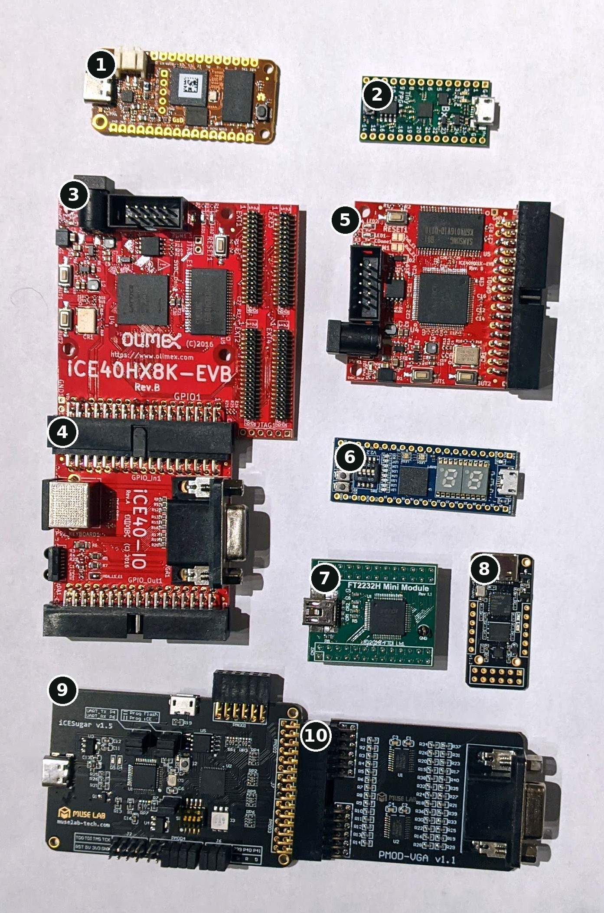

*Bench photo: boards 1–10, seven FPGA boards and three add-ons.
[Photo without numbers](lattice_boards.jpg)*

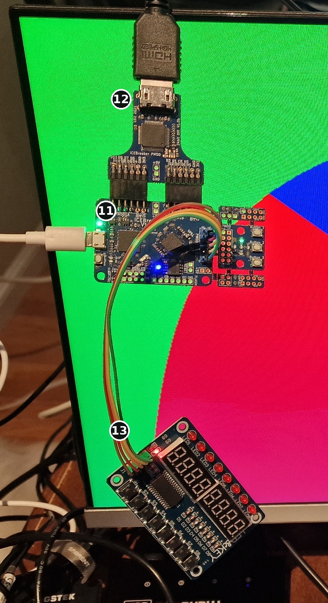

*An iCEBreaker with a DVI Pmod and a TM1638 module, showing HDMI output on a monitor: boards 11–13.
[Photo without numbers](icebreaker.jpg)*

## At a glance

| No. | Board | Where in the photo | Family | FPGA | How it is programmed | basics-graphics-music |
|---:|---|---|---|---|---|---|
| 1 | [OrangeCrab r0.2.1](#b1) | Bench, top left, orange | ECP5 | LFE5U-25F or -85F, csfBGA285 | USB-C, DFU bootloader | `orangecrab_ecp5_yosys` |
| 2 | [TinyFPGA BX](#b2) | Bench, top right, green | iCE40 | iCE40LP8K-CM81 | Micro-USB, USB bootloader | none |
| 3 | [Olimex iCE40HX8K-EVB Rev.B](#b3) | Bench, upper left, large red | iCE40 | iCE40HX8K-CT256 | External programmer, e.g. no. 7 | `ice40hx8k_evb_yosys` |
| 4 | [Olimex iCE40-IO Rev.A](#b4) | Bench, left, under no. 3 | Add-on | — | — | pinout differs from `ice40hx8k_evb_yosys` ([see below](#vga)) |
| 5 | [Olimex iCE40HX1K-EVB Rev.B](#b5) | Bench, upper right, red | iCE40 | iCE40HX1K-VQ100 | External programmer, e.g. no. 7 | none |
| 6 | [STEP-MXO2 V2.2](#b6) | Bench, right, blue | MachXO2 | LCMXO2-4000HC-4MG132 | Micro-USB, on-board USB-JTAG | none |
| 7 | [FTDI FT2232H Mini Module](#b7) | Bench, lower middle, green | Add-on | — | It is the programmer | wiring diagram in `ice40hx8k_evb_yosys` |
| 8 | [MuseLab iCESugar-nano v1.2](#b8) | Bench, lower right, small black | iCE40 | iCE40LP1K-CM36 | USB-C, on-board iCELink | none |
| 9 | [MuseLab iCESugar v1.5](#b9) | Bench, bottom left, black | iCE40 | iCE40UP5K-SG48 | USB-C, on-board iCELink | none |
| 10 | [MuseLab PMOD-VGA v1.1](#b10) | Bench, bottom right, plugged into no. 9 | Add-on | — | — | none |
| 11 | [1BitSquared iCEBreaker V1.0e](#b11) | iCEBreaker photo, middle | iCE40 | iCE40UP5K-SG48 | Micro-USB, on-board FT2232H | `icebreaker_*`, 7 folders |
| 12 | [24-bit DVI Pmod](#b12) | iCEBreaker photo, top, with the HDMI cable | Add-on | — | — | used by `icebreaker_dvi_*` |
| 13 | [TM1638 “LED&KEY” module](#b13) | iCEBreaker photo, bottom | Add-on | — | — | used by `*_tm1638_*` folders |

## FPGA boards

### 1. OrangeCrab r0.2.1

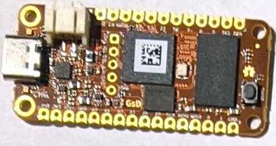

**ECP5** · bench photo, top left

- **Identified by:** orange Feather-size PCB with the “GsD” logo of its designer, Greg Davill. The USB-C
  port dates it: the maker's page says r0.2.1 switched from micro-USB to USB-C.
- **FPGA:** ECP5 LFE5U-25F or LFE5U-85F in the csfBGA285 package
- **On board:** the square chip with the QR label is the ECP5; the tall chip to its right is DDR3L
  memory, 128 MB or 512 MB. 128 Mbit QSPI flash, USB-C wired straight to the FPGA, a LiPo battery
  connector and one button.
- **Programming:** DFU bootloader over USB-C, with `dfu-util`
- **basics-graphics-music:** **Supported.** `orangecrab_ecp5_yosys`: 48 MHz clock, built for the 25F in
  the CSFBGA285 package with Yosys and nextpnr
- **Sources:** [OrangeCrab r0.2.1 hardware page](https://orangecrab-fpga.github.io/orangecrab-hardware/docs/r0.2.1/),
  [Getting started (DFU upload)](https://orangecrab-fpga.github.io/orangecrab-hardware/docs/getting-started/)

> **Unsure:** whether this is the 25F or the 85F. The part number is under the QR label.

### 2. TinyFPGA BX

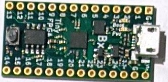

**iCE40** · bench photo, top right

- **Identified by:** silkscreen “TinyFPGA” and “BX”
- **FPGA:** iCE40LP8K-CM81, 7,680 LUTs
- **On board:** 16 MHz MEMS oscillator, 8 Mbit SPI flash, 41 user I/O pins, micro-USB,
  breadboard-friendly pin rows
- **Programming:** a USB bootloader in the flash; upload with `tinyprog` or `apio`
- **basics-graphics-music:** **Not yet.** No board folder.
- **Sources:** [TinyFPGA BX repository](https://github.com/tinyfpga/TinyFPGA-BX),
  [TinyFPGA BX user guide](https://tinyfpga.com/bx/guide.html)

### 3. Olimex iCE40HX8K-EVB Rev.B

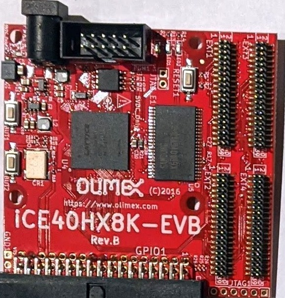

**iCE40** · bench photo, upper left

- **Identified by:** silkscreen “OLIMEX”, “iCE40HX8K-EVB” and “Rev.B”
- **FPGA:** iCE40HX8K-CT256, 7,680 logic cells
- **On board:** 512 KB SRAM (256K × 16), 2 MB SPI flash, 100 MHz oscillator, RESET and two buttons, two
  LEDs, the 34-pin GPIO1 bus connector, four 40-pin EXT connectors, a 10-pin programming header and a
  5 V power jack
- **Programming:** no USB on the board. Use an external programmer: the BGM folder has a wiring diagram
  for the FT2232H Mini Module ([no. 7](#b7)) with `iceprog` or `openFPGALoader`.
- **basics-graphics-music:** **Supported.** `ice40hx8k_evb_yosys`: 100 MHz, VGA with 4 bits per colour on
  GPIO1 pins 14–34. **Check:** those pins don't match the iCE40-IO ([see below](#vga)).
- **Sources:** [Olimex product page](https://www.olimex.com/Products/FPGA/iCE40/iCE40HX8K-EVB/open-source-hardware),
  [Olimex hardware files](https://github.com/OLIMEX/iCE40HX8K-EVB) (Rev.B netlist)

### 5. Olimex iCE40HX1K-EVB Rev.B

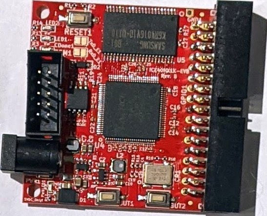

**iCE40** · bench photo, upper right

- **Identified by:** silkscreen “iCE40HX1K-EVB” and “Rev.B”, and the Samsung SRAM marking
- **FPGA:** iCE40HX1K-VQ100, 1,280 logic cells, in a 100-pin TQFP
- **On board:** 512 KB SRAM: the Samsung K6R4016V1D (256K × 16) readable in the photo. 2 MB SPI flash,
  100 MHz oscillator, RESET plus BUT1 and BUT2, LED1 and LED2, the 34-pin GPIO1 bus connector, a 10-pin
  programming header and a 5 V power jack.
- **Programming:** same as the HX8K-EVB: an external programmer such as the FT2232H ([no. 7](#b7))
- **basics-graphics-music:** **Not yet.** No board folder. `ice40hx8k_evb_yosys` is the closest starting
  point: same maker, same 34-pin bus, and Olimex says the iCE40-IO fits both boards.
- **Sources:** [Olimex product page](https://www.olimex.com/Products/FPGA/iCE40/iCE40HX1K-EVB/open-source-hardware)

### 6. STEP-MXO2 V2.2

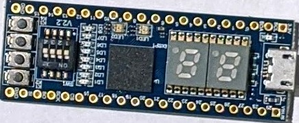

**MachXO2** · bench photo, right, blue

- **Identified by:** layout and the “V2.2” silkscreen; **confirmed** by the owner
- **Maker:** the Chinese STEP FPGA series (小脚丫)
- **FPGA:** LCMXO2-4000HC-4MG132
- **On board:** two 7-segment digits, four switches, four buttons, eight LEDs (LD1–LD8), two RGB LEDs and
  micro-USB. A 40-pin DIP outline with 36 user I/Os that fits a breadboard.
- **Programming:** on-board USB-JTAG circuit through the micro-USB; bitstreams come from Lattice Diamond
- **basics-graphics-music:** **Not yet.** No board folder.
- **Sources:** [STEP-MXO2 repository](https://github.com/stepfpga/STEP-MXO2)

> **Lookalike:** STEP also sells STEP-MAX10, an Intel MAX 10 board with almost the same layout. Read the
> FPGA marking to tell them apart.

### 8. MuseLab iCESugar-nano v1.2

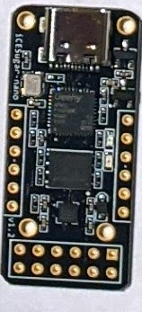

**iCE40** · bench photo, lower right, small black board

- **Identified by:** silkscreen “iCESugar-nano” and “v1.2”
- **FPGA:** iCE40LP1K-CM36, 1,280 logic cells, a 2.5 mm BGA. It is the small square chip near the pin
  end, not the larger one beside the USB-C, which is the iCELink microcontroller (APM32F1).
- **On board:** USB-C, 2 MB SPI flash, one yellow LED, one 2 × 6 Pmod at the far end and a 1 × 6 Pmod
  down each side
- **Programming:** iCELink: copy the bitstream onto the USB drive it presents, or use `icesprog`. The
  same cable gives a USB serial port and a clock of 8, 12, 36 or 72 MHz for the FPGA (12 MHz after
  power-up).
- **basics-graphics-music:** **Not yet.** No board folder.
- **Sources:** [iCESugar-nano repository](https://github.com/wuxx/icesugar-nano), including MuseLab's
  photo of v1.2

### 9. MuseLab iCESugar v1.5

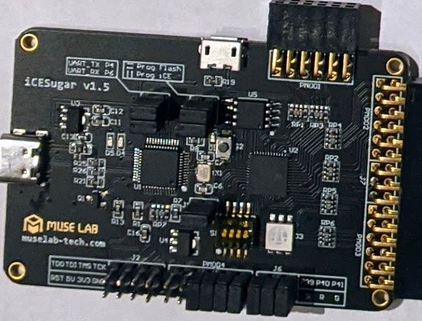

**iCE40** · bench photo, bottom left

- **Identified by:** silkscreen “iCESugar v1.5”, MuseLab logo and URL
- **FPGA:** iCE40UP5K-SG48, 5,280 logic cells
- **On board:** 8 MB SPI flash, USB-C for iCELink, a micro-USB port, RGB LED, 4-way DIP switch, Pmod
  headers PMOD1–PMOD4, UART pins, a JTAG header and jumpers labelled “Prog Flash” and “Prog iCE”
- **Programming:** iCELink: copy the bitstream onto its USB drive, or use `icesprog`. It also gives a USB
  serial port and a 12 MHz clock to the FPGA.
- **basics-graphics-music:** **Not yet.** No board folder. The iCEBreaker folders use the same
  UP5K-SG48 part, so they are the natural starting point.
- **Sources:** [iCESugar repository](https://github.com/wuxx/icesugar) (README in Chinese)

### 11. 1BitSquared iCEBreaker V1.0e

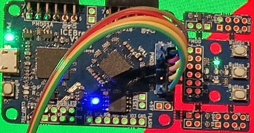

**iCE40** · iCEBreaker photo, middle

- **Identified by:** silkscreen “iCEBreaker V1”; **confirmed** V1.0e by the owner, as the minor revision
  is under the wires
- **FPGA:** iCE40UP5K-SG48, 5,280 logic cells
- **On board:** FT2232H behind the micro-USB, 12 MHz crystal shared with the FPGA, 16 MB QSPI flash,
  PMOD1A, PMOD1B and PMOD2, a pin header for an RGB LED, two LEDs and a user button. The snap-off section on PMOD2, with
  three buttons and five LEDs, is still attached in the photo.
- **Programming:** micro-USB with `iceprog` or Lattice Diamond Programmer; the same port carries a UART
- **basics-graphics-music:** **Supported.** `icebreaker_dvi_24b_tm1638_yosys` matches this exact setup.
  There are also 12-bit DVI, no-DVI and no-TM1638 variants, plus `icebreaker_bare`. The pin legend
  pictures in those folders show V1.0b.
- **Sources:** [iCEBreaker hardware documentation](https://docs.icebreaker-fpga.org/hardware/icebreaker/)

## Add-on boards

No FPGA on these. They add video, input or a programmer to the boards above.

### 4. Olimex iCE40-IO Rev.A

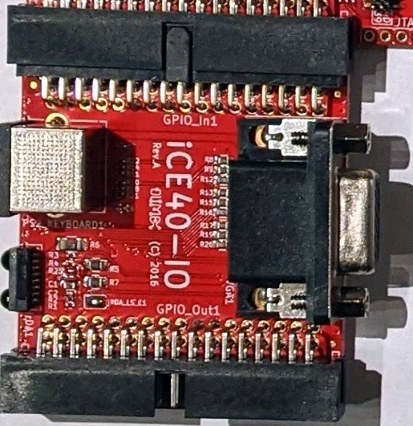

**Add-on** · bench photo, left, under no. 3

- **Identified by:** silkscreen “iCE40-IO”, “Rev.A” and “OLIMEX”
- **Adds:** VGA connector (DE-15) with 3 bits per colour, a PS/2 keyboard socket and a TFDU4100 IrDA
  transceiver
- **Connects:** plugs into the 34-pin bus of the iCE40HX1K-EVB or iCE40HX8K-EVB (GPIO_In1) and passes
  the bus on (GPIO_Out1). In the photo it sits under the HX8K-EVB ([no. 3](#b3)).
- **basics-graphics-music:** **Check:** its VGA pins differ from those in `ice40hx8k_evb_yosys`
  ([see below](#vga))
- **Sources:** [Olimex product page](https://www.olimex.com/Products/FPGA/iCE40/iCE40-IO/open-source-hardware),
  [Olimex hardware files](https://github.com/OLIMEX/iCE40-IO) (Rev.A netlist)

### 7. FTDI FT2232H Mini Module

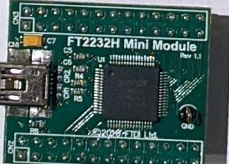

**Programmer** · bench photo, lower middle

- **Identified by:** silkscreen “FT2232H Mini Module”
- **Adds:** a two-channel USB 2.0 Hi-Speed bridge; each channel can drive JTAG or SPI. Mini-USB plus the
  CN2 and CN3 pin headers.
- **Role:** programmer for the two Olimex boards ([no. 3](#b3), [no. 5](#b5)), which have no USB of their
  own
- **basics-graphics-music:** wiring diagram
  `boards/ice40hx8k_evb_yosys/JTAG_wiring_FT2232H_to_iCE40HX8K-EVB.svg`
- **Sources:** [FTDI product page](https://ftdichip.com/products/ft2232h-mini-module/) (not checked:
  FTDI's site refuses scripted downloads)

### 10. MuseLab PMOD-VGA v1.1

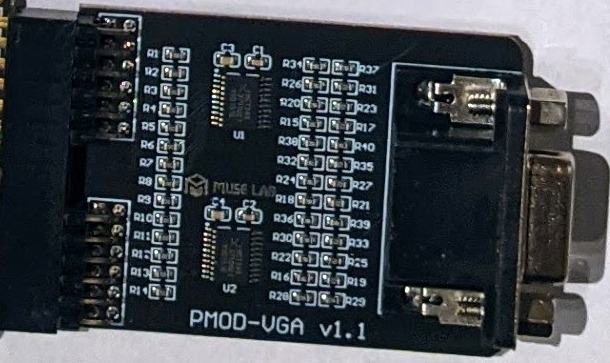

**Add-on** · bench photo, bottom right

- **Identified by:** silkscreen “PMOD-VGA v1.1” and the MuseLab logo
- **Adds:** VGA output with 4 bits per colour (R0–R3, G0–G3, B0–B3), buffered by two 74HCT245 chips
- **Connects:** two Pmod connectors, for HS and VS plus the twelve colour bits; plugged into the iCESugar
  ([no. 9](#b9)) in the photo
- **Sources:** [PMOD-VGA v1.1 schematic](https://github.com/wuxx/icesugar/blob/master/schematic/pmod-vga-v1.1.pdf)

### 12. 24-bit DVI Pmod

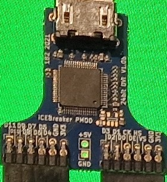

**Add-on** · iCEBreaker photo, top

- **Identified by:** silkscreen “iCEBreaker PMOD” and “24bit DVI”. 1BitSquared sells 4-bit, 12-bit and
  24-bit DDR versions.
- **Adds:** DVI video on an HDMI connector, through a TI TFP410 or its drop-in replacement, the SiI164.
  The chip marking in the photo can't tell which.
- **Connects:** double Pmod on PMOD1A and PMOD1B, with pins D0–D11, CK, DE, HS and VS. Twelve data lines
  carry 24-bit colour by sending 12 bits on the rising and 12 on the falling clock edge.
- **basics-graphics-music:** `DVI_24B`, 8 bits per colour, is the default in the `icebreaker_dvi_24b_*`
  folders; `DVI_12B` gives 4 bits per colour
- **Sources:** [1BitSquared product page](https://1bitsquared.com/products/pmod-digital-video-interface),
  [iCEBreaker DVI Pmod documentation](https://docs.icebreaker-fpga.org/hardware/pmod/dvi/)

### 13. TM1638 “LED&KEY” module

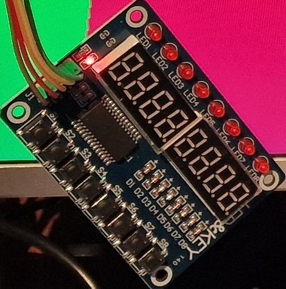

**Add-on** · iCEBreaker photo, bottom

- **Identified by:** eight digits, eight LEDs and eight buttons in the usual LED&KEY layout
- **Adds:** eight 7-segment digits, eight LEDs and eight buttons behind one TM1638 driver, which talks
  over three lines: CLK, STB and DIO
- **Connects:** jumper wires to PMOD2. The photo doesn't show which pins they use;
  `icebreaker_dvi_24b_tm1638_yosys/board_specific_top.sv` expects DIO on P2_8, CLK on P2_9 and STB on
  P2_10.
- **basics-graphics-music:** the labs use it for digits, LEDs and keys on boards that lack them, in every
  `*_tm1638_*` folder
- **Sources:** [TM1638 datasheet](https://www.handsontec.com/pdf_files/TM1638_V1.3_EN.pdf)

## iCE40-IO and basics-graphics-music

Olimex's netlists for the iCE40HX8K-EVB Rev.B and the iCE40-IO Rev.A give each pin of the 34-pin bus.
Pins 1–4 match on both boards (+5V, GND, +3V3, GND), so the numbers line up. The VGA pins in
`ice40hx8k_evb_yosys/board_specific.pcf` don't follow the iCE40-IO: its sync signals land on the PS/2
pins and its red bits on the iCE40-IO's sync pins. With this iCE40-IO plugged in, that folder can't show
a correct picture. Either it was written for a different VGA adapter, or it needs a variant for the
iCE40-IO.

| Pin | iCE40-IO Rev.A | `ice40hx8k_evb_yosys` |
|---:|---|---|
| 14 | PS2_CLK | VGA_HS |
| 16 | PS2_DATA | VGA_VS |
| 18 | VGA_VSYNC | VGA_R[0] |
| 20 | VGA_HSYNC | VGA_R[1] |
| 22 | VGA_BLUE3 | VGA_R[2] |
| 24 | VGA_BLUE2 | VGA_R[3] |
| 26 | VGA_BLUE1 | VGA_G[0] |
| 27 | VGA_RED1 | GPIO[11] |
| 28 | VGA_GREEN3 | VGA_G[1] |
| 29 | VGA_RED2 | VGA_B[3] |
| 30 | VGA_GREEN2 | VGA_G[2] |
| 31 | free | VGA_B[2] |
| 32 | VGA_GREEN1 | VGA_G[3] |
| 33 | IrDA_Tx | VGA_B[1] |
| 34 | VGA_RED3 | VGA_B[0] |

## Still open

- **OrangeCrab, 25F or 85F.** Peel back or read around the QR label on the ECP5. BGM's folder is built
  for the 25F; r0.2.1 boards come with either.
- **Which VGA adapter `ice40hx8k_evb_yosys` expects.** Its pins don't match the iCE40-IO in the photo
  ([table above](#vga)).

## Method

Board names and revisions were read from the silkscreen in 2× crops of the two photos. FPGA parts and
board features were checked on 26 October 2026 against the makers' pages linked in each section, and the
VGA details against the published schematics and netlists. The owner confirmed the iCEBreaker V1.0e and
the STEP-MXO2. The “basics-graphics-music” lines come from the `boards/` folders of basics-graphics-music
on `origin/main`; `origin/yuri_lattice` adds no other board from these photos.

Photos: [lattice_boards.jpg](lattice_boards.jpg) (1393 × 2105) and [icebreaker.jpg](icebreaker.jpg)
(970 × 1783), kept next to this file. `lattice_boards_numbered.jpg` and `icebreaker_numbered.jpg` are
copies with the board numbers drawn on, and `crops/` holds one picture per board, cut from the photos
at full resolution.
