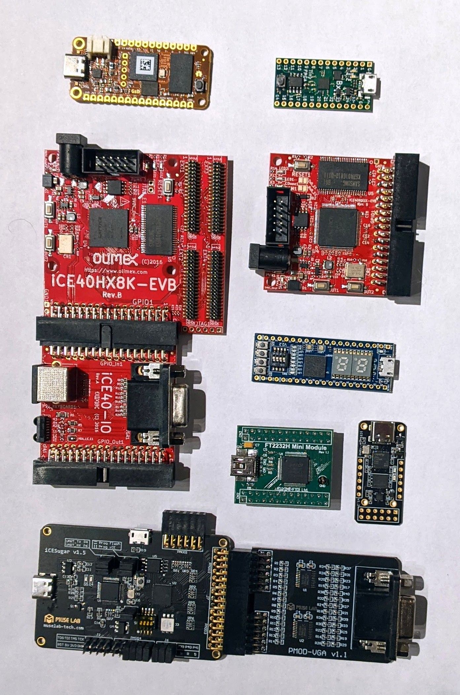

# Lattice Board Lineup

*Board identification · 2 photos · 26 October 2026*

Two photos: a bench shot of loose boards (`lattice_boards.jpg`) and an iCEBreaker driving a monitor
(`icebreaker.jpg`). Board names are read from the silkscreen in enlarged crops of the photos. The FPGA
parts come from each board's published specs, because the chip markings are too blurry to read.

- **8** FPGA boards
- **5** add-on boards
- **6 · 1 · 1** iCE40 · ECP5 · MachXO2
- **3 of 8** already in basics-graphics-music

## The photos

*Bench photo: boards 1–10, seven FPGA boards and three add-ons.*

*An iCEBreaker with a DVI Pmod and a TM1638 module, showing HDMI output on a monitor: boards 11–13.*

## At a glance

| No. | Board | Where in the photo | Family | FPGA | How it is programmed | basics-graphics-music |
|---:|---|---|---|---|---|---|
| 1 | [OrangeCrab](#b1) | Bench, top left, orange | ECP5 | LFE5U-25F or -85F | USB-C, DFU bootloader | `orangecrab_ecp5_yosys` |
| 2 | [TinyFPGA BX](#b2) | Bench, top right, green | iCE40 | iCE40LP8K | Micro-USB, USB bootloader | none |
| 3 | [Olimex iCE40HX8K-EVB Rev.B](#b3) | Bench, upper left, large red | iCE40 | iCE40HX8K-CT256 | External programmer, e.g. no. 7 | `ice40hx8k_evb_yosys` |
| 4 | [Olimex iCE40-IO Rev.A](#b4) | Bench, left, under no. 3 | Add-on | — | — | used by `ice40hx8k_evb_yosys` |
| 5 | [Olimex iCE40HX1K-EVB Rev.B](#b5) | Bench, upper right, red | iCE40 | iCE40HX1K-VQ100 | External programmer, e.g. no. 7 | none |
| 6 | [STEP-MXO2 V2.2](#b6) | Bench, right, blue | MachXO2 | MachXO2-4000HC (assumed) | Micro-USB, on-board programmer | none |
| 7 | [FTDI FT2232H Mini Module](#b7) | Bench, lower middle, green | Add-on | — | It is the programmer | wiring diagram in `ice40hx8k_evb_yosys` |
| 8 | [MuseLab iCESugar-nano v1.2](#b8) | Bench, lower right, small black | iCE40 | iCE40LP1K (per maker) | USB-C, on-board programmer | none |
| 9 | [MuseLab iCESugar v1.5](#b9) | Bench, bottom left, black | iCE40 | iCE40UP5K-SG48 | USB-C, on-board programmer | none |
| 10 | [MuseLab PMOD-VGA v1.1](#b10) | Bench, bottom right, plugged into no. 9 | Add-on | — | — | none |
| 11 | [1BitSquared iCEBreaker V1](#b11) | iCEBreaker photo, middle | iCE40 | iCE40UP5K-SG48 | Micro-USB, on-board FT2232H | `icebreaker_*`, 7 folders |
| 12 | [24-bit DVI Pmod](#b12) | iCEBreaker photo, top, with the HDMI cable | Add-on | — | — | used by `icebreaker_dvi_*` |
| 13 | [TM1638 “LED&KEY” module](#b13) | iCEBreaker photo, bottom | Add-on | — | — | used by `*_tm1638_*` folders |

## FPGA boards

### 1. OrangeCrab

**ECP5** · bench photo, top left

- **Maker:** Greg Davill, whose “GsD” logo is on the silkscreen
- **FPGA:** ECP5 LFE5U-25F or LFE5U-85F
- **On board:** Feather-size board. The square chip with the QR label is the ECP5, and the tall chip to
  its right is DDR3L memory. USB-C wired straight to the FPGA, a LiPo battery connector and one button.
- **Programming:** DFU bootloader over USB-C, with `dfu-util`
- **basics-graphics-music:** **Supported.** `orangecrab_ecp5_yosys`: 48 MHz clock, built for the 25F in
  the CSFBGA285 package with Yosys and nextpnr

> **Unsure:** whether this is the 25F or the 85F. The part number is under the QR label.

### 2. TinyFPGA BX

**iCE40** · bench photo, top right

- **Maker:** TinyFPGA (Luke Valenty)
- **FPGA:** iCE40LP8K, CM81 package
- **On board:** 16 MHz oscillator, SPI flash, micro-USB and two rows of breadboard pins numbered on the
  silkscreen
- **Programming:** a USB bootloader in the flash; upload with `tinyprog` or `apio`
- **basics-graphics-music:** **Not yet.** No board folder.

### 3. Olimex iCE40HX8K-EVB Rev.B

**iCE40** · bench photo, upper left

- **Maker:** Olimex, “(C)2016” on the silkscreen
- **FPGA:** iCE40HX8K-CT256, 7,680 LUTs
- **On board:** SRAM chip beside the FPGA, 100 MHz clock, RESET and two buttons, two LEDs, the 34-pin
  GPIO1 connector, four EXT headers, a 10-pin programming header and a 5 V power jack
- **Programming:** no USB on the board. Use an external programmer: the BGM folder has a wiring diagram
  for the FT2232H Mini Module ([no. 7](#b7)) with `iceprog` or `openFPGALoader`.
- **basics-graphics-music:** **Supported.** `ice40hx8k_evb_yosys`: 100 MHz, VGA with 4 bits per colour on
  the 34-pin connector where the iCE40-IO ([no. 4](#b4)) plugs in

### 5. Olimex iCE40HX1K-EVB Rev.B

**iCE40** · bench photo, upper right

- **Maker:** Olimex
- **FPGA:** iCE40HX1K-VQ100, 1,280 LUTs, in a 100-pin TQFP
- **On board:** Samsung K6R4016V1D SRAM (256K × 16, marking readable in the photo), RESET plus BUT1 and
  BUT2, LED1 and LED2, the 34-pin GPIO1 connector, a 10-pin programming header and a 5 V power jack
- **Programming:** same as the HX8K-EVB: an external programmer such as the FT2232H ([no. 7](#b7))
- **basics-graphics-music:** **Not yet.** No board folder. `ice40hx8k_evb_yosys` is the closest starting
  point: same maker and the same 34-pin connector.

### 6. STEP-MXO2 V2.2

**MachXO2** · bench photo, right, blue

- **Maker:** the Chinese STEP FPGA series (小脚丫)
- **FPGA:** MachXO2-4000HC
- **On board:** two 7-segment digits, four DIP switches, four buttons, eight LEDs (LD1–LD8), two RGB
  LEDs, micro-USB, and two 20-pin rows that fit a breadboard like a DIP-40 chip
- **Programming:** on-board USB programmer through the micro-USB; bitstreams come from Lattice Diamond
- **basics-graphics-music:** **Not yet.** No board folder.

> **Unsure:** STEP also sells a MAX10 board with almost the same layout. The FPGA marking isn't
> readable, so this section assumes the Lattice one.

### 8. MuseLab iCESugar-nano v1.2

**iCE40** · bench photo, lower right, small black board

- **Maker:** MuseLab (muselab-tech.com)
- **FPGA:** iCE40LP1K, CM36 package, per MuseLab's spec
- **On board:** USB-C with a built-in programmer, 2 × 6 Pmod pads at the far end and a row of pins down
  each side
- **Programming:** MuseLab's iCELink: copy the bitstream onto the USB drive it presents, or use
  `icesprog`
- **basics-graphics-music:** **Not yet.** No board folder.

> **Unsure:** the chip marked “Lattice” looks larger than the LP1K's 2.5 mm CM36 package. Worth a look
> under a magnifier.

### 9. MuseLab iCESugar v1.5

**iCE40** · bench photo, bottom left

- **Maker:** MuseLab, logo and URL on the silkscreen
- **FPGA:** iCE40UP5K-SG48, 5,280 LUTs
- **On board:** USB-C programmer port, a micro-USB port, RGB LED, 4-way DIP switch, Pmod headers
  PMOD1–PMOD4, UART pins and jumpers labelled “Prog Flash” and “Prog iCE”
- **Programming:** iCELink: copy the bitstream onto its USB drive, or use `icesprog`
- **basics-graphics-music:** **Not yet.** No board folder. The iCEBreaker folders use the same
  UP5K-SG48 part, so they are the natural starting point.

### 11. 1BitSquared iCEBreaker V1

**iCE40** · iCEBreaker photo, middle

- **Maker:** 1BitSquared
- **FPGA:** iCE40UP5K-SG48, 5,280 LUTs
- **On board:** FT2232H on the board behind the micro-USB, 12 MHz clock, Pmod ports PMOD1A, PMOD1B and
  PMOD2, RGB LED and a user button. The snap-off section on PMOD2, with three buttons and five LEDs, is
  still attached in the photo.
- **Programming:** micro-USB with `iceprog` or `openFPGALoader`; the same port carries a UART
- **basics-graphics-music:** **Supported.** `icebreaker_dvi_24b_tm1638_yosys` matches this exact setup.
  There are also 12-bit DVI, no-DVI and no-TM1638 variants, plus `icebreaker_bare`.

> **Unsure:** the minor revision, such as V1.0b or V1.1a, is hidden under the jumper wires.

## Add-on boards

No FPGA on these. They add video, input or a programmer to the boards above.

### 4. Olimex iCE40-IO Rev.A

**Add-on** · bench photo, left, under no. 3

- **Adds:** VGA connector with a resistor DAC, PS/2 keyboard socket and IrDA
- **Connects:** plugs into the 34-pin GPIO connector of the Olimex EVBs (GPIO_In1) and passes the bus on
  (GPIO_Out1). In the photo it sits under the HX8K-EVB ([no. 3](#b3)).
- **basics-graphics-music:** the VGA pins of `ice40hx8k_evb_yosys` are on this 34-pin connector

### 7. FTDI FT2232H Mini Module

**Programmer** · bench photo, lower middle

- **Adds:** a two-channel USB 2.0 Hi-Speed bridge; each channel can drive JTAG or SPI. Mini-USB plus the
  CN2 and CN3 pin headers.
- **Role:** programmer for the two Olimex boards ([no. 3](#b3), [no. 5](#b5)), which have no USB of their
  own
- **basics-graphics-music:** wiring diagram
  `boards/ice40hx8k_evb_yosys/JTAG_wiring_FT2232H_to_iCE40HX8K-EVB.svg`

### 10. MuseLab PMOD-VGA v1.1

**Add-on** · bench photo, bottom right

- **Adds:** VGA output through a resistor DAC (R1–R40 on the silkscreen)
- **Connects:** two Pmod connectors; plugged into the iCESugar ([no. 9](#b9)) in the photo

### 12. 24-bit DVI Pmod

**Add-on** · iCEBreaker photo, top

- **Adds:** DVI video on an HDMI connector. Silkscreen: “iCEBreaker PMOD” and “24bit DVI”.
- **Connects:** double Pmod on PMOD1A and PMOD1B, with pins D0–D11, CK, DE, HS and VS. Twelve data lines
  carry 24-bit colour by sending 12 bits on each clock edge. The transmitter chip is a 64-pin TQFP whose
  marking is unreadable.
- **basics-graphics-music:** `DVI_24B`, 8 bits per colour, is the default in the `icebreaker_dvi_24b_*`
  folders; `DVI_12B` gives 4 bits per colour

### 13. TM1638 “LED&KEY” module

**Add-on** · iCEBreaker photo, bottom

- **Adds:** eight 7-segment digits, eight LEDs and eight buttons behind one TM1638 driver chip
- **Connects:** jumper wires to PMOD2: data on P2_8, clock on P2_9 and strobe on P2_10, as in
  `icebreaker_dvi_24b_tm1638_yosys/board_specific_top.sv`
- **basics-graphics-music:** the labs use it for digits, LEDs and keys on boards that lack them, in every
  `*_tm1638_*` folder

## What the photos can't settle

- **OrangeCrab, 25F or 85F.** Peel back or read around the QR label on the ECP5. BGM's folder is built
  for the 25F.
- **STEP board, MachXO2 or MAX10.** Read the FPGA marking. A MAX10 board would belong with the Intel
  boards and Quartus.
- **iCESugar-nano FPGA.** Check whether the chip marked “Lattice” is the LP1K in its 2.5 mm package or a
  larger part.
- **iCEBreaker revision.** Move the jumper wires and read the “V1.x” label.
- **Colour depth of the two VGA add-ons.** The photos show the resistor DACs but not how many bits per
  colour they take. BGM drives the iCE40-IO with 4 bits per colour.

## Method

Board names and revisions were read from the silkscreen in 2× crops of the two photos. FPGA parts and
board features come from each maker's published specs, not from chip markings, which are too blurry to
read. The “basics-graphics-music” lines come from the `boards/` folders of basics-graphics-music on
`origin/main`; `origin/yuri_lattice` adds no other board from these photos.

Photos: [lattice_boards.jpg](lattice_boards.jpg) (1393 × 2105) and [icebreaker.jpg](icebreaker.jpg)
(970 × 1783), kept next to this file.
