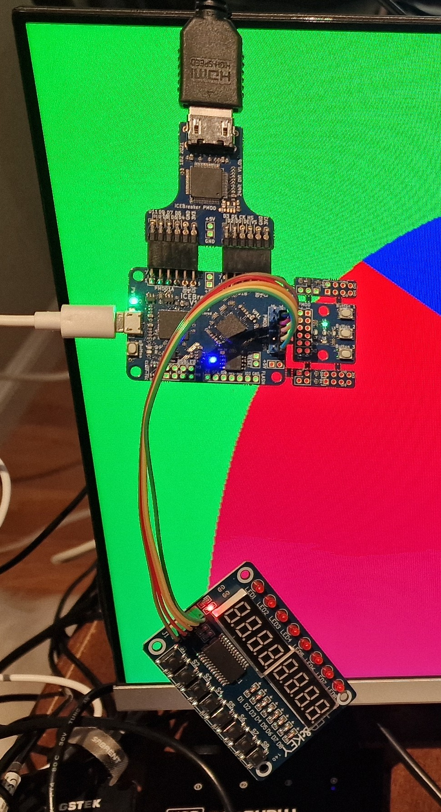

# Lattice FPGA boards in two photographs

26 October 2026 · Updated with owner confirmations

The photographs show eight FPGA development boards and five separate accessory modules. The owner has confirmed that the blue board is a STEP-MXO2 and that the iCEBreaker revision is V1.0e.

Identification is based on visible markings and component layout, checked against the linked board documentation, together with the owner’s confirmations. FPGA types are specifications of the identified models, not claims that every chip marking is readable in the photographs. The STEP-MXO2 model and iCEBreaker V1.0e revision are explicitly confirmed by the owner; the additional V2.2, v1.2, Rev. A and 24-bit markings below were read from the photo crops during comparison with Claude’s report.

## Photo 1 — Seven FPGA development boards

Original photograph: `lattice_boards.jpg`. Locations in the table refer to this orientation. The JPEG is included unchanged in the accompanying image directory.

**Board identifications**

| Location | Board and FPGA | Evidence and limits |
| --- | --- | --- |
| 1. **Top left; orange board** | [OrangeCrab](https://orangecrab-fpga.github.io/orangecrab-hardware/) Lattice ECP5 High confidence | The orange PCB, Feather-style outline, battery connector and memory placement match OrangeCrab. The sticker covers the FPGA marking, so its device density and exact variant cannot be determined. |
| 2. **Top right; small green board marked “BX”** | [TinyFPGA BX](https://tinyfpga.com/) iCE40LP8K High confidence | The “BX” marking and board layout identify the TinyFPGA BX. |
| 3. **Middle left; large red board** | [Olimex iCE40HX8K-EVB, Rev. B](https://www.olimex.com/Products/FPGA/iCE40/iCE40HX8K-EVB/) iCE40HX8K High confidence | The model name and Rev. B are readable on the PCB. An iCE40-IO expansion board is attached beneath it. |
| 4. **Middle right; smaller red board** | [Olimex iCE40HX1K-EVB, Rev. B](https://www.olimex.com/Products/FPGA/iCE40/iCE40HX1K-EVB/) iCE40HX1K High confidence | The small model/revision marking and the arrangement of SRAM, barrel connector, buttons and expansion header match this board. |
| 5. **Centre right; narrow blue board with two seven-segment digits** | [STEP-MXO2 V2.2](https://github.com/stepfpga/STEP-MXO2) MachXO2-4000HC Model confirmed by owner | The owner confirms this is a STEP-MXO2. V2.2 is readable in the photo crop. Its two display digits, four pushbuttons, four switches and micro-USB connector match the documented model. STEP-MAX10 has a very similar layout; appearance alone should not be used to distinguish another board. |
| 6. **Lower right; narrow black board with USB-C** | [MuseLab iCESugar-nano v1.2](https://github.com/wuxx/icesugar-nano) iCE40LP1K High confidence | The iCESugar-nano marking and narrow board layout identify the model. The v1.2 revision is readable in the photo crop. The iCE40LP1K specification comes from the maker’s documentation. |
| 7. **Bottom left; large black board** | [MuseLab iCESugar v1.5](https://github.com/wuxx/icesugar) iCE40UP5K High confidence | The iCESugar v1.5 and MuseLab markings are visible. A PMOD-VGA v1.1 expansion board is attached on its right. |

> The OrangeCrab’s exact ECP5 variant remains hidden by a sticker. Lookalike warning: STEP-MXO2 and STEP-MAX10 have very similar layouts. The owner has confirmed that this particular blue board is STEP-MXO2, using Lattice MachXO2. For another unit, check its model or FPGA marking before choosing Lattice Diamond or Intel Quartus.

## Photo 1 — Three accessory modules

| Location | Accessory | Identification |
| --- | --- | --- |
| Attached below the large red Olimex board | [Olimex iCE40-IO Rev. A](https://github.com/OLIMEX/iCE40-IO) | The PCB label identifies this expansion module, and Rev. A is readable in the photo crop. It provides VGA, PS/2 and IrDA interfaces. It is an accessory to the FPGA board. |
| Lower centre; green board with a mini-USB connector | FTDI FT2232H Mini Module | The name is printed clearly on the board. This is a USB interface module, not an additional Lattice FPGA development board. |
| Bottom right; attached to the iCESugar v1.5 | MuseLab PMOD-VGA v1.1 | The MuseLab and PMOD-VGA v1.1 markings are visible. This is the VGA output expansion with the DE-15 connector. |

## Photo 2 — iCEBreaker with digital video and a front-panel module

Original photograph: `icebreaker.jpg`. The iCEBreaker is in the centre, the video Pmod is above it, and the LED&KEY module hangs below. The JPEG is included unchanged in the accompanying image directory.

### 8. iCEBreaker V1.0e FPGA development board

**FPGA: Lattice iCE40UP5K, SG48 package.** The iCEBreaker marking and the characteristic main-board layout identify the board with high confidence. The micro-USB connector is on the left.

The button-and-LED section on the right is the board’s attached snap-off section. It has three user buttons and five LEDs; it is counted as part of the iCEBreaker, not as a separate FPGA board.

The owner confirms the PCB revision as V1.0e. This revision is recorded from that confirmation, rather than inferred from the partly obscured silkscreen.

Source: [iCEBreaker hardware documentation](https://docs.icebreaker-fpga.org/hardware/icebreaker/).

### Digital-video Pmod above the iCEBreaker

The upper board is an **iCEBreaker / 1BitSquared digital-video (DVI) Pmod**, plugged into the two adjacent Pmod connectors. Its output connector accepts the HDMI cable shown in the photograph.

The photo crop makes the **24bit DVI** marking readable, identifying the 24-bit DDR version. It carries 12 data bits on each clock edge. The identification relies on that marking; the two-connector arrangement alone does not distinguish the 12-bit and 24-bit versions.

The manufacturer offers these adapters with a TI TFP410 or compatible Lattice SiI164 transmitter. The chip marking in this photograph does not establish which transmitter is fitted. The HDMI-shaped connector is used for DVI video output; the photograph does not establish HDMI audio support.

Source: [1BitSquared PMOD Digital Video Interface](https://1bitsquared.com/products/pmod-digital-video-interface).

### TM1638 “LED&KEY” module below the iCEBreaker

The lower board has the characteristic **eight seven-segment digits, eight LEDs and eight pushbuttons** of the common TM1638 LED&KEY module. Its layout and five-wire connection give a high-confidence module identification; the exact module manufacturer and controller marking are not readable.

A TM1638 uses three control/data signals—`STB`, `CLK` and bidirectional `DIO`—plus power and ground. The individual jumper-to-FPGA pin assignments cannot be established from this photograph.

Controller reference: [Titan Micro Electronics TM1638 datasheet, hosted by HandsOn Technology](https://www.handsontec.com/pdf_files/TM1638_V1.3_EN.pdf).

The screen shows large coloured regions and the photograph shows a video cable connected to the Pmod. The image alone does not identify the running HDL design, video resolution or refresh rate.

## Details still to confirm

- **OrangeCrab:** exact ECP5 device variant and PCB revision.
- **Video Pmod:** exact PCB revision and transmitter part; the 24-bit version is identified from its marking.
- **TM1638 module:** exact module manufacturer, controller marking and FPGA pin wiring.

These uncertainties concern unreadable markings or connections. They do not change the visible arrangement of the boards and accessories described above.

---

Both original JPEG files are included in `lattice_boards_identification_images/`. Keep this directory alongside the Markdown file when moving or sharing the report. External links provide supporting product documentation.
